# AP 세계사: 모던 — 토픽 1.6 유럽의 발전, c. 1200–1450 (Developments in Europe from c. 1200 to c. 1450)

**Focus Question (교재 Essential Question):** c. 1200–1450년 주요 종교의 신앙과 관습, 농업 관행, 정치적 분권화는 유럽 사회에 어떤 영향을 주었는가?

> 출처: College Board CED 기준 · 교재 반영 (교재 Topic 1.6)

**Unit 1: 세계의 태피스트리 (The Global Tapestry, c. 1200–1450)**

---

## 학습 목표 (Learning Objectives)

| 코드 | 학습 목표 |
|---|---|
| 1.6 LO-K (CDI) | 유럽의 주요 종교들의 신앙과 관습이 유럽 사회에 어떤 영향을 주었는지 설명하라. |
| 1.6 LO-L (GOV) | c. 1200–1450년 유럽에서 일어난 정치적 분권화 (Political decentralization)의 원인과 결과를 설명하라. |
| 1.6 LO-M (SIO) | c. 1200–1450년 유럽에서 농업이 사회 조직에 준 영향을 설명하라. |

## 역사적 개념 (Historical Developments, CED)

| # | 역사적 개념 | 다루는 곳 |
|---|---|---|
| HD1 (LO-K) · KC-3.1.III.D.v | 기독교 (Christianity), 유대교 (Judaism), 이슬람 (Islam)과 이 종교들의 핵심 신앙과 관습은 계속해서 유럽 사회를 형성했다. | §2, §3, §4, §5, §10, §11, §13 |
| HD2 (LO-L) · KC-3.2.I.B.ii | 유럽은 정치적으로 분열되어 있었고, 분권적 군주정 (Decentralized monarchy), 봉건제 (Feudalism), 장원제 (Manorialism)가 특징이었다. | §1, §6, §7, §8 |
| HD3 (LO-M) · KC-3.3.III.C | 유럽은 대체로 농업 사회였고, 농노제 (Serfdom)를 포함한 자유 노동과 강제 노동에 의존했다. | §6, §9, §10, §11 |

> **참고:** CED는 1.6에 예시 (Illustrative examples)를 두지 않는다. 교재의 정치 부분은 **프랑스**, **신성 로마 제국**, **노르만 잉글랜드**를 다루며(여기에 시칠리아와 스페인에서의 기독교–무슬림 전쟁이 더해진다), 이 노트는 이들을 §7과 §8에서 다룬다. **베네치아**는 제4차 십자군의 방향을 바꾼 부유한 도시국가이자 마르코 폴로의 고향으로만 나오고, **피렌체**는 메디치 가문이 르네상스 예술가를 후원한 이야기로만 나온다.

---

## 큰 그림 요약

> "그리스도에게서 떨어지게 된다면, 나는 아리스토텔레스가 되고 싶지 않다."
> — 피에르 아벨라르 (Peter Abelard), 엘로이즈에게 보낸 편지 17 (Letter 17 to Heloise), 1141

피에르 아벨라르는 당시의 많은 학자처럼 **아리스토텔레스 (Aristotle)** 같은 고전 사상가를 공부했고 때로는 **교회를 비판**했다. 그러나 평생 신실한 기독교인으로 남았다. 그의 말은 이 시대를 잘 보여 준다. 학문은 되살아나고 있었지만, 그 학문은 기독교 세계 안에서 자랐다. 로마 제국이 **5–6세기**에 쇠퇴한 뒤 서유럽은 **중세 (Middle Ages)**에 들어섰다. 교역은 줄었고, 지적 활동은 위축되었으며, 작은 왕국들이 땅을 두고 서로 싸웠다. 유럽 대부분에서 힘을 유지한 것은 **로마 가톨릭교회**뿐이었다. 교재가 **중세 전성기 (High Middle Ages)**라고 부르는 약 **1000–1450년** 사이에 학문과 교역이 다시 살아나기 시작했다.

> ⚠️ 교재는 1000–1450년을 "중세 전성기 (High Middle Ages)"라고 부른다. 많은 설명에서는 중세 전성기를 c. 1000–1300년으로 보고, c. 1300–1500년을 **중세 후기 (Late Middle Ages)**라고 부른다(교재도 다른 곳에서 "중세 후기"라는 말을 쓴다). 선생님이 어떻게 가르치는지 확인이 필요하다.

**서로마 제국 (Western Roman Empire)**이 무너진 뒤 유럽을 다시 하나로 다스린 정부는 없었다. 권력은 왕, 귀족, 교회, 도시로 나뉘었다. 이렇게 나뉜 세계를 하나로 이은 유일한 기관은 **로마 가톨릭교회 (Roman Catholic Church)**였다. 교회는 **성사 (Sacraments)**로 일상생활을 이끌었고, **십일조 (Tithe)**를 거두었으며, **수도원 (Monastery)**과 **대학 (University)**을 운영하고, 거대한 **대성당 (Cathedral)**을 지었다. 동쪽에서는 **1054년** 이후 **동방 정교회 (Eastern Orthodox Church)**와 **비잔티움 제국 (Byzantine Empire)**이 다른 길을 걸었다. 유럽에는 **유대인**과 **무슬림**도 살았다. 그러나 유대인은 점점 더 심한 **박해와 추방**을 겪었고, 이베리아에서는 기독교 왕국들이 **레콘키스타 (Reconquista)**로 무슬림 세력을 몰아냈다. 정치적으로 유럽은 **봉건제** (충성과 군사 봉사의 대가로 땅을 주는 제도)와 **장원제** (**농노 (Serf)**가 일하는 자급자족 영지)로 움직였다. **잉글랜드**와 **프랑스**의 군주는 서서히 힘을 키웠지만, **신성 로마 제국**은 분열된 채로 남았고, **이탈리아 도시국가**는 스스로 다스렸다. **삼포제 (Three-field system)**와 **무거운 쟁기 (Heavy plow)** 같은 새 농법이 늘어나는 인구를 먹여 살렸다. 그러다 **흑사병 (Black Death, 1347–1351)**이 유럽 인구의 약 3분의 1을 죽였다. 노동력이 부족해지자 **농노제가 약해졌고** **농민 반란**이 일어났다. 한편 **백년 전쟁 (Hundred Years' War, 1337–1453)**은 왕들이 더 강한 국가를 세우는 데 도움을 주었다. 교역이 늘면서 새로운 중간 계층인 **부르주아 (Bourgeoisie)**가 생겼고, **소빙하기 (Little Ice Age, c. 1300년부터)**는 성장을 늦추었다. 부유한 후원자와 다시 발견된 고전 문헌은 **르네상스 (Renaissance)**를 낳았고, 동쪽에서는 **러시아**가 몽골의 지배에서 벗어나기 시작했다.

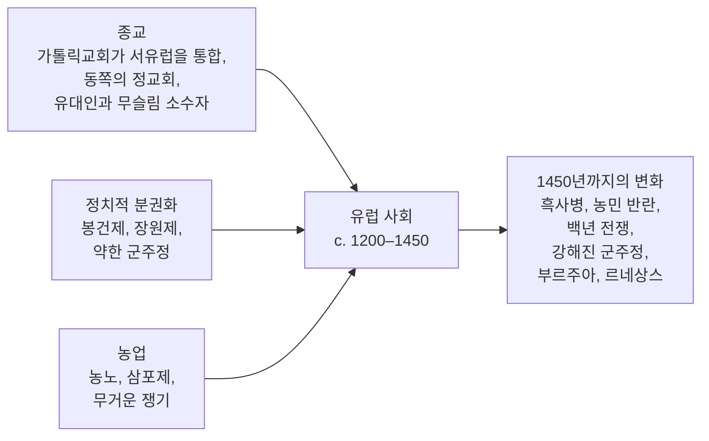

---

## §1. 배경: 로마 이후의 유럽

| 시기 | 사건 | 유럽에 준 영향 |
|---|---|---|
| **476** | 마지막 서로마 황제가 폐위됨 | 서유럽에서 로마의 도로, 법, 중앙 정부가 무너짐 |
| **c. 500–800** | 게르만 왕국들(프랑크족, 서고트족, 앵글로색슨족)이 로마의 지배를 대신함 | 작은 왕국이 여럿 생겼고, 하나의 통치자가 없었음 |
| **800** | 교황이 프랑크 왕 **카롤루스 대제 (Charlemagne)**를 황제로 대관함 | 잠시 제국이 부활했으나, **843년** 손자들 사이에서 나뉨 |
| **c. 800–1000** | **바이킹 (Vikings)**, **마자르족 (Magyars)**, 무슬림의 침입 | 왕이 모두를 지켜 줄 수 없어서, 무장한 기사를 거느린 지방 영주가 방어를 맡음 |
| **962** | 독일 왕 **오토 1세 (Otto I)**가 카롤루스 대제의 칭호를 이어 **신성 로마 황제**로 대관함 | 신성 로마 제국이 시작되었고, 말기에는 힘이 거의 없었지만 **1806년**까지 이어짐 |
| **1066** | 노르망디 공작 **정복왕 윌리엄 (William the Conqueror)**이 잉글랜드를 정복함 (**노르만 정복 (Norman Conquest)**) | 영국 해협 양쪽에 땅을 가진, 잘 조직된 봉건 왕국이 생김 |
| **1122** | **보름스 협약 (Concordat of Worms)**으로 교황과 황제 사이의 **서임권 투쟁 (Lay investiture controversy)**이 끝남 | 주교를 누가 임명하는지가 정리됨. 교재는 교회가 세속 권력으로부터 자율을 얻었다고 설명함 (§7) |

- 왕은 약하고 침입은 끊이지 않았기 때문에, 사람들은 보호를 받으려고 **지방 영주 (Lord)**에게 의지했다. 이것이 봉건제와 장원제가 생긴 주된 **원인**이었다 (§6).
- **동로마 제국**은 무너지지 않았다. **콘스탄티노폴리스 (Constantinople)**를 수도로 한 **비잔티움 제국**으로 이어졌다 (§3).
- 교재는 중세 초기를 이렇게 정리한다. **교역이 줄었고**, **지적 활동이 위축되었으며**, 통일된 로마 국가 대신 서로 자주 싸우는 **작은 왕국들**이 들어섰다. 왕, 영주, 농민은 **공동 방어**를 위한 약속을 맺었다.

## §2. 로마 가톨릭교회

로마 가톨릭교회는 서유럽에서 **가장 강력하고 사람들을 하나로 묶는 기관**이었다. 왕국들은 나뉘어 있었지만(교재는 유럽이 **수백 개의 작은 정치 단위**로 나뉘어 있었다고 쓴다), 서유럽 사람들은 거의 모두 같은 신앙, 같은 라틴어 의식, 같은 교회 위계를 공유했다.

| 특징 | 내용 | 사회에 준 영향 |
|---|---|---|
| **위계 (Hierarchy)** | 로마의 **교황 (Pope)**이 대주교, 주교, 본당 사제를 이끌었음. 지역의 **주교 (Bishop)**는 교황에게 충성했고, 옛 로마 제국의 지역 지도자처럼 **본당 사제를 뽑고 감독했음** | 여러 왕국에 걸친 하나의 권위 체계 |
| **성사 (Sacraments)** | 구원에 꼭 필요하다고 여긴 일곱 가지 거룩한 의식. 세례, 성체(영성체), 고해, 혼인 등 | 태어나서 죽을 때까지 삶의 모든 단계가 교회를 거쳤음 |
| **십일조 (Tithe)** | 수입이나 수확의 10분의 1을 교회에 내는 세금 | 교회가 크게 부유해졌고, 가장 큰 토지 소유자 가운데 하나가 되었음 |
| **파문 (Excommunication)과 성무 금지령 (Interdict)** | 교회는 한 사람을 성사에서 끊어 내거나(파문), 한 지역 전체의 교회를 닫을 수 있었음(성무 금지령). 더 작은 규모로는 지역 **주교가 영주의 농노들을 위한 예배를 취소**할 수 있었고, 화가 난 농노들이 영주에게 주교의 뜻을 따르라고 압박했음 | 교황에게 왕과 영주를 누를 힘을 주었음. 교황 인노첸시오 3세 (Innocent III)는 존 왕과의 분쟁으로 잉글랜드에 성무 금지령을 내렸음 (1208–1214) |
| **수도원 (Monastery)과 수녀원 (Convent)** | 수도사와 수녀의 공동체. 다수가 **성 베네딕트 규칙 (Rule of St. Benedict)**을 따랐음. 수도원은 다른 장원과 **같은 경제적 기능**(농업과 보호)을 했음. 여성은 **수녀**가 되어 수도원에서 영향력을 발휘할 수 있었음 | 필사본을 베껴 학문을 지켰고, 학교와 병원을 운영했으며, 땅을 개간해 농사를 지었음 |
| **탁발 수도회 (Mendicant orders)** | **프란치스코회 (Franciscans)**와 **도미니코회 (Dominicans)** (1200년대 초)는 가난하게 살며 도시에서 설교했음 | 성장하는 도시에 신앙을 전했음. 도미니코회는 이단과도 싸웠음 |
| **대성당 (Cathedral)** | 뾰족한 아치, 공중 부벽, 스테인드글라스를 갖춘 거대한 **고딕 (Gothic)** 양식 교회 (예: 샤르트르, 파리 노트르담) | 교회의 부를 보여 주었고, 글을 읽지 못하는 사람들에게 성경 이야기를 가르쳤음 |
| **대학 (University)** | **교회가 유럽 최초의 대학을 세웠음**. 대학은 대성당 학교에서 발전함: **볼로냐 (Bologna)**, **파리 (Paris)**, **옥스퍼드 (Oxford)** (모두 c. 1200년까지 등장) | 성직자, 법률가, 의사를 길렀고, **스콜라 철학**의 중심지가 되었음 |
| **문자 해득과 예술 (Literacy and art)** | 마을에서 **글을 읽고 쓸 줄 아는 사람은 교회 사람뿐**인 경우가 많았음. 대부분의 장원에는 작은 교회와 사제가 있었음. 사상가와 작가 대부분이 성직자였고, 예술 작품 대부분은 **종교적 주제**를 다루었음 | 평민은 글을 읽거나 쓸 일이 있으면 교회 사람에게 부탁했음. 종교화는 **글을 모르는 농노**가 성경을 이해하도록 도왔음 |
| **공동의 정체성 (Shared identity)** | 지역마다 쓰는 **자국어 (Vernacular)**가 라틴어를 대신하기 시작한 뒤에도 기독교는 사람들을 하나로 묶었음 | 유럽인은 스스로를 하나의 그리스도교 세계의 일원으로 여겼음 |

> ⚠️ 교재는 **모든 예술가가 교회를 위해 일했다**고 쓴다. 많은 설명에서는 왕, 귀족, 부유한 도시민도 예술가에게 돈을 주었다고 보며, 교재 스스로도 뒤에서 피렌체의 메디치 가문이 화가를 후원했다고 쓴다(§12). 선생님이 어떻게 가르치는지 확인이 필요하다.

### 스콜라 철학과 토마스 아퀴나스

- **스콜라 철학 (Scholasticism)**은 **이성과 논리**로 기독교 신앙을 설명하고 옹호하는 학문 방법이었다.
- 학자들은 그리스 철학자 **아리스토텔레스 (Aristotle)**를 다시 발견했다. 이는 알안달루스의 **아랍어 번역과 주석**을 통한 경우가 많았다 (예: 유럽에서 아베로에스 (Averroes)로 알려진 무슬림 학자 **이븐 루시드 (Ibn Rushd)**).
- 이 노트 맨 앞에 인용한 **피에르 아벨라르 (Peter Abelard, 1079–1142)**는 아리스토텔레스를 공부하고 때로 교회를 비판했지만, 평생 신앙을 지켰다.
- 도미니코회 수도사 **토마스 아퀴나스 (Thomas Aquinas, 1225–1274)**는 ***신학대전 (Summa Theologica)***을 썼다. 그는 신앙과 이성이 모두 신에게서 오기 때문에 **서로 충돌하지 않는다**고 주장했다.

### 교회 권위에 대한 도전

- **이단:** 교회는 남프랑스의 **카타리파 (Cathars)**처럼 이단으로 본 집단과 싸웠고(알비 십자군 (Albigensian Crusade), 1209–1229), 이단을 재판하는 **종교 재판 (Inquisition)**을 만들었다.
- **왕과 교황의 대립:** 프랑스 왕 **필리프 4세 (Philip IV)**는 성직자 과세 문제로 교황 **보니파시오 8세 (Boniface VIII)**와 맞섰다 (c. 1296–1303).
- **아비뇽 교황청 (Avignon Papacy, 1309–1377):** 교황들이 프랑스의 강한 영향 아래 아비뇽에 머물렀다.
- **서방 교회 대분열 (Western Schism, 1378–1417):** 두 명, 나중에는 세 명이 동시에 자신이 교황이라고 주장했다. 이 일로 교회의 위신이 떨어졌다.
- **부와 부패:** 성직자는 **청빈 서약**을 하고 지역 자선을 도왔지만, 실제로 큰 정치적 영향력을 가졌고 일부 수도원은 매우 부유해졌다. 교재는 부와 권력이 **13–14세기의 부패**로 이어졌다고 쓴다. 부패와 신학적 이견은 뒤에 **마르틴 루터 (Martin Luther)** 같은 개혁가가 **16세기**에 가톨릭교회의 통일을 깨뜨리게 만들었다 (이후 단원의 배경).

> **핵심:** 정치적으로 **분열된** 유럽에서 가톨릭교회는 서유럽에 **공동의 정체성**(그리스도교 세계, Christendom), 학문의 공통 언어(**라틴어**), 그리고 왕에게 맞설 수 있는 힘을 주었다.

## §3. 동방 정교회와 비잔티움 제국

- 동쪽의 기독교는 **비잔티움 황제**와 **콘스탄티노폴리스 총대주교 (Patriarch)** 아래에서 발전했다. 예배는 **그리스어**로 드렸고, **이콘 (Icon, 성화상)**이 예배의 중심이었다.
- **동서 교회 분열 (East-West Schism, 1054):** **교황의 권위**와 종교 관습(예: 성찬에 쓰는 빵의 종류)을 둘러싼 갈등으로 교황의 사절과 총대주교가 **서로를 파문했다**. 기독교는 서쪽의 **로마 가톨릭**과 동쪽의 **동방 정교회**로 갈라졌다.
- 교재는 1054년의 분열을 **대분열 (Great Schism)**이라고 부른다. 일부 책에서 역시 "대분열"이라고 부르는 1378–1417년의 **서방 교회 대분열 (Western Schism)**(§2)과 헷갈리지 않아야 한다.
- 1054년 이후에도 가톨릭교회는 약 다섯 세기 동안 유럽 대부분을 지배했고, 정교회는 더 동쪽, 곧 **그리스에서 러시아까지** 강한 힘을 가졌다.
- 정교회는 **동유럽과 러시아**로 퍼졌다 (키예프 루스 (Kievan Rus')는 **988년**에 개종했다. §13 참고).
- **1204년:** **베네치아**의 지원을 받은 **제4차 십자군 (Fourth Crusade)**은 성지에서 싸우는 대신 **콘스탄티노폴리스를 약탈했다**. 그리고 **라틴 제국 (Latin Empire, 1204–1261)**을 세웠다. 이 일로 가톨릭과 정교회 신자 사이의 증오가 깊어졌다.
- 비잔티움은 **1261년** 콘스탄티노폴리스를 되찾았지만, 다시는 예전의 힘을 회복하지 못했다.
- **1453년:** **메흐메트 2세 (Mehmed II)**가 이끄는 **오스만 튀르크 (Ottoman Turks)**가 콘스탄티노폴리스를 점령해 비잔티움 제국이 멸망했다.

> 가톨릭과 정교회의 비교는 §비교표를 참고하라.

## §4. 십자군 (1095–1291)

**십자군 (Crusades)**은 교황이 **성지 (Holy Land)**를 무슬림의 지배에서 되찾으려고 일으킨 일련의 종교 전쟁이었다. 성지는 중동의 **팔레스타인 (Palestine)** 지역으로, **유대인, 기독교인, 무슬림** 모두에게 거룩한 장소가 있었다. 유럽 기독교인은 이 땅이 무슬림의 지배 아래 들어간 뒤에도 수백 년 동안 이곳을 방문할 수 있었다.

### 십자군의 원인

- **종교적 원인:** 교회는 영적 권위로 사람들을 모았다. 십자군에 참여하면 **의무적인 속죄와 고행을 면제**해 주고, **더 빨리 천국에 간다**고 약속했다.
- **동쪽의 요청:** **셀주크 튀르크 (Seljuk Turks)**가 기독교 순례자를 박해한다는 소식에 놀란 비잔티움 측이 성지 탈환을 도와 달라고 **교황 우르바노 2세 (Urban II)**에게 요청했다.
- **사회적 원인:** **장자 상속제 (Primogeniture)** 아래에서는 맏아들이 재산 전체를 물려받았기 때문에, 많은 **둘째 이하 아들**은 땅도 재산도 거의 없었다. 땅을 가진 귀족들은 십자군을 이 불만 많은 젊은 귀족들, 그리고 이웃 영주의 땅을 자주 약탈하던 **일자리 없는 농민**의 힘을 다른 데로 돌리는 방법으로 보았다.
- **경제적 원인:** 상인들은 중동을 지나는 교역로를 **자유롭게 이용**하기를 원했다.
- **정치적 원인:** 교황과 왕 사이의 긴장 때문에 교회는 더욱 주도권을 쥐려고 했다.

> ⚠️ 교재는 콘스탄티노폴리스의 **정교회 총대주교**가 교황 우르바노 2세에게 도움을 청했다고 쓴다. 많은 설명에서는 아래 표처럼 **비잔티움 황제 알렉시오스 1세 콤니노스 (Alexios I Komnenos)**가 도움을 청했다고 본다. 선생님이 어떻게 가르치는지 확인이 필요하다.

| 십자군 / 사건 | 연도 | 내용 |
|---|---|---|
| **클레르몽 공의회 (Council of Clermont)** | **1095** | 비잔티움 황제가 **셀주크 튀르크 (Seljuk Turks)**에 맞설 도움을 청하자 교황 **우르바노 2세 (Urban II)**가 제1차 십자군을 호소함 |
| **제1차 십자군 (First Crusade)** | 1096–1099 | 십자군이 **예루살렘을 점령(1099년 7월)**하고 **십자군 국가 (Crusader states)**를 세움. 교재는 이것이 기독교 세계의 유일한 분명한 승리였다고 봄 |
| **살라딘 (Saladin)의 예루살렘 탈환** | 1187 | 무슬림 지도자 살라딘이 예루살렘을 되찾음 |
| **제3차 십자군 (Third Crusade)** | 1189–1192 | 예루살렘 탈환에 실패함. 휴전으로 기독교 순례자의 방문은 허용됨 |
| **자라 (Zara) 약탈** | 1202 | 베네치아는 십자군을 **레반트 (Levant, 동지중해 연안)**로 실어 나르기로 계약했지만 대금을 다 받지 못하자, 십자군을 설득해 먼저 교역 도시 **자라**를 공격하게 함 |
| **제4차 십자군 (Fourth Crusade)** | 1202–1204 | 방향을 바꿔 베네치아의 큰 교역 경쟁자인 **콘스탄티노폴리스**로 가서 **1204년** 이를 약탈함. 끝내 성지에는 가지 못함 |
| **아크레 (Acre) 함락** | **1291** | **맘루크 (Mamluks)**가 마지막 주요 십자군 도시를 점령해 십자군 국가가 끝남 |

> ⚠️ 교재는 **주요 십자군을 네 차례**로 세고, 제4차(1202–1204)를 마지막 주요 십자군이라고 하며, 십자군 시기를 "1095년부터 1200년대까지"로 쓴다. 많은 설명에서는 십자군을 더 많이(제5차부터 제8차 또는 제9차까지, 1272년까지) 세고, 이 노트처럼 1291년 아크레 함락으로 십자군 국가가 끝났다고 본다. 선생님이 어떻게 가르치는지 확인이 필요하다.

> ⚠️ 교재는 자라를 "이탈리아의 도시"라고 쓴다. 많은 설명에서는 자라(지금의 크로아티아 자다르 (Zadar))가 아드리아해 동쪽 달마티아 해안에 있었고 헝가리 왕의 지배를 받았다고 본다. 즉 십자군은 기독교 도시를 공격한 것이다. 선생님이 어떻게 가르치는지 확인이 필요하다.

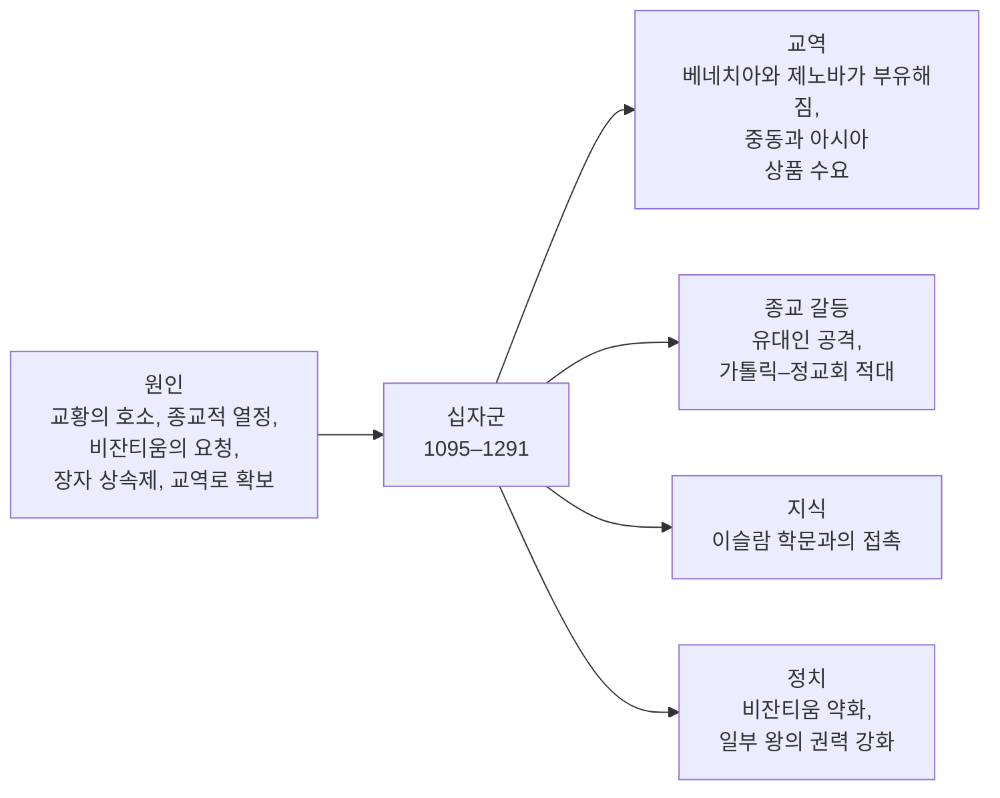

- **교역에 준 영향:** **베네치아 (Venice)**와 **제노바 (Genoa)** 같은 이탈리아 도시국가는 십자군과 상품을 실어 나르며 부유해졌다. 중동은 **생활 수준이 더 높았고**, 돌아온 십자군 때문에 유럽에서 중동 상품의 수요가 늘었다. 유럽인들은 향신료, 비단, 설탕의 맛을 알게 되었다 (2.1 참고).
- **문화에 준 영향:** 십자군은 유럽과 중동 사이의 **문화 교류**를 촉진했다. (십자군 시기까지 이슬람이 퍼진 과정은 1.2 참고.)
- **종교에 준 영향:** 십자군은 1096년 **라인란트 (Rhineland)의 유대인 공동체**를 공격했다. 제4차 십자군은 가톨릭과 정교회 신자를 서로 원수로 만들었다.
- **정치에 준 영향:** 많은 귀족이 전사하거나 원정 비용을 마련하려고 땅을 팔았다. 이것이 일부 왕이 권력을 키우는 데 도움이 되었다.
- **최종 결과:** 결국 레반트에서는 이슬람 세력이 승리했다.

## §5. 유럽의 유대교와 이슬람

### 유대교: 박해받은 소수자

- **유대인 공동체**는 유럽 곳곳의 도시에 살았다. 이들은 자신들의 **율법(토라 (Torah)와 탈무드 (Talmud))**, 회당, 공동체 지도자를 지켰다.
- 중세 동안 기독교 유럽의 적은 유대인 인구는 **늘어났다**. 많은 유대인이 무슬림이 다스리던 **이베리아**와 **지중해** 주변에 살았는데, 기독교인이 이 지역을 차지하자 형편이 되는 유대인은 북쪽으로 옮겨 갔다. 특히 **암스테르담 (Amsterdam)**을 비롯한 상업 도시의 일부 지도자는 사업과 교역 경험이 많은 이들을 반겼다.
- 교회는 기독교인 사이의 **고리대금 (Usury, 이자를 받고 돈을 빌려주는 것)**을 금지했지만, 유대인은 이 규칙에 묶이지 않았다. 또 유대인은 많은 곳에서 **땅을 소유할 수 없었고** 대부분의 **길드 (Guild)에서 배제**되었다. 그래서 많은 유대인이 **대금업**과 상업에 종사했다. 교재는 이로 인해 늘어난 돈의 흐름이 **유럽 경제 성장에 도움이 되었다**고 쓴다.
- 대부분의 유럽인과 달리 유대인은 주로 **도시**에 살았고, 기독교인과 기독교인이 원하는 상품을 가진 무슬림 사이를 잇는 **다리** 역할을 했다.
- 왕들은 유대인 대금업자를 **보호하면서 무거운 세금**을 매겼고, 필요할 때는 그들을 배신했다.
- **제4차 라테라노 공의회 (Fourth Lateran Council, 1215)**는 기독교 지역의 유대인(과 무슬림)에게 **구별되는 옷이나 표식**을 달게 했다.
- **반유대주의 (Antisemitism, 유대인에 대한 적대감)**가 널리 퍼져 있었다. 많은 기독교인은 유대인을 외부인이자 믿을 수 없는 사람으로 여겼다.
- **박해:** 유대인은 거짓 고발("피의 비방 (Blood libel)" 등), 폭도의 폭력, 강제 개종에 시달렸다.
- **추방:** 왕들은 유대인 대금업자에게 진 빚을 압수하는 경우가 많았다. 유대인은 북유럽과 중부 유럽의 여러 왕국과 도시에서도 추방되었다.

| 왕국 | 유대인 추방 | 비고 |
|---|---|---|
| **잉글랜드 (England)** | **1290** | **에드워드 1세 (Edward I)** |
| **프랑스 (France)** | **1306**, 최종적으로 **1394** (교재의 연도) | **필리프 4세**가 1306년에 추방했고, 유대인은 뒤에 돌아오도록 허락받았다가 다시 추방되었음 |
| **스페인 (Spain)** | **1492** | 페르난도와 이사벨 (이후 단원의 배경) |
| **포르투갈 (Portugal)** | **1497** | 이후 단원의 배경 |

> ⚠️ 교재는 프랑스의 유대인 추방 연도를 **1394년**으로 쓴다. 많은 설명에서는 **1306년**(필리프 4세)을 첫 대규모 추방으로 보며, 유대인은 1315년에 돌아오도록 허락받았다가 다시 추방되었고 1394년에 최종적으로 추방되었다고 본다. 두 연도를 모두 알아 두고, 선생님이 어떻게 가르치는지 확인이 필요하다.

- **흑사병:** 많은 기독교인이 유대인이 우물에 독을 탔다는 거짓 소문을 믿고 **흑사병의 책임을 유대인에게 돌렸다**. 교황 **클레멘스 6세 (Clement VI)**가 유대인에게 책임이 없다고 선언했는데도, **스트라스부르 (Strasbourg, 1349)** 등 많은 도시에서 유대인 공동체가 학살되었다.
- 많은 유대인이 통치자들이 받아들여 준 **동쪽의 폴란드와 리투아니아**로 이주했다. 교재는 유대인이 1세기부터 동유럽에 살았지만, 추방 때문에 그 수가 크게 늘었다고 쓴다.

### 이슬람: 알안달루스와 레콘키스타

- 무슬림은 **711년**부터 **이베리아반도 (Iberian Peninsula)**(스페인과 포르투갈)의 상당 부분을 다스렸다. 이 지역을 **알안달루스 (al-Andalus)**라고 불렀다.
- **코르도바 (Córdoba)**와 **톨레도 (Toledo)** 같은 도시는 무슬림, 유대인, 기독교인 학자들이 함께 활동한 학문의 중심지였다. 철학, 의학, 수학에 관한 아랍어 문헌이 라틴어로 번역되어 유럽 스콜라 철학이 시작되는 데 도움을 주었다. 유대인 철학자 **마이모니데스 (Maimonides)**도 코르도바에서 태어났다.
- 잉글랜드를 정복한 **노르만족 (Normans)**은 지중해의 섬 **시칠리아 (Sicily)**도 무슬림 통치자에게서 빼앗았다 (1091년 완료).
- **레콘키스타 (Reconquista, 국토 회복 운동)**는 기독교 왕국들(카스티야 (Castile), 아라곤 (Aragon), 포르투갈 (Portugal))이 이베리아를 되찾으려고 벌인 오랜 전쟁이었다.

| 연도 | 사건 |
|---|---|
| 1085 | 카스티야가 **톨레도**를 점령함 |
| **1212** | **라스나바스데톨로사 전투 (Battle of Las Navas de Tolosa)**에서 기독교 측이 이겨 이베리아의 무슬림 세력이 꺾임 |
| 1236 / 1248 | 카스티야가 **코르도바**와 **세비야 (Seville)**를 점령함 |
| 1232–1492 | **나스르 왕조의 그라나다 (Nasrid Emirate of Granada)**만 무슬림 지배 아래 남음 |
| **1492** | 페르난도와 이사벨이 **그라나다를 함락**함 (이후 단원의 배경). 교재는 이때 스페인 왕이 개종하지 않은 나머지 무슬림을 추방했다고 덧붙임 |

> ⚠️ 교재는 개종하지 않은 무슬림이 **1492년**에 스페인에서 추방되었다고 쓴다. 많은 설명에서는 1492년이 그라나다가 함락되고 스페인이 **유대인**을 추방한 해이며, 카스티야의 무슬림은 **1502년**에 개종하거나 떠나도록 강요받았고, 개종한 그 후손(모리스코 (Moriscos))은 **1609년**에 추방되었다고 본다. 선생님이 어떻게 가르치는지 확인이 필요하다.

- 유럽 남동부에서는 1300년대에 **오스만**이 **발칸반도 (Balkans)**로 진출하면서 이슬람이 세력을 넓혔다 (Unit 3 참고). 지금의 **알바니아 (Albania)**, **코소보 (Kosovo)**, **보스니아 헤르체고비나 (Bosnia and Herzegovina)**에는 무슬림 인구가 많아졌고, 스페인을 떠난 많은 무슬림도 유럽 남동부로 옮겨 갔다.

> ⚠️ 교재는 오스만 제국이 **13세기**에 발칸반도로 진출했다고 쓴다. 많은 설명에서는 오스만 국가가 c. 1299년에 세워졌고, **1300년대 중반**에 발칸반도로 건너갔다고 본다(예: 1389년 코소보 전투). 선생님이 어떻게 가르치는지 확인이 필요하다.

> **핵심:** 유럽은 주로 기독교 사회였지만, 박해 속에서도 **유대인과 무슬림은 유럽 사회를 형성하는 데 기여했다**. 무슬림 칼리프국의 상인들과의 접촉은 봉건제 아래 오랫동안 자급자족하며 고립되어 있던 유럽인에게 **교역과 사상**의 세계를 열어 주었다.

## §6. 정치적 분권화의 원인: 봉건제와 장원제

### 분권화의 원인

- **로마의 멸망:** 서유럽에는 중앙 정부, 조세 제도, 직업 군대가 남지 않았다.
- **외부의 침입:** 바이킹, 마자르족, 무슬림의 침입에 맞서려면 **현지에서 빠르게 방어**해야 했다. 사람들은 **도적과 경쟁 영주**로부터도 보호가 필요했다.
- **약한 왕:** 왕은 돈과 관리가 부족해서 병사를 얻으려면 **귀족에게 의존**했다.
- **토지 중심 경제:** 교역과 화폐가 적어 **땅**이 부의 중심이었다. 그래서 통치자는 땅으로 충성을 샀다.
- **경쟁하는 권위:** 교회는 자체의 땅, 법정, 세금을 가졌다.

### 봉건제 (정치·군사 제도)

교재는 **봉건제**를 **땅과 충성을 맞바꾸는** 분권적 제도로 정의하며, 그 핵심은 **상호 의무**였다고 설명한다. 군주는 영주에게 봉토를 주었고, 영주는 기사에게 땅을 주었으며, 영주는 농민에게 땅과 보호를 주었다. 농민은 영주의 땅을 경작하고, 작물과 가축을 바치고, 영주의 명령에 따랐다.

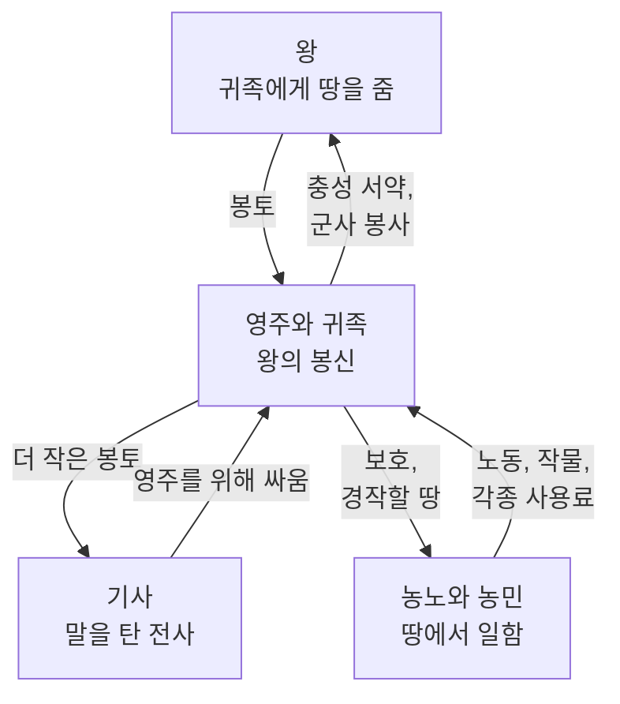

| 용어 | 뜻 |
|---|---|
| **영주 (Lord)** | 땅을 소유하고 그 일부를 다른 사람에게 나누어 준 귀족 |
| **봉신 (Vassal)** | 영주에게서 땅을 받고 충성을 맹세한 사람. 교재의 표현으로는 자기보다 지위가 높은 사람에게 봉사할 의무를 진 사람 |
| **봉토 (Fief)** | 충성과 군사 봉사의 대가로 영주가 봉신에게 준 땅 |
| **충성 서약 (Oath of fealty)** | 봉신이 영주에게 충성을 다하겠다고 한 맹세 |
| **기사 (Knight)** | 영주를 섬긴, 훈련받고 갑옷을 입은 기마 전사. **기사도 (Chivalry)**(용기, 충성, 약자 보호)를 따라야 했음 |
| **기사도 (Chivalry)** | **명예, 예의, 용기**를 중시한 불문의 행동 규범. 분쟁을 해결하는 데도 쓰였음. 여성을 보호해야 할 존재로 "받들었지만" 실제 권리는 거의 주지 않았음 |

- 봉신은 자기 봉신을 거느린 **영주**가 될 수 있었고, 한 사람이 **여러 영주의 봉신**이 될 수도 있었다. 충성 관계가 겹쳐서 중앙의 통제가 어려웠다.
- 봉건제는 농민에게 **안전**을, 전사에게 **장비**를, 영주를 섬기는 사람에게 **땅**을 주었다. 제도 전체가 농업에 바탕을 두었기 때문에 **부는 현금이 아니라 땅으로 측정되었다**.

### 장원제 (경제 제도)

- **장원 (Manor)**은 영주의 영지로, 성이나 영주 저택, 마을, 경작지, 목초지, 숲, 방앗간, 교회가 있었다. 교재는 이를 **장원 제도 (Manorial system)**라고 부르며, 큰 봉토나 영지를 장원이라고 했다고 설명한다.
- 장원은 작은 마을로, 흔히 **교회**, **대장간**, **방앗간**, **포도주 압착기**, 그리고 농노의 집이 있었다.
- 장원은 대체로 **자급자족**했다. 식량, 옷감, 도구, 건축 자재를 스스로 만들었다. 그래서 교역할 필요가 적었고, **많은 농노가 평생 한 장원에서만 살며** 유럽의 다른 곳에서 일어나는 일을 거의 몰랐다.
- **농노**는 일주일에 며칠씩 영주의 직영지 (Demesne)에서 일했고, 자기 수확의 일부를 영주에게 바쳤다. 또 영주의 방앗간이나 화덕을 쓰거나 결혼할 때 **사용료**를 냈다.
- 농노는 **노예는 아니었지만 땅에 묶여 있었다**. 영주의 허락 없이는 여행하거나 결혼할 수 없었다. 농노는 **작물, 노동, 드물게는 동전**으로 공납을 바쳤고, **농노에게서 태어난 아이도 농노**가 되었다.
- 그 대가로 영주는 **보호**와 장원 법정의 **재판**을 제공했고, 한 뙈기의 땅을 경작할 권리를 주었다.

> **분권화의 결과:** 실제 권력은 지방 귀족이 쥐었고, 영주들 사이의 전쟁이 잦았으며, 교역과 이동이 제한되었다. 그리고 **교회**가 유럽을 잇는 중심 기관이 되었다 (§2).

## §7. 분권적 군주정과 도시국가

- **중세 후기의 흐름 (교재):** 군주는 자기 **관료제 (Bureaucracy)**와 **군대**를 두어 **봉건 영주를 희생시키며** 힘을 키웠다. 이 관리와 병사는 왕이나 여왕을 직접 섬겼다(미국 같은 근대 국가에서는 관리와 군인이 최고 지도자가 아니라 나라를 위해 일한다). 군주들이 모은 땅, 특히 **잉글랜드와 프랑스**는 오늘날 유럽 국가의 모습을 띠기 시작했다.

| 국가 | 통치 형태 | 왕권이 커지거나 제한된 방식 | 주요 연도 |
|---|---|---|---|
| **잉글랜드 (England)** | 세습 군주정 (1066년부터 노르만 왕조, 이후 플랜태저넷 (Plantagenet) 왕조) | **정복왕 윌리엄**은 **국왕 직속 행정관 (Sheriff)**을 통해 잘 조직된 봉건 제도를 운영했음. 뒤에 귀족들이 **존 왕 (King John)**에게 **마그나 카르타 (Magna Carta)**를 받아들이게 했음. 이로써 왕도 **법 아래** 놓였고, **군역 면제세 (Scutage)** 같은 일부 세금에는 동의가 필요해졌음. **의회 (Parliament)**는 왕의 자문 회의에서 발전해 기사와 도시민까지 포함하게 되었음 | **1066** 노르만 정복, **1215** 마그나 카르타, **1265** 시몽 드 몽포르 (Simon de Montfort)의 의회, **1295** 모범 의회 (Model Parliament, 에드워드 1세) |
| **프랑스 (France)** | 세습 군주정 (**카페 왕조 (Capetian)**, 987–1328, 이후 **발루아 왕조 (Valois)**) | 처음에 왕은 **파리** 주변만 다스렸음. **필리프 2세 (Philip II, 재위 1180–1223)**는 처음으로 제대로 된 왕실 **관료제**를 만들었고 1204년 잉글랜드에게서 노르망디를 빼앗았음. **필리프 4세 (재위 1285–1314)**는 교황에 맞서 지지를 얻으려고 **삼부회 (Estates-General)**를 소집했음. 왕들은 성직자와 귀족에게서 정기적인 세금을 걷지 않았기 때문에 삼부회의 힘은 약했음 | **1204** 노르망디, **1302** 첫 삼부회, **1328** 발루아 왕조 시작 |
| **신성 로마 제국 (Holy Roman Empire)** | **수백 개**의 독일 국가와 이탈리아 북부 일부를 다스린 **선출** 황제 | 962년 **오토 1세**의 대관으로 시작되었음. 황제는 **서임권 투쟁**에서 교황과 다투었고, 이 다툼은 **보름스 협약(1122)**으로 정리되었음. 강력한 제후, 주교, 자유 도시가 각자 자기 땅을 다스렸고, 황제는 강한 중앙 국가를 세우지 못했음 | **962** 오토 1세 대관, **1122** 보름스 협약, **1356** **금인칙서 (Golden Bull)**: 일곱 명의 **선제후 (Prince-electors)**가 황제를 선출 |
| **이탈리아 도시국가 (Italian city-states)** | 독립 도시들: **베네치아** (**도제 (Doge)**가 이끄는 공화국), **피렌체 (Florence)**, **제노바**, **밀라노 (Milan)**. 교황은 **교황령 (Papal States)**을 다스렸음 | 피렌체의 은행가 **메디치 (Medici)** 가문 같은 부유한 상인 가문이 통치했고, 이탈리아를 통일한 통치자는 없었음 | 베네치아가 제4차 십자군의 방향 전환(1202–1204)을 이끌었고, 지중해 교역을 장악했음 |

- **잉글랜드 (노르만의 뿌리):** **노르만족**은 프랑스 북서부 **노르망디 (Normandy)**에 정착한 **바이킹**의 후손이었다. **1066년** 노르망디 공작 윌리엄(교재는 "노르만 왕"이라고 부른다)이 잉글랜드를 침공해 차지했고, 영국 해협 양쪽에 땅을 갖게 되었다. 노르만족과 앵글로색슨족이 섞여 잉글랜드 민족이 형성되었다.
- **잉글랜드 (마그나 카르타):** 많은 잉글랜드 귀족은 노르만 왕들의 권력에 반대했다. **1215년** 그들은 **존 왕**에게 마그나 카르타에 서명하게 했다. 마그나 카르타는 민주주의가 아니라 왕과 **귀족 (Barons)** 사이의 합의였다. 그러나 **왕도 법을 지켜야 한다**는 원칙을 세웠다. 제39조는 이렇다. "어떤 자유인도 그와 동등한 사람들의 적법한 판결이나 국법에 의하지 않고서는 체포되거나 투옥되거나, 권리나 재산을 빼앗기거나, 법의 보호를 박탈당하거나 추방되거나, 그 밖의 어떤 방식으로도 지위를 잃지 않는다. 또한 우리는 그에게 무력을 쓰거나 다른 사람을 보내 그렇게 하지 않을 것이다." 귀족들은 또 기사가 군사 봉사 대신 내는 돈인 **군역 면제세 (Scutage)**에 대해 의견을 들을 권리도 얻었다.

> ⚠️ 교재는 마그나 카르타가 귀족을 투옥하기 전에 "배심 재판을 받을 권리"를 보장했다고 쓴다. 많은 설명에서는 제39조가 약속한 것은 "동등한 사람들의 적법한 판결이나 국법"뿐이며, 오늘날과 같은 배심 재판은 뒤에 발전했다고 본다. 선생님이 어떻게 가르치는지 확인이 필요하다.

- **잉글랜드 (의회):** 교재는 잉글랜드 최초의 의회를 **1265년**으로 보며, 이때 귀족과 고위 성직자를 대표하는 **상원 (House of Lords)**과 부유한 도시민이 선출한 대표로 이루어진 **하원 (House of Commons)**이 있었다고 쓴다. 이런 변화는 **평민이 아니라 귀족**의 권리를 늘렸다. 시간이 지나면서 잉글랜드 의회는 유럽 대륙의 비슷한 기구보다 더 강해졌고, 뒤에 세금을 승인하는 권리를 얻었다.

> ⚠️ 교재는 1265년 의회에 이미 **상원**과 **하원**이 있었다고 쓴다. 많은 설명에서는 시몽 드 몽포르의 1265년 의회가 기사와 도시민 대표(버지스 (Burgesses))를 처음 불렀고, 의회가 두 원으로 나뉜 것은 **14세기**이며, **1295년 모범 의회**를 최초의 대표 의회로 부르는 경우가 많다고 본다. 선생님이 어떻게 가르치는지 확인이 필요하다.

- **프랑스:** **삼부회**는 세 **신분 (Estates, 법적 계급)**을 대표했다. **성직자**(제1신분), **귀족**(제2신분), **평민**(제3신분)이다. 성직자와 귀족은 정기적인 세금을 내지 않았기 때문에, 자신들이 돈을 대지 않는 정부를 지킬 책임을 거의 느끼지 않았다. 이 문제는 **1789년 프랑스 혁명** 직전까지 점점 커졌다.
- **신성 로마 제국:** 독일 왕 **오토 1세**는 카롤루스 대제의 "로마인의 황제" 칭호를 이어 **962년** 황제로 대관했다. **서임권 투쟁**(11–12세기)에서 교황과 황제는 **세속**(종교와 관계없는) 통치자가 주교에게 직위의 상징을 줄 수 있는지를 두고 다투었다. **보름스 협약(1122)**이 이 문제를 정리했다. 황제 **카를 4세 (Charles IV)**가 내린 **금인칙서(1356)**는 일곱 선제후를 정했다. 마인츠, 쾰른, 트리어의 대주교, 보헤미아 왕, 라인 궁중백, 작센 공작, 브란덴부르크 변경백이다. 이 칙서로 선거는 질서를 갖추었지만 **제후의 권력이 굳어져** 독일은 계속 분열되었다. 교재는 제국이 **30년 전쟁 (Thirty Years' War, 1618–1648)**으로 거의 무너졌고, 나폴레옹이 중부 유럽을 침공한 뒤 **1806년** 공식적으로 끝났다고 덧붙인다.

> ⚠️ 교재는 보름스에서 교회가 "세속 권력으로부터 자율을 얻었다"고 하고, 신성 로마 제국이 30년 전쟁 때까지 "활기찼다"고 쓴다. 많은 설명에서는 보름스 협약을 **타협**(황제가 주교에게 땅을 주는 데에는 계속 관여함)으로 보고, 이 노트와 CED처럼 이 시기의 제국이 이미 **분열**되어 있었다고 강조한다. 선생님이 어떻게 가르치는지 확인이 필요하다.

- **이탈리아 도시국가:** 교역과 금융으로 부유해졌다. 베네치아와 제노바는 동지중해와 흑해의 해상 교역을 장악했다.

## §8. 백년 전쟁 (1337–1453)

| 항목 | 내용 |
|---|---|
| **원인** | 잉글랜드 왕은 프랑스 안에 땅(가스코뉴 (Gascony))을 가지고 있었고, 카페 왕조의 직계가 끊기자(1328) 잉글랜드의 **에드워드 3세 (Edward III)**가 프랑스 왕위를 주장했음. 양쪽 모두 양모 교역 지역인 **플랑드르 (Flanders)**를 차지하려 했음 |
| **주요 전투** | **크레시 (Crécy, 1346)**, **푸아티에 (Poitiers, 1356)**, **아쟁쿠르 (Agincourt, 1415)**에서 잉글랜드가 승리했음. 승리의 주된 무기는 **장궁 (Longbow, 길이 약 6피트)**이었음 |
| **잔 다르크 (Joan of Arc)** | 신이 프랑스를 구하라고 했다고 말한 프랑스 농민 소녀. **오를레앙 포위 (Siege of Orléans, 1429)**를 푸는 데 기여했음. 잉글랜드에 붙잡혀 **1431년 화형**을 당했음 |
| **화약 (Gunpowder)** | 이 전쟁은 **화약 무기가 널리 퍼지고 있음**을 보여 주었음. 화약은 **중국**에서 발명되어 **몽골**을 통해 서쪽으로 전해졌음 |
| **결과** | 프랑스가 승리했음. **1453년**까지 잉글랜드는 **칼레 (Calais)**를 빼고 프랑스 안의 땅을 모두 잃었음 |

- **군주정에 준 영향:** 왕들은 **상설 세금**을 걷고 **상비군 (Standing army)**을 만들었다. 봉건 기사에 덜 의존하게 되었다.
- **군사적 변화:** **장궁**과 이후의 **대포(화약)** 때문에 갑옷 입은 기사와 성벽의 쓸모가 줄었다. 이는 봉건제를 약하게 만들었다.
- **국민 의식:** 잉글랜드인과 프랑스인은 스스로를 **국민 (Nation)**으로 여기기 시작했다. 한 군주 아래에서 싸우면서 **서로 다른 언어나 방언**을 쓰던 병사들이 하나가 되었고, 사람들은 자기 지방 대신 "잉글랜드인"이나 "프랑스인"이라고 스스로를 부르기 시작했다. 잉글랜드에서는 정부와 법정의 언어로 프랑스어 대신 영어가 쓰였다.
- **결과:** 1450년까지 **잉글랜드와 프랑스는 점점 중앙집권화**되었지만, **신성 로마 제국**과 **이탈리아**는 분열된 채로 남았다.

## §9. 농업과 사회 조직

### 농업 위에 세워진 사회

- 유럽인 대부분(약 **90퍼센트**)은 땅에서 살며 일하는 **농민**이었다.
- 중세 저술가들은 사회를 **세 신분**으로 설명했다. **기도하는 사람**(성직자), **싸우는 사람**(귀족과 기사), **일하는 사람**(농민)이다.

| 집단 | 지위 | 노동 |
|---|---|---|
| **농노 (Serf)** | **강제 노동 (Coerced labor)**: 법적으로 **땅에 묶여** 있었음. 영주의 허락 없이는 장원을 떠나거나 결혼하거나 이사할 수 없었음. 땅과 따로 팔 수 없었기 때문에 노예는 아니었음 | 영주의 밭에서 일하고, 작물과 사용료를 바쳤음 |
| **자유농 (Free peasant)** | **자유 노동 (Free labor)**: 땅을 빌리거나 작은 땅을 소유했고, 이동할 수 있었음 | 돈, 작물, 노동으로 지대를 냈음 |
| **도시민 (Townspeople)** | 상인과 장인이 **길드 (Guild)**로 조직되었음. "도시의 공기는 사람을 자유롭게 한다" (도시에서 1년하고 하루를 산 농노는 자유를 얻는 경우가 많았음). 교재는 커져 가는 도시의 중간 계층을 **부르주아 (Bourgeoisie)** 또는 **버거 (Burghers)**라고 부름 (§11) | 수공업과 교역 |

### 농업 혁신과 인구 증가

- **기후와 기술**이 조금씩 나아지면서 **경작 가능한 (Arable)** 땅이 점점 늘었다.

| 혁신 | 원리 | 결과 |
|---|---|---|
| **무거운 쟁기 (Heavy plow)** | 바퀴가 달리고 날 끝이 쇠로 된 쟁기로, 북유럽의 **무겁고 축축한 점토질 흙**을 깊이 갈 수 있었음 (교재: 알프스 북쪽의 단단한 흙) | 비옥한 북유럽 땅을 농지로 만들었음 |
| **가벼운 쟁기 (Light plow)** | 교재에 따르면 **남유럽**에서 더 잘 맞았던 가벼운 쟁기 | 알프스 남쪽의 가벼운 흙에 알맞았음 |
| **말 목걸이 (Horse collar)** | 말이 숨이 막히지 않고 끌 수 있게 한 덧댄 목걸이 | 말이 소보다 빨리 밭을 갈았음 |
| **삼포제 (Three-field system)** | 땅을 셋으로 나눠 하나는 **가을에 뿌리는 작물**(밀, 호밀), 하나는 **봄에 뿌리는 작물**(귀리, 보리, 완두, 콩), 하나는 **휴경**(쉬게 함)으로 두고 해마다 돌려 썼음. 콩과 작물(완두, 렌즈콩, 콩)은 흙에 **질소를 더해** 땅을 비옥하게 했음 | 해마다 땅의 절반이 아니라 3분의 2에서 수확했고, 완두와 콩이 땅심을 되살렸음 |
| **물레방아와 풍차 (Water mills and windmills)** | 물과 바람의 힘으로 곡물을 빻았음 | 사람의 노동을 줄였음 |

> ⚠️ 교재는 농업이 **중세 말기 무렵**에 더 효율적이 되었고 삼포제가 그때 "쓰이기 시작했다"고 쓴다. 많은 설명에서는 삼포제가 **8–9세기**부터 퍼지기 시작해 1000–1200년대에는 널리 쓰였고, c. 1000–1300년의 인구 증가를 이끌었다고 본다. 선생님이 어떻게 가르치는지 확인이 필요하다.

- 이런 혁신과 따뜻한 기후 덕분에 **인구가 늘었다**. 유럽 인구는 **c. 1000–1300년 사이에 대략 두 배**가 되었다.
- 식량이 늘자 **도시가 커지고**, **교역**이 늘었으며, 새로운 **길드**와 **대학**이 생겼다.
- 이 성장은 **대기근 (Great Famine, 1315–1317)**과 뒤이은 **흑사병**으로 멈추었고 (§10), **소빙하기**가 회복을 늦추었다 (§11).

### 여성의 지위

- **농민 여성**은 밭일을 하고, 가축을 기르고, 실을 잣고 옷감을 짜고, 맥주를 빚고, 아이를 길렀다.
- **귀족 여성**은 특히 남편이 전쟁에 나갔을 때 영지와 집안을 관리했다. 그러나 대개 정치적 관직은 맡을 수 없었다. 교재는 교육을 받은 여성이 남성보다도 더 적었지만, 여성이 **장원의 회계를 맡는** 경우가 많았다고 쓴다.
- 수녀원의 **수녀**는 교육을 받을 수 있었고, 수녀원장은 실제 권한을 가질 수 있었다. 교재는 **수도회**가 여성이 **행정과 지도력**을 발휘할 기회가 더 많았던 곳이라고 쓴다.
- 도시에서는 일부 여성이 **길드**에서 일했다(예: 비단 노동자). 장인의 미망인인 경우가 많았다. 일부 여성은 **장인이자 길드 회원**이 되었지만, 모두가 재산권을 가진 것은 아니었다.
- 교회는 여성이 남성에게 순종해야 한다고 가르쳤고, **법과 상속은 남성에게 유리**했다. 교재는 농업 사회에서 더 도시적인 사회로 옮겨 가면서 가부장적 사고와 저술이 퍼져 여성의 권리가 **줄어들었다**고 쓴다. **기사도**는 여성을 "받들었지만" 권리는 거의 주지 않았다 (§6).
- 작가 **크리스틴 드 피상 (Christine de Pizan)**은 ***여인들의 도시 (The Book of the City of Ladies, 1405)***에서 여성의 능력을 옹호했다.
- **비교:** 교재는 **이슬람 사회**의 여성이 특히 **아프리카와 동남아시아** 일부 지역에서 더 높은 수준의 평등을 누린 경향이 있었다고 쓴다.

## §10. 흑사병과 그 영향 (1347–1351)

- **선페스트 (Bubonic plague)**는 중앙아시아에서 교역로를 따라 퍼졌다 (2.6 참고). **흑해**의 항구 **카파 (Caffa)**에서 출발한 이탈리아 상선을 통해 유럽에 들어왔고, **1347년 시칠리아**에 도착했다. 이는 14세기 유라시아를 휩쓴 여러 차례의 심각한 전염병 가운데 하나였다.
- 흑사병은 유럽 인구의 약 **3분의 1**을 죽였고, 어떤 지역에서는 **절반**에 이르는 사람이 죽었다.

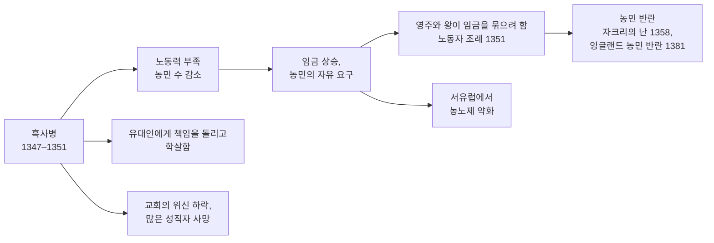

| 결과 | 내용 |
|---|---|
| **노동력 부족 (Labor shortage)** | 일꾼이 너무 많이 죽어서, 살아남은 농민이 **더 높은 임금**과 더 나은 조건을 요구할 수 있었음. 교재는 농노가 영주에 대해 **협상력**을 얻었다는 점을 강조함 |
| **노동 법 (Labor laws)** | 잉글랜드의 **노동자 칙령 (Ordinance of Labourers, 1349)**과 **노동자 조례 (Statute of Labourers, 1351)**는 임금을 흑사병 이전 수준으로 묶으려 했음 |
| **자크리의 난 (Jacquerie, 1358)** | **북프랑스**에서 일어난 격렬한 농민 봉기. 푸아티에 패배 뒤의 전쟁 피해와 무거운 세금이 원인이었음. 귀족들이 몇 주 만에 진압했음 |
| **잉글랜드 농민 반란 (English Peasants' Revolt, 1381)** | **인두세 (Poll tax, 한 사람마다 매기는 세금)**가 계기였음. **와트 타일러 (Wat Tyler)**와 설교자 **존 볼 (John Ball)**이 이끌었음. 반란군은 런던으로 진군해 **리처드 2세 (Richard II)**를 만났음. 반란은 진압되었지만 인두세는 폐지되었음 |
| **농노제의 약화 (Weakening of serfdom)** | **서유럽**에서는 많은 영주가 일꾼을 붙잡아 두려고 노동 의무를 **화폐 지대**로 바꾸거나 농노를 해방했음. 잉글랜드에서는 이후 한 세기 동안 농노제가 사라져 갔음 |
| **종교 (Religion)** | **채찍질 고행단 (Flagellants)**이 신의 자비를 구하며 공개적으로 자기 몸에 채찍질을 했음. 유대인이 **희생양**이 되었음. 많은 사제가 죽었고, 사람들은 교회에 의문을 품었음 |

> **핵심:** 흑사병은 **농업이 사회 조직을 어떻게 형성했는지** 보여 준다. 노동력이 귀해지자 농민의 협상력이 커졌고, 옛 장원 제도가 무너지기 시작했다. (반대로 동유럽에서는 나중에 영주들이 농노제를 **더 강화**했다.)

## §11. 도시, 교역, 변화하는 사회

중세 후기에 지역의 **자급자족**은 점차 유럽의 다른 지역과 먼 항구에서 오는 상품에 대한 관심으로 바뀌었다. 십자군은 이런 변화의 한 부분일 뿐이었다.

### 마르코 폴로

- **13세기 후반**, **베네치아** 출신의 **마르코 폴로 (Marco Polo)**는 **대도 (Dadu, 지금의 베이징)**에 있던 **쿠빌라이 칸 (Kublai Khan)**의 궁정을 방문했다 (2.5 참고).
- 그가 만난 사람들의 풍습에 대한 묘사는 유럽인을 사로잡았다. 그는 몽골인이 **여러 아내를 두고**, **말젖**을 마시고, 집을 데우려고 **"검은 돌"(석탄)**을 태우고, **자주**, 흔히 일주일에 세 번 **목욕한다**고 썼다.
- 아시아에 대한 유럽인의 호기심이 크게 늘었고, 이는 **지도 제작 (Cartography)**에 대한 관심을 자극했다.

### 부르주아와 도시의 성장

- 원거리 상업이 커지면서 서유럽의 **사회 피라미드**가 바뀌었다. **경제적 성공**이 종교적 소명이나 군사 봉사와 겨룰 만한 지위 획득의 길이 되었다.
- 엘리트와 농민 사이에 **중간 계층**이 자라났다. 이들을 **부르주아 (Bourgeoisie)** 또는 **버거 (Burghers)**라고 불렀다.

| 사회 집단 | 속한 사람 | 지위의 바탕 |
|---|---|---|
| **엘리트 (Elite)** | 귀족과 성직자 | 땅, 군사 봉사, 종교 직위 |
| **중간 계층 (부르주아, 버거) (Middle class)** | 상점 주인, 상인, 장인, 작은 땅을 가진 사람 | 교역과 수공업에서의 경제적 성공 |
| **다수의 농민 (Mass of peasants)** | 농노와 자유농 | 장원에서의 농사 노동 |

- **도시의 성장:** 삼포제와 다른 농업 발전으로 인구가 늘었다. **농업 잉여 (Agricultural surplus)** 덕분에 **도시**가 커지고, 축일에만 열리던 **시장**이 더 자주 열리게 되었다.
- **흑사병** 뒤에는 늘어난 노동 수요와 많은 사람의 죽음 때문에 농노가 영주에 대해 더 큰 협상력을 얻었다 (§10).

### 소빙하기

- 약 **1300년** 이후 **소빙하기 (Little Ice Age)**라고 불리는 기후 냉각이 시작되었다. 이 냉각은 약 **다섯 세기** 동안 이어졌다.

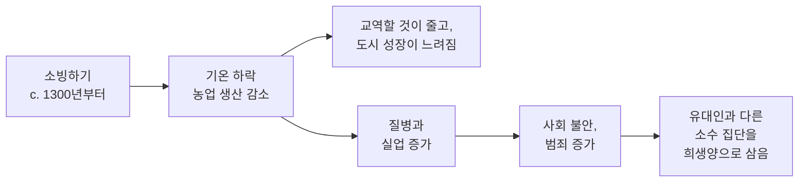

- **희생양 삼기 (Scapegoating)**는 어떤 집단이 어찌할 수 없었던 일의 책임을 그 집단에 돌리는 것이다. 이미 차별을 받던 유대인과 다른 집단이 피해자가 되었다.

> **핵심:** 교역과 도시는 장원 질서를 서서히 느슨하게 하고 새로운 중간 계층을 만들었지만, 기후와 질병은 성장에 한계를 지웠다.

## §12. 르네상스 (교재의 배경 설명)

- CED의 1.6 역사적 개념에는 르네상스가 나오지 않는다. 교재는 교역과 도시 성장의 결과로 르네상스를 여기에서 다룬다. (고대 그리스·로마의 뿌리는 교재의 프롤로그 (Prologue) 참고.)
- **원인:** 교역의 확대, 농업 잉여의 증가, 예술가를 후원할 수 있는 **중간 계층**의 성장이 큰 창조성을 낳았다.
- **정의:** **르네상스 (Renaissance)**는 **고대 그리스와 로마**의 문학, 예술, 문화, 시민적 덕목에 대한 관심이 되살아난 시기였다. 학자들은 수백 년 전에 쓰여 낡아 가던 필사본을 되찾아 연구했다.
- **인쇄기:** **요하네스 구텐베르크 (Johannes Gutenberg)**가 **1439년**에 개발한 활판 인쇄기는 비교적 싼 비용으로 책을 대량 생산할 수 있게 했다. 이로써 **문자 해득률**이 높아지고 **사상**이 빠르게 퍼졌다.
- **인문주의 (Humanism):** **신보다 개인**에 초점을 맞춘 태도(교재의 표현)이다. 인문주의자는 교육과 개혁을 추구했고 **세속**(종교와 관계없는) 문학을 쓰기 시작했다.
- **자국어와 정치:** **자국어 (Vernacular)** 사용이 늘면서 강력한 군주정의 등장, 정부의 중앙집권화, **민족주의 (Nationalism)**의 탄생이 촉진되었다.

| 인물 | 지역 | 작품 | 의의 |
|---|---|---|---|
| **단테 알리기에리 (Dante Alighieri, 1265–1321)** | 이탈리아 (피렌체) | 지옥, 연옥, 천국을 여행하는 ***신곡 (The Divine Comedy)*** | 종교적 틀을 썼지만 **부패한 교회 관리를 대담하게 비판**했고, 라틴어 대신 **이탈리아 자국어**로 썼음 |
| **메디치 가문 (The Medici family)** | 피렌체 | 부유한 후원자 | 자기 돈으로 **화가, 조각가, 건축가**를 후원했음 |
| **제프리 초서 (Geoffrey Chaucer, c. 1343–1400)** | 잉글랜드 | ***캔터베리 이야기 (The Canterbury Tales)*** (1300년대 후반) | 여러 교회 직책을 포함해 중간 계층의 다양한 직업을 그렸음. 사냥을 좋아하는 수도사와 지나치게 감상적인 수녀를 **풍자**했음. **중세 영어 (Middle English)**로 썼음 |
| **요하네스 구텐베르크 (Johannes Gutenberg)** | 독일 (마인츠) | **활판 인쇄기 (Movable-type printing press, 1439)** | 책값을 낮추고 사상이 빠르게 퍼지도록 도왔음 |

- **남부 르네상스:** 이탈리아와 스페인에서는 **교회의 후원**이 메디치 같은 부유한 가문과 함께 르네상스를 뒷받침했다.
- **북부 르네상스:** 교재는 르네상스 정신이 **1400년까지** 북유럽으로 퍼졌다고 쓴다. 일부 예술가는 신앙심을 강조했고, 다른 예술가는 **인간의 관심사**를 강조했다.

> ⚠️ 교재는 초서를 북부 르네상스(1400년까지)에 넣고, 그의 다른 글 가운데 많은 수가 **라틴어**로 쓰였다고 한다. 많은 설명에서는 초서를 **중세 후기**의 작가로 보고, 북부 르네상스를 1400년대 후반–1500년대로 보며, 그의 작품은 거의 모두 **영어**로 쓰였다고 본다. 선생님이 어떻게 가르치는지 확인이 필요하다.

## §13. 러시아의 기원

- 동유럽에서는 **모피, 생선, 곡물**의 활발한 교역이 **스칸디나비아**에서 **지중해**, **중앙아시아**까지 사람들을 이었다.
- 이 교역의 중심에는 **키예프 (Kiev, 지금의 우크라이나 키이우)**를 근거지로 한 **키예프 루스 (Kievan Rus')**가 있었다. 교재는 이를 도시국가라고 부른다.
- 키예프 루스는 **정교회 (Orthodox Christianity)**를 받아들였기 때문에(988, §3) 로마 가톨릭 유럽보다 **비잔티움**과 더 가까운 문화적 관계를 유지했다.
- **13세기**에 **몽골**이 이 지역을 정복했고 (2.2 참고), 그 결과 이 지역은 유럽의 나머지와 더욱 따로 발전했다.
- 몽골은 **현지 귀족에게 세금을 걷게** 했다. 이 귀족들은 부유해지면서 몽골의 지배에 **저항**하기 시작했다.
- **15세기 후반**, **모스크바 (Moscow)**를 근거지로 한 **이반 대제 (Ivan the Great, 이반 3세)** 아래에서 이 지역은 몽골로부터 독립했다(보통 **1480년**으로 본다). 이것이 **근대 러시아 국가의 시작**이었다.

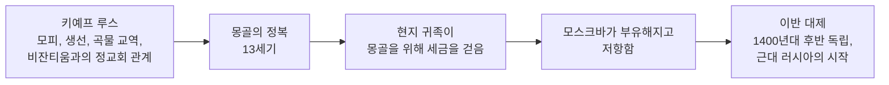

---

## 연표

```mermaid
timeline
    title 유럽 c. 1200-1450
    section 1200년 이전의 배경
        962 : 오토 1세가 신성 로마 황제로 대관
        1054 : 동서 교회 분열
        1066 : 노르만 정복
        1095 : 우르바노 2세가 제1차 십자군을 호소
        1099 : 십자군이 예루살렘 점령
        1122 : 보름스 협약
        1187 : 살라딘이 예루살렘 탈환
    section 1200년대
        1202 : 십자군이 자라를 약탈
        1204 : 제4차 십자군이 콘스탄티노폴리스 약탈
             : 프랑스가 잉글랜드에게서 노르망디를 빼앗음
        1212 : 라스나바스데톨로사 전투
        1215 : 마그나 카르타
             : 제4차 라테라노 공의회
        1265 : 시몽 드 몽포르가 의회를 소집
        1265-1274 : 아퀴나스가 신학대전을 씀
        1275 : 마르코 폴로가 쿠빌라이 칸의 궁정에 도착
        1290 : 잉글랜드가 유대인을 추방
        1291 : 아크레 함락으로 십자군 국가가 끝남
        1295 : 모범 의회
    section 1300년대
        1300 : 이 무렵 소빙하기 시작
        1302 : 프랑스의 첫 삼부회
        1306 : 프랑스가 유대인을 추방
        1315-1317 : 대기근
        1337 : 백년 전쟁 시작
        1347 : 흑사병이 시칠리아에 도착
        1356 : 금인칙서
        1358 : 프랑스의 자크리의 난
        1381 : 잉글랜드 농민 반란
        1387-1400 : 초서가 캔터베리 이야기를 씀
        1394 : 프랑스가 유대인을 다시 추방
    section 1400년대
        1405 : 크리스틴 드 피상이 여인들의 도시를 씀
        1429 : 잔 다르크가 오를레앙 포위를 풂
        1439 : 구텐베르크가 인쇄기를 개발
        1453 : 백년 전쟁 종결
             : 오스만이 콘스탄티노폴리스 점령
        1480 : 이반 대제가 러시아에 대한 몽골 지배를 끝냄
        1492 : 그라나다 함락, 이후 단원의 배경
             : 스페인이 유대인을 추방
        1497 : 포르투갈이 유대인을 추방
```

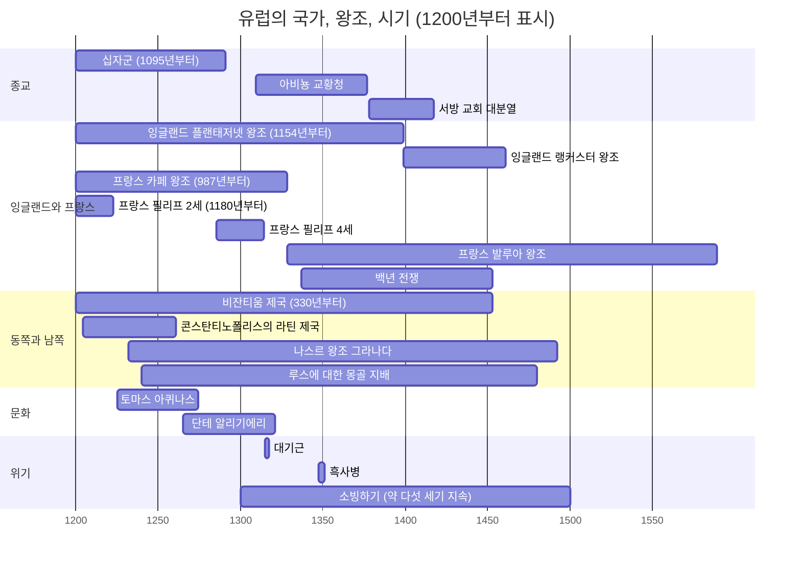

---

## 지도

### 지도: c. 1300년 유럽의 정치 지형

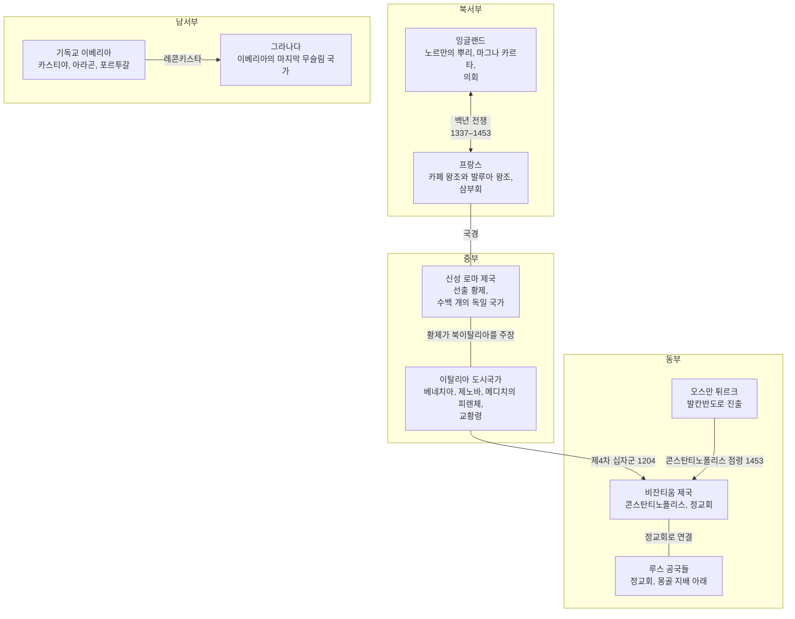

### 지도: 흑사병의 확산

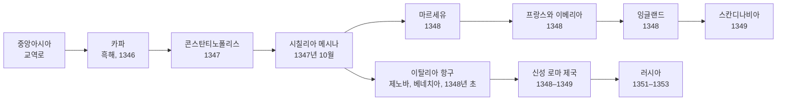

> ⚠️ 확인 필요: 지역별 도착 연도는 자료마다 조금씩 다르고, 교재에는 이 연도가 나오지 않는다. 흑해 → 이탈리아 → 프랑스 → 잉글랜드와 독일 → 스칸디나비아 → 러시아라는 순서는 일반적인 설명이다.

---

## 비교표

### 유럽 봉건제와 일본 봉건제 (1.1과 연결)

| 항목 | 유럽 | 일본 |
|---|---|---|
| 사회의 정점 | 왕 (힘이 약한 경우가 많았음) | **천황 (Emperor)** (상징적 존재). 실권은 **쇼군 (Shogun)**에게 있었음 |
| 땅을 가진 영주 | 영주와 귀족 (봉신) | **다이묘 (Daimyo)** |
| 전사 계층 | **기사 (Knight)** | **사무라이 (Samurai)** |
| 전사의 규범 | **기사도 (Chivalry)** | **무사도 (Bushido)** |
| 관계의 바탕 | 땅(봉토)과 충성·군사 봉사를 맞바꾸는 **계약**. 양쪽 모두 의무가 있었음 | 주군에 대한 개인적 **충성**. 유교 사상의 영향을 받았음 |
| 종교 | **기독교**. 교회는 따로 존재하는 강력한 기관이었음 | **신토 (Shinto)**, **불교 (Buddhism)**, 유교적 가치 |
| 일하는 사람 | **농노**와 자유농 | 영주에게 쌀을 바친 농민 |
| 공통점 | 둘 다 분권적이고 토지에 바탕을 둔 제도였고, 전사 엘리트가 땅이나 수입을 받고 영주를 섬겼음 | (동일) |

> ⚠️ 확인 필요: "무사도"라는 말은 후대에 널리 쓰이게 되었지만, AP 자료는 이 시기 사무라이의 규범을 가리킬 때 이 말을 쓴다.

### 잉글랜드, 프랑스, 신성 로마 제국

| 항목 | 잉글랜드 (England) | 프랑스 (France) | 신성 로마 제국 (Holy Roman Empire) |
|---|---|---|---|
| 기초를 놓은 인물 (교재) | **정복왕 윌리엄** (노르만 정복, 1066) | 처음으로 제대로 된 왕실 관료제를 만든 **필리프 2세** | 962년 황제로 대관한 **오토 1세** |
| 통치자가 권력을 얻은 방식 | 세습 | 세습 | 제후들의 **선출** |
| 통치자에 대한 제한 | **마그나 카르타 (Magna Carta, 1215)**, **의회 (Parliament)** | 강력한 귀족, **삼부회 (Estates-General, 1302)** | 강한 제후, **금인칙서 (Golden Bull, 1356)** |
| 세금 | 귀족이 **군역 면제세**에 대해 의견을 들을 권리를 얻었고, 의회가 뒤에 세금을 승인함 | 성직자와 귀족에게 정기적인 세금이 없어 삼부회가 약했음 | 제후가 자기 땅과 수입을 직접 관리했음 |
| 교황과의 관계 | 성무 금지령 끝에 존 왕이 굴복함 (1213) | 필리프 4세가 보니파시오 8세를 꺾었고, 교황청이 아비뇽으로 옮겨 감 | 황제와 교황의 오랜 대립 (서임권 투쟁, 1122년 보름스 협약) |
| 1450년까지의 흐름 | **중앙집권화**. 의회가 권력을 나눠 가짐 | **중앙집권화**. 백년 전쟁 뒤 강한 왕권 | **분열**. 수백 개의 국가 |

### 로마 가톨릭과 동방 정교회

| 항목 | 로마 가톨릭 (Roman Catholic) | 동방 정교회 (Eastern Orthodox) |
|---|---|---|
| 중심지 | **로마** | **콘스탄티노폴리스** |
| 지도자 | 모든 기독교인에 대한 권위를 주장한 **교황 (Pope)** | **비잔티움 황제**의 강한 영향을 받은 **총대주교 (Patriarch)** |
| 언어 | **라틴어** | **그리스어** (와 슬라브어) |
| 사제 | 결혼하지 않아야 했음 (**독신 (Celibacy)**) | 본당 사제는 결혼할 수 있었음 |
| 성찬 빵 | 누룩 없는 빵 | 누룩 넣은 빵 |
| 교회와 국가 | 교황과 왕은 **서로 다른, 경쟁하는** 권력이었음 | 황제와 교회가 **밀접하게 연결**되었음 |
| 지역 | 서유럽과 중부 유럽 | 비잔티움, 발칸반도, 러시아 |
| 공통점 | 둘 다 기독교로, 성경과 성사를 공유했고 일상생활 전체를 형성했음 | (동일) |

### 남부 르네상스와 북부 르네상스

| 항목 | 남부 르네상스 (Southern Renaissance) | 북부 르네상스 (Northern Renaissance) |
|---|---|---|
| 지역 | **이탈리아**와 **스페인** | 잉글랜드 같은 **북유럽** |
| 시기 (교재) | 단테(1265–1321)의 시대에 먼저 시작됨 | **1400년까지** 북쪽으로 퍼짐 |
| 주된 후원 | **교회의 후원**, 피렌체의 **메디치** 같은 부유한 가문 | 르네상스 정신이 북쪽으로 퍼짐 |
| 대표 작가 | **단테**, *신곡* | **초서**, *캔터베리 이야기* |
| 언어 | **이탈리아** 자국어 | **중세 영어** |
| 초점 | 종교적 틀 안에서 부패한 교회 관리를 비판함 | **인간의 관심사**, 교회 인물을 포함한 사회 풍자 |
| 공통점 | 둘 다 라틴어 대신 자국어를 택했고 교회 인물을 비판했음 | (동일) |

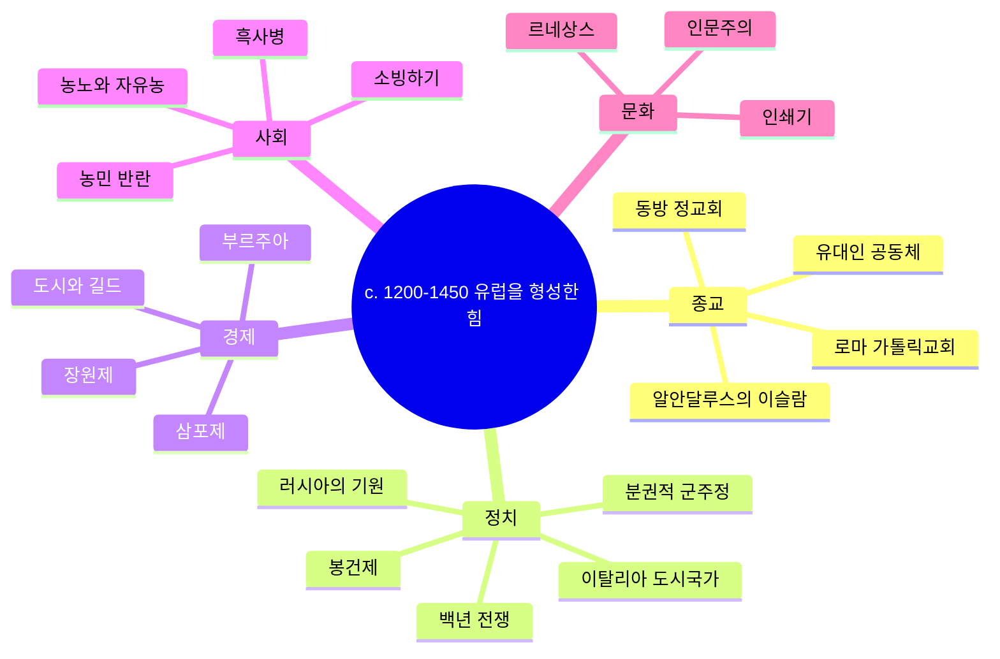

---

## Key Terms (핵심 용어)

| 주제 | 용어 | 정의 |
|---|---|---|
| 문화 | 로마 가톨릭교회 (Roman Catholic Church) | 로마의 교황이 이끈 기독교 교회. 서유럽을 하나로 묶은 중심 기관 |
| 문화 | 성사 (Sacraments) | 세례, 성체처럼 구원에 꼭 필요하다고 여긴 일곱 가지 거룩한 의식 |
| 문화 | 십일조 (Tithe) | 수입이나 수확의 10분의 1을 교회에 내는 것 |
| 문화 | 파문 (Excommunication) | 한 사람을 교회와 성사에서 끊어 내는 것 |
| 문화 | 수도원 (Monastery) | 종교 규칙에 따라 사는 수도사들의 공동체. 학문을 지켰음 |
| 문화 | 스콜라 철학 (Scholasticism) | 이성과 논리로 기독교 신앙을 설명한 학문 방법 |
| 문화 | 피에르 아벨라르 (Peter Abelard) | 아리스토텔레스를 공부하고 때로 교회를 비판했지만 신앙을 지킨 12세기 학자 |
| 문화 | 토마스 아퀴나스 (Thomas Aquinas) | 신앙과 이성을 결합한 *신학대전*을 쓴 도미니코회 학자 (1225–1274) |
| 문화 | 동서 교회 분열 (East-West Schism) | 1054년 로마 가톨릭과 동방 정교회가 갈라진 사건 |
| 문화 | 대분열 (Great Schism) | 교재가 1054년 동서 교회 분열을 부르는 이름 (1378–1417년 서방 교회 대분열과 다름) |
| 문화 | 동방 정교회 (Eastern Orthodox Church) | 콘스탄티노폴리스 총대주교가 이끈 비잔티움 제국의 기독교 교회 |
| 문화 | 서임권 투쟁 (Lay investiture controversy) | 세속 통치자와 교황 가운데 누가 주교에게 직위의 상징을 줄 수 있는지를 두고 11–12세기에 벌어진 다툼 |
| 문화 | 성지 (Holy Land) | 유대인, 기독교인, 무슬림 모두에게 거룩한 장소가 있는 팔레스타인 지역 |
| 문화 | 십자군 (Crusades) | 교황이 성지를 무슬림 지배에서 되찾으려고 일으킨 종교 전쟁 (1095–1291) |
| 문화 | 레콘키스타 (Reconquista) | 이베리아를 무슬림 지배에서 되찾으려 한 기독교 세력의 전쟁. 1492년에 끝남 |
| 문화 | 알안달루스 (al-Andalus) | 무슬림이 다스린 이베리아. 학문의 중심지 |
| 문화 | 자국어 (Vernacular) | 한 지역 사람들이 일상에서 쓰는 언어. 라틴어를 대신하기 시작했음 |
| 문화 | 마르코 폴로 (Marco Polo) | 13세기 후반 쿠빌라이 칸의 궁정을 방문한 베네치아 사람. 그의 묘사는 아시아에 대한 유럽인의 호기심을 불러일으켰음 |
| 문화 | 르네상스 (Renaissance) | 고대 그리스·로마의 문학, 예술, 문화, 시민적 덕목에 대한 관심이 되살아난 시기 |
| 문화 | 인문주의 (Humanism) | 개인과 인간의 관심사에 초점을 맞추고 교육, 개혁, 세속 문학을 추구한 르네상스의 태도 |
| 문화 | 단테 알리기에리 (Dante Alighieri) | 이탈리아 자국어로 *신곡*을 쓴 이탈리아 작가 (1265–1321) |
| 문화 | 제프리 초서 (Geoffrey Chaucer) | 중세 영어로 *캔터베리 이야기*(1300년대 후반)를 쓴 잉글랜드 작가 |
| 사회 | 고리대금 (Usury) | 이자를 받고 돈을 빌려주는 것. 기독교인 사이에서는 금지되어 많은 유대인이 대금업자가 되었음 |
| 사회 | 반유대주의 (Antisemitism) | 중세 기독교인 사이에 널리 퍼진 유대인에 대한 적대감이나 편견 |
| 사회 | 희생양 삼기 (Scapegoating) | 어떤 집단이 어찌할 수 없었던 일의 책임을 그 집단에 돌리는 것 |
| 정치 | 봉건제 (Feudalism) | 영주가 충성과 군사 봉사의 대가로 봉신에게 땅을 준 정치·군사 제도 |
| 정치 | 봉신 (Vassal) | 영주에게서 땅을 받고 충성을 맹세한 사람 |
| 정치 | 봉토 (Fief) | 영주가 봉신에게 준 땅 |
| 정치 | 기사 (Knight) | 영주를 섬기고 기사도를 따른, 갑옷 입은 기마 전사 |
| 정치 | 기사도 (Chivalry) | 명예, 예의, 용기를 중시한 기사의 불문 행동 규범 |
| 정치 | 분권적 군주정 (Decentralized monarchy) | 왕이 귀족, 교회, 도시와 실제 권력을 나눠 가진 왕국 |
| 정치 | 정복왕 윌리엄 (William the Conqueror) | 1066년 잉글랜드를 정복하고 잘 조직된 봉건 제도를 운영한 노르망디 공작 |
| 정치 | 마그나 카르타 (Magna Carta) | 왕을 법 아래 둔 1215년 잉글랜드의 문서 |
| 정치 | 군역 면제세 (Scutage) | 기사가 군사 봉사 대신 낸 돈. 귀족들은 이에 대해 의견을 들을 권리를 얻었음 |
| 정치 | 의회 (Parliament) | 귀족, 성직자, 기사, 도시민이 모인 잉글랜드의 회의. 세금에 대한 권한을 얻었음 |
| 정치 | 신분 (Estates) | 프랑스의 세 법적 계급. 성직자, 귀족, 평민 |
| 정치 | 삼부회 (Estates-General) | 1302년 처음 소집된 프랑스 세 신분의 회의 |
| 정치 | 신성 로마 제국 (Holy Roman Empire) | 선출된 황제 아래 수백 개의 독일·북이탈리아 국가가 느슨하게 묶인 나라 |
| 정치 | 오토 1세 (Otto I) | 962년 신성 로마 황제로 대관한 독일 왕 |
| 정치 | 보름스 협약 (Concordat of Worms) | 서임권 투쟁을 끝낸 1122년의 합의 |
| 정치 | 금인칙서 (Golden Bull) | 일곱 선제후가 신성 로마 황제를 뽑도록 정한 1356년의 칙령 |
| 정치 | 이탈리아 도시국가 (Italian city-states) | 베네치아, 제노바, 피렌체처럼 스스로 다스린 교역 도시 |
| 정치 | 백년 전쟁 (Hundred Years' War) | 잉글랜드와 프랑스 사이의 전쟁(1337–1453). 두 나라의 왕권을 모두 강화했음 |
| 정치 | 키예프 루스 (Kievan Rus') | 키예프를 중심으로 한 정교회 교역 국가. 13세기에 몽골에 정복되었음 |
| 정치 | 이반 대제 (Ivan the Great) | 15세기 후반 몽골 지배를 끝내고 근대 러시아 국가를 시작한 모스크바의 통치자 |
| 경제 | 장원제 (Manorialism) | 농노가 일하는 자급자족 영지(장원)를 바탕으로 한 경제 제도. 교재는 장원 제도 (Manorial system)라고 부름 |
| 경제 | 장원 (Manor) | 마을, 경작지, 방앗간, 교회를 포함한 영주의 영지 |
| 경제 | 길드 (Guild) | 도시에서 한 업종을 관리한 상인이나 장인의 조합 |
| 경제 | 부르주아 (Bourgeoisie, 버거 Burghers) | 상점 주인, 상인, 장인, 작은 땅을 가진 사람으로 이루어진, 커져 가는 중간 계층 |
| 경제 | 지도 제작 (Cartography) | 아시아에 대한 유럽인의 호기심이 커지면서 발전한 지도 만들기 |
| 사회 | 장자 상속제 (Primogeniture) | 맏아들이 재산 전체를 물려받는 규칙 |
| 사회 | 농노 (Serf) | 법적으로 땅에 묶여 영주에게 노동과 공납의 의무를 진 농민 |
| 사회 | 자유농 (Free peasant) | 땅을 빌리거나 소유했고, 이동할 수 있었던 농민 |
| 사회 | 흑사병 (Black Death) | 1347–1351년 유럽을 덮쳐 인구의 약 3분의 1을 죽인 선페스트 대유행 |
| 사회 | 자크리의 난 (Jacquerie) | 1358년 북프랑스에서 일어난 농민 반란 |
| 사회 | 잉글랜드 농민 반란 (English Peasants' Revolt) | 와트 타일러와 존 볼이 이끈, 인두세와 노동법에 맞선 1381년의 봉기 |
| 사회 | 노동자 조례 (Statute of Labourers) | 흑사병 뒤 임금을 묶으려 한 1351년 잉글랜드의 법 |
| 기술 | 무거운 쟁기 (Heavy plow) | 북유럽의 무거운 흙을 갈 수 있었던, 바퀴 달린 쇠날 쟁기 |
| 기술 | 삼포제 (Three-field system) | 세 개의 밭(가을 작물, 봄 작물, 휴경)을 돌려 쓰는 윤작법 |
| 기술 | 장궁 (Longbow) | 길이가 약 6피트로, 백년 전쟁에서 승리를 이끈 잉글랜드의 강력한 활 |
| 기술 | 인쇄기 (Printing press) | 책값을 낮추고 사상을 빠르게 퍼뜨린 구텐베르크의 활판 인쇄기 (1439) |
| 환경 | 소빙하기 (Little Ice Age) | 약 1300년부터 약 다섯 세기 동안 이어지며 수확을 줄인 기후 냉각 |
