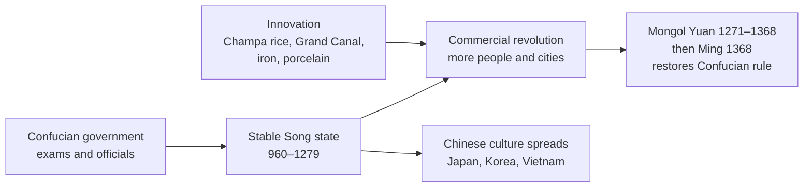

# AP World History: Modern — Topic 1.1 Summary: East Asia (c. 1200–1450)

> Source: Summary of AP_WH_1.1_Notes_EN.md (College Board CED · textbook incorporated, Topic 1.1 reading)

**Unit 1: The Global Tapestry (c. 1200–1450)**

---

## In One Sentence

Song China kept old Confucian ways of ruling (**continuity**), grew rich through new farming and trade ideas (**innovation**), and spread its culture to Japan, Korea, and Vietnam, which each changed it in their own way (**diversity**).

## The Big Picture

The **Song Dynasty** (960–1279) was the richest and most populous state in the world in the 1200s. It ruled with **Confucian** ideas and a large group of trained officials. New crops, canals, and industries made its economy grow fast. Chinese ideas and **Buddhism** spread to China's neighbors, who borrowed them but adapted them. The **Mongols** conquered the Song, and later the **Ming** brought back Confucian rule.

## Key Points

### 1. How the Song Ruled (LO-A)

- The emperor claimed the **Mandate of Heaven**: Heaven gave him the right to rule, but could take it away if he ruled badly.
- Confucian ideas said the ruler should be **benevolent** (kind, like a good father), and subjects should show **respect and obedience**.
- An **imperial bureaucracy** (a large system of appointed, paid officials) ran taxes, law, and local government. This system was a **continuity** from earlier dynasties.
- Officials were chosen by **civil service examinations** on the Confucian classics. The Song greatly expanded the exams, so office depended more on **merit** (ability) than on birth.
- In practice, rich families had an advantage, because study took years. **Women could not take the exams.**

### 2. Confucian Traditions and Society (LO-B)

- **Filial piety** means children must obey, respect, and care for their parents and ancestors.
- **Neo-Confucianism** was a Song revival of Confucianism. Its great thinker was **Zhu Xi**. It borrowed some ideas from Buddhism and Daoism and stressed **ethics** (right behavior).
- A new class, the **scholar-gentry** (educated men who passed the exams), became the most powerful group in society. Merchants had low status.
- Confucian tradition both **respected women** and expected them to **defer to** (obey) men. This **patriarchy** grew stronger under the Tang and Song.
- **Foot binding**, the tight wrapping of girls' feet, became common among elite Song families. It limited women's movement and work outside the home.

> ⚠️ The textbook says Neo-Confucianism evolved between 770 and 840. Many accounts trace its roots to Tang thinkers but say it took its full form under the Song, with Zhu Xi at its center. Check how your teacher presents this.

> ⚠️ The textbook says only that foot binding became common among aristocratic families during the Song. Many accounts say its exact origin is uncertain, and that it spread to ordinary families only in later centuries. Check how your teacher presents this.

### 3. Buddhism and Its Branches (LO-B)

- All branches share the **Four Noble Truths** and the **Eightfold Path**, which lead to **nirvana** (release from suffering and rebirth).
- **Theravada** focused on personal growth through silent meditation. It was strongest in **Sri Lanka and Southeast Asia**.
- **Mahayana** focused on helping **all beings**. **Bodhisattvas** delay their own nirvana to help others. It was strongest in **China, Korea, Japan, and Vietnam**.
- **Tibetan** Buddhism focused on **chanting** and honored teachers called lamas. It was strong in Tibet and Mongolia, and the Yuan court supported it.
- In China, Buddhism mixed with Daoism (**Chan**, called **Zen** in Japan). Confucian critics called it foreign.

### 4. Chinese Influence on Neighbors (LO-B)

- Neighbors faced **sinification**, the taking-in of Chinese traditions. Each one **borrowed** from China but **adapted** what it took.
- **Japan (Heian period):** copied Chinese characters, Buddhism, and court ranks, but created its own **kana** script, kept Shinto, and gave office by birth, not exams. Later a **shogun** (military ruler) and his samurai held real power.
- **Korea:** shares a land border with China and copied it most closely. **Goryeo** adopted exams in 958, but aristocrats still ruled. **Joseon** (1392) made Neo-Confucianism its official ideology.
- **Vietnam (Đại Việt):** copied the bureaucracy and held exams from 1075, but **fought hard against Chinese rule**, kept its own language, and gave **women more rights**.
- Under the **tributary system**, neighbors sent gifts to honor the Chinese emperor and got trade and recognition in return.

### 5. The Song Economy: Innovation (LO-C)

- **Champa rice**, a fast-ripening rice from Vietnam, allowed two harvests a year in some areas. The **population roughly doubled**.
- The **Grand Canal**, improved by the Song, linked the Yangzi and Yellow rivers and moved rice cheaply from south to north.
- **Iron and steel** output rose sharply, using coal. China had the world's greatest manufacturing capability.
- **Silk and porcelain** were exported, especially by sea. **Paper money** made big trades easier.
- The economy became **commercialized** (more production for the market), but it still rested on **free peasants** and **artisans** (skilled craftworkers), not serfs.

### 6. Change Over Time: Yuan and Ming (LO-A)

- The Mongols conquered the Southern Song in 1279. **Kublai Khan** had declared the **Yuan Dynasty** in 1271.
- The Yuan kept the bureaucracy and claimed the Mandate of Heaven, but put **Mongols above Chinese** and **suspended the exams** until 1315.
- Inflation, floods, disease, and rebellion weakened the Yuan.
- The **Ming** (1368) **restored** the Confucian exams and bureaucracy, a return to **continuity**.

## Must-Know Terms & People

| Term | What it is | Why it matters |
|---|---|---|
| Mandate of Heaven | Belief that Heaven gives a good ruler the right to rule | How Chinese emperors justified power |
| Imperial bureaucracy | Appointed, paid officials who governed for the emperor | A continuity in Chinese government; expanded under the Song |
| Civil service examinations | Tests on the Confucian classics used to choose officials | Made merit the main route into government |
| Scholar-gentry | Educated men who passed the exams and served as officials | New ruling class loyal to the Confucian state |
| Neo-Confucianism | Song revival of Confucianism that borrowed from Buddhism and Daoism | Shaped China, Korea, Vietnam, and Japan |
| Zhu Xi | Greatest Neo-Confucian thinker | His writings became the basis of the exams from 1313 |
| Filial piety | Duty of children to respect and obey parents and ancestors | Core Confucian value across East Asia |
| Sinification | Neighbors taking in Chinese traditions | Explains Chinese influence on Japan, Korea, Vietnam |
| Mahayana / Theravada / Tibetan | The three main branches of Buddhism | Shows diversity in Asian Buddhism |
| Champa rice | Fast-ripening, drought-resistant rice | More food, so the population grew |
| Grand Canal | Waterway linking the Yangzi and Yellow rivers | Tied China's economy together |
| Kublai Khan | Mongol ruler who founded the Yuan Dynasty | Foreign rule changed, but kept, Chinese government |

## Key Dates

| Year | Event |
|---|---|
| 960 | Song Dynasty founded, capital at Kaifeng |
| 1012 | Song government gives out Champa rice seed |
| 1127 | Jurchen take Kaifeng; Song court flees south |
| 1271 | Kublai Khan declares the Yuan Dynasty |
| 1279 | Southern Song falls to the Mongols |
| 1315 | Yuan restores the civil service exams |
| 1368 | Ming Dynasty founded |
| 1392 | Joseon Dynasty founded in Korea |

## How the Exam Asks About It

- **Legitimacy & consolidation:** The Song justified rule with the Mandate of Heaven and Confucian virtue, and kept power through exam-chosen officials who were loyal to the state.
- **Continuity, innovation, diversity:** Continuity: the imperial bureaucracy. Innovation: Champa rice and paper money. Diversity: Japan, Korea, and Vietnam each adapted Chinese ways differently.
- **Likely comparison:** Korea vs. Japan. Both took Chinese characters, Buddhism, and Confucian ideas. But Korea adopted civil service exams, while in Japan office depended on birth.
- **Common trap:** Students say the Song economy ran on serfs. The fix: it was commercialized but still rested on **free peasants and artisans**.

## Check Yourself

1. How did Song emperors justify their rule?

▶ Answer
They claimed the Mandate of Heaven and promised to rule with Confucian virtue, like a kind father. Officials chosen by Confucian exams carried out their rule.

2. Name two Song innovations and one effect of each.

▶ Answer
Champa rice allowed more harvests, so the population grew. The Grand Canal moved rice and goods cheaply from south to north, which tied the economy together.

3. How did Mahayana Buddhism differ from Theravada Buddhism?

▶ Answer
Mahayana focused on helping all beings, with bodhisattvas, and was strongest in China, Korea, Japan, and Vietnam. Theravada focused on personal growth through silent meditation and was strongest in Sri Lanka and Southeast Asia.

