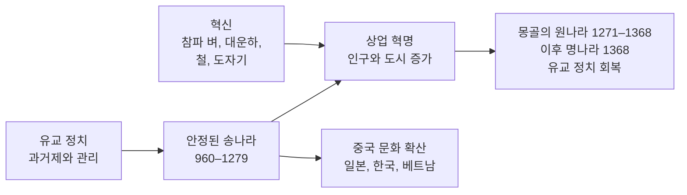

# AP 세계사: 모던 — 토픽 1.1 요약: 동아시아의 발전 (Developments in East Asia)

> 출처: AP_WH_1.1_Notes_KR.md 요약 (College Board CED 기준 · 교재 반영, 교재 Topic 1.1)

**Unit 1: 세계의 태피스트리 (The Global Tapestry, c. 1200–1450)**

---

## 한 문장 요약

송나라 (Song Dynasty) 중국은 옛 유교식 통치를 이어 갔고(**연속성**), 새로운 농업과 교역 방식으로 부유해졌으며(**혁신**), 그 문화가 일본, 한국, 베트남으로 퍼져 각 나라가 자기 방식으로 바꾸어 받아들였다(**다양성**).

## 큰 그림

**송나라** (Song Dynasty, 960–1279)는 1200년대에 세계에서 가장 부유하고 인구가 많은 나라였다. 송은 **유교 (Confucianism)** 사상과 훈련받은 많은 관리로 나라를 다스렸다. 새 작물, 운하, 산업 덕분에 경제가 빠르게 성장했다. 중국의 사상과 **불교** (Buddhism)는 주변 나라로 퍼졌고, 주변 나라는 이를 빌려 오되 자기 방식으로 바꾸었다. **몽골** (Mongols)이 송을 정복했고, 뒤에 **명나라** (Ming Dynasty)가 유교 정치를 되살렸다.

## 핵심 정리

### 1. 송은 어떻게 다스렸는가 (LO-A)

- 황제는 **천명** (Mandate of Heaven)을 내세웠다. 하늘이 황제에게 통치권을 주었고, 잘못 다스리면 거둘 수도 있다는 믿음이다.
- 유교 사상에 따르면 통치자는 좋은 아버지처럼 **자애로워야** 했고, 백성은 **존경하고 복종**해야 했다.
- **황제 관료제 (Imperial bureaucracy)**, 곧 황제가 임명하고 봉급을 준 관리들의 큰 조직이 세금, 법, 지방 행정을 맡았다. 이 제도는 이전 왕조에서 이어진 **연속성**이었다.
- 관리는 유교 경전으로 치르는 **과거제** (Civil service examinations)로 뽑았다. 송은 과거를 크게 넓혀서, 관직이 출신보다 **능력** (Merit)에 더 많이 달려 있게 되었다.
- 실제로는 공부에 여러 해가 걸려 부유한 집안이 유리했다. **여성은 시험을 볼 수 없었다.**

### 2. 유교 전통과 사회 (LO-B)

- **효** (Filial piety)는 자식이 부모와 조상에게 복종하고, 존경하고, 보살펴야 한다는 뜻이다.
- **성리학** (Neo-Confucianism)은 송나라 때 유교를 되살린 사상이다. 가장 위대한 학자는 **주희** (Zhu Xi)였다. 불교와 도교 (Daoism)의 사상을 일부 빌려 왔고, **윤리**(바른 행동)를 강조했다.
- 과거에 합격한 교육받은 남성인 **사대부** (Scholar-gentry)라는 새 계층이 사회에서 가장 힘 있는 집단이 되었다. 상인은 지위가 낮았다.
- 유교 전통은 **여성을 존중**하면서도 여성이 남성을 **따르기** (Defer)를 기대했다. 이런 **가부장제** (Patriarchy)는 당과 송 시대에 더 강해졌다.
- 여자아이의 발을 꽁꽁 묶는 **전족** (Foot binding)이 송의 상류층 집안에서 흔해졌다. 전족은 여성의 이동과 집 밖 노동을 제한했다.

> ⚠️ 교재는 성리학이 770년에서 840년 사이에 발전했다고 쓴다. 많은 설명에서는 성리학의 뿌리를 당나라 학자에게서 찾지만, 주희를 중심으로 완성된 것은 송나라 때라고 본다. 선생님이 어떻게 가르치는지 확인이 필요하다.

> ⚠️ 교재는 송나라 때 귀족 집안에서 전족이 흔해졌다고만 쓴다. 많은 설명에서는 전족의 정확한 기원이 분명하지 않고, 일반 가정에 퍼진 것은 그 뒤의 일이라고 본다. 선생님이 어떻게 가르치는지 확인이 필요하다.

### 3. 불교와 그 종파 (LO-B)

- 모든 종파는 **사성제** (Four Noble Truths)와 **팔정도** (Eightfold Path)를 공유한다. 이 가르침은 고통과 윤회에서 벗어나는 **열반** (Nirvana)으로 이끈다.
- **상좌부** (Theravada)는 고요한 명상을 통한 개인의 성장에 초점을 두었다. **스리랑카와 동남아시아**에서 가장 강했다.
- **대승** (Mahayana)은 **모든 존재**를 돕는 데 초점을 두었다. **보살** (Bodhisattva)은 다른 사람을 돕기 위해 자기 열반을 미룬다. **중국, 한국, 일본, 베트남**에서 가장 강했다.
- **티베트 불교** (Tibetan)는 **염송** (Chanting)에 초점을 두었고 라마 (Lama)라는 스승을 받들었다. 티베트와 몽골에서 강했고, 원나라 조정이 후원했다.
- 중국에서 불교는 도교와 섞였다(**선종 (Chan)**, 일본에서는 **Zen**). 유학자들은 불교를 외래 종교라고 비판했다.

### 4. 주변 나라에 끼친 중국의 영향 (LO-B)

- 주변 나라는 중국의 전통을 받아들이는 **중국화 (Sinification)** 문제를 겪었다. 각 나라는 중국에서 **빌려 왔지만** 받아들인 것을 **변형했다.**
- **일본 (헤이안 시대 Heian period):** 한자, 불교, 관등 제도를 본떴지만, 고유 문자 **가나** (Kana)를 만들고 신토 (Shinto)를 지켰으며, 관직은 과거가 아니라 출신으로 정했다. 뒤에는 **쇼군 (Shogun)**(군사 지도자)과 그의 사무라이 (Samurai)가 실권을 쥐었다.
- **한국:** 중국과 국경이 맞닿아 있었고 중국을 가장 가깝게 따랐다. **고려** (Goryeo)는 958년 과거를 도입했지만 여전히 귀족이 정치를 장악했다. **조선** (Joseon, 1392)은 성리학을 공식 이념으로 삼았다.
- **베트남 (대월 Đại Việt):** 관료제를 본뜨고 1075년부터 과거를 치렀지만, **중국의 지배에 강하게 맞섰고**, 고유 언어를 지켰으며, **여성에게 더 많은 권리**를 주었다.
- **조공 체제 (Tributary system)** 아래에서 주변 나라는 중국 황제를 기리는 선물을 바치고, 그 대가로 교역 기회와 승인을 얻었다.

### 5. 송의 경제: 혁신 (LO-C)

- 베트남에서 들여온 빨리 익는 벼인 **참파 벼 (Champa rice)** 덕분에 일부 지역에서는 1년에 두 번 수확했다. **인구가 약 두 배로 늘었다.**
- 송이 개량한 **대운하** (Grand Canal)는 양쯔강과 황허강을 이어, 남쪽의 쌀을 북쪽으로 싸게 옮겼다.
- 석탄을 때서 **철과 강철 (Iron and steel)** 생산이 급증했다. 중국은 세계 최대의 제조 능력을 갖추었다.
- **비단과 도자기**는 주로 바닷길로 수출되었다. **지폐** (Paper money)는 큰 거래를 쉽게 만들었다.
- 경제는 **상업화 (Commercialization)**(시장을 위한 생산의 증가)되었지만, 여전히 농노가 아니라 **자유 농민** (Free peasants)과 **장인 (Artisans)**(숙련 기술자)의 노동에 기댔다.

### 6. 시대에 따른 변화: 원과 명 (LO-A)

- 몽골은 1279년 남송을 정복했다. **쿠빌라이 칸** (Kublai Khan)은 1271년에 이미 **원나라** (Yuan Dynasty)를 선포했다.
- 원나라는 관료제를 유지하고 천명을 내세웠지만, **몽골인을 중국인보다 높은 신분에 두었고**, 1315년까지 **과거를 중단했다.**
- 인플레이션, 홍수, 전염병, 반란이 원나라를 약하게 만들었다.
- **명나라** (1368)는 유교식 과거와 관료제를 **되살렸다.** 이는 **연속성**으로의 복귀였다.

## 꼭 알아야 할 용어·인물

| 용어 | 무엇인가 | 왜 중요한가 |
|---|---|---|
| 천명 (Mandate of Heaven) | 하늘이 좋은 통치자에게 통치권을 준다는 믿음 | 중국 황제가 권력을 정당화한 방법 |
| 황제 관료제 (Imperial bureaucracy) | 황제를 대신해 다스린, 임명되고 봉급을 받은 관리들 | 중국 정치의 연속성. 송 때 확대됨 |
| 과거제 (Civil service examinations) | 관리를 뽑기 위해 유교 경전으로 치른 시험 | 능력을 관직에 오르는 주된 길로 만듦 |
| 사대부 (Scholar-gentry) | 과거에 합격해 관리가 된 교육받은 남성들 | 유교 국가에 충성한 새 지배층 |
| 성리학 (Neo-Confucianism) | 불교와 도교에서 사상을 빌려 온 송나라의 유교 부흥 사상 | 중국, 한국, 베트남, 일본에 영향을 줌 |
| 주희 (Zhu Xi) | 가장 위대한 성리학자 | 그의 저술이 1313년부터 과거의 기준이 됨 |
| 효 (Filial piety) | 자식이 부모와 조상을 존경하고 따라야 하는 의무 | 동아시아 전역의 핵심 유교 가치 |
| 중국화 (Sinification) | 주변 나라가 중국의 전통을 받아들이는 것 | 일본, 한국, 베트남에 끼친 중국의 영향을 설명함 |
| 대승 / 상좌부 / 티베트 불교 (Mahayana / Theravada / Tibetan) | 불교의 세 주요 종파 | 아시아 불교의 다양성을 보여 줌 |
| 참파 벼 (Champa rice) | 빨리 익고 가뭄에 강한 벼 | 식량이 늘어 인구가 증가함 |
| 대운하 (Grand Canal) | 양쯔강과 황허강을 이은 수로 | 중국 경제를 하나로 묶음 |
| 쿠빌라이 칸 (Kublai Khan) | 원나라를 세운 몽골 통치자 | 외래 지배가 중국 정치를 바꾸었지만 그 틀은 유지함 |

## 주요 연도

| 연도 | 사건 |
|---|---|
| 960 | 카이펑 (Kaifeng)을 수도로 송나라 건국 |
| 1012 | 송 정부가 참파 볍씨를 나눠 줌 |
| 1127 | 여진 (Jurchen)이 카이펑을 함락함. 송 조정이 남쪽으로 피신함 |
| 1271 | 쿠빌라이 칸이 원나라를 선포함 |
| 1279 | 남송이 몽골에게 무너짐 |
| 1315 | 원나라가 과거를 되살림 |
| 1368 | 명나라 건국 |
| 1392 | 한국에서 조선 건국 |

## 시험에서는 이렇게 묻는다

- **정당화와 공고화:** 송은 천명과 유교적 덕으로 통치를 정당화했고, 국가에 충성하는 과거 출신 관리들을 통해 권력을 지켰다.
- **연속성·혁신·다양성:** 연속성은 황제 관료제이다. 혁신은 참파 벼와 지폐이다. 다양성은 일본, 한국, 베트남이 중국의 방식을 저마다 다르게 변형한 것이다.
- **자주 나오는 비교:** 한국과 일본. 두 나라 모두 한자, 불교, 유교 사상을 받아들였다. 그러나 한국은 과거제를 도입했고, 일본에서는 출신이 관직을 결정했다.
- **자주 하는 실수:** 송의 경제가 농노 (Serf)의 노동으로 돌아갔다고 쓰는 것이다. 바로잡기: 송의 경제는 상업화되었지만 여전히 **자유 농민과 장인**에게 기댔다.

## 스스로 확인하기

1. 송나라 황제들은 통치를 어떻게 정당화했는가?

▶ 정답
천명을 내세우고, 자애로운 아버지처럼 유교적 덕으로 다스리겠다고 했다. 유교 시험으로 뽑힌 관리들이 그 통치를 실행했다.

2. 송나라의 혁신 두 가지와 각각의 결과를 하나씩 쓰라.

▶ 정답
참파 벼 덕분에 수확이 늘어 인구가 증가했다. 대운하는 쌀과 상품을 남쪽에서 북쪽으로 싸게 옮겨 경제를 하나로 묶었다.

3. 대승 불교는 상좌부 불교와 어떻게 달랐는가?

▶ 정답
대승은 보살을 통해 모든 존재를 돕는 데 초점을 두었고, 중국, 한국, 일본, 베트남에서 가장 강했다. 상좌부는 고요한 명상을 통한 개인의 성장에 초점을 두었고, 스리랑카와 동남아시아에서 가장 강했다.

