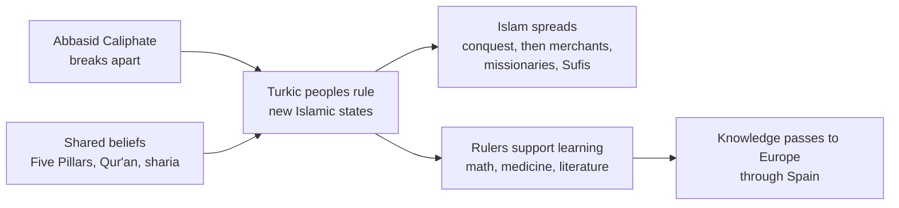

# AP World History: Modern — Topic 1.2 Summary: Dar al-Islam (c. 1200–1450)

> Source: Summary of AP_WH_1.2_Notes_EN.md (College Board CED · textbook incorporated, Topic 1.2 reading)

**Unit 1: The Global Tapestry (c. 1200–1450)**

---

## In One Sentence

As the Abbasid Caliphate broke apart, Turkic peoples built new Islamic states, while shared beliefs such as the Five Pillars, the Qur'an, and sharia held Dar al-Islam together, shaped daily life, and supported learning that later reached Europe.

## The Big Picture

**Dar al-Islam** ("the house of Islam") means the lands where Muslim rulers governed and Islamic law shaped daily life. By 1200 it reached from Spain to northern India, but it was no longer one state. The **Abbasid Caliphate** had split into many states, and **Turkic** rulers such as the Seljuks, the Mamluks, and the Delhi sultans held real power. Islam kept spreading, first through conquest and then through merchants, missionaries, and Sufis. Muslim rulers also supported scholars, and their knowledge later passed to Christian Europe.

---

## Key Points

### 1. Shared Beliefs Held Dar al-Islam Together

- After 1200, Dar al-Islam was **one cultural region**, not one empire.
- The **Qur'an** is the holy book of Islam. It was the base of law, worship, and education.
- The **Five Pillars** are five core practices: declaring faith, prayer, charity, fasting, and the **hajj** (pilgrimage to Mecca).
- **Sharia** is Islamic law. It gave Muslim lands a **common legal culture**, which helped trade.
- The **ulama** (scholars of religion and law) taught in schools and gave rulers **religious approval**.

### 2. Beliefs Shaped Society

- **Sufism** is the **mystical** side of Islam. Mystical means seeking a personal, emotional closeness to God.
- Jews and Christians were **dhimmi** ("protected people"). They could keep their religion but paid a special tax, the **jizya**.
- Over time, the jizya and social advantages led many people to **convert slowly** to Islam.
- Islamic law gave women real **rights**: they could inherit and own property and had to agree to marriage.
- But society stayed **patriarchal** (men held more power). Men could have up to four wives, and a woman's word in court counted half.

### 3. The Abbasid Caliphate Broke Apart

- The **Abbasid Caliphate** (750–1258) ruled from **Baghdad**. By 1200 the caliph ruled little beyond the city.
- Causes: the empire was **too big**, governors became independent, and **rival caliphates** arose in Córdoba and Cairo.
- Caliphs relied on **Turkic slave-soldiers**, who took real power. Trade also **moved north**, and Baghdad grew poor.
- In **1055** the **Seljuk Turks** entered Baghdad. Their leader became **sultan** (the ruler with political and military power), and the caliph kept only religious authority.
- In **1258** the **Mongols** sacked Baghdad and killed the last Abbasid caliph. Islamic civilization survived.

### 4. New Turkic Islamic States

- **Seljuks:** Turkic rulers used **Persian officials**. Soldiers got **iqta**, the right to collect land revenue, in return for service.
- **Mamluks** (slave-soldiers) seized power in **Egypt in 1250**. They **defeated the Mongols at Ain Jalut (1260)**.
- The Mamluks brought an Abbasid survivor to Cairo as a **"shadow caliph"** to make their rule look rightful.
- **Delhi Sultanate (1206–1526):** a **Muslim minority ruled a Hindu majority** in northern India. Most Hindus did not convert.
- These states show **continuity** (they kept sharia and Abbasid ways), **innovation** (new kinds of rulers), and **diversity** (many peoples and faiths).

### 5. How Islam Spread

- **Step 1:** Muslim **rule** spread through **military conquest**, for example by the Seljuks in Anatolia and the Delhi Sultanate in India.
- **Step 2:** the **religion** then spread peacefully through **merchants, missionaries, and Sufis**, often to places no Muslim army conquered.
- Sufis **accepted local customs**, so many people found their Islam easy to accept.
- In West Africa, **rulers and merchants converted first**. Many ordinary people kept their traditional beliefs.

### 6. Learning and Its Transfer to Europe

- The **House of Wisdom** in Baghdad translated Greek, Persian, and Indian works into **Arabic**, which **preserved** ancient learning.
- **Math:** al-Khwarizmi's book gave us the word **algebra**. **Nasir al-Din al-Tusi** ran the **Maragha observatory** and laid the groundwork for **trigonometry**.
- **Medicine:** Ibn Sina's **Canon of Medicine** was a textbook in European universities for centuries.
- **Literature:** the Sufi poets **Rumi** and **'A'ishah al-Ba'uniyyah**, and the historian **Ibn Khaldun**.
- In **Spain**, Ibn Rushd wrote **commentaries on Aristotle**. After 1085, **Toledo** translated Arabic works into **Latin** for Christian Europe.

> ⚠️ The textbook gives 'A'ishah al-Ba'uniyyah's dates as 1460–1507. Many reference works give her death as 1517, and her life falls mostly after c. 1450. Check how your teacher presents this.

> ⚠️ The textbook says Muslims, Christians, and Jews in al-Andalus "coexisted peacefully" and "not only tolerated one another but also influenced one another." Many historians say this coexistence (sometimes called *convivencia*, "living together") was real but often unequal, and it sometimes broke down into violence. Check how your teacher presents this.

## Must-Know Terms & People

| Term | What it is | Why it matters |
|---|---|---|
| Dar al-Islam | "The house of Islam"; lands under Muslim rule | One cultural region even when split into many states |
| Sharia | Islamic law based on the Qur'an and the hadith | Gave Muslim lands a shared legal system |
| Five Pillars | The five core practices of Islam | Gave Muslims in very different places the same daily practices |
| Sufism | The mystical tradition of Islam | Sufi missionaries spread Islam by accepting local customs |
| Dhimmi | "Protected people," mainly Jews and Christians | Kept their faith under Muslim rule |
| Jizya | A tax paid by dhimmi | Encouraged slow conversion to Islam |
| Caliph | Successor of Muhammad | After 1055, mostly a religious figurehead |
| Sultan | A Muslim ruler with political and military power | Turkic sultans held the real power after the Abbasids weakened |
| Mamluk | A slave-soldier, usually Turkic | Mamluks ruled Egypt and stopped the Mongols |
| House of Wisdom | A library and translation center in Baghdad | Preserved Greek, Persian, and Indian learning |
| Nasir al-Din al-Tusi | A scholar who directed the Maragha observatory | CED example of advances in mathematics |
| Ibn Rushd (Averroes) | A scholar from Córdoba | His work on Aristotle passed to Christian Europe |

## Key Dates

| Year | Event |
|---|---|
| 1055 | Seljuk Turks enter Baghdad |
| 1085 | Castile captures Toledo, later a translation center |
| 1206 | Delhi Sultanate founded |
| 1250 | Mamluks seize power in Egypt |
| 1258 | Mongols sack Baghdad; the Abbasid Caliphate ends |
| 1259 | Maragha observatory founded |
| 1260 | Mamluks defeat the Mongols at Ain Jalut |

## How the Exam Asks About It

- **Legitimacy & consolidation:** legitimacy means the right to rule in people's eyes. Seljuk sultans ruled in the Abbasid caliph's name, the Mamluks kept a "shadow caliph" in Cairo, and rulers won the support of the ulama.
- **Continuity, innovation, diversity:** continuity: the new states kept sharia and Persian-style government. Innovation: the sultan became a political ruler separate from the caliph. Diversity: in the Delhi Sultanate, Muslim rulers governed a Hindu majority.
- **Likely comparison:** Mamluks vs. Delhi Sultanate. Both were Sunni, Turkic-led states whose founders rose from slave-soldiers. The Mamluks mostly ruled Arab Muslims, while the Delhi sultans ruled a Hindu majority that mostly did not convert.
- **Common trap:** saying Islam spread only "by the sword." Fix: conquest spread Muslim **rule**, but the **religion** spread mostly through merchants, missionaries, and Sufis.

## Check Yourself

1. Give two reasons the Abbasid Caliphate broke apart.

▶ Answer
The empire was too big, so governors became independent. Caliphs also relied on Turkic slave-soldiers who took real power, and trade moved away from Baghdad.

2. Why were Sufis good at spreading Islam?

▶ Answer
Sufis accepted local customs and sometimes blended local religious elements into Islam. This made their version of Islam easy for many people to accept.

3. How did learning from Dar al-Islam reach Christian Europe?

▶ Answer
Scholars in Baghdad translated ancient works into Arabic and built on them. In Spain, Ibn Rushd wrote on Aristotle, and after 1085 Toledo translated Arabic works into Latin.

