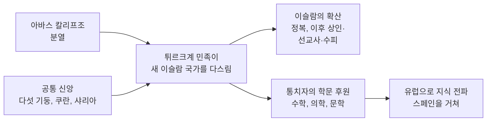

# AP 세계사: 모던 — 토픽 1.2 요약: 다르 알 이슬람 (Developments in Dar al-Islam)

> 출처: AP_WH_1.2_Notes_KR.md 요약 (College Board CED 기준 · 교재 반영, 교재 Topic 1.2)

**Unit 1: 세계의 태피스트리 (The Global Tapestry, c. 1200–1450)**

---

## 한 문장 요약

아바스 칼리프조 (Abbasid Caliphate)가 분열하자 튀르크계 민족 (Turkic peoples)이 새로운 이슬람 국가를 세웠고, 다섯 기둥 (Five Pillars), 쿠란 (Qur'an), 샤리아 (Sharia) 같은 공통 신앙은 다르 알 이슬람 (Dar al-Islam)을 하나로 묶고 일상생활을 이끌었으며, 뒷날 유럽에 전해진 학문을 뒷받침했다.

## 큰 그림

**다르 알 이슬람**("이슬람의 집")은 무슬림 통치자가 다스리고 이슬람 법이 일상생활을 이끈 지역을 뜻한다. 1200년 무렵 이 지역은 스페인에서 북인도까지 이어졌지만, 더 이상 하나의 국가가 아니었다. **아바스 칼리프조**는 여러 국가로 쪼개졌고, 셀주크 (Seljuks), 맘루크 (Mamluks), 델리 술탄들 같은 **튀르크계** 통치자가 실권을 쥐었다. 이슬람은 먼저 정복으로, 그 뒤에는 상인, 선교사, 수피 (Sufis)를 통해 계속 퍼졌다. 무슬림 통치자들은 학자도 후원했고, 그 지식은 뒷날 기독교 유럽으로 전해졌다.

---

## 핵심 정리

### 1. 공통 신앙이 다르 알 이슬람을 하나로 묶었다

- 1200년 이후 다르 알 이슬람은 하나의 제국이 아니라 **하나의 문화 지역**이었다.
- **쿠란**은 이슬람의 경전이다. 쿠란은 법, 예배, 교육의 바탕이었다.
- **다섯 기둥**은 다섯 가지 핵심 실천이다. 신앙 고백, 기도, 자선, 금식, **하지 (Hajj)**(메카 순례)이다.
- **샤리아**는 이슬람 법이다. 샤리아는 무슬림 지역에 **공통의 법 문화**를 만들어 교역을 도왔다.
- **울라마 (Ulama)**(종교와 법을 연구하는 학자)는 학교에서 가르쳤고, 통치자에게 **종교적 인정**을 주었다.

### 2. 신앙이 사회를 만들어 갔다

- **수피즘** (Sufism)은 이슬람의 **신비주의** 전통이다. 신비주의란 신과의 개인적이고 감정적인 가까움을 추구하는 것이다.
- 유대인과 기독교인은 **딤미** (Dhimmi, "보호받는 사람들")였다. 자기 종교를 지킬 수 있었지만 **지즈야** (Jizya)라는 특별세를 냈다.
- 시간이 지나면서 지즈야와 사회적 이점 때문에 많은 사람이 이슬람으로 **천천히 개종**했다.
- 이슬람 법은 여성에게 실제 **권리**를 주었다. 여성은 재산을 상속하고 소유할 수 있었고, 결혼에 동의해야 했다.
- 그러나 사회는 여전히 **가부장적**(남성이 더 큰 권력을 가짐)이었다. 남성은 아내를 네 명까지 둘 수 있었고, 법정에서 여성의 증언은 절반만 인정받았다.

### 3. 아바스 칼리프조가 분열했다

- **아바스 칼리프조** (750–1258)는 **바그다드** (Baghdad)에서 다스렸다. 1200년 무렵 칼리프 (Caliph)가 실제로 다스린 곳은 바그다드 주변 정도였다.
- 원인: 제국이 **너무 넓었고**, 지방 총독들이 독립했으며, 코르도바 (Córdoba)와 카이로 (Cairo)에 **경쟁 칼리프조**가 생겼다.
- 칼리프들은 **튀르크계 노예 군인**에 의존했고, 이들이 실권을 쥐었다. 교역도 **북쪽으로 옮겨 가** 바그다드는 가난해졌다.
- **1055년** **셀주크 튀르크** (Seljuk Turks)가 바그다드에 들어갔다. 그 지도자는 **술탄 (Sultan)**(정치·군사 권력을 가진 통치자)이 되었고, 칼리프는 종교적 권위만 지켰다.
- **1258년** **몽골** (Mongols)이 바그다드를 약탈하고 마지막 아바스 칼리프를 처형했다. 그래도 이슬람 문명은 살아남았다.

### 4. 새로운 튀르크계 이슬람 국가

- **셀주크:** 튀르크계 통치자가 **페르시아인 관리**를 썼다. 군인들은 군역의 대가로 토지 세금을 거둘 권리인 **이크타** (Iqta)를 받았다.
- **맘루크 (Mamluk)**(노예 군인)는 **1250년 이집트**에서 권력을 잡았다. 이들은 **아인잘루트 전투 (Battle of Ain Jalut, 1260)에서 몽골군을 물리쳤다**.
- 맘루크는 자신들의 통치가 정당해 보이도록 살아남은 아바스 왕족을 카이로로 데려와 "**그림자 칼리프** (Shadow caliph)"로 세웠다.
- **델리 술탄국 (Delhi Sultanate, 1206–1526):** 북인도에서 **무슬림 소수가 힌두교도 다수를 다스렸다**. 대부분의 힌두교도는 개종하지 않았다.
- 이 국가들은 **연속성**(샤리아와 아바스 왕조의 방식을 이어 감), **혁신**(새로운 형태의 통치자), **다양성**(여러 민족과 신앙)을 보여 준다.

### 5. 이슬람은 어떻게 퍼졌는가

- **1단계:** 무슬림의 **지배**는 **군사적 정복**으로 넓어졌다. 아나톨리아 (Anatolia)의 셀주크, 인도의 델리 술탄국이 그 예이다.
- **2단계:** 그 뒤 **종교**로서의 이슬람은 **상인, 선교사, 수피**를 통해 평화롭게 퍼졌다. 무슬림 군대가 정복하지 않은 곳에도 퍼진 경우가 많았다.
- 수피는 **지역 관습을 받아들였다**. 그래서 많은 사람이 그들이 전한 이슬람을 쉽게 받아들였다.
- 서아프리카에서는 **통치자와 상인이 먼저 개종**했다. 많은 평민은 전통 신앙을 유지했다.

### 6. 학문과 유럽으로의 전파

- 바그다드의 **지혜의 집** (House of Wisdom)은 그리스, 페르시아, 인도의 저작을 **아랍어로 번역**해 고대 학문을 **보존**했다.
- **수학:** 알 콰리즈미 (al-Khwarizmi)의 책에서 **대수학** (Algebra)이라는 말이 나왔다. **나시르 알딘 알투시** (Nasir al-Din al-Tusi)는 **마라게 천문대** (Maragha observatory)를 이끌었고 **삼각법** (Trigonometry)의 바탕을 놓았다.
- **의학:** 이븐 시나 (Ibn Sina)의 『**의학 정전** (Canon of Medicine)』은 수백 년 동안 유럽 대학의 교과서였다.
- **문학:** 수피 시인 **루미** (Rumi)와 **아이샤 알바우니야 ('A'ishah al-Ba'uniyyah)**, 역사가 **이븐 할둔** (Ibn Khaldun)이 있다.
- **스페인**에서는 이븐 루시드 (Ibn Rushd)가 **아리스토텔레스 주석**을 썼다. 1085년 이후 **톨레도** (Toledo)는 아랍어 저작을 **라틴어**로 번역해 기독교 유럽에 전했다.

> ⚠️ 교재는 아이샤 알바우니야의 생몰년을 1460–1507년으로 쓴다. 많은 참고 자료는 그녀가 1517년에 죽었다고 보며, 그녀의 생애는 대부분 c. 1450년 이후이다. 선생님이 어떻게 가르치는지 확인이 필요하다.

> ⚠️ 교재는 알안달루스 (al-Andalus)의 무슬림, 기독교인, 유대인이 "평화롭게 공존했고" "서로를 관용했을 뿐 아니라 서로 영향을 주고받았다"고 쓴다. 많은 역사학자는 이 공존(*콘비벤시아 (Convivencia)*, "함께 살기"라고도 함)이 실제로 있었지만 불평등한 경우가 많았고, 때로는 폭력으로 무너지기도 했다고 본다. 선생님이 어떻게 가르치는지 확인이 필요하다.

## 꼭 알아야 할 용어·인물

| 용어 | 무엇인가 | 왜 중요한가 |
|---|---|---|
| 다르 알 이슬람 (Dar al-Islam) | "이슬람의 집". 무슬림이 다스린 지역 | 여러 국가로 나뉜 뒤에도 하나의 문화 지역이었음 |
| 샤리아 (Sharia) | 쿠란과 하디스 (Hadith)에 바탕을 둔 이슬람 법 | 무슬림 지역에 공통의 법 체계를 줌 |
| 다섯 기둥 (Five Pillars) | 이슬람의 다섯 가지 핵심 실천 | 서로 매우 다른 지역의 무슬림에게 같은 일상 실천을 줌 |
| 수피즘 (Sufism) | 이슬람의 신비주의 전통 | 수피 선교사들이 지역 관습을 받아들이며 이슬람을 퍼뜨림 |
| 딤미 (Dhimmi) | "보호받는 사람들". 주로 유대인과 기독교인 | 무슬림 지배 아래에서도 자기 신앙을 지킴 |
| 지즈야 (Jizya) | 딤미가 낸 세금 | 이슬람으로의 점진적 개종을 이끔 |
| 칼리프 (Caliph) | 무함마드 (Muhammad)의 계승자 | 1055년 이후에는 주로 명목상의 종교 지도자 |
| 술탄 (Sultan) | 정치·군사 권력을 가진 무슬림 통치자 | 아바스 왕조가 약해진 뒤 튀르크계 술탄이 실권을 쥠 |
| 맘루크 (Mamluk) | 주로 튀르크계 출신의 노예 군인 | 맘루크는 이집트를 다스렸고 몽골을 막아 냄 |
| 지혜의 집 (House of Wisdom) | 바그다드의 도서관이자 번역 중심지 | 그리스, 페르시아, 인도의 학문을 보존함 |
| 나시르 알딘 알투시 (Nasir al-Din al-Tusi) | 마라게 천문대 (Maragha observatory)를 이끈 학자 | 수학 발전을 보여 주는 CED 예시 |
| 이븐 루시드 (Ibn Rushd/Averroes) | 코르도바 (Córdoba) 출신의 학자 | 그의 아리스토텔레스 연구가 기독교 유럽에 전해짐 |

## 주요 연도

| 연도 | 사건 |
|---|---|
| 1055 | 셀주크 튀르크 (Seljuk Turks)의 바그다드 입성 |
| 1085 | 카스티야 (Castile)의 톨레도 (Toledo) 점령. 톨레도는 뒤에 번역 중심지가 됨 |
| 1206 | 델리 술탄국 (Delhi Sultanate) 건국 |
| 1250 | 맘루크 (Mamluks)가 이집트에서 권력 장악 |
| 1258 | 몽골 (Mongols)의 바그다드 약탈. 아바스 칼리프조 (Abbasid Caliphate)가 끝남 |
| 1259 | 마라게 천문대 (Maragha observatory) 설립 |
| 1260 | 아인잘루트 전투 (Battle of Ain Jalut)에서 맘루크가 몽골 격파 |

## 시험에서는 이렇게 묻는다

- **정당화와 공고화:** 정당성 (Legitimacy)이란 사람들이 보기에 다스릴 권리가 있다는 뜻이다. 셀주크 술탄은 아바스 칼리프의 이름으로 다스렸고, 맘루크는 카이로에 "그림자 칼리프"를 두었으며, 통치자들은 울라마의 지지를 얻었다.
- **연속성·혁신·다양성:** 연속성: 새 국가들은 샤리아와 페르시아식 통치를 이어 갔다. 혁신: 술탄이 칼리프와 분리된 정치 통치자가 되었다. 다양성: 델리 술탄국에서는 무슬림 통치자가 힌두교도 다수를 다스렸다.
- **자주 나오는 비교:** 맘루크 vs. 델리 술탄국. 둘 다 노예 군인 출신이 세운 수니파 (Sunni), 튀르크계 주도 국가였다. 맘루크는 주로 아랍계 무슬림을 다스렸고, 델리 술탄은 대부분 개종하지 않은 힌두교도 다수를 다스렸다.
- **자주 하는 실수:** 이슬람이 "칼로만" 퍼졌다고 쓰는 것이다. 바로잡기: 정복으로 넓어진 것은 무슬림의 **지배**였고, **종교**는 주로 상인, 선교사, 수피를 통해 퍼졌다.

## 스스로 확인하기

1. 아바스 칼리프조가 분열한 이유를 두 가지 들어 보라.

▶ 정답
제국이 너무 넓어서 지방 총독들이 독립했다. 또 칼리프들이 튀르크계 노예 군인에 의존하다가 이들에게 실권을 빼앗겼고, 교역이 바그다드를 비껴가게 되었다.

2. 수피는 왜 이슬람을 잘 퍼뜨렸는가?

▶ 정답
수피는 지역 관습을 받아들였고, 때로는 지역의 종교 요소를 이슬람에 섞었다. 그래서 많은 사람이 그들이 전한 이슬람을 쉽게 받아들였다.

3. 다르 알 이슬람의 학문은 어떻게 기독교 유럽에 전해졌는가?

▶ 정답
바그다드의 학자들은 고대 저작을 아랍어로 번역하고 그 위에 새 발견을 더했다. 스페인에서는 이븐 루시드가 아리스토텔레스를 연구했고, 1085년 이후 톨레도에서 아랍어 저작이 라틴어로 번역되었다.

