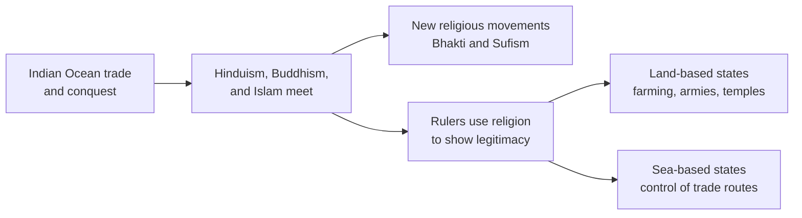

# AP World History: Modern — Topic 1.3 Summary: South and Southeast Asia (c. 1200–1450)

> Source: Summary of AP_WH_1.3_Notes_EN.md (College Board CED · textbook incorporated, Topic 1.3 reading)

**Unit 1: The Global Tapestry (c. 1200–1450)**

---

## In One Sentence

Hinduism, Buddhism, and Islam shaped daily life and social rank in South and Southeast Asia, and rulers used these religions, along with farming, armies, and control of sea trade, to build and keep their states.

## The Big Picture

South and Southeast Asia had three big religions: Hinduism, Buddhism, and Islam. Hinduism and Buddhism came to Southeast Asia from India by trade. Islam came by conquest in north India and by merchants and Sufis in the ports. The religions mixed and changed each other, and new movements (Bhakti and Sufism) opened religion to ordinary people. Rulers used religion to show **legitimacy** (the right to rule in people's eyes). Some states got rich from land and farming; others got rich from sea trade.

## Key Points

### 1. Three Belief Systems Shape Society

- Most South Asians were **Hindu**. Hindus believed in **dharma** (your duty) and **karma** (your actions shape your next life).
- Hindu society was ranked by the **caste system**: people were born into a group and usually married inside it.
- Caste was a strong **continuity** (something that stayed the same over time). Muslim merchants and migrants found a place in it by their job.
- **Islam** taught that all believers are **equal**. Some low-caste Hindus converted, but the textbook says this usually did not raise their status.
- Islam did **not greatly change gender relations**. Converts kept many of their old customs.

### 2. New Ways to Worship: Bhakti and Sufism

- **Bhakti** means "devotion." It taught deep personal love for **one god**, such as Vishnu or Shiva. It started in **south India**.
- Bhakti **rejected caste hierarchy**, welcomed **women** and lower castes, and used **local languages** instead of Sanskrit.
- **Sufism** is the **mystical** side of Islam: Sufis sought a personal experience of God through prayer, poetry, music, and dance.
- Sufis were the most important **missionaries** of Islam. They were flexible and accepted local customs, so most conversion was **gradual and peaceful**.
- Bhakti and Sufism led to **syncretism** (the blending of beliefs). The poet **Kabir** taught that God is one, whether called Rama or Allah.

### 3. Buddhism Moves Out of India: Monks and Kings

- Buddhism **declined in India**. Hindu devotion took in many Buddhist ideas, and raids on monasteries hurt it.
- **Buddhist monasticism** means monks and nuns living together in communities. Monasteries were centers of learning and owned land.
- In Sri Lanka, the **Sinhala dynasties** were Theravada Buddhist kings. They gave land to monasteries, and the Buddha's **Tooth Relic** was a symbol of the right to rule.
- Sri Lankan monks carried **Theravada Buddhism** to Burma, Thailand, and Cambodia.
- The Thai **Sukhothai kingdom** broke away from Khmer control in the 13th century and supported Theravada Buddhism from Sri Lanka.

### 4. States of South Asia: Delhi Sultanate, Rajputs, Vijayanagara

- South Asia was rarely united. **Hinduism** gave the region cultural unity, and local Hindu kingdoms kept a major role.
- The **Delhi Sultanate** (1206–1526) was an **innovation** (something new): a small Muslim elite ruled a **Hindu majority** in north India.
- It kept power through its army, taxes such as the **jizya** (a tax on non-Muslims), and practical tolerance. It stopped the **Mongols** from conquering South Asia.
- The **Rajput kingdoms** were Hindu warrior clans in Rajasthan. They often fought each other, but they **resisted** the Delhi Sultanate.
- **Vijayanagara** (founded 1336) was a new **Hindu** state in south India. Its power came from farming, trade, temple building, and hiring Muslim cavalry.

### 5. Sea-Based States: Srivijaya and Majapahit

- **Srivijaya**, on Sumatra, controlled the **Strait of Malacca**, the main sea route between India and China.
- Ships waited in its ports for the **monsoon winds** to change. Srivijaya **taxed** the ships and used its **navy** against pirates.
- Srivijaya was a **Buddhist** center. A Chola raid in 1025 weakened it.
- **Majapahit** (founded 1293) on Java was a **Hindu-Buddhist** kingdom. Its power came from **rice** and from a **navy** that controlled the spice trade.
- Majapahit took **tribute** (payments that showed loyalty) from many islands. It declined as Muslim port states grew richer.

> ⚠️ The 1.3 textbook reading calls Srivijaya "primarily a Buddhist kingdom" and Majapahit "a Hindu kingdom (but with strong Buddhist influences)," which matches most scholarship (Srivijaya mainly Mahayana Buddhist; Majapahit Hindu-Buddhist, mainly Shaiva Hindu with Buddhism). The 2.5 textbook reading, and so the 2.5 notes, says the reverse (Srivijaya Hindu, Majapahit Buddhist). The textbook contradicts itself. Check how your teacher presents this.

### 6. A Land-Based State: The Khmer Empire

- The **Khmer Empire** (founded 802) was based at **Angkor** in Cambodia. It did not depend on sea power.
- King Suryavarman II built **Angkor Wat** for the Hindu god Vishnu. Later Khmer rulers became **Buddhist**, and Angkor Wat became a Buddhist temple.
- Rulers added Buddhist art **without destroying** the Hindu art.
- Huge **reservoirs** and canals let farmers grow **rice** several times a year. Kings linked themselves to the gods and controlled labor and water.
- Wars with the Thai kingdom of **Ayutthaya** weakened the empire, and Angkor was sacked c. 1431.

> ⚠️ The textbook calls Angkor Wat a Buddhist temple complex built in the same period as the Buddhist additions at Angkor Thom. Many accounts say Angkor Wat was built earlier, in the first half of the 12th century under Suryavarman II, as a Hindu temple to Vishnu, and became Buddhist later; Angkor Thom was built later in the 12th century under Jayavarman VII. Check how your teacher presents this.

> ⚠️ The textbook says the Thais of the **Sukhothai Kingdom** invaded in 1431 and forced the Khmers out. Many accounts say it was the Thai kingdom of **Ayutthaya**, which by then had made Sukhothai its vassal. Check how your teacher presents this.

## Must-Know Terms & People

| Term | What it is | Why it matters |
|---|---|---|
| Caste system | Hindu ranking of people by birth group | A strong continuity; Bhakti and Sufism challenged it but did not end it |
| Bhakti movement | Hindu devotion to one god, open to all castes and women | Made Hinduism personal and helped it stay strong under Muslim rule |
| Sufism | The mystical side of Islam | Sufis spread Islam peacefully through shrines, poetry, and music |
| Buddhist monasticism | Monks and nuns living in communities | Kings funded monasteries, and monks carried Buddhism to new lands |
| Kabir | A poet who blended Hindu and Muslim ideas | The clearest example of syncretism |
| Delhi Sultanate | Muslim state in north India (1206–1526) | Innovation: Muslim rule over a Hindu majority |
| Jizya | A tax paid by non-Muslims under Muslim rule | Gave money to the state; many Hindus resented it |
| Rajput kingdoms | Hindu warrior clans in Rajasthan | Continuity: Hindu kingship survived and resisted the Sultanate |
| Vijayanagara Empire | Hindu empire in south India (founded 1336) | A new Hindu state that used farming, trade, and temples |
| Srivijaya Empire | Buddhist sea-based state on Sumatra | Shows power from controlling the Strait of Malacca |
| Majapahit | Hindu-Buddhist kingdom on Java (founded 1293) | Power from both rice farming and sea trade |
| Khmer Empire | Land-based empire centered at Angkor | Shows the shift from Hinduism to Buddhism and power from irrigation |

## Key Dates

| Year | Event |
|---|---|
| 802 | Jayavarman II founds the Khmer Empire |
| 1025 | Chola navy raids Srivijaya |
| 1206 | Delhi Sultanate founded |
| 1293 | Majapahit founded on Java |
| 1336 | Vijayanagara founded |
| 1398 | Timur sacks Delhi |
| 1526 | Delhi Sultanate ends at Panipat |

## How the Exam Asks About It

- **Legitimacy & consolidation:** Rulers tied their power to religion. Hindu kings built temples, Sinhala kings protected Buddhism and held the Tooth Relic, and Khmer kings linked themselves to the gods. The Delhi Sultanate used its army, taxes, and tolerance of Hindus to stay in power.
- **Continuity, innovation, diversity:** Continuity is the caste system and Hindu and Buddhist kingship (the Rajputs, the Sinhala dynasties). Innovation is Muslim rule over a Hindu majority (the Delhi Sultanate). Diversity is the mix of Muslim, Hindu, and Buddhist states, both land-based and sea-based.
- **Likely comparison:** Srivijaya and the Khmer Empire. Similar: both used Indian religions to support royal power. Different: Srivijaya grew rich by taxing ships at sea, while the Khmer grew rich from irrigated rice farming on land.
- **Common trap:** Students say Islam spread only by the sword. Fix: in the north it came by conquest, but in the ports it spread through merchants and Sufis, and most conversion was gradual and peaceful.

## Check Yourself

1. Name two ways Islam spread into South and Southeast Asia.

▶ Answer
It came by conquest in north India, where the Delhi Sultanate was founded. It also spread through Muslim merchants and Sufis in Indian Ocean ports.

2. How did the Bhakti movement challenge the caste system?

▶ Answer
Bhakti taught that anyone could reach god through devotion, without Brahmin priests or costly rituals. It welcomed women and lower castes and used local languages.

3. Why was the Delhi Sultanate an innovation, and how did it keep power?

▶ Answer
For the first time, a Muslim state ruled much of north India, with a small Muslim elite over a Hindu majority. It kept power through military strength, taxes such as the jizya, and practical tolerance of Hindus.

