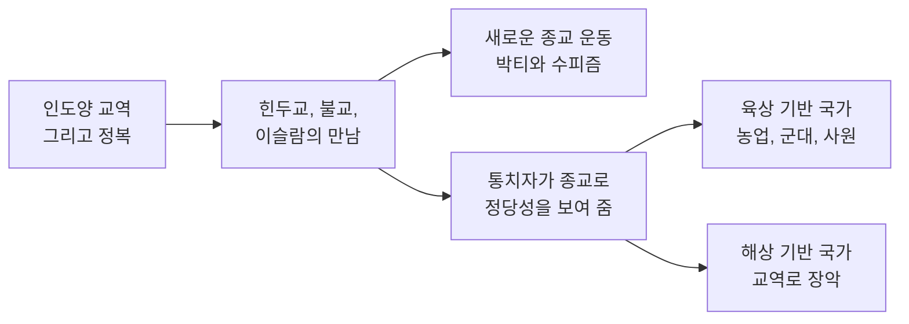

# AP 세계사: 모던 — 토픽 1.3 요약: 남아시아와 동남아시아 (South and Southeast Asia)

> 출처: AP_WH_1.3_Notes_KR.md 요약 (College Board CED 기준 · 교재 반영, 교재 Topic 1.3)

**Unit 1: 세계의 태피스트리 (The Global Tapestry, c. 1200–1450)**

---

## 한 문장 요약

힌두교 (Hinduism), 불교 (Buddhism), 이슬람 (Islam)은 남아시아와 동남아시아의 일상생활과 신분 질서를 형성했고, 통치자들은 이 종교들과 함께 농업, 군대, 해상 교역 장악을 이용해 국가를 세우고 유지했다.

## 큰 그림

남아시아와 동남아시아에는 힌두교, 불교, 이슬람이라는 세 큰 종교가 있었다. 힌두교와 불교는 교역을 통해 인도에서 동남아시아로 전해졌다. 이슬람은 북인도에는 정복으로, 항구에는 상인과 수피 (Sufi)를 통해 들어왔다. 종교들은 서로 섞이고 서로를 바꾸었으며, 새로운 운동(박티와 수피즘)이 평범한 사람들에게 종교를 열어 주었다. 통치자들은 종교를 이용해 **정당성 (Legitimacy)**, 곧 사람들이 보기에 다스릴 권리가 있음을 보여 주었다. 어떤 국가는 땅과 농업으로 부유해졌고, 어떤 국가는 해상 교역으로 부유해졌다.

## 핵심 정리

### 1. 세 신앙 체계가 사회를 형성하다

- 남아시아 사람 대부분은 **힌두교도**였다. 힌두교도는 **다르마 (Dharma)**(자기 의무)와 **카르마 (Karma)**(행위가 다음 생을 결정함)를 믿었다.
- 힌두 사회는 **카스트 제도** (Caste system)로 서열이 나뉘었다. 사람들은 어떤 집단에 태어났고, 대개 그 집단 안에서 결혼했다.
- 카스트는 강한 **연속성 (Continuity)**, 곧 오랫동안 바뀌지 않고 이어진 것이었다. 무슬림 상인과 이주민도 직업에 따라 그 안에서 자리를 찾았다.
- **이슬람**은 모든 신자가 **평등**하다고 가르쳤다. 일부 낮은 카스트의 힌두교도가 개종했지만, 교재는 이것이 대개 신분을 높여 주지 못했다고 쓴다.
- 이슬람은 **젠더 관계 (Gender relations)를 크게 바꾸지 않았다**. 개종자들은 옛 관습을 많이 지켰다.

### 2. 새로운 신앙 방식: 박티와 수피즘

- **박티** (Bhakti)는 "헌신"이라는 뜻이다. 비슈누 (Vishnu)나 시바 (Shiva) 같은 **한 신**에 대한 깊고 개인적인 사랑을 가르쳤다. **남인도**에서 시작되었다.
- 박티는 **카스트 위계를 거부**했고, **여성**과 낮은 카스트를 받아들였으며, 산스크리트어 (Sanskrit) 대신 **토착어** (Vernacular)를 썼다.
- **수피즘** (Sufism)은 이슬람의 **신비주의** 갈래이다. 수피는 기도, 시, 음악, 춤을 통해 신을 개인적으로 체험하려 했다.
- 수피는 이슬람의 가장 중요한 **선교자**였다. 유연하게 지역 관습을 받아들였기 때문에 개종은 대부분 **점진적이고 평화로웠다**.
- 박티와 수피즘은 **혼합주의 (Syncretism)**, 곧 신앙이 섞이는 현상으로 이어졌다. 시인 **카비르** (Kabir)는 신을 라마라고 부르든 알라라고 부르든 신은 하나라고 가르쳤다.

### 3. 인도를 떠난 불교: 승려와 왕

- 불교는 **인도에서 쇠퇴**했다. 힌두교 신앙이 불교의 많은 생각을 흡수했고, 수도원 습격이 불교에 타격을 주었다.
- **불교 수도원 제도** (Buddhist monasticism)는 승려와 비구니가 공동체를 이루어 함께 사는 것이다. 수도원은 학문의 중심지였고 땅을 소유했다.
- 스리랑카의 **싱할라 왕조** (Sinhala dynasties)는 상좌부 불교를 믿는 왕들이었다. 그들은 수도원에 땅을 주었고, 부처의 **불치 사리** (Tooth Relic)는 다스릴 권리의 상징이었다.
- 스리랑카 승려들은 **상좌부 불교** (Theravada Buddhism)를 버마, 태국, 캄보디아로 전했다.
- 타이인의 **수코타이 왕국** (Sukhothai kingdom)은 13세기에 크메르의 지배에서 벗어났고, 스리랑카에서 들어온 상좌부 불교를 후원했다.

### 4. 남아시아의 국가: 델리 술탄국, 라지푸트, 비자야나가르

- 남아시아는 거의 통일되지 못했다. **힌두교**가 지역에 문화적 통일성을 주었고, 지역 힌두 왕국들이 계속 큰 역할을 했다.
- **델리 술탄국 (Delhi Sultanate)**(1206–1526)은 **혁신 (Innovation)**, 곧 새로운 것이었다. 소수의 무슬림 엘리트가 북인도의 **힌두교도 다수**를 다스렸다.
- 술탄국은 군대, **지즈야 (Jizya)**(비무슬림에게 걷는 세금) 같은 세금, 실용적 관용으로 권력을 유지했다. 또 **몽골**이 남아시아를 정복하지 못하게 막았다.
- **라지푸트 왕국** (Rajput kingdoms)은 라자스탄 (Rajasthan)의 힌두 전사 씨족들이었다. 서로 자주 싸웠지만 델리 술탄국에 **맞섰다**.
- **비자야나가르 (Vijayanagara)**(1336년 건국)는 남인도의 새로운 **힌두** 국가였다. 힘은 농업, 교역, 사원 건설, 무슬림 기병 고용에서 나왔다.

### 5. 해상 기반 국가: 스리위자야와 마자파힛

- 수마트라의 **스리위자야** (Srivijaya)는 인도와 중국을 잇는 주요 바닷길인 **말라카 해협** (Strait of Malacca)을 장악했다.
- 배들은 **몬순 (Monsoon)** 바람이 바뀔 때까지 스리위자야의 항구에서 기다렸다. 스리위자야는 배에 **세금**을 걷고 **해군**으로 해적을 막았다.
- 스리위자야는 **불교**의 중심지였다. 1025년 촐라 (Chola)의 공격으로 약해졌다.
- 자와의 **마자파힛 (Majapahit)**(1293년 건국)은 **힌두-불교** 왕국이었다. 힘은 **쌀**과 향신료 교역을 장악한 **해군**에서 나왔다.
- 마자파힛은 많은 섬에서 **조공 (Tribute)**, 곧 충성을 보여 주는 바침을 받았다. 무슬림 항구 국가들이 더 부유해지면서 쇠퇴했다.

> ⚠️ 1.3 교재는 스리위자야를 "주로 불교 왕국"으로, 마자파힛을 "힌두 왕국(그러나 불교의 영향이 강함)"으로 설명한다. 이는 대부분의 연구(스리위자야는 주로 대승 불교, 마자파힛은 주로 시바파 힌두교와 불교가 함께한 힌두-불교 국가)와 일치한다. 그런데 2.5 교재와 이를 따른 2.5 노트는 반대로(스리위자야는 힌두교, 마자파힛은 불교) 쓴다. 교재 안에서 설명이 서로 어긋난다. 선생님이 어떻게 가르치는지 확인이 필요하다.

### 6. 육상 기반 국가: 크메르 제국

- **크메르 제국 (Khmer Empire)**(802년 건국)은 캄보디아의 **앙코르** (Angkor)에 기반을 두었다. 바다의 힘에 의존하지 않았다.
- 수리야바르만 2세 (Suryavarman II) 왕은 힌두교 신 비슈누에게 바친 **앙코르 와트** (Angkor Wat)를 세웠다. 이후 크메르 통치자들은 **불교도**가 되었고, 앙코르 와트는 불교 사원이 되었다.
- 통치자들은 힌두 예술을 **없애지 않고** 불교 예술을 더했다.
- 거대한 **저수지**와 운하 덕분에 농민은 1년에 여러 번 **벼**를 수확했다. 왕들은 자신을 신과 연결했고 노동력과 물을 통제했다.
- 태국 왕국 **아유타야** (Ayutthaya)와의 전쟁이 제국을 약하게 했고, 앙코르는 c. 1431년 약탈당했다.

> ⚠️ 교재는 앙코르 와트를 앙코르 톰에 불교 요소가 더해진 시기와 같은 때에 지어진 불교 사원 단지로 설명한다. 많은 설명에서는 앙코르 와트가 그보다 이른 12세기 전반 수리야바르만 2세 때 비슈누에게 바친 힌두 사원으로 지어졌고 나중에 불교 사원이 되었으며, 앙코르 톰은 12세기 후반 자야바르만 7세 때 지어졌다고 본다. 선생님이 어떻게 가르치는지 확인이 필요하다.

> ⚠️ 교재는 1431년 **수코타이 왕국** (Sukhothai Kingdom)의 타이인들이 침입해 크메르인을 몰아냈다고 쓴다. 많은 설명에서는 그 무렵 수코타이를 속국으로 만든 태국 왕국 **아유타야**가 앙코르를 공격했다고 본다. 선생님이 어떻게 가르치는지 확인이 필요하다.

## 꼭 알아야 할 용어·인물

| 용어 | 무엇인가 | 왜 중요한가 |
|---|---|---|
| 카스트 제도 (Caste system) | 출생 집단에 따른 힌두 사회의 신분 서열 | 강한 연속성. 박티와 수피즘이 도전했지만 없애지 못함 |
| 박티 운동 (Bhakti movement) | 모든 카스트와 여성에게 열린, 한 신에 대한 힌두교의 헌신 | 힌두교를 개인적인 종교로 만들고 무슬림 통치 아래에서도 강하게 남게 함 |
| 수피즘 (Sufism) | 이슬람의 신비주의 갈래 | 수피는 성묘, 시, 음악으로 이슬람을 평화롭게 퍼뜨림 |
| 불교 수도원 제도 (Buddhist monasticism) | 승려와 비구니가 공동체를 이루어 사는 생활 | 왕은 수도원을 지원했고, 승려는 불교를 새로운 땅으로 전함 |
| 카비르 (Kabir) | 힌두교와 이슬람의 생각을 섞은 시인 | 혼합주의 (Syncretism)의 가장 분명한 예 |
| 델리 술탄국 (Delhi Sultanate) | 북인도의 무슬림 국가 (1206–1526) | 혁신: 힌두교도 다수를 다스린 무슬림 통치 |
| 지즈야 (Jizya) | 무슬림 통치 아래에서 비무슬림이 내는 세금 | 국가에 돈을 가져다줌. 많은 힌두교도가 이를 원망함 |
| 라지푸트 왕국 (Rajput kingdoms) | 라자스탄의 힌두 전사 씨족 | 연속성: 힌두 왕권이 살아남아 술탄국에 맞섬 |
| 비자야나가르 제국 (Vijayanagara Empire) | 남인도의 힌두 제국 (1336년 건국) | 농업, 교역, 사원을 이용한 새로운 힌두 국가 |
| 스리위자야 제국 (Srivijaya Empire) | 수마트라의 불교 해상 기반 국가 | 말라카 해협 장악에서 나온 힘을 보여 줌 |
| 마자파힛 (Majapahit) | 자와의 힌두-불교 왕국 (1293년 건국) | 벼농사와 해상 교역 모두에서 힘을 얻음 |
| 크메르 제국 (Khmer Empire) | 앙코르를 중심으로 한 육상 기반 제국 | 힌두교에서 불교로의 변화와 관개에서 나온 힘을 보여 줌 |

## 주요 연도

| 연도 | 사건 |
|---|---|
| 802 | 자야바르만 2세 (Jayavarman II)가 크메르 제국 (Khmer Empire)을 세움 |
| 1025 | 촐라 (Chola) 해군이 스리위자야 (Srivijaya)를 공격 |
| 1206 | 델리 술탄국 (Delhi Sultanate) 건국 |
| 1293 | 자와에서 마자파힛 (Majapahit) 건국 |
| 1336 | 비자야나가르 (Vijayanagara) 건국 |
| 1398 | 티무르 (Timur)가 델리를 약탈 |
| 1526 | 파니파트 (Panipat)에서 델리 술탄국 멸망 |

## 시험에서는 이렇게 묻는다

- **정당화와 공고화:** 통치자들은 권력을 종교와 연결했다. 힌두 왕들은 사원을 세웠고, 싱할라 왕들은 불교를 보호하고 불치 사리를 지녔으며, 크메르 왕들은 자신을 신과 연결했다. 델리 술탄국은 군대, 세금, 힌두교도에 대한 관용으로 권력을 지켰다.
- **연속성·혁신·다양성:** 연속성은 카스트 제도와 힌두교·불교 왕권(라지푸트, 싱할라 왕조)이다. 혁신은 힌두교도 다수를 다스린 무슬림 통치(델리 술탄국)이다. 다양성은 무슬림·힌두교·불교 국가, 그리고 육상 기반 국가와 해상 기반 국가가 섞여 있었다는 점이다.
- **자주 나오는 비교:** 스리위자야와 크메르 제국. 공통점: 둘 다 인도의 종교를 이용해 왕권을 뒷받침했다. 차이점: 스리위자야는 바다에서 배에 세금을 걷어 부유해졌고, 크메르는 땅에서 관개 벼농사로 부유해졌다.
- **자주 하는 실수:** 이슬람이 칼로만 퍼졌다고 쓰는 것이다. 바로잡기: 북쪽에서는 정복으로 들어왔지만, 항구에서는 상인과 수피를 통해 퍼졌고, 개종은 대부분 점진적이고 평화로웠다.

## 스스로 확인하기

1. 이슬람이 남아시아와 동남아시아로 퍼진 두 가지 방법을 써라.

▶ 정답
북인도에는 정복으로 들어왔고, 그곳에 델리 술탄국이 세워졌다. 또 인도양 항구에서 무슬림 상인과 수피를 통해 퍼졌다.

2. 박티 운동은 카스트 제도에 어떻게 도전했는가?

▶ 정답
박티는 브라만 (Brahmin) 사제나 값비싼 의식 없이도 누구나 헌신으로 신에게 다가갈 수 있다고 가르쳤다. 여성과 낮은 카스트를 받아들였고 토착어를 썼다.

3. 델리 술탄국은 왜 혁신이었으며, 어떻게 권력을 유지했는가?

▶ 정답
무슬림 국가가 처음으로 북인도의 넓은 지역을 다스렸고, 소수의 무슬림 엘리트가 힌두교도 다수를 다스렸다. 군사력, 지즈야 같은 세금, 힌두교도에 대한 실용적 관용으로 권력을 유지했다.

