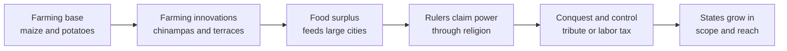

# AP World History: Modern — Topic 1.4 Summary: State Building in the Americas (c. 1200–1450)

> Source: Summary of AP_WH_1.4_Notes_EN.md (College Board CED · textbook incorporated, Topic 1.4 reading)

**Unit 1: The Global Tapestry (c. 1200–1450)**

---

## In One Sentence

In the Americas, the Maya city-states, the Mexica tribute empire, the centralized Inca Empire, and the North American chiefdoms of Cahokia, Chaco, and Mesa Verde grew on maize and potato farming and used religion to support their rulers, and the larger states then expanded by conquest.

## The Big Picture

Between 1200 and 1450, states in the Americas grew larger and more powerful, as states in Afro-Eurasia did. They had no contact with Afro-Eurasia, no large draft animals (except the llama in the Andes), and no iron tools. Still, they built large cities and empires on maize and potato farming. The Maya stayed divided into city-states, the Mexica built a tribute empire, the Inca built the most centralized state, and North American peoples built chiefdoms and ceremonial centers.

## Key Points

### 1. Maya City-States
- The Maya **never united** into one empire. They lived in dozens of competing **city-states** (a city plus the farmland and villages around it).
- Often one strong city-state **dominated** its neighbors, but shifting alliances meant no city held power for long.
- Each king claimed **descent from a god**, so his power was both political and religious.
- City-states fought for **captives, tribute**, and prestige, and rarely to take land.
- After the **Classic Maya collapse** (c. 900), power moved north to the Yucatán Peninsula: first **Chichén Itzá**, then **Mayapán** (c. 1220–1450), which led a league of city-states.

### 2. The Mexica (Aztec) Empire
- The Mexica moved into the Valley of Mexico in the 1200s and founded **Tenochtitlan** (c. 1325) on an island in Lake Texcoco.
- **Chinampas** were raised fields built in the shallow lake. They gave several harvests a year and fed the crowded city.
- In 1428 Tenochtitlan, Texcoco, and Tlacopan formed the **Triple Alliance**. Tenochtitlan became the leader, and the empire grew from the Gulf of Mexico to the Pacific.
- It was a **tribute state**: conquered peoples paid goods such as cloth, food, and feathers, but their **local rulers** stayed in power as tribute collectors.
- This control was cheap but **decentralized**, so loyalty was shallow and many subject peoples were resentful.

### 3. The Inca Empire
- The Inca began as a small kingdom around **Cuzco**. In c. 1438 **Pachacuti** began rapid conquests.
- By the early 1500s the empire stretched about 2,500 miles along the Andes, from **Ecuador** to central **Chile**.
- It was the most **centralized** state in the Americas. The emperor, the **Sapa Inca**, was believed to be the son of the sun god Inti, and governors and officials ran four provinces.
- Instead of paying goods, households owed the **mit'a**, a labor tax: men aged 15 to 50 took turns working on roads, terraces, and state farms, or as soldiers.
- A **road network**, **quipu** records (knotted cords), the **Quechua** language, and moving whole groups of people (mitma) held the empire together.

### 4. North American Societies
- These were **chiefdoms** and ceremonial centers, not empires, and they had no writing. They add to the **diversity** of the Americas.
- **Cahokia**, near the Mississippi River, was the center of the **Mississippian culture**. It was famous for huge earthen mounds, such as Monks Mound, about 100 feet tall.
- Mississippian towns had a rigid class structure. The textbook calls each town's chief the **Great Sun**. The society was **matrilineal**: the chief's title passed to his sister's son.
- In the dry Southwest, **Chaco** people built large stone-and-clay houses with hundreds of rooms, and **Mesa Verde** people built homes into cliffs.
- **Climate** limited these farming societies. Chaco and Mesa Verde declined as the climate grew drier, and Cahokia declined after 1200.

> ⚠️ The textbook applies the title "Great Sun" to Mississippian chiefs in general. Many accounts say the title comes from French records of the Natchez, a later Mississippian people of the 1700s, so no one knows what Cahokia's own rulers were called. Check how your teacher presents this.

> ⚠️ The textbook says Cahokia was abandoned around 1450. Many accounts say Cahokia was largely abandoned by c. 1350–1400. Check how your teacher presents this.

### 5. Why These States Grew and Changed
- The environment set **limits**: there were no horses or oxen, and the wheel was not used for transport, so people carried goods themselves.
- People solved local problems with **innovations**: chinampas in a lake, terraces on mountain slopes, and water storage in the dry Southwest.
- **Religion** made rulers look chosen by the gods, which helped them keep power.
- The Mexica and the Inca grew by **conquest** and then took tribute or labor from the peoples they conquered.

## Must-Know Terms & People

| Term | What it is | Why it matters |
|---|---|---|
| City-state | An independent city that rules the land around it | The Maya political unit; the Maya never formed one empire |
| Mayapán | The leading Maya city in the Yucatán, c. 1220–1450 | Shows change: it led a league of city-states |
| Tenochtitlan | The Mexica capital on an island in Lake Texcoco, founded c. 1325 | Center of the Mexica Empire |
| Chinampas | Raised fields built in Lake Texcoco | An innovation that fed Tenochtitlan |
| Triple Alliance | The 1428 alliance of Tenochtitlan, Texcoco, and Tlacopan | Created the Mexica Empire |
| Tribute state | An empire that takes goods from conquered peoples but keeps their local rulers | Explains Mexica control and its weak loyalty |
| Huitzilopochtli | The Mexica sun and war god | His worship justified war and human sacrifice |
| Pachacuti | The Inca ruler who began rapid expansion c. 1438 | Built the Inca Empire |
| Sapa Inca | The Inca emperor, believed to be the son of the sun god Inti | Religion and political power in one person |
| Mit'a | The Inca labor tax: households took turns working for the state | The Inca took labor, not goods |
| Quipu | Knotted, colored cords used to keep records | Record keeping without a writing system |
| Matrilineal society | A society where social standing comes from the mother's side | Mississippian chiefs' titles passed to a sister's son |

## Key Dates

| Year | Event |
|---|---|
| c. 900 | Classic Maya collapse; power moves north to the Yucatán |
| c. 1050–1200 | Cahokia at its peak |
| 1200s | The Mexica migrate into the Valley of Mexico |
| c. 1220 | Mayapán becomes the leading Maya city |
| c. 1325 | The Mexica found Tenochtitlan |
| 1428 | The Triple Alliance is formed |
| c. 1438 | Pachacuti begins Inca expansion |
| c. 1441–1450 | Mayapán collapses |

## How the Exam Asks About It

- **Legitimacy & consolidation:** Rulers used religion to justify power: Maya kings claimed descent from gods, the Mexica emperor was a divine representative of the gods, and the Sapa Inca was the son of Inti. To keep power, the Mexica kept local rulers as tribute collectors, and the Inca used officials, the mit'a, the Quechua language, and resettlement.
- **Continuity, innovation, diversity:** Continuity: Maya holy kings and the calendar lasted from the Classic period. Innovation: chinampas fed a city built in a lake. Diversity: competing Maya city-states, a decentralized Mexica empire, a centralized Inca empire, and North American chiefdoms.
- **Likely comparison:** Mexica vs. Inca. Similarity: both were large land-based empires built by conquest and led by rulers with religious authority. Difference: the Mexica were decentralized and took tribute in goods; the Inca were centralized and took labor through the mit'a.
- **Common trap:** Students mix up tribute and the mit'a. Fix: the Mexica took goods (tribute); the Inca took work (labor tax), and the textbook says conquered people under the Inca did not pay tribute in goods.

## Check Yourself

1. Why do historians describe the Maya as city-states and not as an empire?

▶ Answer
The Maya never united under one government. They lived in many competing city-states, each with its own king, although one strong city often dominated its neighbors.

2. How did the Mexica and the Inca differ in what they took from conquered peoples?

▶ Answer
The Mexica took tribute in goods, such as cloth, food, and feathers, and let local rulers stay in power. The Inca took labor through the mit'a, a labor tax in which households took turns working for the state.

3. How were the North American societies different from the Mexica and Inca, and what limited them?

▶ Answer
Cahokia, Chaco, and Mesa Verde were chiefdoms and ceremonial centers, not empires, and they had no writing. Climate limited them, because drought or other extreme weather could ruin the farming that fed them.

