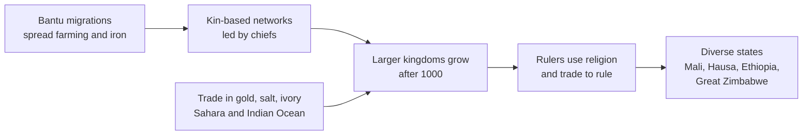

# AP World History: Modern — Topic 1.5 Summary: State Building in Africa (c. 1200–1450)

> Source: Summary of AP_WH_1.5_Notes_EN.md (College Board CED · textbook incorporated, Topic 1.5 reading)

**Unit 1: The Global Tapestry (c. 1200–1450)**

---

## In One Sentence

Between 1200 and 1450, African states grew larger and richer by **controlling trade** in gold, salt, and ivory and by **using religion** (Islam, Christianity, or local traditions) to support their rulers, and they took **many different forms**: empires, city-states, and kingdoms.

## The Big Picture

For a long time, many people in Sub-Saharan Africa lived in small **kin-based networks** led by chiefs, not under one central government. After **1000**, larger kingdoms grew in importance. Rulers became rich by controlling and taxing **trade routes**, across the Sahara Desert and across the Indian Ocean. They used **religion** and **old traditions** to show that they had the right to rule. The result was a **diverse** set of states: the **Mali Empire**, the **Hausa city-states**, the Christian kingdom of **Ethiopia**, and the stone city of **Great Zimbabwe**.

## Key Points

### 1. Before 1200: Chiefs and the Ghana Empire

- Many Sub-Saharan societies did **not centralize** power. Families governed themselves in **kin-based networks**.
- A **chief** (the male head of the network) settled conflicts. Groups of chiefs solved problems for a **district** (a group of villages).
- As populations grew, fighting between villages increased, and **larger kingdoms** became more important after 1000.
- The **Ghana Empire** in West Africa grew rich by **taxing gold and salt** that passed through its land. It was **not** in the same place as the modern country of Ghana.
- The textbook says that by the 12th century, wars with neighbors had permanently weakened Ghana. **Mali** became the strongest new state in the region.

### 2. The Mali Empire (West Africa)

- **Sundiata Keita** defeated the Sosso king at the **Battle of Kirina** (c. 1235) and founded the **Mali Empire**. He took over Ghana's old trade routes.
- Mali controlled the **gold fields** and taxed **gold, salt, and copper**. Its ruler was called the **mansa** ("king" or "emperor").
- In **1324**, **Mansa Musa** made the **hajj** (the Muslim pilgrimage to Mecca). He gave away so much gold in Cairo that gold lost value there for years.
- Musa brought back scholars and architects. **Timbuktu** became a center of **Islamic learning**.
- Rulers and merchants became Muslim, but many farmers kept **traditional beliefs**. Rulers mixed Islam with local customs, such as **griots** (oral historians) and old court rituals. This mixing is called **syncretism**.

### 3. The Hausa Kingdoms (West Africa)

- The Hausa people formed **seven states** in northern Nigeria **sometime before 1000**. Main cities included **Kano, Katsina, and Zaria**.
- Each was an independent **city-state** (a city that governs itself and the land around it), ruled by a king called a **sarki**.
- They were **decentralized**: there was **no central authority**, only loose **kinship ties**. They were **never united** into one empire before the 1800s.
- They built big **walled cities** with farmland inside the walls, so people could survive a siege.
- Each city had a **trade specialty**, such as **cotton cloth**, dyeing, or leather. Rulers and merchants adopted **Islam** around the **14th century**.

### 4. Ethiopia: A Christian Kingdom (Horn of Africa)

- Ethiopia continued the **Christian** tradition of the ancient kingdom of **Aksum**.
- The **Zagwe dynasty** ruled until 1270. **King Lalibela** is credited with **eleven churches carved down into solid rock** (c. 1200; exact dates are debated).
- In **1270**, the **Solomonic dynasty** took power. It claimed descent from **King Solomon** and the **Queen of Sheba**.
- The **Kebra Nagast**, a book compiled in the early 1300s, told this story. It **legitimized** (gave a reason to accept) Solomonic rule. Kings also gave land to the Church, and the Church supported the king.
- The textbook calls Ethiopia an **"island of Christianity"** surrounded by **Muslim states**. Kings such as Amda Seyon **expanded** the kingdom by fighting nearby Muslim sultanates.

### 5. Great Zimbabwe (Southern Africa)

- The **Shona**, a Bantu-speaking people, built **Great Zimbabwe**, a city of **stone walls** made **without mortar** (dry-stone walls).
- The **king and elites** lived inside the stone walls; ordinary people lived outside in mud houses.
- Wealth came from **cattle**, farming, and above all **gold**. The kingdom **taxed the transport of gold**.
- Gold and ivory went to the **Swahili coast** (Muslim trading cities such as Kilwa) and into **Indian Ocean trade**. Archaeologists found **Chinese porcelain** and Persian pottery there.
- It was abandoned around **1450**, probably because of **overgrazing** and a shift of the gold trade to the north.

> ⚠️ The textbook places Zimbabwe in **East Africa** and translates "zimbabwe" as "dwellings." Most maps place it in **southern** (southeastern) Africa, and many accounts translate the Shona term as "houses of stone." Check how your teacher presents this.

## Must-Know Terms & People

| Term | What it is | Why it matters |
|---|---|---|
| Kin-based network | A community where families governed themselves, led by a chief | Shows that many Africans lived without a central government |
| Mali Empire | A West African empire founded by Sundiata c. 1235 | Grew rich by controlling the gold-salt trade |
| Sundiata Keita | The founder of Mali, who won the Battle of Kirina | His story, the Epic of Sundiata, supported Mali's rulers |
| Mansa Musa | Mali's ruler who made the hajj in 1324 | His gold made Mali famous; he supported Islamic learning in Timbuktu |
| Griot | A West African oral historian, musician, and storyteller | Kept history and advised kings; a local tradition Mali's rulers kept |
| Syncretism | The blending of different religious or cultural traditions | Mali's rulers blended Islam with local customs to rule everyone |
| Hausa kingdoms | Independent walled city-states in northern Nigeria | A CED example of decentralized states that never united |
| Zagwe dynasty | The Ethiopian dynasty before 1270 | Known for the rock-hewn churches of Lalibela |
| Solomonic dynasty | Ethiopia's ruling dynasty from 1270 | Claimed descent from Solomon and Sheba to justify its rule |
| Kebra Nagast | An early 1300s Ethiopian book about Solomon, Sheba, and their son | Legitimized Solomonic rule |
| Great Zimbabwe | A Shona stone city with dry-stone walls (c. 1200–1450) | A CED example of a state rich from gold and Indian Ocean trade |
| Swahili coast | Muslim trading city-states on the East African coast, such as Kilwa | Linked Great Zimbabwe to the Indian Ocean trade |

## Key Dates

| Year | Event |
|---|---|
| Before 1000 | Seven Hausa states form |
| c. 1200 | Rock-hewn churches of Lalibela; Great Zimbabwe begins to grow |
| c. 1235 | Battle of Kirina; Sundiata founds Mali |
| 1270 | Yekuno Amlak founds the Solomonic dynasty in Ethiopia |
| Early 1300s | Kebra Nagast compiled |
| 1324 | Mansa Musa's hajj through Cairo |
| 14th century | Hausa rulers adopt Islam |
| c. 1450 | Great Zimbabwe abandoned (the textbook says by the end of the 1400s) |

## How the Exam Asks About It

- **Legitimacy & consolidation:** Mali's rulers used **Islam**, **griots**, and **gold wealth**, and let conquered local rulers keep power if they paid **tribute**. Ethiopia's kings used the **Kebra Nagast** and **Church support**. Great Zimbabwe's rulers showed power with **stone walls** and control of the **gold trade**.
- **Continuity, innovation, diversity:** Continuity: Mali took over **Ghana's gold-salt trade**. Innovation: the **rock-hewn churches** of Lalibela. Diversity: an **empire** (Mali), **city-states** (Hausa), a **Christian kingdom** (Ethiopia), and a **stone city** (Great Zimbabwe).
- **Likely comparison:** Mali vs. Great Zimbabwe. Similarity: both grew rich from **gold**. Difference: Mali traded **by land** across the Sahara and its rulers were Muslim; Great Zimbabwe traded **by sea** through the Swahili coast and kept **traditional** beliefs.
- **Common trap:** Students think the "Hausa kingdoms" were one empire. Fix: they were **separate city-states** with **no central authority** that competed with each other.

## Check Yourself

1. How did Mali's rulers rule both Muslim merchants and non-Muslim farmers?

▶ Answer
They adopted Islam for trade ties, literacy, and prestige, but kept traditional rituals and griots. This blending (syncretism) kept both groups loyal.

2. How did Ethiopia's Solomonic dynasty justify its right to rule?

▶ Answer
It claimed descent from King Solomon and the Queen of Sheba, a story told in the Kebra Nagast. The Church, which received land from the kings, also supported the king's right to rule.

3. Where did Great Zimbabwe's wealth come from?

▶ Answer
It came from cattle and above all gold. The kingdom taxed the transport of gold and sent gold and ivory to the Swahili coast for Indian Ocean trade.

