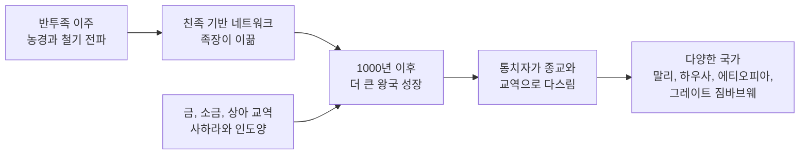

# AP 세계사: 모던 — 토픽 1.5 요약: 아프리카의 국가 형성 (State Building in Africa)

> 출처: AP_WH_1.5_Notes_KR.md 요약 (College Board CED 기준 · 교재 반영, 교재 Topic 1.5)

**Unit 1: 세계의 태피스트리 (The Global Tapestry, c. 1200–1450)**

---

## 한 문장 요약

1200–1450년 아프리카의 국가들은 금, 소금, 상아 **교역을 장악**하고 **종교**(이슬람, 기독교, 토착 전통)를 이용해 통치자를 뒷받침하면서 더 크고 부유해졌으며, 제국, 도시 국가, 왕국처럼 **여러 형태**를 띠었다.

## 큰 그림

오랫동안 사하라 이남 아프리카의 많은 사람은 하나의 중앙 정부 대신 족장이 이끄는 작은 **친족 기반 네트워크 (Kin-based networks)** 속에서 살았다. **1000년** 이후에는 더 큰 왕국들이 중요해졌다. 통치자들은 사하라 사막과 인도양을 건너는 **교역로**를 장악하고 세금을 거두어 부유해졌다. 이들은 **종교**와 **오래된 전통**을 이용해 자신에게 통치할 권리가 있음을 보여 주었다. 그 결과 **말리 제국 (Mali Empire)**, **하우사 도시 국가 (Hausa city-states)**, 기독교 왕국 **에티오피아 (Ethiopia)**, 석조 도시 **그레이트 짐바브웨** (Great Zimbabwe)처럼 **다양한** 국가가 나타났다.

## 핵심 정리

### 1. 1200년 이전: 족장과 가나 제국

- 사하라 이남의 많은 사회는 권력을 **집중하지 않았다**. 가족이 **친족 기반 네트워크** 안에서 스스로를 다스렸다.
- 네트워크의 남성 우두머리인 **족장** (Chief)이 분쟁을 조정했다. 족장들이 함께 **지구** (District, 여러 마을의 모임)의 문제를 풀었다.
- 인구가 늘면서 마을 사이의 싸움이 늘었고, 1000년 이후 **더 큰 왕국**이 중요해졌다.
- 서아프리카의 **가나 제국** (Ghana Empire)은 영토를 지나는 **금과 소금에 세금**을 매겨 부유해졌다. 오늘날의 가나 공화국과는 위치가 **다르다**.
- 교재는 12세기까지 이웃과의 전쟁이 가나를 영구히 약하게 만들었다고 쓴다. 이 지역에서 가장 강한 새 나라는 **말리**였다.

### 2. 말리 제국 (서아프리카)

- **순디아타 케이타** (Sundiata Keita)는 **키리나 전투** (Battle of Kirina, c. 1235)에서 소소 (Sosso)의 왕을 물리치고 **말리 제국**을 세웠다. 그는 가나의 옛 교역로를 차지했다.
- 말리는 **금광**을 장악하고 **금, 소금, 구리**에 세금을 매겼다. 통치자는 **만사** (Mansa, "왕" 또는 "황제")라고 불렸다.
- **1324년** **만사 무사** (Mansa Musa)는 **하즈** (Hajj, 메카로 가는 이슬람 성지 순례)를 떠났다. 그가 카이로에서 금을 너무 많이 나누어 주어서 그곳의 금값이 몇 년 동안 떨어졌다.
- 만사 무사는 학자와 건축가를 데려왔다. **팀북투** (Timbuktu)는 **이슬람 학문**의 중심지가 되었다.
- 통치자와 상인은 무슬림이 되었지만, 많은 농민은 **토착 신앙**을 지켰다. 통치자들은 이슬람을 **그리오** (Griot, 구전 역사가)와 오래된 궁정 의례 같은 토착 관습과 섞었다. 이렇게 섞는 것을 **혼합주의** (Syncretism)라고 한다.

### 3. 하우사 왕국 (서아프리카)

- 하우사족은 **1000년 이전 어느 때** 나이지리아 북부에 **일곱 나라**를 세웠다. 주요 도시로 **카노 (Kano), 카치나 (Katsina), 자리아** (Zaria)가 있었다.
- 각 나라는 **사르키** (Sarki)라는 왕이 다스린 독립 **도시 국가** (City-state, 스스로와 주변 땅을 다스리는 도시)였다.
- 이들은 **분권적** (Decentralized)이었다. **중앙 권력이 없었고** 느슨한 **친족 관계**로만 이어졌다. 1800년대 이전에는 하나의 제국으로 **통일되지 않았다**.
- 이들은 성벽 안에 농지가 있는 큰 **성벽 도시**를 지었다. 그래서 포위되어도 버틸 수 있었다.
- 도시마다 **면직물 (Cotton cloth)**, 염색, 가죽 같은 **교역 특산 분야**가 있었다. 통치자와 상인은 **14세기** 무렵 **이슬람**을 받아들였다.

### 4. 에티오피아: 기독교 왕국 (아프리카의 뿔)

- 에티오피아는 고대 왕국 **악숨** (Aksum)의 **기독교** 전통을 이어 갔다.
- **자그웨 왕조** (Zagwe dynasty)는 1270년까지 다스렸다. **랄리벨라 왕** (King Lalibela)은 **단단한 바위를 아래로 파 내려가며 깎은 11개의 교회**를 만든 인물로 알려져 있다(c. 1200, 정확한 시기는 논쟁 중이다).
- **1270년** **솔로몬 왕조** (Solomonic dynasty)가 권력을 잡았다. 이 왕조는 **솔로몬 왕** (King Solomon)과 **시바 여왕** (Queen of Sheba)의 후손이라고 주장했다.
- 1300년대 초에 편찬된 책 **케브라 나가스트** (Kebra Nagast)가 이 이야기를 담았다. 이 책은 솔로몬 왕조의 통치를 **정당화** (Legitimize, 받아들일 이유를 줌)했다. 왕은 교회에 땅을 주었고, 교회는 왕을 지지했다.
- 교재는 에티오피아를 **이슬람 국가**들에 둘러싸인 "**기독교의 섬** (Island of Christianity)"이라고 부른다. **암다 시온 (Amda Seyon)** 같은 왕은 주변 이슬람 술탄국과 싸워 영토를 **넓혔다**.

### 5. 그레이트 짐바브웨 (남부 아프리카)

- 반투어를 쓰는 **쇼나족** (Shona)이 **그레이트 짐바브웨**를 세웠다. 이 도시는 **모르타르 없이** 쌓은 **석벽**, 곧 **건식 석벽** (Dry-stone walls)으로 지어졌다.
- **왕과 엘리트**는 석벽 안에 살았고, 보통 사람들은 벽 밖의 흙집에 살았다.
- 부는 **소 (Cattle)**, 농업, 그리고 무엇보다 **금**에서 나왔다. 왕국은 **금 운송에 세금**을 매겼다.
- 금과 상아는 **스와힐리 해안** (Swahili coast, 킬와 (Kilwa) 같은 무슬림 교역 도시)을 거쳐 **인도양 교역** (Indian Ocean trade)으로 나갔다. 고고학자들은 이곳에서 **중국 도자기** (Chinese porcelain)와 페르시아 도기를 발견했다.
- 이 도시는 **1450년** 무렵 버려졌다. **과도한 방목**과 금 교역의 중심이 북쪽으로 옮겨 간 것이 원인으로 보인다.

> ⚠️ 교재는 짐바브웨를 **동아프리카**에 두고, "짐바브웨"를 "거처"로 옮긴다. 대부분의 지도는 이곳을 **남부**(남동부) 아프리카에 두며, 많은 설명에서는 이 쇼나어를 "돌로 된 집"으로 옮긴다. 선생님이 어떻게 가르치는지 확인이 필요하다.

## 꼭 알아야 할 용어·인물

| 용어 | 무엇인가 | 왜 중요한가 |
|---|---|---|
| 친족 기반 네트워크 (Kin-based network) | 족장이 이끌고 가족이 스스로를 다스린 공동체 | 많은 아프리카인이 중앙 정부 없이 살았음을 보여 준다 |
| 말리 제국 (Mali Empire) | c. 1235년 순디아타가 세운 서아프리카 제국 | 금-소금 교역을 장악해 부유해졌다 |
| 순디아타 케이타 (Sundiata Keita) | 키리나 전투에서 이긴 말리의 건국자 | 그의 이야기인 순디아타 서사시가 말리 통치자를 뒷받침했다 |
| 만사 무사 (Mansa Musa) | 1324년 하즈를 떠난 말리의 통치자 | 그의 금이 말리를 유명하게 했고, 그는 팀북투의 이슬람 학문을 후원했다 |
| 그리오 (Griot) | 서아프리카의 구전 역사가이자 음악가, 이야기꾼 | 역사를 지키고 왕에게 조언했다. 말리 통치자가 지킨 토착 전통이다 |
| 혼합주의 (Syncretism) | 서로 다른 종교나 문화 전통이 섞이는 것 | 말리 통치자는 이슬람과 토착 관습을 섞어 모두를 다스렸다 |
| 하우사 왕국 (Hausa kingdoms) | 나이지리아 북부의 독립된 성벽 도시 국가 | 끝내 통일되지 않은 분권적 국가의 CED 예시이다 |
| 자그웨 왕조 (Zagwe dynasty) | 1270년 이전의 에티오피아 왕조 | 랄리벨라의 암반 교회 (Rock-hewn churches)로 유명하다 |
| 솔로몬 왕조 (Solomonic dynasty) | 1270년부터 에티오피아를 다스린 왕조 | 솔로몬과 시바의 후손이라고 주장해 통치를 정당화했다 |
| 케브라 나가스트 (Kebra Nagast) | 솔로몬, 시바와 그 아들의 이야기를 담은 1300년대 초 에티오피아의 책 | 솔로몬 왕조의 통치를 정당화했다 |
| 그레이트 짐바브웨 (Great Zimbabwe) | 건식 석벽으로 지은 쇼나족의 석조 도시 (c. 1200–1450) | 금과 인도양 교역으로 부유해진 국가의 CED 예시이다 |
| 스와힐리 해안 (Swahili coast) | 킬와 같은 동아프리카 해안의 무슬림 교역 도시 국가 | 그레이트 짐바브웨를 인도양 교역과 이어 주었다 |

## 주요 연도

| 연도 | 사건 |
|---|---|
| 1000년 이전 | 하우사 일곱 나라 형성 |
| c. 1200 | 랄리벨라의 암반 교회. 그레이트 짐바브웨 성장 시작 |
| c. 1235 | 키리나 전투. 순디아타가 말리 건국 |
| 1270 | 예쿠노 암라크 (Yekuno Amlak)가 에티오피아에 솔로몬 왕조 건국 |
| 1300년대 초 | 케브라 나가스트 편찬 |
| 1324 | 만사 무사가 카이로를 거쳐 하즈 |
| 14세기 | 하우사 통치자들이 이슬람 수용 |
| c. 1450 | 그레이트 짐바브웨가 버려짐 (교재는 1400년대 말까지라고 씀) |

## 시험에서는 이렇게 묻는다

- **정당화와 공고화:** 말리 통치자는 **이슬람**, **그리오**, **금의 부**를 이용했고, 정복된 지역의 통치자가 **공물** (Tribute)을 바치면 권력을 유지하게 했다. 에티오피아 왕은 **케브라 나가스트**와 **교회의 지지**를 이용했다. 그레이트 짐바브웨의 통치자는 **석벽**과 **금 교역**의 장악으로 권력을 보여 주었다.
- **연속성·혁신·다양성:** 연속성 (Continuity): 말리는 **가나의 금-소금 교역**을 이어받았다. 혁신 (Innovation): 랄리벨라의 **암반 교회**. 다양성 (Diversity): **제국**(말리), **도시 국가**(하우사), **기독교 왕국**(에티오피아), **석조 도시**(그레이트 짐바브웨).
- **자주 나오는 비교:** 말리와 그레이트 짐바브웨. 공통점: 둘 다 **금**으로 부유해졌다. 차이점: 말리는 사하라를 건너 **육로로** 교역했고 통치자가 무슬림이었다. 그레이트 짐바브웨는 스와힐리 해안을 통해 **바닷길로** 교역했고 **토착** 신앙을 지켰다.
- **자주 하는 실수:** 학생들은 "하우사 왕국"을 하나의 제국으로 생각하곤 한다. 바로잡기: 이들은 **중앙 권력이 없는** **별개의 도시 국가**였고 서로 경쟁했다.

## 스스로 확인하기

1. 말리의 통치자들은 어떻게 무슬림 상인과 비무슬림 농민을 함께 다스렸는가?

▶ 정답
교역 관계, 문자, 위신을 위해 이슬람을 받아들이면서도 토착 의례와 그리오를 유지했다. 이런 혼합주의 덕분에 두 집단 모두의 충성을 지킬 수 있었다.

2. 에티오피아의 솔로몬 왕조는 자신의 통치권을 어떻게 정당화했는가?

▶ 정답
솔로몬 왕과 시바 여왕의 후손이라고 주장했고, 이 이야기는 케브라 나가스트에 담겼다. 왕에게서 땅을 받은 교회도 왕의 통치권을 지지했다.

3. 그레이트 짐바브웨의 부는 어디에서 나왔는가?

▶ 정답
소와, 무엇보다 금에서 나왔다. 왕국은 금 운송에 세금을 매겼고, 금과 상아를 스와힐리 해안으로 보내 인도양 교역에 참여했다.

