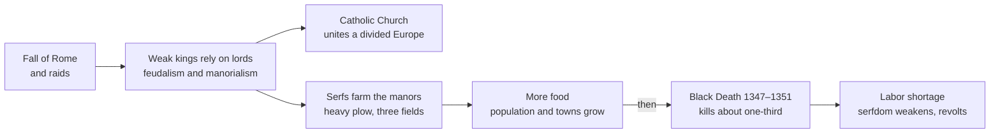

# AP World History: Modern — Topic 1.6 Summary: Developments in Europe (c. 1200–1450)

> Source: Summary of AP_WH_1.6_Notes_EN.md (College Board CED · textbook incorporated, Topic 1.6 reading)

**Unit 1: The Global Tapestry (c. 1200–1450)**

---

## In One Sentence

From c. 1200 to c. 1450, the Christian Church tied a politically divided Europe together, feudal lords held most local power, and serfs farmed the land, until the Black Death and new wars began to weaken serfdom and make some kings stronger.

## The Big Picture

After the Western Roman Empire fell, no single government ruled Europe again. Kings were weak, so people turned to local lords for protection, and Europe ran on **feudalism** and **manorialism**. The **Roman Catholic Church** was the one institution that reached across this divided world, while Jews and Muslims lived in Europe as minorities. Most people were peasants, and new farming methods fed a growing population. Then the **Black Death (1347–1351)** killed about a third of Europe's people, and the labor shortage weakened serfdom.

## Key Points

### 1. The Catholic Church Holds Europe Together (religion)
- The **Roman Catholic Church** was the most powerful institution in Western Europe. Kingdoms were divided, but almost everyone in the west shared one faith.
- People believed the **sacraments** (seven sacred rituals, such as baptism and marriage) were needed for salvation, so every stage of life ran through the Church.
- People paid a **tithe** (one-tenth of their income or harvest) to the Church. This made the Church very rich and one of the largest landowners.
- The Church ran **monasteries** and founded the first **universities**. **Scholasticism** used reason and logic to explain faith, and **Thomas Aquinas** argued that faith and reason do not conflict.
- The Church could **excommunicate** a person (cut them off from the sacraments). This gave popes power over kings and lords.

### 2. Other Faiths: Orthodox Christians, Jews, and Muslims (religion)
- In **1054**, the **East-West Schism** split Christianity into the Roman Catholic west and the **Eastern Orthodox** east. The textbook calls this split the Great Schism.
- Starting in **1095**, popes called the **Crusades**, religious wars to take the Holy Land (Palestine) from Muslim rule. In **1204**, the Fourth Crusade sacked Constantinople, which deepened hatred between Catholics and Orthodox Christians.
- The Church banned **usury** (lending money at interest) among Christians, and Jews were barred from owning land in many places, so many Jews became **moneylenders** and traders in towns.
- **Antisemitism** (anti-Jewish feeling) was widespread. Kings **expelled** Jews, for example England in 1290, and during the Black Death many Christians falsely blamed Jews for the plague.
- Muslim-ruled Iberia, called **al-Andalus**, was a center of learning. Christian kingdoms fought the long **Reconquista** to take Iberia back from Muslim rule.

### 3. Why Power Was Spread Out: Feudalism and Manorialism (politics)
- **Political decentralization** means power was split among many local rulers instead of one central government.
- After Rome fell, there was no central government, tax system, or professional army in the west. Viking, Magyar, and Muslim **raids** needed fast, local defense.
- Kings had little money and **depended on nobles** for soldiers. Land was the main form of wealth, so rulers paid for loyalty with land.
- **Feudalism:** a lord gave a **fief** (a grant of land) to a **vassal**, who swore loyalty and gave military service. Knights were mounted warriors who fought for their lords.
- **Manorialism:** a lord's estate, the **manor**, was largely self-sufficient and was worked by serfs. The lord gave protection and justice in return.

### 4. Kings, Emperors, and City-States (politics)
- **England:** In **1215**, nobles forced King John to accept **Magna Carta**, which put the king under the law. **Parliament** grew from royal councils and came to include knights and townspeople.
- **France:** Kings at first controlled only the area around Paris. Philip IV called the **Estates-General** in 1302, but it had little power.
- **Holy Roman Empire:** An **elected** emperor ruled hundreds of German states. The **Golden Bull (1356)** named seven prince-electors and confirmed the princes' power, so Germany stayed divided.
- **Italian city-states** such as Venice, Florence, and Genoa governed themselves. Wealthy merchant families, such as the **Medici** bankers of Florence, ruled.
- The **Hundred Years' War (1337–1453)** between England and France led kings to raise permanent taxes and build **standing armies**. By 1450, England and France were becoming more centralized, while the Holy Roman Empire and Italy stayed divided.

### 5. Farming Shapes Society (agriculture)
- About **90 percent** of Europeans were peasants who lived and worked on the land.
- **Serfs** were **coerced labor**: they were bound to the land and could not leave or marry without the lord's permission. They were not slaves, and children born to serfs were also serfs.
- **Free peasants** were **free labor**: they rented or owned small plots and could move.
- The **heavy plow** cut into the heavy, wet soils of northern Europe. The **three-field system** let two-thirds of the land produce crops each year instead of half.
- These changes and a warmer climate helped Europe's population roughly **double** between c. 1000 and c. 1300. More food meant more towns and trade.

> ⚠️ The textbook says agriculture became more efficient and the three-field system "came into use" near the end of the Middle Ages. Many accounts say the three-field system began spreading in the 8th and 9th centuries and was widespread by the 1000s–1200s, helping cause the population growth of c. 1000–1300. Check how your teacher presents this.

### 6. The Black Death and a Changing Society (agriculture)
- The **Black Death** (bubonic plague) reached Sicily in 1347 and killed about **one-third** of Europe's people.
- So many workers died that surviving peasants could demand **higher wages**. The textbook stresses that serfs gained **bargaining power** with lords.
- Lords and kings tried to freeze wages with laws such as England's **Statute of Labourers (1351)**. **Peasant revolts** followed: the Jacquerie in France (1358) and the English Peasants' Revolt (1381).
- In Western Europe, many lords turned labor duties into money rents or freed serfs, so **serfdom weakened**. In Eastern Europe, by contrast, lords later tightened serfdom.
- Growing trade created a new middle class in towns, the **bourgeoisie**, while the **Little Ice Age** (a cooling of the climate from about 1300) slowed growth.

## Must-Know Terms & People

| Term | What it is | Why it matters |
|---|---|---|
| Roman Catholic Church | The Christian church led by the pope in Rome | The main institution that united a divided Western Europe |
| Scholasticism | A method of study that used reason and logic to explain Christian faith | Shows learning reviving inside the Church |
| Thomas Aquinas | A Dominican scholar (1225–1274) who wrote the *Summa Theologica* | Argued that faith and reason do not conflict |
| East-West Schism | The 1054 split between Roman Catholic and Eastern Orthodox Christianity | Divided European Christianity into west and east |
| Reconquista | The Christian campaign to retake Iberia from Muslim rule | Shows Christian kingdoms pushing back Islam in Europe |
| Feudalism | A system in which lords granted land to vassals for loyalty and military service | A defining feature of decentralized Europe |
| Manorialism | An economic system of self-sufficient estates worked by serfs | Linked farming to the social order |
| Serf | A peasant legally bound to the land who owed labor and dues to the lord | The main example of coerced labor in Europe |
| Magna Carta | The 1215 English charter that put the king under the law | An early limit on royal power |
| Holy Roman Empire | A loose union of hundreds of German and northern Italian states under an elected emperor | A clear example of a state that stayed fragmented |
| Black Death | The plague of 1347–1351 that killed about a third of Europe's people | Caused a labor shortage that weakened serfdom |
| Bourgeoisie | The growing town middle class of merchants, shopkeepers, and craftspeople | Showed that economic success could bring status |

## Key Dates

| Year | Event |
|---|---|
| 1054 | East-West Schism splits Christianity |
| 1095 | Pope Urban II calls the First Crusade |
| 1204 | The Fourth Crusade sacks Constantinople |
| 1215 | Magna Carta |
| 1290 | England expels its Jews |
| 1337–1453 | Hundred Years' War between England and France |
| 1347–1351 | Black Death in Europe |
| 1381 | English Peasants' Revolt |

## How the Exam Asks About It

- **Legitimacy & consolidation:** Kings held their lords through oaths of loyalty, and emperors claimed the title of Charlemagne, whom a pope had crowned in 800. Over time, kings in England and France built power by hiring their own officials and armies, and after the Hundred Years' War by collecting permanent taxes and keeping standing armies.
- **Continuity, innovation, diversity:** Continuity: Christianity, Judaism, and Islam continued to shape European society. Innovation: the heavy plow and the three-field system grew more food. Diversity: a Catholic west, an Orthodox east, and Jewish and Muslim communities.
- **Likely comparison:** European feudalism vs. Japanese feudalism (Topic 1.1). Similar: both were decentralized, land-based systems in which a warrior elite (knights, samurai) served lords. Different: in Europe the bond was a contract with duties on both sides and the Church was a separate, powerful institution; in Japan it was personal loyalty shaped by Confucian ideas.
- **Common trap:** Students often call serfs slaves. Serfs were coerced labor bound to the land, but they could not be sold apart from the land, so they were not slaves.

## Check Yourself

1. Why was Europe politically decentralized in this period?

▶ Answer
After Rome fell, kings were weak and could not stop the raids, so people turned to local lords for protection. Lords gave land to vassals in exchange for loyalty and military service (feudalism), so real power stayed with local nobles.

2. Give two ways the Roman Catholic Church shaped daily life in Europe.

▶ Answer
People believed the sacraments were needed for salvation, so every stage of life ran through the Church. People also paid the Church a tithe, and the Church ran monasteries and universities.

3. How did the Black Death change the lives of peasants in Western Europe?

▶ Answer
So many workers died that surviving peasants could demand higher wages and better terms. When lords and kings tried to freeze wages, peasants revolted, and serfdom weakened as many lords freed serfs or took money rents instead of labor.

