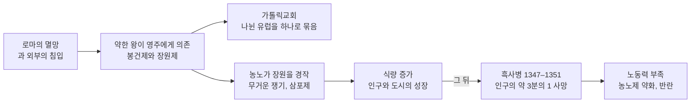

# AP 세계사: 모던 — 토픽 1.6 요약: 유럽의 발전 (Developments in Europe, c. 1200–1450)

> 출처: AP_WH_1.6_Notes_KR.md 요약 (College Board CED 기준 · 교재 반영, 교재 Topic 1.6)

**Unit 1: 세계의 태피스트리 (The Global Tapestry, c. 1200–1450)**

---

## 한 문장 요약

c. 1200–1450년 유럽에서는 기독교 교회가 정치적으로 나뉜 유럽을 하나로 묶었고, 봉건 영주가 지방 권력의 대부분을 쥐었으며, 농노가 땅을 경작했지만, 흑사병과 새로운 전쟁이 농노제를 약하게 만들고 일부 왕을 더 강하게 만들기 시작했다.

## 큰 그림

**서로마 제국 (Western Roman Empire)**이 무너진 뒤 유럽을 다시 하나로 다스린 정부는 없었다. 왕이 약했기 때문에 사람들은 보호를 받으려고 지방 영주에게 의지했고, 유럽은 **봉건제 (Feudalism)**와 **장원제 (Manorialism)**로 움직였다. 이렇게 나뉜 세계를 하나로 이은 유일한 기관은 **로마 가톨릭교회 (Roman Catholic Church)**였고, 유대인과 무슬림은 소수자로 유럽에 살았다. 사람들 대부분은 농민이었고, 새 농법이 늘어나는 인구를 먹여 살렸다. 그러다 **흑사병 (Black Death, 1347–1351)**이 유럽 인구의 약 3분의 1을 죽였고, 노동력 부족이 농노제를 약하게 만들었다.

## 핵심 정리

### 1. 가톨릭교회가 유럽을 하나로 묶다 (종교)
- **로마 가톨릭교회**는 서유럽에서 가장 강력한 기관이었다. 왕국들은 나뉘어 있었지만, 서유럽 사람들은 거의 모두 같은 신앙을 가졌다.
- 사람들은 **성사 (Sacraments)**(세례, 혼인 같은 일곱 가지 거룩한 의식)가 구원에 꼭 필요하다고 믿었다. 그래서 삶의 모든 단계가 교회를 거쳤다.
- 사람들은 교회에 **십일조 (Tithe)**(수입이나 수확의 10분의 1)를 냈다. 이 때문에 교회는 크게 부유해졌고, 가장 큰 토지 소유자 가운데 하나가 되었다.
- 교회는 **수도원 (Monastery)**을 운영했고 최초의 **대학 (University)**을 세웠다. **스콜라 철학 (Scholasticism)**은 이성과 논리로 신앙을 설명했고, **토마스 아퀴나스 (Thomas Aquinas)**는 신앙과 이성이 충돌하지 않는다고 주장했다.
- 교회는 한 사람을 **파문 (Excommunication)**(성사에서 끊어 내는 것)할 수 있었다. 이 힘 덕분에 교황은 왕과 영주를 누를 수 있었다.

### 2. 다른 신앙: 정교회 신자, 유대인, 무슬림 (종교)
- **1054년** **동서 교회 분열 (East-West Schism)**로 기독교는 서쪽의 로마 가톨릭과 동쪽의 **동방 정교회 (Eastern Orthodox Church)**로 갈라졌다. 교재는 이 분열을 대분열 (Great Schism)이라고 부른다.
- **1095년**부터 교황은 성지 (Holy Land, 팔레스타인)를 무슬림 지배에서 되찾으려고 **십자군 (Crusades)**이라는 종교 전쟁을 일으켰다. **1204년** 제4차 십자군 (Fourth Crusade)은 콘스탄티노폴리스 (Constantinople)를 약탈했고, 이 일로 가톨릭과 정교회 신자 사이의 증오가 깊어졌다.
- 교회는 기독교인 사이의 **고리대금 (Usury, 이자를 받고 돈을 빌려주는 것)**을 금지했고, 유대인은 많은 곳에서 땅을 소유할 수 없었다. 그래서 많은 유대인이 도시에서 **대금업자**와 상인이 되었다.
- **반유대주의 (Antisemitism, 유대인에 대한 적대감)**가 널리 퍼져 있었다. 왕들은 유대인을 **추방**했고(예: 1290년 잉글랜드), 흑사병 때 많은 기독교인이 흑사병의 책임을 거짓으로 유대인에게 돌렸다.
- 무슬림이 다스린 이베리아, 곧 **알안달루스 (al-Andalus)**는 학문의 중심지였다. 기독교 왕국들은 이베리아를 무슬림 지배에서 되찾으려고 오랜 **레콘키스타 (Reconquista)**를 벌였다.

### 3. 권력이 나뉜 이유: 봉건제와 장원제 (정치)
- **정치적 분권화 (Political decentralization)**는 권력이 하나의 중앙 정부가 아니라 여러 지방 통치자에게 나뉘어 있었다는 뜻이다.
- 로마가 무너진 뒤 서유럽에는 중앙 정부, 조세 제도, 직업 군대가 남지 않았다. 바이킹 (Vikings), 마자르족 (Magyars), 무슬림의 **침입**에 맞서려면 현지에서 빠르게 방어해야 했다.
- 왕은 돈이 부족해서 병사를 얻으려면 **귀족에게 의존**했다. 땅이 부의 중심이었기 때문에 통치자는 땅으로 충성을 샀다.
- **봉건제:** 영주는 **봉신 (Vassal)**에게 **봉토 (Fief, 나누어 준 땅)**를 주었고, 봉신은 충성을 맹세하고 군사 봉사를 했다. 기사 (Knight)는 영주를 위해 싸운 기마 전사였다.
- **장원제:** 영주의 영지인 **장원 (Manor)**은 대체로 자급자족했고, 농노가 일했다. 그 대가로 영주는 보호와 재판을 제공했다.

### 4. 왕, 황제, 도시국가 (정치)
- **잉글랜드:** **1215년** 귀족들이 존 왕 (King John)에게 **마그나 카르타 (Magna Carta)**를 받아들이게 했고, 이로써 왕도 법 아래 놓였다. **의회 (Parliament)**는 왕의 자문 회의에서 발전해 기사와 도시민까지 포함하게 되었다.
- **프랑스:** 처음에 왕은 파리 주변만 다스렸다. 필리프 4세 (Philip IV)는 1302년 **삼부회 (Estates-General)**를 소집했지만, 삼부회의 힘은 약했다.
- **신성 로마 제국 (Holy Roman Empire):** **선출**된 황제가 수백 개의 독일 국가를 다스렸다. **금인칙서 (Golden Bull, 1356)**는 일곱 선제후 (Prince-electors)를 정하고 제후의 권력을 굳혔기 때문에, 독일은 계속 분열되었다.
- 베네치아 (Venice), 피렌체 (Florence), 제노바 (Genoa) 같은 **이탈리아 도시국가 (Italian city-states)**는 스스로 다스렸다. 피렌체의 은행가 **메디치 (Medici)** 가문 같은 부유한 상인 가문이 통치했다.
- 잉글랜드와 프랑스 사이의 **백년 전쟁 (Hundred Years' War, 1337–1453)**으로 왕들은 상설 세금을 걷고 **상비군 (Standing army)**을 만들었다. 1450년까지 잉글랜드와 프랑스는 점점 중앙집권화되었지만, 신성 로마 제국과 이탈리아는 분열된 채로 남았다.

### 5. 농업이 사회를 만들다 (농업)
- 유럽인의 약 **90퍼센트**는 땅에서 살며 일하는 농민이었다.
- **농노 (Serf)**는 **강제 노동 (Coerced labor)**이었다. 땅에 묶여 있었고, 영주의 허락 없이는 장원을 떠나거나 결혼할 수 없었다. 노예는 아니었고, 농노에게서 태어난 아이도 농노가 되었다.
- **자유농 (Free peasant)**은 **자유 노동 (Free labor)**이었다. 땅을 빌리거나 작은 땅을 소유했고, 이동할 수 있었다.
- **무거운 쟁기 (Heavy plow)**는 북유럽의 무겁고 축축한 흙을 갈 수 있었다. **삼포제 (Three-field system)** 덕분에 해마다 땅의 절반이 아니라 3분의 2에서 수확했다.
- 이런 변화와 따뜻한 기후 덕분에 유럽 인구는 c. 1000–1300년 사이에 대략 **두 배**가 되었다. 식량이 늘자 도시와 교역도 커졌다.

> ⚠️ 교재는 농업이 중세 말기 무렵에 더 효율적이 되었고 삼포제가 그때 "쓰이기 시작했다"고 쓴다. 많은 설명에서는 삼포제가 8–9세기부터 퍼지기 시작해 1000–1200년대에는 널리 쓰였고, c. 1000–1300년의 인구 증가를 이끌었다고 본다. 선생님이 어떻게 가르치는지 확인이 필요하다.

### 6. 흑사병과 변화하는 사회 (농업)
- **흑사병**(선페스트 (Bubonic plague))은 1347년 시칠리아에 도착했고, 유럽 인구의 약 **3분의 1**을 죽였다.
- 일꾼이 너무 많이 죽어서 살아남은 농민은 **더 높은 임금**을 요구할 수 있었다. 교재는 농노가 영주에 대해 **협상력**을 얻었다는 점을 강조한다.
- 영주와 왕은 잉글랜드의 **노동자 조례 (Statute of Labourers, 1351)** 같은 법으로 임금을 묶으려 했다. 뒤이어 **농민 반란**이 일어났다. 프랑스의 자크리의 난 (Jacquerie, 1358)과 잉글랜드 농민 반란 (English Peasants' Revolt, 1381)이다.
- 서유럽에서는 많은 영주가 노동 의무를 화폐 지대로 바꾸거나 농노를 해방했다. 그래서 **농노제가 약해졌다**. 반대로 동유럽에서는 나중에 영주들이 농노제를 더 강화했다.
- 교역이 늘면서 도시에 새로운 중간 계층인 **부르주아 (Bourgeoisie)**가 생겼고, **소빙하기 (Little Ice Age)**(약 1300년부터 시작된 기후 냉각)는 성장을 늦추었다.

## 꼭 알아야 할 용어·인물

| 용어 | 무엇인가 | 왜 중요한가 |
|---|---|---|
| 로마 가톨릭교회 (Roman Catholic Church) | 로마의 교황이 이끈 기독교 교회 | 나뉜 서유럽을 하나로 묶은 중심 기관 |
| 스콜라 철학 (Scholasticism) | 이성과 논리로 기독교 신앙을 설명한 학문 방법 | 교회 안에서 학문이 되살아났음을 보여 줌 |
| 토마스 아퀴나스 (Thomas Aquinas) | *신학대전 (Summa Theologica)*을 쓴 도미니코회 학자 (1225–1274) | 신앙과 이성이 충돌하지 않는다고 주장함 |
| 동서 교회 분열 (East-West Schism) | 1054년 로마 가톨릭과 동방 정교회가 갈라진 사건 | 유럽의 기독교를 서쪽과 동쪽으로 나눔 |
| 레콘키스타 (Reconquista) | 이베리아를 무슬림 지배에서 되찾으려 한 기독교 세력의 전쟁 | 기독교 왕국이 유럽에서 이슬람 세력을 밀어낸 과정을 보여 줌 |
| 봉건제 (Feudalism) | 영주가 충성과 군사 봉사의 대가로 봉신에게 땅을 준 제도 | 분권화된 유럽의 대표적 특징 |
| 장원제 (Manorialism) | 농노가 일하는 자급자족 영지를 바탕으로 한 경제 제도 | 농업과 사회 질서를 이어 줌 |
| 농노 (Serf) | 법적으로 땅에 묶여 영주에게 노동과 공납의 의무를 진 농민 | 유럽 강제 노동의 대표적 예 |
| 마그나 카르타 (Magna Carta) | 왕을 법 아래 둔 1215년 잉글랜드의 문서 | 왕권을 제한한 초기 사례 |
| 신성 로마 제국 (Holy Roman Empire) | 선출된 황제 아래 수백 개의 독일·북이탈리아 국가가 느슨하게 묶인 나라 | 분열된 채로 남은 국가의 분명한 예 |
| 흑사병 (Black Death) | 1347–1351년 유럽 인구의 약 3분의 1을 죽인 전염병 | 노동력 부족을 낳아 농노제를 약하게 만듦 |
| 부르주아 (Bourgeoisie) | 상인, 상점 주인, 장인으로 이루어진, 커져 가는 도시의 중간 계층 | 경제적 성공으로도 지위를 얻을 수 있음을 보여 줌 |

## 주요 연도

| 연도 | 사건 |
|---|---|
| 1054 | 동서 교회 분열 (East-West Schism)로 기독교가 갈라짐 |
| 1095 | 교황 우르바노 2세 (Urban II)가 제1차 십자군을 호소함 |
| 1204 | 제4차 십자군 (Fourth Crusade)이 콘스탄티노폴리스를 약탈함 |
| 1215 | 마그나 카르타 (Magna Carta) |
| 1290 | 잉글랜드가 유대인을 추방함 |
| 1337–1453 | 잉글랜드와 프랑스 사이의 백년 전쟁 (Hundred Years' War) |
| 1347–1351 | 유럽의 흑사병 (Black Death) |
| 1381 | 잉글랜드 농민 반란 (English Peasants' Revolt) |

## 시험에서는 이렇게 묻는다

- **정당화와 공고화:** 왕은 충성 서약으로 영주를 붙잡아 두었고, 황제는 교황이 800년에 대관한 카롤루스 대제 (Charlemagne)의 칭호를 내세웠다. 시간이 지나면서 잉글랜드와 프랑스의 왕은 자기 관리와 군대를 두어 힘을 키웠고, 백년 전쟁 뒤에는 상설 세금을 걷고 상비군을 유지했다.
- **연속성·혁신·다양성:** 연속성: 기독교, 유대교, 이슬람이 계속해서 유럽 사회를 형성했다. 혁신: 무거운 쟁기와 삼포제가 식량을 늘렸다. 다양성: 가톨릭의 서쪽, 정교회의 동쪽, 그리고 유대인과 무슬림 공동체가 있었다.
- **자주 나오는 비교:** 유럽 봉건제와 일본 봉건제 (토픽 1.1). 공통점: 둘 다 분권적이고 토지에 바탕을 둔 제도였고, 전사 엘리트(기사 (Knight), 사무라이 (Samurai))가 영주를 섬겼다. 차이점: 유럽에서는 관계가 양쪽 모두 의무를 지는 계약이었고 교회가 따로 존재하는 강력한 기관이었다. 일본에서는 유교 사상의 영향을 받은 개인적 충성이 관계의 바탕이었다.
- **자주 하는 실수:** 학생들은 농노를 노예라고 부르는 경우가 많다. 농노는 땅에 묶인 강제 노동이었지만, 땅과 따로 팔 수 없었기 때문에 노예는 아니었다.

## 스스로 확인하기

1. 이 시기 유럽은 왜 정치적으로 분권화되어 있었는가?

▶ 정답
로마가 무너진 뒤 왕은 약해서 침입을 막지 못했고, 사람들은 보호를 받으려고 지방 영주에게 의지했다. 영주는 충성과 군사 봉사의 대가로 봉신에게 땅을 주었기 때문에(봉건제) 실제 권력은 지방 귀족에게 남았다.

2. 로마 가톨릭교회가 유럽의 일상생활을 형성한 방법을 두 가지 들어 보라.

▶ 정답
사람들은 성사가 구원에 꼭 필요하다고 믿었기 때문에 삶의 모든 단계가 교회를 거쳤다. 또 사람들은 교회에 십일조를 냈고, 교회는 수도원과 대학을 운영했다.

3. 흑사병은 서유럽 농민의 삶을 어떻게 바꾸었는가?

▶ 정답
일꾼이 너무 많이 죽어서 살아남은 농민은 더 높은 임금과 더 나은 조건을 요구할 수 있었다. 영주와 왕이 임금을 묶으려 하자 농민이 반란을 일으켰고, 많은 영주가 농노를 해방하거나 노동 대신 화폐 지대를 받으면서 농노제가 약해졌다.

