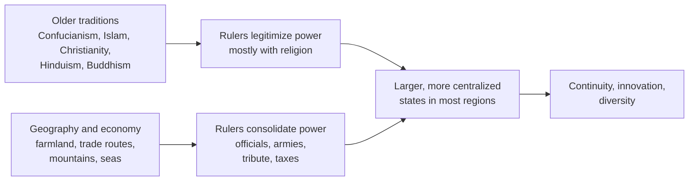

# AP World History: Modern — Topic 1.7 Summary: Comparing State Building (c. 1200–1450)

> Source: Summary of AP_WH_1.7_Notes_EN.md (College Board CED · textbook incorporated, Topic 1.7 reading)

**Unit 1: The Global Tapestry (c. 1200–1450)**

---

## In One Sentence

Between c. 1200 and c. 1450, most states grew **larger and more centralized** and used **religion** to justify their rule, but each region got there in its own way (Mongol military power in Asia, Islam in West Africa, the Middle East, and South Asia, trade in Europe), and some places, such as Japan, became **less** centralized.

## The Big Picture

Topic 1.7 asks you to **compare** the states you studied in Topics 1.1–1.6. Every ruler had two jobs. First, he had to **legitimize** his power: show people that he had the right to rule. Second, he had to **consolidate** his power: keep control over land, people, and wealth. Most rulers used religion for the first job and tools such as officials, armies, and taxes for the second. The CED sums up the era in three words: **continuity** (old traditions went on), **innovation** (new states appeared), and **diversity** (many kinds of states existed at once).

## Key Points

### 1. Two Jobs of Every Ruler
- **Legitimacy** means the accepted right to rule. It answers: why do people accept this ruler?
- **Consolidation** means keeping control. It answers: how does the ruler hold on to land, people, and wealth?
- Almost every state needed **both**. Force alone was easy to overthrow, and religious claims alone could not collect taxes.
- A **centralized state** keeps power at the center (Song China, the Inca). A **decentralized state** shares power with local lords or rulers (feudal Europe, Japan).

### 2. Legitimizing Power: Religion First
- **Song China:** the emperor ruled by the **Mandate of Heaven**, the idea that Heaven gives the right to rule to a good ruler.
- **Islam:** rulers of the **Mamluk Sultanate**, the **Delhi Sultanate**, and **Mali** presented themselves as defenders of Islam. **Mansa Musa** of Mali showed his faith with his hajj (pilgrimage) to Mecca in 1324.
- **Christianity:** kings in Europe were crowned by the Church. Ethiopia's **Solomonic dynasty** claimed descent from King Solomon and the Queen of Sheba.
- **Hinduism and Buddhism:** Khmer kings used the **devaraja** ("god-king") idea and built Angkor Wat.
- **Sun worship:** the Mexica offered **human sacrifice** to their sun and war god. The Sapa Inca claimed to be the **son of Inti**, the sun god.

### 3. Consolidating Power: Many Tools
- **Bureaucracy:** Song China chose officials through **civil service exams** on Confucian texts.
- **Military elites:** the **Mamluks** were Turkic slave soldiers who took over Egypt in 1250. Both sultanates paid officers with **iqta** land grants.
- **Feudal ties:** lords gave land for military service, in Europe (knights) and in Japan (samurai).
- **Tribute and labor:** the Mexica collected **tribute** (goods paid by conquered peoples). The Inca used the **mit'a** labor tax, roads, and quipu records.
- **Taxing trade and building monuments:** Mali taxed the **gold and salt** trade. Huge buildings, such as Angkor Wat and the stone walls of Great Zimbabwe, showed the ruler's power.

### 4. Continuity, Innovation, Diversity
- **Continuity:** the Song kept the old **Confucian** bureaucracy. Islam stayed the basis of rule even after the Mongols destroyed the Abbasid capital, Baghdad, in 1258.
- **Innovation:** as the **Abbasid Caliphate** broke up, new Islamic states appeared, most of them led by **Turkic** peoples. Other new states included the Delhi Sultanate (1206), the Mexica, and the Inca.
- **Revival:** rebuilding an older empire is a kind of continuity. The textbook says the **Song** built on the Han, and **Mali** built on Ghana.
- **Diversity:** empires, sultanates, kingdoms, **sea-based** trading states, city-states, feudal states, and nomadic empires all existed at the same time.

### 5. Different Paths in Different Regions
- **Shared trend:** states in the core areas grew **larger**, and smaller states declined.
- **Driving force:** **Mongol military power** in most of Asia, **Islam** in West Africa, the Middle East, and South Asia, and **trade** in Europe.
- **Africa:** the textbook says **Mali** was bigger and more centrally run than Ghana before it.
- **Europe and Japan:** in Europe, feudal ties **declined** as kings gained power, most clearly in England and France. Japan, unlike most states, became **more decentralized**.
- **Land vs. sea:** the **Khmer** were land-based and taxed rice farming. **Srivijaya** was sea-based and taxed ships in the Strait of Malacca.

### 6. Nomads From the Steppe
- Both the **Mongols** and the **Turkic peoples** came from the steppes (grasslands) of Central Asia.
- The Mongols built **one empire** in a coordinated campaign by unified clans. They conquered the Song by 1279.
- **Different Turkic groups** built **separate** empires, such as the Seljuks and Ottomans, and some lasted well past 1450.
- As stronger states rose, the influence of **nomadic** societies began to fade by the 15th century.

## Must-Know Terms & People

| Term | What it is | Why it matters |
|---|---|---|
| Legitimacy | The accepted right to rule, often based on religion or descent | One of the two things every ruler needed |
| Consolidation | Strengthening and keeping control over land, people, and wealth | The other thing every ruler needed |
| Centralized state | A state where the ruler and appointed officials hold power | The main trend of the era (Song, Inca, Mali) |
| Mandate of Heaven | The Chinese idea that Heaven gives a just emperor the right to rule | How the Song legitimized power |
| Civil service exams | Song exams on Confucian texts used to choose officials | How the Song consolidated power |
| Mamluks | Turkic slave soldiers who took power in Egypt in 1250 | A new Turkic-led Islamic state that stopped the Mongols |
| Iqta | A land grant whose taxes paid a military officer | Used by both the Mamluk and Delhi sultanates |
| Mansa Musa | Ruler of Mali who made a hajj to Mecca in 1324 | Showed how Islam legitimized African rulers |
| Feudalism | Lords gave land in exchange for military service and loyalty | Decentralized rule in Europe and Japan |
| Tribute system (Mexica) | Conquered city-states sent goods and labor to Tenochtitlan | How the Mexica held their empire |
| Mit'a | The Inca labor tax on state projects | How the Inca consolidated power |
| Sea-based state | A state that got its power from taxing sea trade | Contrasts with land-based states (Srivijaya vs. Khmer) |

## Key Dates

| Year | Event |
|---|---|
| 1206 | Delhi Sultanate founded |
| 1250 | Mamluks take power in Egypt |
| 1258 | Mongols destroy Abbasid Baghdad |
| 1260 | Mamluks defeat the Mongols at Ayn Jalut |
| 1279 | Song Dynasty falls to the Mongols |
| 1324 | Mansa Musa makes his hajj to Mecca |
| c. 1325 | Mexica found Tenochtitlan |
| 1438 | Pachacuti begins Inca expansion |

## How the Exam Asks About It

- **Legitimacy & consolidation:** rulers **legitimized** power mostly with religion (Mandate of Heaven, Islam, Christianity, god-kings, sun gods) and **consolidated** it with bureaucracy, military elites, feudal ties, tribute and labor, trade taxes, and monuments.
- **Continuity, innovation, diversity:** continuity is the Song keeping its Confucian bureaucracy; innovation is the Delhi Sultanate, a new state whose first sultans were former slave soldiers; diversity is sultanates, sea-based trading states, and feudal states existing side by side.
- **Likely comparison:** **Song China vs. the Inca.** Both were centralized states that used religion to legitimize rulers. The Song ruled through exam-chosen officials, whereas the Inca ruled through the mit'a, roads, and quipu, because the Song had a long written tradition and the Inca had no writing system.
- **Common trap:** saying that **every** state became more centralized. Japan became more decentralized, and most of the Americas had no centralized state. Say "most states" and name an exception.

## Check Yourself

1. What is the difference between legitimizing power and consolidating power? Give one example of each.

▶ Answer
Legitimizing means showing people you have the right to rule; consolidating means keeping control. For example, the Song legitimized power with the Mandate of Heaven and consolidated it with civil service exams.

2. How did Srivijaya and the Khmer Empire differ in where their wealth came from?

▶ Answer
Srivijaya was sea-based and taxed ships passing through the Strait of Malacca. The Khmer Empire was land-based and taxed rice farming.

3. How did the Mongols and the Turkic peoples differ in the way they built empires?

▶ Answer
The Mongols built one empire in a coordinated campaign by unified clans. Different Turkic groups, such as the Seljuks and Ottomans, built separate empires, and some lasted well past 1450.

