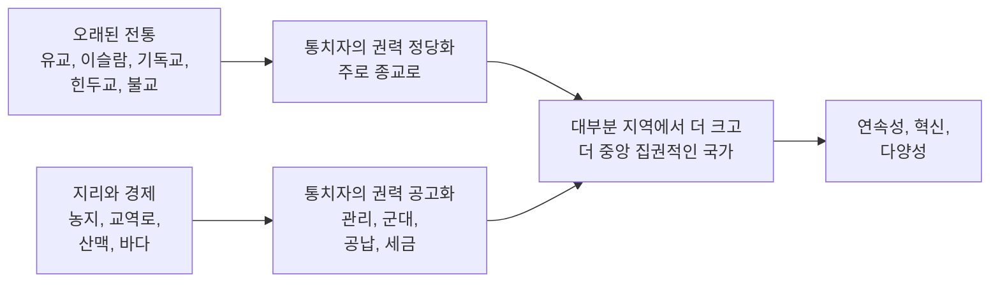

# AP 세계사: 모던 — 토픽 1.7 요약: 국가 형성 비교 (Comparing State Building)

> 출처: AP_WH_1.7_Notes_KR.md 요약 (College Board CED 기준 · 교재 반영, 교재 Topic 1.7)

**Unit 1: 세계의 태피스트리 (The Global Tapestry, c. 1200–1450)**

---

## 한 문장 요약

c. 1200–1450년 대부분의 국가는 **더 크고 더 중앙 집권적으로** 변했고 **종교**로 통치를 정당화했지만, 지역마다 그 길은 달랐으며(아시아의 몽골 군사력, 서아프리카·중동·남아시아의 이슬람, 유럽의 교역), 일본처럼 오히려 **덜** 중앙 집권적으로 변한 곳도 있었다.

## 큰 그림

토픽 1.7은 토픽 1.1–1.6에서 배운 국가들을 **비교** (Comparison)하라고 요구한다. 모든 통치자에게는 두 가지 일이 있었다. 첫째, 권력을 **정당화** (Legitimize)해야 했다. 즉, 자신에게 다스릴 권리가 있다고 사람들에게 보여 주어야 했다. 둘째, 권력을 **공고화** (Consolidate)해야 했다. 즉, 땅과 사람과 부를 계속 통제해야 했다. 대부분의 통치자는 첫째 일에 종교를 썼고, 둘째 일에 관리, 군대, 세금 같은 수단을 썼다. CED는 이 시대를 세 단어로 요약한다. 오래된 전통이 이어진 **연속성 (Continuity)**, 새 국가가 나타난 **혁신 (Innovation)**, 여러 종류의 국가가 동시에 존재한 **다양성** (Diversity)이다.

## 핵심 정리

### 1. 모든 통치자의 두 가지 일
- **정당성** (Legitimacy)은 다스릴 권리를 인정받는 것이다. 사람들은 왜 이 통치자를 받아들이는가라는 질문에 답한다.
- **공고화** (Consolidation)는 통제를 유지하는 것이다. 통치자는 땅, 사람, 부를 어떻게 지키는가라는 질문에 답한다.
- 거의 모든 국가에는 둘 다 **함께** 필요했다. 힘만 있으면 쉽게 무너졌고, 종교적 주장만 있으면 세금을 거둘 수 없었다.
- **중앙 집권 국가** (Centralized state)는 권력을 중앙에 둔다(송나라, 잉카). **지방 분권 국가** (Decentralized state)는 지방 영주나 통치자와 권력을 나눈다(봉건 유럽, 일본).

### 2. 권력의 정당화: 먼저 종교
- **송나라 (Song Dynasty):** 황제는 **천명** (Mandate of Heaven)으로 다스렸다. 하늘이 좋은 통치자에게 다스릴 권리를 준다는 사상이다.
- **이슬람 (Islam):** **맘루크 술탄국 (Mamluk Sultanate)**, **델리 술탄국 (Delhi Sultanate)**, **말리** (Mali)의 통치자들은 이슬람의 수호자로 자신을 내세웠다. 말리의 **만사 무사** (Mansa Musa)는 1324년 메카 성지 순례 (Hajj)로 신앙심을 보여 주었다.
- **기독교 (Christianity):** 유럽의 왕은 교회에서 대관식을 받았다. 에티오피아의 **솔로몬 왕조** (Solomonic dynasty)는 솔로몬 왕과 시바 여왕의 후손이라고 주장했다.
- **힌두교와 불교:** 크메르 (Khmer)의 왕은 **데바라자 (Devaraja, "신왕")** 사상을 이용했고 앙코르 와트 (Angkor Wat)를 지었다.
- **태양 숭배:** 메시카 (Mexica)는 태양과 전쟁의 신에게 **인신 공양** (Human sacrifice)을 바쳤다. 사파 잉카 (Sapa Inca)는 태양신 **인티 (Inti)의 아들**이라고 주장했다.

### 3. 권력의 공고화: 여러 가지 수단
- **관료제 (Bureaucracy):** 송나라는 유교 경전을 시험하는 **과거제** (Civil service exams)로 관리를 뽑았다.
- **군사 엘리트:** **맘루크** (Mamluks)는 1250년 이집트를 장악한 튀르크계 노예 병사였다. 두 술탄국 모두 **이크타 (Iqta)** 토지 수여로 장교에게 보수를 주었다.
- **봉건적 유대:** 영주는 군사 봉사를 받고 땅을 주었다. 유럽(기사)과 일본(사무라이 (Samurai))이 그랬다.
- **공납과 노동:** 메시카는 **공납 (Tribute)**(정복된 민족이 바치는 물자)을 거두었다. 잉카는 **미타 (Mit'a)** 노동세, 도로, 키푸 (Quipu) 기록을 썼다.
- **교역 과세와 기념물:** 말리는 **금·소금 (Gold and salt)** 교역에 세금을 매겼다. 앙코르 와트나 그레이트 짐바브웨 (Great Zimbabwe)의 돌벽 같은 거대한 건축물은 통치자의 권력을 보여 주었다.

### 4. 연속성, 혁신, 다양성
- **연속성:** 송나라는 오래된 **유교** 관료제를 유지했다. 몽골이 1258년 아바스 왕조의 수도 바그다드를 파괴한 뒤에도 이슬람은 통치의 바탕으로 남았다.
- **혁신:** **아바스 칼리프조** (Abbasid Caliphate)가 분열하면서 새로운 이슬람 국가들이 나타났고, 그 대부분은 **튀르크계 (Turkic)** 민족이 이끌었다. 다른 새 국가로는 델리 술탄국(1206), 메시카, 잉카가 있었다.
- **부흥:** 오래된 제국을 다시 세우는 것은 연속성의 한 형태이다. 교재에 따르면 **송나라**는 한나라를, **말리**는 가나를 바탕으로 했다.
- **다양성:** 제국, 술탄국, 왕국, **해상 기반 (Sea-based)** 교역 국가, 도시 국가, 봉건 국가, 유목 제국이 모두 동시에 존재했다.

### 5. 지역마다 다른 길
- **공통된 흐름:** 문명의 중심 지역에 있던 국가들은 **더 커졌고**, 작은 국가들은 쇠퇴했다.
- **이끈 힘:** 아시아 대부분에서는 **몽골 군사력**, 서아프리카·중동·남아시아에서는 **이슬람**, 유럽에서는 **교역**이었다.
- **아프리카:** 교재에 따르면 **말리**는 앞선 가나 제국 (Empire of Ghana)보다 더 크고 더 중앙 집권적으로 운영되었다.
- **유럽과 일본:** 유럽에서는 왕이 힘을 키우면서 봉건적 유대가 **약해졌고**, 잉글랜드와 프랑스에서 가장 분명했다. 일본은 대부분의 국가와 달리 **더 분권적으로** 변했다.
- **육지와 바다:** **크메르**는 육지 기반 (Land-based)으로 벼농사에 세금을 매겼다. **스리위자야** (Srivijaya)는 해상 기반으로 믈라카 해협 (Strait of Malacca)을 지나는 배에 세금을 매겼다.

### 6. 초원에서 온 유목민
- **몽골** (Mongols)과 **튀르크계 민족** (Turkic peoples)은 둘 다 중앙아시아의 초원(풀밭) 출신이었다.
- 몽골은 통합된 씨족들의 조직적인 원정으로 **하나의 제국**을 세웠다. 몽골은 1279년까지 송나라를 정복했다.
- **서로 다른 튀르크 집단**은 셀주크 (Seljuk)와 오스만 (Ottoman)처럼 **각각 따로** 제국을 세웠고, 그중 일부는 1450년 이후까지 오래 이어졌다.
- 더 강한 국가들이 등장하면서 **유목 사회** (Nomadic societies)의 영향력은 15세기에 이르러 줄어들기 시작했다.

## 꼭 알아야 할 용어·인물

| 용어 | 무엇인가 | 왜 중요한가 |
|---|---|---|
| 정당성 (Legitimacy) | 다스릴 권리를 인정받는 것. 종교나 혈통에 근거한 경우가 많음 | 모든 통치자에게 필요했던 두 가지 중 하나 |
| 공고화 (Consolidation) | 땅, 사람, 부에 대한 통제를 강화하고 유지하는 것 | 모든 통치자에게 필요했던 나머지 하나 |
| 중앙 집권 국가 (Centralized state) | 통치자와 임명된 관리가 권력을 가진 국가 | 이 시대의 주된 흐름 (송나라, 잉카, 말리) |
| 천명 (Mandate of Heaven) | 하늘이 정의로운 황제에게 통치권을 준다는 중국의 사상 | 송나라가 권력을 정당화한 방법 |
| 과거제 (Civil service exams) | 유교 경전으로 관리를 뽑은 송나라의 시험 | 송나라가 권력을 공고화한 방법 |
| 맘루크 (Mamluks) | 1250년 이집트에서 권력을 잡은 튀르크계 노예 병사 | 몽골을 막아 낸, 튀르크계가 이끈 새 이슬람 국가 |
| 이크타 (Iqta) | 그 땅의 세금으로 군 장교에게 보수를 준 토지 수여 | 맘루크 술탄국과 델리 술탄국이 모두 씀 |
| 만사 무사 (Mansa Musa) | 1324년 메카 성지 순례를 한 말리의 통치자 | 이슬람이 아프리카 통치자를 정당화한 모습을 보여 줌 |
| 봉건제 (Feudalism) | 영주가 군사 봉사와 충성을 받고 땅을 준 제도 | 유럽과 일본의 지방 분권 통치 |
| 공납 제도 (Tribute system, Mexica) | 정복된 도시 국가들이 테노치티틀란 (Tenochtitlan)에 물자와 노동을 바친 제도 | 메시카가 제국을 유지한 방법 |
| 미타 (Mit'a) | 국가 사업에 일하게 한 잉카의 노동세 | 잉카가 권력을 공고화한 방법 |
| 해상 기반 국가 (Sea-based state) | 해상 교역에 세금을 매겨 힘을 얻은 국가 | 육지 기반 국가와 대비됨 (스리위자야 대 크메르) |

## 주요 연도

| 연도 | 사건 |
|---|---|
| 1206 | 델리 술탄국 (Delhi Sultanate) 건국 |
| 1250 | 맘루크 (Mamluks)가 이집트에서 권력 장악 |
| 1258 | 몽골 (Mongols)이 아바스 왕조의 바그다드 파괴 |
| 1260 | 맘루크가 아인 잘루트 (Ayn Jalut)에서 몽골 격파 |
| 1279 | 송나라 (Song Dynasty)가 몽골에 멸망 |
| 1324 | 만사 무사 (Mansa Musa)의 메카 순례 |
| c. 1325 | 메시카 (Mexica)가 테노치티틀란 (Tenochtitlan) 건설 |
| 1438 | 파차쿠티 (Pachacuti)가 잉카 팽창 시작 |

## 시험에서는 이렇게 묻는다

- **정당화와 공고화:** 통치자들은 주로 종교(천명, 이슬람, 기독교, 신왕, 태양신)로 권력을 **정당화**했고, 관료제, 군사 엘리트, 봉건적 유대, 공납과 노동, 교역세, 기념물로 권력을 **공고화**했다.
- **연속성·혁신·다양성:** 연속성은 송나라가 유교 관료제를 유지한 것이다. 혁신은 첫 술탄들이 노예 병사 출신이었던 새 국가 델리 술탄국이다. 다양성은 술탄국, 해상 교역 국가, 봉건 국가가 나란히 존재한 것이다.
- **자주 나오는 비교:** **송나라 대 잉카.** 둘 다 종교로 통치자를 정당화한 중앙 집권 국가였다. 송나라는 과거제로 뽑은 관리를 통해 다스렸고, 반면 잉카는 미타, 도로, 키푸로 다스렸다. 송나라에는 문자로 된 오랜 전통이 있었고, 잉카에는 문자 체계가 없었기 때문이다.
- **자주 하는 실수:** **모든** 국가가 더 중앙 집권적으로 변했다고 쓰는 것이다. 일본은 더 분권적으로 변했고, 아메리카 대부분에는 중앙 집권 국가가 없었다. "대부분의 국가"라고 쓰고 예외를 하나 든다.

## 스스로 확인하기

1. 권력을 정당화하는 것과 공고화하는 것은 어떻게 다른가? 각각 예를 하나씩 들어라.

▶ 정답
정당화는 다스릴 권리가 있다고 사람들에게 보여 주는 것이고, 공고화는 통제를 유지하는 것이다. 예를 들어 송나라는 천명으로 권력을 정당화했고, 과거제로 권력을 공고화했다.

2. 스리위자야와 크메르 제국은 부를 얻는 곳이 어떻게 달랐는가?

▶ 정답
스리위자야는 해상 기반 국가로, 믈라카 해협을 지나는 배에 세금을 매겼다. 크메르 제국은 육지 기반 국가로, 벼농사에 세금을 매겼다.

3. 몽골과 튀르크계 민족은 제국을 세운 방식이 어떻게 달랐는가?

▶ 정답
몽골은 통합된 씨족들의 조직적인 원정으로 하나의 제국을 세웠다. 셀주크와 오스만 같은 서로 다른 튀르크 집단은 각각 따로 제국을 세웠고, 그중 일부는 1450년 이후까지 오래 이어졌다.

