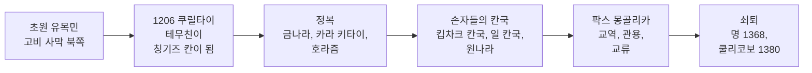
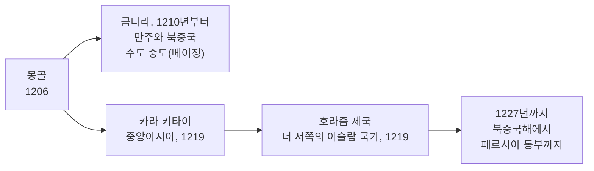
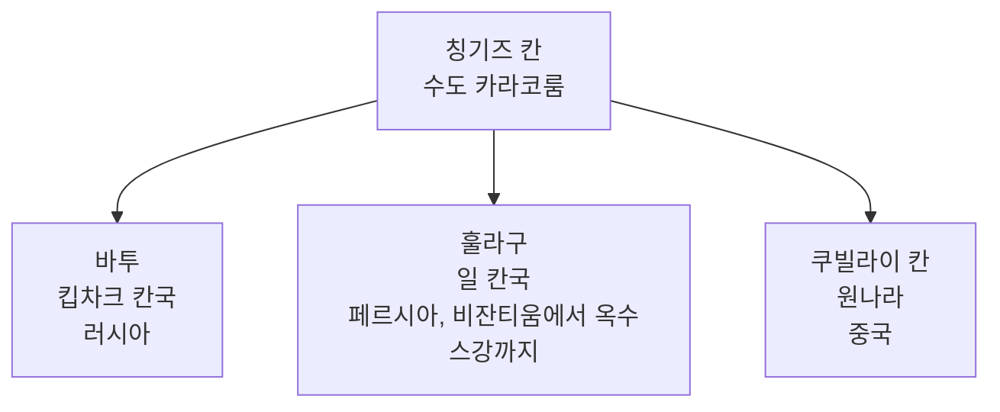
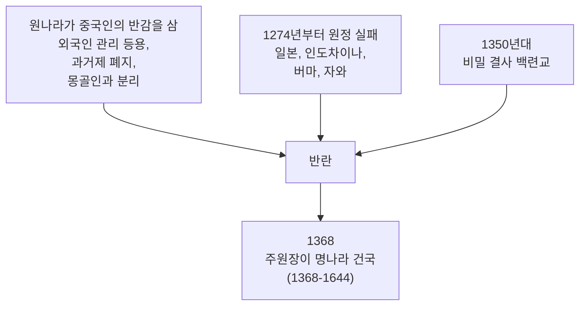
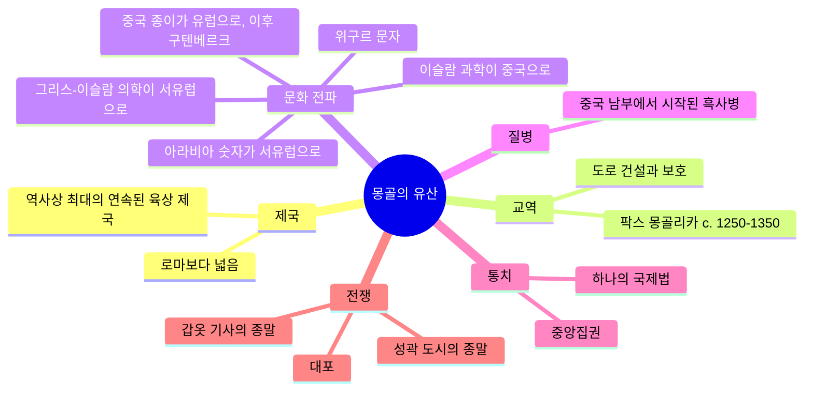
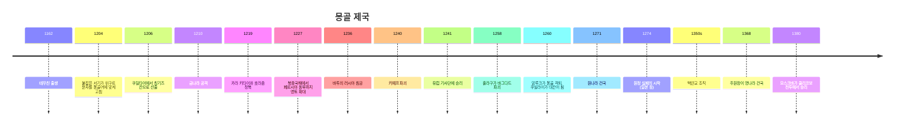
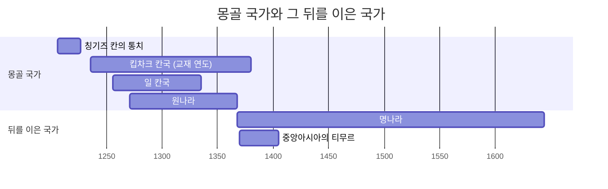

# AP 세계사: 모던 — 토픽 2.2 몽골 제국과 근대 세계의 형성 (The Mongol Empire and the Making of the Modern World)

**Focus Question (교재 Essential Question):** 유라시아 제국들은 시간에 따라 어떻게 성장했으며, 그 팽창은 교역과 통신에 어떤 영향을 주었는가?

> 출처: College Board CED 기준 · 교재 반영 (교재 Topic 2.2)

**Unit 2: 교류의 네트워크 (Networks of Exchange, c. 1200–1450)**

---

## 학습 목표 (Learning Objectives)

| 코드 | 학습 목표 |
|---|---|
| 2.2 LO-B (GOV) | 시간에 따른 유라시아의 국가 형성 (State building)과 쇠퇴 과정을 설명하라. |
| 2.2 LO-C (ECN) | 제국의 팽창이 시간에 따라 교역과 통신에 어떤 영향을 주었는지 설명하라. |
| 2.2 LO-D (CDI) | 더 큰 연속성과 변화의 흐름 속에서 몽골 제국이 갖는 의의를 설명하라. |

## 역사적 개념 (Historical Developments, CED)

| # | 역사적 개념 | LO | 다루는 곳 |
|---|---|---|---|
| HD1 | KC-3.2.I.B.iii: 세계 여러 지역에서 제국이 무너졌고, 일부 지역에서는 몽골 칸국 (Mongol khanates) 같은 새 제국이 그 자리를 대신했다. | B | §2, §4, §5 |
| HD2 | KC-3.1.I.E.i: 몽골을 비롯한 제국의 팽창은 새로운 사람들이 정복자의 경제와 교역망에 편입되면서 아프로-유라시아의 교역과 통신을 촉진했다. | C | §3, §4, §6 |
| HD3 | KC-3.2.II.A.ii: 몽골을 비롯한 국가·제국 사이의 지역 간 접촉과 충돌은 중요한 기술·문화 전파를 촉진했다. 예시 (Illustrative examples) — *기술·문화 전파:* 그리스-이슬람 의학 지식 (Greco–Islamic medical knowledge)의 서유럽 전래; 수 체계 (Numbering systems)의 유럽 전래; 위구르 문자 (Uyghur script) 채택. | D | §2 (위구르 문자), §3, §6 (그리스-이슬람 의학, 아라비아 숫자, 위구르 문자) |

---

## 큰 그림 요약

> "그들(몽골인)은 메뚜기 떼처럼 땅을 뒤덮으며 (유럽의) 동쪽 지역에 끔찍한 참화를 가져왔고, 불과 살육으로 그곳을 황폐하게 만들었다..."
> — 매슈 패리스 (Matthew Paris), 『대연대기 (Chronica Majora)』 (1240)

매슈 패리스는 잉글랜드의 안전한 베네딕트회 수도원에서 이 글을 썼고, 몽골을 **직접 본 적이 없었다.** 당시 대부분의 작가처럼 그도 몽골의 **잔혹 행위**에 초점을 맞추었다. 몽골은 13세기 유라시아 전역에 실제로 파괴를 퍼뜨렸다. 그러나 피와 보물을 좇는 과정에서, 세계가 천 년 동안 겪지 못한 수준의 **지역 간 연결과 교류**도 시작되었다.

**테무친 (Temujin)**은 초원의 씨족들을 통일하고 **1206년 쿠릴타이 (Kuriltai)**에서 **칭기즈 칸 (Genghis Khan)**이 되었다. 규율 잡힌 기마 궁수들이 북중국에서 페르시아까지 정복했다. 손자인 **바투 (Batu)**(러시아의 킵차크 칸국), **훌라구 (Hulegu)**(페르시아의 일 칸국), **쿠빌라이 칸 (Kublai Khan)**(중국의 원나라)이 제국을 더 넓혔다. **팍스 몽골리카 (Pax Mongolica)**(c. 1250–1350) 동안 몽골은 교역을 보호하고, 종교적 관용을 베풀고, 지식을 퍼뜨렸다. 동시에 **흑사병**도 퍼뜨렸다. 1300년대 후반 몽골의 힘은 약해졌다. 모스크바가 킵차크 칸국을 물리쳤고(1380), 명나라가 원나라를 몰아냈다(1368).

---

## §1. 몽골과 주변 환경

- 12세기의 몽골은 **고비 사막 (Gobi Desert) 북쪽**에서 염소와 양을 치는 **여러 유목 씨족**이자 수렵·채집민이었다.
- **건조한 아시아 초원**의 혹독한 생활이 몽골 문화를 만들었다. **남녀 모두** 말을 잘 타야 했고, 사냥과 전쟁에서의 용기를 매우 중시했다.
- 주변에는 **타타르 (Tatars), 나이만 (Naimans), 메르키트 (Merkits)**, 그리고 북중국의 강력한 **여진 (Jurchen)**이 있었다.
- 몽골은 실크로드에 가까워 비단옷이나 금 장신구 같은 사치품을 쉽게 얻는 이웃들의 **부를 탐냈다.**

## §2. 칭기즈 칸: 국가 형성과 정복

### 권력의 확립

- **테무친**(**1162년** 출생)은 수십 년 동안 **부족 동맹**을 맺고 이웃 부족을 하나씩 물리쳤다.
- 중요한 우정을 맺었고, 맏아들을 이웃 **칸 (Khan, 왕)**의 딸과 결혼시켰다.
- 때로는 친족보다 **재능 있는 외부인**을 높은 자리에 앉혔다. **냉혹하기도** 했으며(이복형제를 죽임), **개인적 충성**을 가장 중시했다.
- **1206년:** 몽골 족장들의 회의인 **쿠릴타이**에서 칸으로 선출되어 **칭기즈 칸**("모든 것의 통치자")이라는 이름을 얻었다.

### 정복

- **1210년:** 여진족이 세운 **금나라 (Jin Empire)**를 공격했다. 수도는 **중도 (Zhongdu)**(지금의 베이징)였다. 저항한 사람들은 잔인하게 죽임을 당했고, 때로는 마을 전체가 몰살되었다.
- 이런 **잔혹함에 대한 소문이 먼저 퍼져서**, 일부 지도자들은 **공격받기 전에 항복했다.**
- **1219년:** 중앙아시아의 **카라 키타이 (Kara Khitai)**와 이슬람 국가인 **호라즘 (Khwarazm)**을 정복했다.
- **1227년까지:** 칭기즈 칸의 칸국은 **북중국해에서 페르시아 동부까지** 이르렀다.

### 전쟁에서의 칭기즈 칸

| 전략 | 내용 |
|---|---|
| **숙련된 병사** | 말을 잘 타고 **단궁 (Short bow)**에 능숙하며 규율이 엄격함. 효율적인 지휘 체계 |
| **전령** | 며칠 동안 쉬지 않고 달리며 말 위에서 잠을 잔 전령 부대 |
| **지도 제작 부대** | 지형을 미리 지도로 만들어 공격에 대비하고 진격로를 정함 |
| **거짓 후퇴 (Feigned retreat)** | 적보다 적은 병력이 패한 척 물러나고, 적이 쫓아오면 더 큰 병력이 모여 적을 혼란에 빠뜨리고 포위함 |
| **항복 요구** | 작은 부대가 먼저 항복을 요구하고, 거부하면 **귀족을 모두 죽임** |
| **피정복민 활용** | 장인, 광부, 읽고 쓸 줄 아는 사람은 **등용**하고, 나머지는 약탈품을 나르거나 최전선에 세움 |
| **기술 흡수** | 붙잡은 중국·페르시아 기술자가 이동식 공성탑, 투석기 같은 **공성 무기 (Siege weapons)**를 만듦 |
| **통신** | 글이 아닌 **말로 된** 메시지를 전하는 일종의 "역마 우편 (Pony express)" |

### 평화기의 칭기즈 칸

- 지금의 몽골에 있는 **카라코룸 (Karakorum)**을 수도로 삼고, 중국과 이슬람 전통의 학자·기술자에게 자문을 구했다.
- 역사상 **어떤 통치자보다 많은 다리**를 놓았을 수도 있다.
- 13세기에는 드물었던 **종교적 관용** 정책을 제국 전역에 시행했다.
- 병사들이 **실크로드를 보호**하면서 실크로드의 **세 번째 황금기**가 시작되었다 (2.1 참고).
- **위구르 문자 (Uyghur alphabet):** 1204년에 붙잡은 서기에게 위구르 문자를 몽골어에 맞게 고치도록 했다. 제국 전체에 하나의 문자를 쓰게 하려는 시도는 실패했지만, **이 문자는 지금도 몽골에서 쓰인다.**

## §3. 교역·통신·문화에 미친 영향

- **팍스 몽골리카**("몽골의 평화", c. 1250–1350) 동안 아시아·중동·아프리카·유럽 사이에 **새로운 교역로**가 열렸다.
- 정복할 때마다 **새로운 민족이 몽골의 경제와 교류망에 편입되었다** (CED HD2).
- 정복에서 살아남은 사람들은 로마와 한 제국 이후 거의 쓰이지 않던 **교역로가 되살아난** 덕을 보았다.
- 도로가 건설되고 유지되었으며 보호받았다.
- **몽골 여성**은 다른 사회의 여성보다 **더 독립적으로** 살았다. 가축을 돌보고, 말을 타고, 남성과 같은 가죽 바지를 입었다. 남편을 잃으면 **재혼**할 수 있었고, **이혼을 먼저 요구**할 수도 있었다.

## §4. 칭기즈 칸의 손자들을 통한 팽창

### 바투와 킵차크 칸국 (Golden Horde, 러시아)

| 연도 | 사건 |
|---|---|
| **1236** | 칭기즈 칸의 맏아들의 아들인 바투가 **10만 대군**을 이끌고 러시아로 진격함. 당시 러시아는 도시국가와 공국들이 느슨하게 이어진 곳이었음 |
| **1240** | **키예프 (Kiev)**가 약탈당하고 파괴됨 |
| **1241** | **실레지아의 헨리크 왕 (King Henry of Silesia)**이 이끄는 폴란드·독일·프랑스 기사단을 물리치고, 이어 헝가리 기사단도 물리침 |
| — | 이탈리아와 오스트리아를 노렸으나 **오고타이 칸 (Ögödei Khan)**이 죽어 장례와 후계 문제로 돌아감. 다시 유럽에 왔을 때는 서유럽 정복에 **관심을 잃은** 듯했음 |
| **1380** | 모스크바가 이끄는 연합이 **쿨리코보 전투 (Battle of Kulikovo)**에서 킵차크 칸국을 물리침 |

- 서유럽이 처음에 몽골에 가졌던 호감(종교적 관용, 교역 장려)은 킵차크 칸국이 **기독교 지역인 러시아**를 정복하자 **사라졌다.**
- **간접 통치:** 몽골은 숲에서 살고 싶지 않아서, 정기적으로 **공납**을 바치는 기존 **러시아 통치자들**을 통해 북부 러시아를 다스렸다.
- **모스크바의 성장:** 모스크바의 통치자들은 **추가 공납**을 걷어 군대를 키우고 **반몽골 연합**을 만들어 **쿨리코보(1380)**에서 승리했다.
- 16세기 중반까지 러시아는 몽골 후손의 칸국을 모두 물리쳤다. **크림 타타르 (Crimean Tatars)**만 예외였는데, 18세기 후반에야 정복되었다.

**러시아에 미친 장기적 영향**

| 변화 | 내용 |
|---|---|
| 파괴 | 광범위한 파괴와 죽음 |
| 군사·정치 | 러시아 공후들이 **군사 조직**을 개선하고 더 **중앙집권적인 지도력**의 가치를 받아들임 |
| 문화 | 3세기에 걸친 몽골 지배로 **서유럽과의 관계가 끊겨** 이전보다 **더 뚜렷한 러시아 문화**가 발달함 |
| 국가의 기초 | 몽골에 대한 저항이 **근대 러시아 국가의 기초**가 됨 |

### 훌라구와 이슬람 중심지 (일 칸국, Il-khanate)

- **1258년:** 훌라구가 **바그다드**를 파괴하고 **칼리프**와 약 **20만 명의 주민**을 죽여 아바스 칼리프조를 무너뜨렸다.
- **1260년:** 팔레스타인에서 **바이바르스 (Baibars)**가 이끄는 **무슬림 맘루크 (Mamluks)**와 **기독교 십자군**의 일시적 동맹에 패했다. 두 세력 모두 몽골을 심각한 위협으로 여겼다.
- **일 칸국**의 영토는 **비잔티움에서 옥수스강**(지금의 아무다리야강)까지 이르렀다.
- 몽골인이 다스렸지만 **페르시아인이 대신과 지방 관리**를 맡았다. 이 방식으로 **세금을 가장 많이** 걷을 수 있었다.
- 훌라구와 일 칸국의 몽골인 대부분은 **이슬람으로 개종**했다. 개종 전에는 모든 종교를 관용했지만, 개종 후에는 **유대인과 기독교인 학살**을 지지했다.

> ⚠️ 교재는 1260년 승리를 맘루크와 십자군의 일시적 동맹으로 설명한다. 아인 잘루트 전투 (Battle of Ain Jalut)에 관한 많은 설명에서는 십자군이 맘루크의 통과를 허락한 정도로 본다. 선생님이 어떻게 가르치는지 확인이 필요하다.

> ⚠️ 교재는 훌라구 자신이 이슬람으로 개종했다고 쓴다. 많은 설명에서는 후대의 통치자 가잔 (Ghazan)이 1295년에 개종했다고 본다. 수업 자료와 대조해 확인이 필요하다.

### 쿠빌라이 칸과 원나라 (Yuan Dynasty, 중국)

- 중국(**송나라**)은 다른 칸들이 상대한 적보다 훨씬 강했다. 교재에 따르면 쿠빌라이의 군대는 **1235년부터 1271년까지** 중국 정복을 시도했다.
- **1260년:** 쿠빌라이가 **대칸 (Great Khan)** 칭호를 얻었고, 11년 뒤 마침내 중국을 물리쳤다.
- 몽골식 통치보다 **중국 전통**을 따르며 **원나라**를 세웠다.
- 1215년 몽골이 파괴한 **중도**를 다시 지어 **대도 (Dadu)**라 불렀다.
- **종교적 관용**으로 당시 소외되어 있던 불교도와 도교도의 충성을 얻었고, 무슬림, 유대인, 기독교인에게도 관대했다.
- 처음에는 대부분의 중국인이 그의 통치를 반겼다. 문화 교류와 유럽을 포함한 다른 나라와의 교역으로 **번영**을 가져왔기 때문이다.

> ⚠️ 교재의 1235–1271년은 몽골과 송나라의 전쟁 기간이다. 쿠빌라이는 1215년에 태어났으므로 처음부터 전쟁을 이끈 것은 아니다. 인쇄된 교재와 대조해 확인이 필요하다.

## §5. 몽골의 쇠퇴

- **중국인의 반감:** 원나라는 중국인 대신 **외국인**을 관리로 썼고, 불교도와 도교도를 우대했으며, **과거제를 폐지**했다. 이는 주로 유교를 따르던 **사대부 계층 (Scholar-gentry)**을 불안하게 했다. 몽골인은 중국인과 떨어져 지냈고, **몽골인이 아닌 사람이 몽골어를 쓰는 것을 금지**했다.
- **원정 실패:** **1274년**부터 원나라는 **일본, 인도차이나, 버마, 자와** 정복에 실패했다. 이는 몽골이 더 이상 예전만큼 두렵지 않다는 인상을 주었다.
- **반란:** **1350년대**에 비밀 결사 **백련교 (White Lotus Society)**가 조직되기 시작했다. **1368년** 가난한 농민 출신의 불교 승려 **주원장 (Zhu Yuanzhang)**이 반란을 이끌어 원나라를 무너뜨리고 **명나라 (Ming Dynasty, 1368–1644)**를 세웠다.
- **전반적인 쇠퇴:** 교재에 따르면 킵차크 칸국은 **1369년경** 영토를 잃었고, 비슷한 시기에 **티무르 (Tamerlane/Timur the Lame)**가 중앙아시아 영토를 정복했다.

> ⚠️ 교재는 킵차크 칸국의 영토 상실을 1369년경, 쿨리코보 전투를 1380년으로 쓴다. 많은 설명에서는 러시아에 대한 몽골의 공납 지배가 1480년에야 끝났다고 본다. 이 노트는 교재를 따른다.

## §6. 몽골 침입의 장기적 영향

| 영역 | 영향 |
|---|---|
| **규모** | 로마보다 넓은 땅을 정복함. **역사상 가장 큰 연속된 육상 제국** |
| **교역** | 팍스 몽골리카(c. 1250–1350)가 아시아·중동·아프리카·유럽 사이의 교역을 되살림 |
| **문화 전파** | **이슬람 과학**이 중국에 전해짐. **중국의 종이**가 **구텐베르크 인쇄기**의 통신 혁명을 가능하게 함. **그리스-이슬람 의학 지식**과 **아라비아 숫자**가 서유럽에 전해짐 |
| **질병** | 몽골은 **흑사병 (Bubonic plague / Black Death)**을 옮기는 벼룩이 중국 남부에서 중앙아시아, 동남아시아, 유럽으로 퍼지는 데 기여함. 교역로와 군사 경로를 따라 퍼짐 (2.6 참고) |
| **통치** | 몽골의 **중앙집권** 방식과 **하나의 국제법**을 유럽, 아시아, 동남아시아의 후대 국가들이 이어받거나 모방함 |
| **전쟁** | 몽골의 속도와 기습 전술 때문에 서유럽에서 **갑옷 입은 기사**의 시대가 끝남. 몽골의 공성 기술 앞에서 **성곽 도시**가 쓸모없어짐 |
| **대포** | **대포 (Cannon)**를 몽골의 발명품으로 보는 사람도 있음. **중국의 화약**, **무슬림의 화염 방사기**, **유럽의 종 주조 기술**을 결합한 것 |

### 연속성과 변화

| 변화 | 연속성 |
|---|---|
| 역사상 가장 크게 연결된 교역권 | 기존의 교역로와 교역품은 그대로 이어짐 |
| 아바스 칼리프조와 송나라의 멸망 | 현지 통치자와 관료제가 계속 일함 (러시아 공후, 페르시아 대신) |
| 모스크바와 명나라의 부상 | 칸국들이 현지 문화를 받아들임 (일 칸국의 이슬람, 원나라의 중국 전통) |
| 기사와 성곽 도시의 종말 | 초원 유목민과 정착민 사이의 갈등은 계속됨 |

---

## 연표

---

## 비교표: 세 손자의 칸국

| 항목 | 킵차크 칸국 (바투) | 일 칸국 (훌라구) | 원나라 (쿠빌라이) |
|---|---|---|---|
| 지역 | 러시아 | 페르시아와 서남아시아 (비잔티움에서 옥수스강까지) | 중국 |
| 핵심 사건 | 키예프 파괴 (1240) | 바그다드 파괴 (1258) | 원나라 건국 (1271) |
| 통치 방식 | 러시아 공후와 공납을 통한 **간접 통치** | 몽골인 통치자와 **페르시아인 대신·관리** | **중국 전통**을 따랐으나 몽골인을 분리하고 과거제를 폐지함 |
| 종교 | — | **이슬람**으로 개종, 이후 유대인과 기독교인 학살 | 불교도, 도교도, 무슬림, 유대인, 기독교인에게 **관용** |
| 한계 또는 종말 | 쿨리코보 (1380), 모스크바가 이끈 연합 | 맘루크에게 저지당함 (1260) | 일본 등 정복 실패 (1274년부터), 명나라 (1368) |
| 남긴 유산 | 모스크바의 부상과 독자적인 러시아 문화 | 이슬람-페르시아식 행정 | 대도(베이징), 유럽과의 교역 |

---

## Key Terms (핵심 용어)

| 주제 | 용어 | 정의 |
|---|---|---|
| 정치 | 몽골 (Mongols) | 고비 사막 북쪽의 유목 씨족들 |
| 정치 | 칸 (Khan) | 왕 또는 통치자 |
| 정치 | 쿠릴타이 (Kuriltai) | 몽골 족장들의 회의로, 1206년 테무친을 칸으로 선출함 |
| 정치 | 칭기즈 칸 (Genghis Khan) | "모든 것의 통치자", 몽골 제국을 세운 테무친 |
| 정치 | 칸국 (Khanates) | 칸이 다스리는 왕국 |
| 정치 | 팍스 몽골리카 (Pax Mongolica) | "몽골의 평화"(c. 1250–1350), 교역이 안전했던 시기 |
| 정치 | 바투 (Batu) | 칭기즈 칸의 손자로, 킵차크 칸국을 이끎 |
| 정치 | 킵차크 칸국 (Golden Horde) | 러시아를 지배한 바투의 군대이자 칸국 |
| 정치 | 모스크바 (Moscow) | 반몽골 연합을 이끈 도시국가 (쿨리코보, 1380) |
| 정치 | 훌라구 (Hulegu) | 칭기즈 칸의 손자로, 바그다드를 파괴함 (1258) |
| 정치 | 일 칸국 (Il-khanate) | 페르시아와 서남아시아를 다스린 훌라구의 칸국 |
| 정치 | 쿠빌라이 칸 (Kublai Khan) | 칭기즈 칸의 손자로, 대칸(1260)이자 원나라의 건국자 |
| 정치 | 원나라 (Yuan Dynasty) | 중국의 몽골 왕조 (1271–1368) |
| 정치 | 주원장 (Zhu Yuanzhang) | 원나라를 무너뜨리고 명나라를 세운 불교 승려 (1368) |
| 정치 | 명나라 (Ming Dynasty) | 원나라 이후의 중국 왕조 (1368–1644) |
| 환경 | 고비 사막 (Gobi Desert) | 몽골의 근거지 남쪽에 있는 동아시아의 사막 |
| 기술 | 공성 무기 (Siege weapons) | 붙잡은 기술자들이 만든 이동식 공성탑과 투석기 |
| 기술 | 대포 (Cannon) | 중국·무슬림·유럽 기술을 결합한 몽골의 발명품일 가능성이 있는 무기 |
| 문화 | 위구르 문자 (Uyghur alphabet) | 몽골어 표기에 맞게 고친 문자로, 지금도 몽골에서 쓰임 |
| 사회 | 백련교 (White Lotus Society) | 원나라에 맞서 조직된 비밀 결사 (1350년대) |
| 사회 | 흑사병 (Bubonic plague) | 몽골의 교역로와 군사 경로를 따라 퍼진 질병 |
| 정치 | 역사상 가장 큰 연속된 육상 제국 (Largest contiguous land-based empire) | 몽골 제국의 역사적 위치 |
| CED | 그리스-이슬람 의학 지식 (Greco-Islamic medical knowledge) | 몽골과의 접촉을 통해 서유럽에 전해진 의학 지식 |
