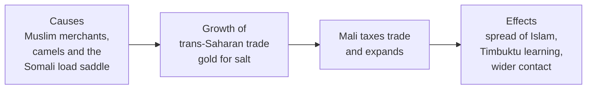
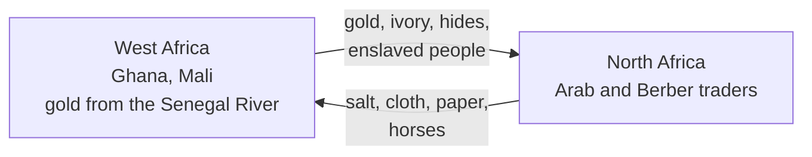
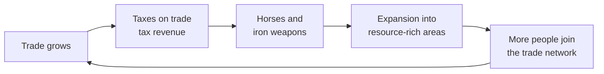
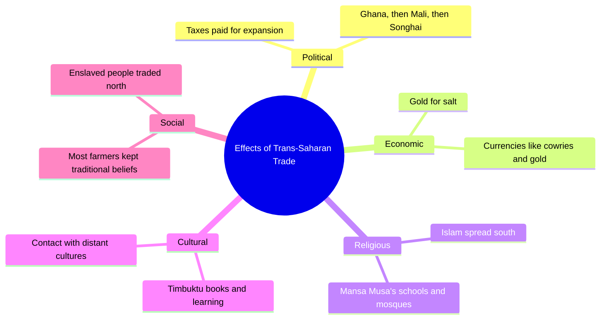
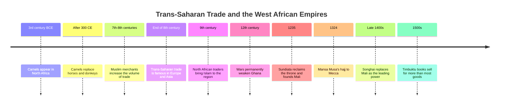
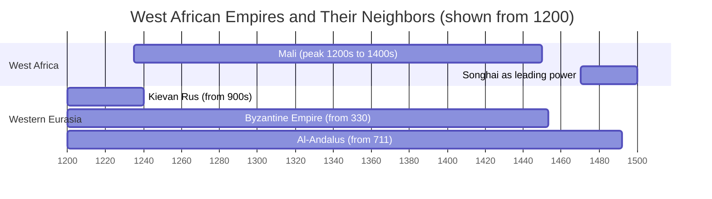

# AP World History: Modern — Topic 2.4 Trans-Saharan Trade Routes

**Focus Question (textbook Essential Question):** What were the causes and effects of trans-Saharan trade, and how did the growth of empires influence trade and communication?

> Source: Based on the College Board CED · Textbook incorporated (Topic 2.4 reading)

**Unit 2: Networks of Exchange (c. 1200–1450)**

---

## Learning Objectives

| Code | Learning Objective |
|---|---|
| 2.4 LO-H (TEC) | Explain the causes and effects of the growth of trans-Saharan trade. |
| 2.4 LO-I (GOV) | Explain how the expansion of empires influenced trade and communication over time. |

## Historical Developments (CED)

| # | Historical Development | LO | Covered in |
|---|---|---|---|
| HD1 | KC-3.1.II.A.ii: The growth of interregional trade was encouraged by innovations in existing transportation technologies. Illustrative examples — *Technologies encouraging interregional trade:* Camel saddle; Caravans. | H | §1 (caravans), §2, §3 (camel saddle) |
| HD2 | KC-3.1.I.A.iv: Improved transportation technologies and commercial practices led to an increased volume of trade and expanded the geographical range of existing trade routes, including the trans-Saharan trade network. | H | §1, §3, §4 |
| HD3 | KC-3.1.I.E.ii: The expansion of empires—including Mali in West Africa–facilitated Afro-Eurasian trade and communication as new people were drawn into the economies and trade networks. | I | §4, §5 |

---

## The Big Picture

> "From Timbuktu I sailed down the Nile [Niger] on a small boat, hollowed out of a single piece of wood... I went on ... to Gawgaw [Gao], which is a large city on the Nile [Niger]... The buying and selling of its inhabitants is done with cowry-shells, and the same is the case at Malli [the city of Mali]."
> — Ibn Battuta (textbook dates: 1304–1353)

> ⚠️ The textbook gives Ibn Battuta's dates as 1304–1353. Many sources date his death to 1368 or 1369; 1353 is roughly when his travels ended. Check with your teacher.

Few societies lived in the **Sahara Desert**, because its dry climate made farming nearly impossible. Nomads carried on some trade, but the **volume of trade increased** when **Muslim merchants** arrived in the **7th and 8th centuries**. Commerce **expanded dramatically** when empires such as **Mali** took over the region in the **early 1200s**. Two things made this trade possible: **camels**, which reached North Africa in the 3rd century B.C.E., and **camel saddles**, especially the **Somali saddle**, which could carry **600 pounds**. Caravans of thousands of camels traded West African **gold, ivory, hides, and enslaved people** for Arab and Berber **salt, cloth, paper, and horses**. Mali grew rich by **taxing** this trade and used the revenue to **expand**. Under **Sundiata** (1235) and **Mansa Musa** (hajj of 1324), Mali became a center of **Islam**, and **Timbuktu** became a world-famous center of learning. By the late 1400s, **Songhai** had replaced Mali.

---

## §1. The Sahara, Its Oases, and Caravan Routes

- The Sahara covers about **3.6 million square miles**, about the size of China.
- Only about **800 square miles** are **oases**: places where underground water reaches the surface and makes the land fertile. In some oases the water rises naturally; in others, people dug **wells**.
- **Caravans** often had **thousands of camels**. They carried trade goods plus enough food and **fresh water** to reach the next oasis. Caravan leaders usually **walked the whole way**.
- There were **seven north–south routes** and **two east–west routes**, which put Sub-Saharan Africans in touch with more cultures and trading partners.

*Ibn Battuta's route in the opening quote*

| Going north (from West Africa) | Going south (from North Africa) |
|---|---|
| **Gold** (the most precious good) | **Salt** |
| Ivory | Cloth and textiles |
| Hides | Paper |
| Enslaved people | Horses |

- West African merchants got gold from the waters of the **Senegal River** (near modern Senegal and Mauritania).
- By the end of the **8th century**, trans-Saharan trade was **famous in Europe and Asia**.
- For **more than 700 years**, the trade brought great wealth to West Africa, especially to **Ghana and Mali**, and it brought **Islam** into Sub-Saharan Africa.

## §2. Camels

- Camels are native to **Arabia** (the Islamic heartland) and appeared in **North Africa in the 3rd century B.C.E.**
- Used to the harsh **Arabian Desert**, they adapted well to the Sahara.
- A camel can drink **more than 50 gallons in three minutes** and then go a long time without more water.
- Camels **began to replace horses and donkeys after 300 C.E.**

## §3. Camel Saddles

People developed as many as **15 types of camel saddles** for different purposes.

| Saddle | Who developed it | Design | Purpose |
|---|---|---|---|
| **South Arabian saddle** | South Arabians | Rider sits **behind the hump** | Easier riding; the rider can hold the hump's hair |
| **North Arabian saddle** | Northern Arabians | Rider sits **on top of the hump**, high in the air and near the head | Better **visibility in battle** and the best control over the camel |
| **Somali saddle** | **Somalis** of East Africa (semi-nomadic) | Built for **loads up to 600 pounds** | **Greatest impact on trade**: without it, camels could not carry heavy trade goods |

> **Key idea:** The camel saddle is the CED's main example of a **transportation innovation**. In the textbook, the specific saddle that changed trade is the **Somali load saddle**.

> **Changed from the earlier version:** The earlier note described the North Arabian saddle as the key saddle for trade. This version follows the textbook, which credits the Somali saddle.

### Textbook Table: Comparing Pack Animals

| Animal | Location | Benefits | Drawbacks |
|---|---|---|---|
| **Camel** | Northern Africa and Sub-Saharan West Africa | Travels long distances; eats thorny plants and drinks salty desert water; long eyelashes protect against desert winds; the only animal that can cross deserts; does not spook easily; carries up to 600 pounds | Needs a lot of salt to stay healthy; can be very aggressive, even vengeful; cannot be controlled with a bit; cannot be kept in a stall |
| **(name missing) ⚠️** | Eurasia and the Americas | High stamina; pulls the heaviest loads; unlikely to stray or be stolen; survives on local grazing; tolerates many climates and diets | Moves slowly; needs more water and food than other pack animals |
| **Horse** | Worldwide | Runs fast; can be controlled with a bit; can be used in battle; adapts to most climates and terrains | Needs grain to stay fit; spooks easily; easily stolen; strays easily; less sure-footed; cannot tolerate high heat |
| **Llama** | Americas | Keeps traction in mountains; calm; needs little water; suited to cold, mountainous climates | Cannot pull heavy loads; carries less than other pack animals; cannot tolerate high heat |

> ⚠️ The second animal's name is missing from the extracted text. The description (high stamina, heaviest loads, slow) suggests the **ox**. Check the printed textbook.

## §4. West African Empire Expansion: Mali

- By the **12th century**, wars with neighbors had **permanently weakened Ghana** (see 1.5). Several new trading societies rose in its place, and the most powerful was **Mali**.
- North African traders had introduced **Islam** to the region in the **9th century**.

> ⚠️ The textbook says Islam was introduced "to Mali" in the 9th century, but the Mali Empire was founded around 1235. This most likely means the region that later became Mali.

### Mali's Riches

- Mali profited from the **gold trade** and also **taxed nearly all other trade** entering West Africa, so it became **even richer than Ghana**.
- Most people were **farmers** who grew **sorghum and rice**.
- The great cities of **Timbuktu** and **Gao** gathered the most wealth and became centers of **Muslim life**.
- **Timbuktu** became a **world-renowned center of Islamic learning**. By the **1500s**, books made and sold in Timbuktu sold for **higher prices than most other goods**.

### Expanding Role of States

- Rulers needed a **currency** whose value people understood. Mali's currencies were **cowrie shells, cotton cloth, gold, glass beads, and salt**.
- Rulers had to **protect trade routes** and the places where currencies and trade resources were produced.
- Empires sometimes **expanded into resource-rich areas**, using armies equipped with **horses and iron weapons bought with tax revenue**.
- With each expansion, **more people were drawn into the empire's economy and trade networks**, which put them in touch with distant cultures.

### Sundiata, "the Lion Prince"

- His father ruled a small society in present-day **Guinea**. After his father died, rivals invaded, killed most of the royal family, and took the throne.
- They spared Sundiata because he was **crippled** and did not seem to be a threat. He learned to fight anyway and became such a feared warrior that his enemies forced him into **exile**, which only made him and his allies stronger.
- In **1235**, he returned, defeated his enemies, and **reclaimed the throne**.
- He was also a skilled ruler. **Most scholars believe he was a Muslim**, and he used ties with other Muslims to build **trade relationships with North African and Arab merchants**. He built a thriving **gold trade**, and Mali's wealth grew greatly.

## §5. Mansa Musa and the Decline of Mali

### Mansa Musa's Hajj (1324)

- **Mansa Musa**, Sundiata's **grand-nephew**, ruled in the **14th century**. He was known more for his **religious leadership** than for his politics or economics.
- In **1324**, this devout Muslim began a **pilgrimage (hajj) to Mecca**, Islam's holiest city.
- His caravan was extraordinarily lavish: **100 camels**, **thousands of enslaved people and soldiers**, and **gold** to give to everyone who hosted him along the way.
- The pilgrimage **displayed Mali's wealth to the outside world**.
- After returning, he set up **religious schools in Timbuktu**, built **mosques** in Muslim trading cities, and sponsored people who wanted to study religion elsewhere.
- Most West Africans **kept their traditional beliefs**, but his reign **deepened support for Islam** in Mali.
- *Additional (not in the textbook):* the **Catalan Atlas** (1375), a European map, shows Mansa Musa holding gold, which is evidence of his fame.

### The Decline of Mali

- Less than **100 years after Mansa Musa's death**, Mali was declining.
- By the **late 1400s**, the **Songhai Kingdom** had become the leading power in West Africa. It went through processes like Mali's and became **larger and richer than Mali**.
- Mansa Musa's work to strengthen Islam lasted: **Islam is still prominent in the region today**.

## §6. Effects of Trans-Saharan Trade

| Area | Effect |
|---|---|
| **Political** | Trading empires rose in turn (**Ghana**, then **Mali**, then **Songhai**) and used trade taxes to expand |
| **Economic** | Huge wealth from gold; states set up **currencies** (cowrie shells, cloth, gold, beads, salt) |
| **Religious** | **Islam** spread into Sub-Saharan Africa, especially among rulers and city people |
| **Cultural** | **Timbuktu** became a world center of Islamic learning; books were highly valued |
| **Social** | Most West Africans, mostly farmers, **kept traditional beliefs**; enslaved people were among the goods sent north |

## §7. Textbook Table: Empires in Western Eurasia and Africa in the 13th Century

| Feature | Mali | Al-Andalus | Byzantine Empire | Kievan Rus |
|---|---|---|---|---|
| Location | West Africa | Spain | Middle East | Russia |
| Peak years | 1200s to 1400s | 711 to 1492 | 330 to 1453 | 900s to 1200s |
| Major city | Timbuktu | Córdoba | Constantinople | Kiev |
| Key figures | **Sundiata**: founder who built a strong trade network; **Mansa Musa**: political and religious leader | **Ibn Rushd**: Islamic legal scholar and philosopher; **Maimonides**: Jewish scholar of ethics | **Justinian**: ruler behind the Body of Civil Law; **Heraclius**: shifted focus to the East | **Vladimir I**: converted to Christianity in 989; **Yaroslav I**: codified the legal system |
| Legacy | Connected West and North Africa through trade; spread Islam in West Africa | Created a vibrant, tolerant society; preserved classical Greek learning | Fostered trade between Asia, Europe, and Africa; carried on the Roman legacy | Developed the first large civilization in Russia; spread Christianity eastward |

---

## Timeline

---

## Comparison Table: Ghana vs. Mali

| Feature | Ghana | Mali |
|---|---|---|
| Time | Permanently weakened by wars by the 12th century | Early 1200s to 1400s |
| Source of wealth | The gold trade | The gold trade **plus taxes on nearly all other trade**, so it was richer than Ghana |
| Religion | Islam brought to the region by North African traders (9th century) | Rulers were Muslim (Sundiata probably; Mansa Musa devoutly) |
| Famous rulers | — | Sundiata, Mansa Musa |
| Main cities | — | Timbuktu, Gao |
| Successor | Mali and other new trading societies | Songhai (late 1400s) |

---

## Key Terms

| Theme | Term | Definition |
|---|---|---|
| Government (Sub-Saharan Africa) | Mali | West African trading empire (1200s–1400s) that taxed nearly all trade |
| Government (Sub-Saharan Africa) | Sundiata | "The Lion Prince," founder of Mali (1235) |
| Government (Sub-Saharan Africa) | Mansa Musa | Sundiata's grand-nephew and religious leader, famous for his 1324 hajj |
| Government (Sub-Saharan Africa) | Songhai Kingdom | The power that replaced Mali by the late 1400s; larger and richer than Mali |
| Environment (Africa) | Sahara Desert | Desert of about 3.6 million square miles, about the size of China |
| Environment (Africa) | Oases | Fertile places where underground water reaches the surface (about 800 square miles of the Sahara) |
| Environment (Southwest Asia) | Arabian Desert | The camel's native desert environment |
| Culture (Islam) | Timbuktu | Mali's trade city and world-renowned center of Islamic learning |
| Culture (Islam) | Mecca | Islam's holiest city and the destination of the hajj |
| Technology (Pack animals) | Camel saddle | Saddle designs; the Somali saddle carried up to 600 pounds |
| Economics (Trade) | Trans-Saharan trade | Trade across the Sahara, mainly West African gold for salt |
| Additional | Caravan | A large group of traders and camels traveling together |
| Additional | Hajj | The pilgrimage to Mecca |
| Additional | Cowrie shells | Shells used as currency in Mali and Gao |
| Additional | Gao | A large trading city on the Niger River in Mali |
