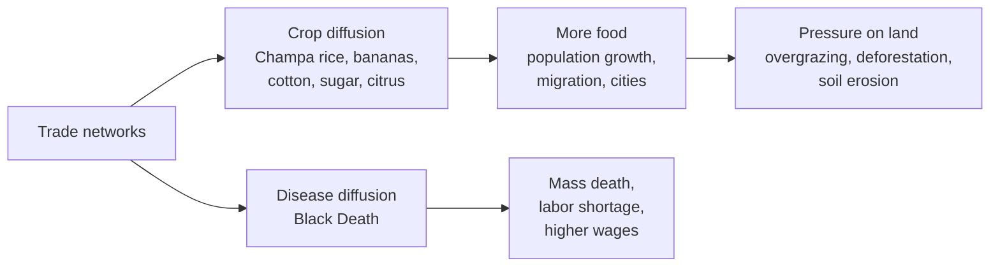
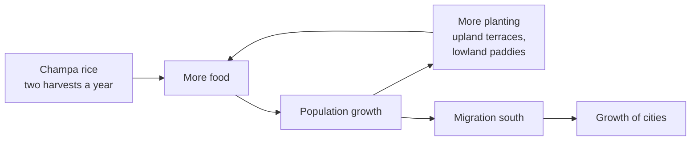
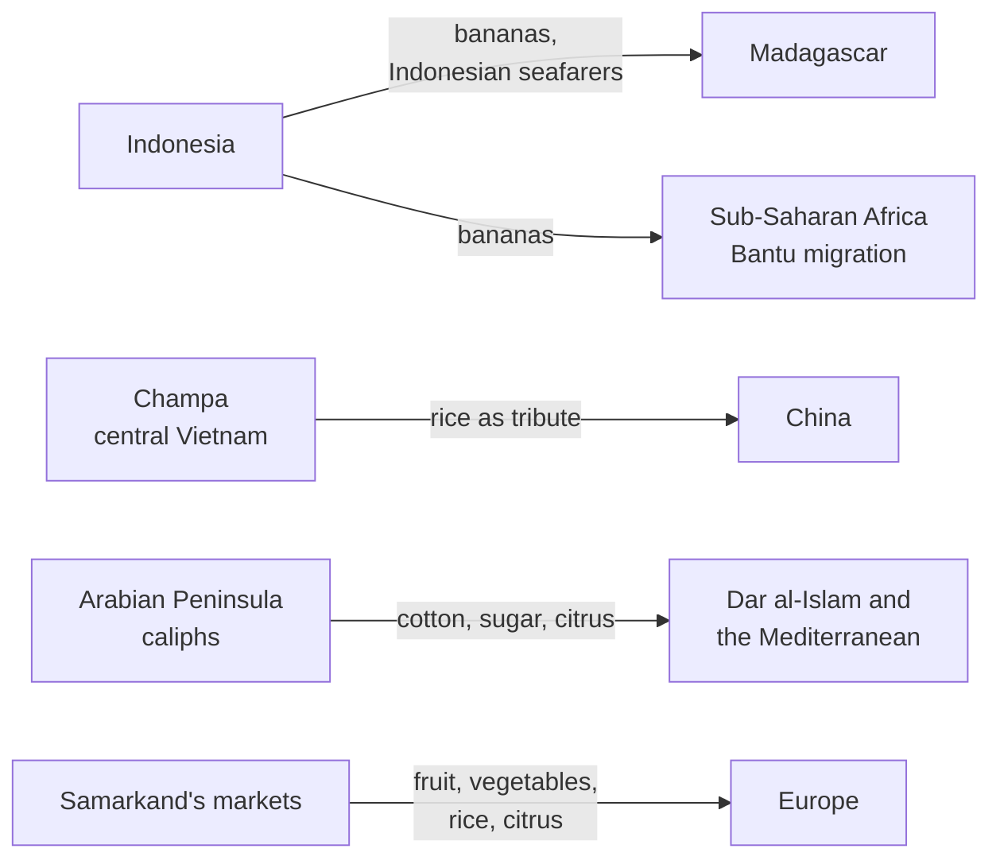
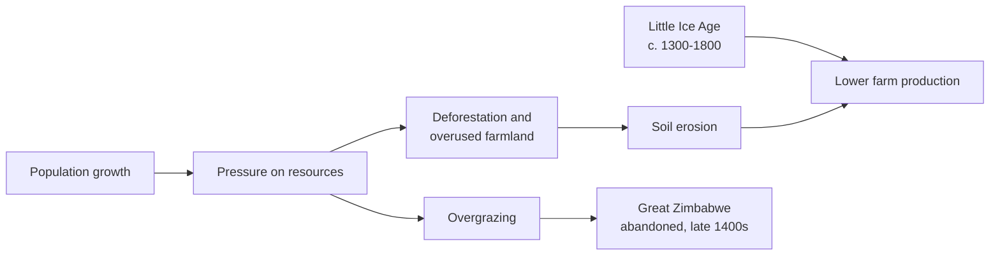
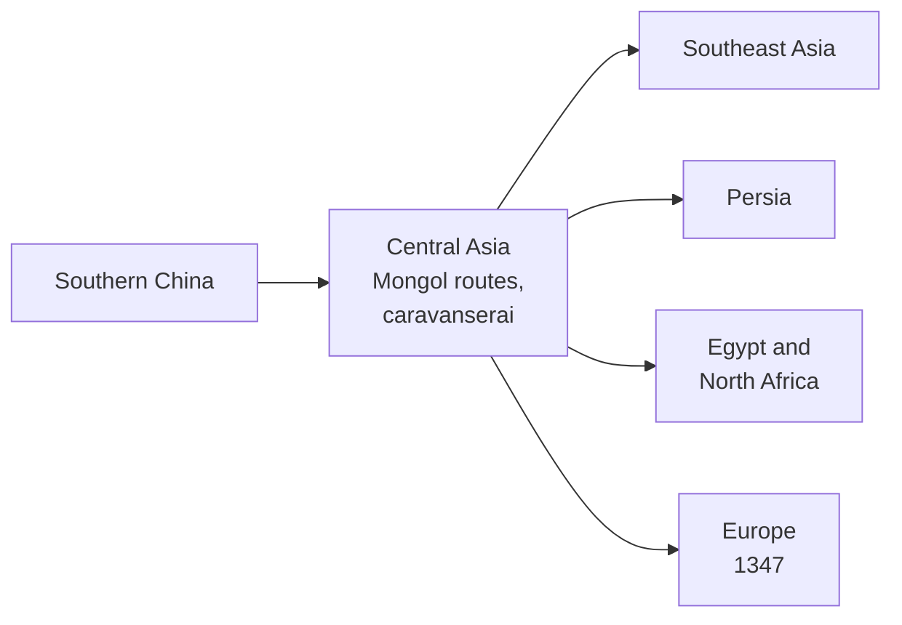
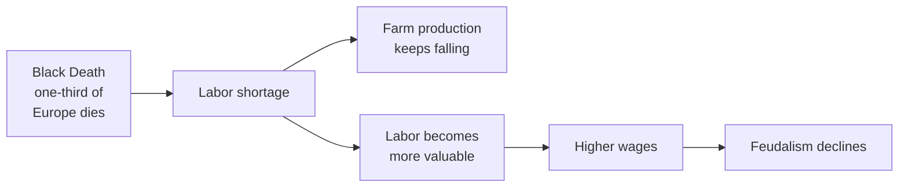
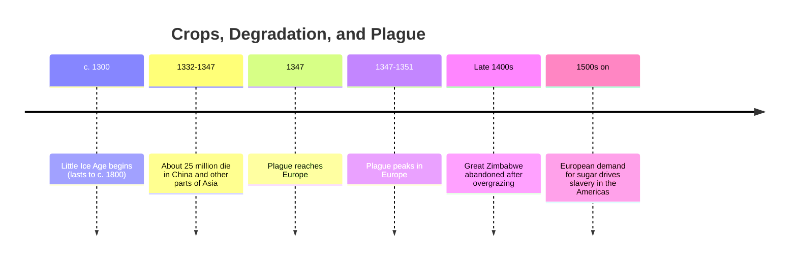
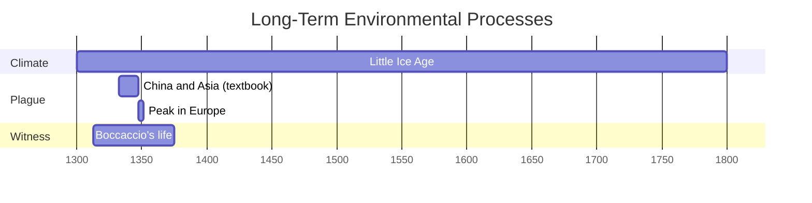

# AP World History: Modern — Topic 2.6 Environmental Consequences of Connectivity

**Focus Question (textbook Essential Question):** What were some of the environmental effects of trade in Afro-Eurasia from c. 1200 to c. 1450?

> Source: Based on the College Board CED · Textbook incorporated (Topic 2.6 reading)

**Unit 2: Networks of Exchange (c. 1200–1450)**

---

## Learning Objective

| Code | Learning Objective |
|---|---|
| 2.6 LO-K (ENV) | Explain the environmental effects of the various networks of exchange in Afro-Eurasia from c. 1200 to c. 1450. |

## Historical Developments (CED)

| # | Historical Development | Covered in |
|---|---|---|
| HD1 | KC-3.1.IV: There was continued diffusion of crops and pathogens, with epidemic diseases, including the bubonic plague, along trade routes. Illustrative examples — *Diffusion of crops:* Bananas in Africa; New rice varieties in East Asia; Spread of citrus in the Mediterranean. | §1 (bananas, Champa rice, citrus), §3 |
| Textbook extension | Population pressure caused environmental degradation: overgrazing, deforestation, and soil erosion. | §2 |

---

## The Big Picture

> "Dead bodies filled every corner."
> — Giovanni Boccaccio (1313–1375)

Trade networks spread **new crops** to new places: **Champa rice** in China, **bananas** in Sub-Saharan Africa, and **cotton, sugar, and citrus** across Dar al-Islam and the Mediterranean. These crops changed **land use** and caused **population growth and migration**. Growing populations also strained the land, causing **overgrazing** near Great Zimbabwe and **deforestation and soil erosion** in feudal Europe, which the **Little Ice Age** made worse. The **most dramatic** environmental effect, however, was **disease**, not food. The **bubonic plague (Black Death)** swept out of Central Asia, struck China, India, Persia, and Egypt, and reached **Europe in 1347**. It killed an estimated **75 to 200 million** people in Eurasia and peaked in Europe from **1347 to 1351**. Boccaccio lived through it, and the experience inspired his famous work *The Decameron*.

---

## §1. Crop Diffusion

Along with luxury goods, spices, textiles, and religions, merchants brought **crops to places where they had not grown before**. New crops affected **land use** and **population growth and distribution**. Some places kept production high over time; elsewhere, overuse of the land led to **environmental degradation** (§2).

### Champa Rice

- **Fast-ripening**, **drought-resistant**, **flood-resistant**, and able to produce **two harvests a year**.
- **Origin (textbook):** the rice was **sent to China as tribute** from Champa. Because Champa (present-day central Vietnam) was under **Hindu influence**, some scholars think the rice **may have come from India** originally.
- It was planted widely in China to **feed a growing population**, which in turn caused **further population growth**.
- **Land use:** with **terraced farming in the uplands** and **paddies in the lowlands**, rice was grown in many parts of China where the land had been thought **unusable** for it.
- **Migration:** as China's population grew, people moved **south** to the original rice-growing region, which helped **cities grow**.

> ⚠️ The textbook sentence reads "introduced to the Champa states by Vietnam, a Hindu state." This seems garbled: **Champa** was the Hindu-influenced kingdom, while the Vietnamese state to its north (Đại Việt) was not Hindu. Most sources say the rice came **from Champa** to Song China as tribute. The textbook's point that the rice may have originated in India also explains why the 2.5 reading says it spread "from India."

### Bananas in Sub-Saharan Africa

- **Indonesian seafarers** sailing across the Indian Ocean brought **bananas to Sub-Saharan Africa**, and many Indonesians **settled on Madagascar**.
- Bananas are **nutrition-rich**, so the population **rose sharply**.
- Bananas let **Bantu-speaking peoples**, who had metalworking skills and farming techniques, migrate to places where **yams** (a traditional food) did not grow well.
- Growing bananas meant **clearing more land for farming**, which **enriched diets** and caused **population growth**.

### Cotton, Sugar, and Citrus

- As **caliphs** conquered lands beyond the Arabian Peninsula, they spread **Islam**, the **Arabic language**, and the cultivation of **cotton, sugar, and citrus**.
- Markets along the trade routes sold new foods. **Samarkand's markets** passed new fruits and vegetables, along with **rice and citrus from Southwest Asia**, on to **Europe**.
- European demand for **sugar** later grew so large that it became a **key factor in the mass use of enslaved people in the Americas** from the 1500s on (see Unit 4).

| Crop | Carried by | From → To | Effects |
|---|---|---|---|
| **Champa rice** | Tribute to China | Champa (central Vietnam; possibly India originally) → China | Two harvests a year; population growth; upland terraces and lowland paddies; migration south; growth of cities |
| **Bananas** | Indonesian seafarers | Indonesia → Sub-Saharan Africa and Madagascar | Sharp population growth; Bantu migration beyond yam-growing areas; more farmland |
| **Cotton** | Expansion of the caliphates | Across Dar al-Islam and the Mediterranean | Spread together with Islam and Arabic |
| **Sugar** | Expansion of the caliphates | Across Dar al-Islam and the Mediterranean | European demand later drove slavery in the Americas |
| **Citrus** | Caliphates; Samarkand's markets | Southwest Asia → the Mediterranean and Europe | New foods in European markets |

## §2. Environmental Degradation

Population growth **put pressure on resources**.

| Place | Problem | Result |
|---|---|---|
| **Great Zimbabwe** | Severe **overgrazing** around the city | The city was **abandoned in the late 1400s** (see 1.5) |
| **Feudal Europe** | **Overuse of farmland** and **deforestation** | **Soil erosion**, which lowered farm production |
| **Europe (climate)** | **The Little Ice Age** (c. 1300–c. 1800) | Smaller harvests |
| **The Maya (Americas)** | Environmental degradation | One factor in their decline |

## §3. Epidemics Spread Through Exchange Networks

- Scholars in **Dar al-Islam and India** were making advances in medicine, but **no knowledge of the time** could stop the deadly diseases that traveled with trade.
- The **Mongol conquests** helped carry the plague-bearing **fleas** from **southern China to Central Asia**, and from there to **Southeast Asia and Europe**.
- **Caravanserai** housed people and animals together, and some historians think they **helped spread** the disease, since the animals probably carried infected fleas.

| Region | Death toll (textbook) |
|---|---|
| **Eurasia overall** | About **75 to 200 million** (estimate) |
| **Europe** | **One-third** of the population within a few years (peak 1347–1351) |
| **China and other parts of Asia** | About **25 million**, 1332–1347 |
| **North Africa, Central Asia** | Similar heavy losses |
| **South Asia, Sub-Saharan Africa** | **Spared**, because these regions had few trading ports |

> ⚠️ The textbook's opening says the plague "struck ... India," but later says South Asia was **spared** because it had few trading ports. These statements conflict, and South Asia had major ports such as Calicut (see 2.3). Historians still debate how badly India was hit because evidence is limited. Check how your teacher wants you to answer this.

### Effects on Europe

- With **fewer workers**, farm production kept falling.
- But each worker's **labor became more valuable**, so workers could **demand higher wages**. This changed the relationship between workers and employers.
- This shift **laid the groundwork for economic changes** as **feudalism declined**.

---

## Timeline

---

## Comparison Tables

### Crop Diffusion vs. Disease Diffusion

| Feature | Crop diffusion | Disease diffusion |
|---|---|---|
| What moved | Champa rice, bananas, cotton, sugar, citrus | The bubonic plague (fleas carried by animals) |
| Carried by | Tribute, Indonesian seafarers, caliphs, market traders | Mongol conquests, merchants, animals at caravanserai |
| Speed | Gradual | Fast (across Europe in a few years) |
| Effect on population | **Increased** | **Decreased** (75–200 million dead) |
| Effect on land and labor | More farmland, terraces, paddies | Labor shortages, falling farm production |
| Long-term effects | Migration, growth of cities, later sugar plantations | Higher wages, decline of feudalism |

### Environmental Degradation: Great Zimbabwe vs. Feudal Europe

| Feature | Great Zimbabwe | Feudal Europe |
|---|---|---|
| Cause | Overgrazing | Overused farmland, deforestation, the Little Ice Age |
| Result | City abandoned (late 1400s) | Soil erosion, lower farm production |
| Similarity | Population growth put pressure on resources in both | (same) |

---

## Key Terms

| Theme | Term | Definition |
|---|---|---|
| Environment (Crop diffusion) | Champa rice | Fast-ripening rice that resists drought and floods and gives two harvests a year; spread widely in China |
| Environment (Crop diffusion) | Bananas | Brought to Sub-Saharan Africa by Indonesian seafarers; caused sharp population growth |
| Environment (Crop diffusion) | Sugar | Spread by the caliphates; European demand later drove slavery in the Americas |
| Environment (Crop diffusion) | Citrus crops | Spread by the caliphates; reached Europe through markets such as Samarkand's |
| Environment (Degradation) | Overgrazing | Too many animals eating the plant cover; forced the abandonment of Great Zimbabwe |
| Environment (Degradation) | Deforestation | Clearing forests; caused soil erosion in feudal Europe |
| Environment (Degradation) | Soil erosion | Loss of topsoil, which lowers farm production |
| Environment (Disease) | Bubonic plague | The Black Death, spread by fleas along trade routes |
| Additional | Cotton | Not a CED example (the CED lists bananas, new rice varieties, and citrus); spread together with Islam |
| Additional | Terraced farming | Step-shaped fields on hillsides; used to grow Champa rice in the uplands |
| Additional | Paddies | Flooded lowland fields for growing rice |
| Additional | Little Ice Age | A cooler period (c. 1300–c. 1800) that reduced harvests |
| Additional | Pathogen | A germ that causes disease (CED term) |
| Additional | Black Death | The name for the 14th-century plague pandemic |
| Additional | *The Decameron* | Boccaccio's work, inspired by his experience of the plague |
| Additional | Labor shortage | Too few workers, which raised wages after the plague |
