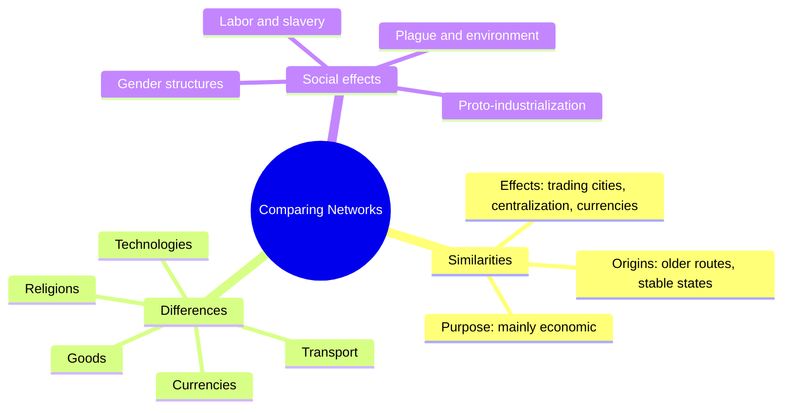
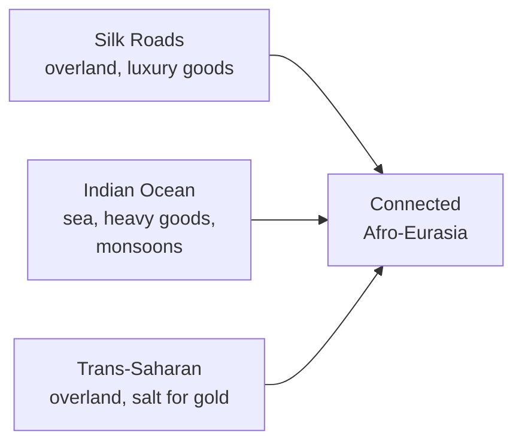
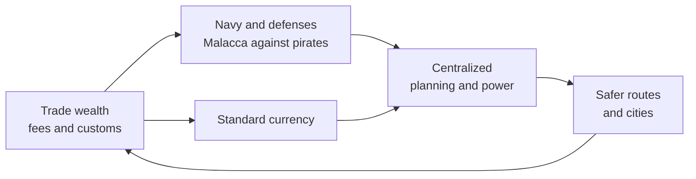
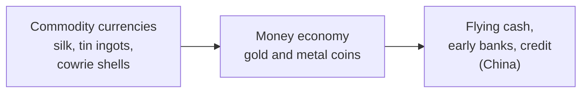
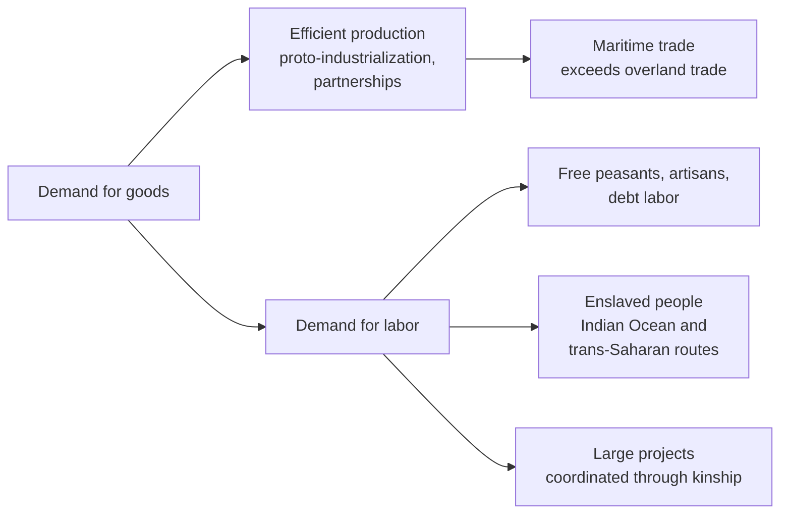
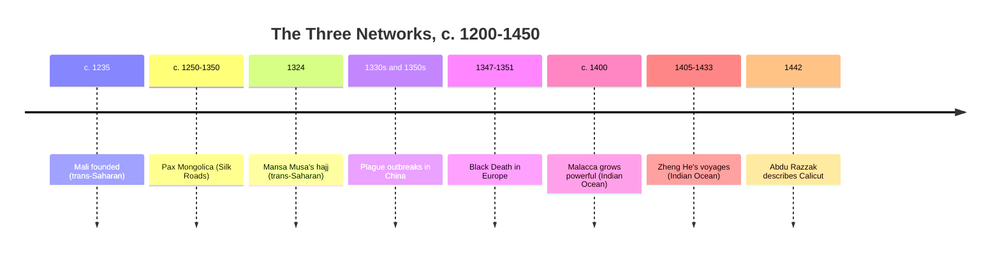
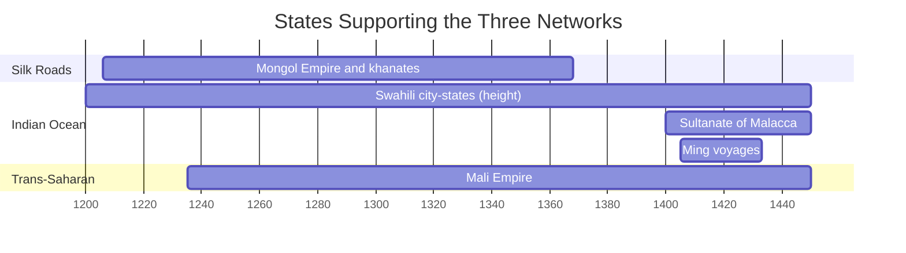

# AP World History: Modern — Topic 2.7 Comparison of Economic Exchange

**Focus Question (textbook Essential Question):** What were the similarities and differences among the various networks of exchange in the period from c. 1200 to c. 1450?

> Source: Based on the College Board CED · Textbook incorporated (Topic 2.7 reading)

**Unit 2: Networks of Exchange (c. 1200–1450)**

---

## Learning Objective

| Code | Learning Objective |
|---|---|
| 2.7 LO-L (—) | Explain the similarities and differences among the various networks of exchange in the period from c. 1200 to c. 1450. |

> The textbook's Essential Question matches this LO word for word, which supports the LO wording used here. The CED lists no thematic focus for 2.7, so the code has no theme.

## Historical Developments (CED)

> 2.7 is a comparison topic. The CED adds no new Historical Developments. Under "Review: Unit 2 Key Concepts," it lists two key concepts (KC-3.1 and KC-3.3) and three Historical Developments from 2.1 to draw on when **comparing the networks of exchange**. The textbook builds its comparison around **origins, purpose, and effects** (similarities) and **goods, transport, technology, and religion** (differences).

| # | Review: Unit 2 Key Concepts (CED) | Source topic | Covered in |
|---|---|---|---|
| R1 | KC-3.1: A deepening and widening of networks of human interaction within and across regions contributed to cultural, technological, and biological diffusion within and between various societies. | 2.1–2.6 | §1, §3 (technology, religions), §5 (plague) |
| R2 | KC-3.1.I.A.i: Improved commercial practices led to an increased volume of trade and expanded the geographical range of existing trade routes—including the Silk Roads—promoting the growth of powerful new trading cities. | 2.1 | §2 (trading cities) |
| R3 | KC-3.1.I.C.i: The growth of interregional trade in luxury goods was encouraged by innovations in previously existing transportation and commercial technologies, including the caravanserai, forms of credit, and the development of money economies. | 2.1 | §3 (caravanserai; currencies and commercial practices) |
| R4 | KC-3.3: Changes in trade networks resulted from and stimulated increasing productive capacity, with important implications for social and gender structures and environmental processes. | 2.1, 2.5 | §4, §5 |
| R5 | KC-3.3.I.B: Demand for luxury goods increased in Afro-Eurasia. Chinese, Persian, and Indian artisans and merchants expanded their production of textiles and porcelains for export; manufacture of iron and steel expanded in China. | 2.1 | §4 (production) |

---

## The Big Picture

> "Wealthy merchants bring in big cargoes, which they unload and unhesitatingly send into the markets without thinking in the meantime of any security, or checking the account, or keeping watch over the goods."
> — Abdu Razzak, "Description of Calicut" (1442)

**Calicut**, the "**City of Spices**," was like other great trading cities in some ways: it was **secure**, and many kinds of people used its markets. In other ways, such as its **currency** and how its **polity** (government) earned money from trade, it was different. The same pattern holds for the **three networks** of 1200–1450 as a whole. They were **similar** in their **origins** (built on older routes and supported by stable states), their **purpose** (mainly economic, though diplomats and missionaries traveled them too), and their **effects** (trading cities as "knots" in the network, centralization, and standard currencies). They were **different** in their **goods, transport, technologies, religions, and currencies**. Trade also had **social effects**: proto-industrialization, new business partnerships, more demand for labor (including slavery), patriarchy with some exceptions, plague, and environmental strain.

---

## §1. The Three Networks

| Network | Route | What made it special |
|---|---|---|
| **Silk Roads** | Through the **Gobi Desert** and mountain passes of China and Central Asia to Southwest Asia and Europe | Merchants tended to specialize in **luxury goods** |
| **Indian Ocean** | **Monsoon-dependent** routes linking East Asia with Southeast, South, and Southwest Asia | Merchants traded **goods too heavy to move by land** |
| **Trans-Saharan** | From North Africa and the Mediterranean across the desert to West and East Africa | **Salt** from North Africa traded for **gold** from kingdoms south of the desert |

> ⚠️ The textbook says the trans-Saharan routes reached "West **and East** Africa." Most accounts, and the textbook's own 2.4 reading, focus on **West** Africa (Ghana, Mali, Songhai). East Africa connected mainly through the Indian Ocean.

## §2. Similarities: Origins, Purpose, and Effects

### Origins

- Interregional trade began **long before the Common Era**, as farming cultures settled into **stable settlements**. The trade of 1200–1450 **built on routes** first traced by those early traders and conquerors.
- As kingdoms and empires grew, **so did the trade routes** they controlled.
- Networks needed **stable states** to grow. Stable kingdoms, caliphates, city-states, and empires **protected** routes and merchants. That is why Calicut's merchants could walk away from their cargo without fear of theft.
- Stable states also supported **technology upgrades** that made trade more profitable: the **magnetic compass**, **lateen sail**, **high-yield crops**, and **saddles** for heavy loads.

### Purpose

- The **main purpose was economic**: to trade what people could grow or make for what they wanted or needed.
- But **diplomats** (negotiating alliances) and **missionaries** (seeking converts) also traveled the routes. Together with merchants, they exchanged **ways of life** as well as goods.

### Effects

- **Trading cities as "knots":** a network is like a fabric of cords crossing at regular distances and **knotted for strength at the crossings**. Trading cities were the **knots** that held the network together.
- **Centralization:** trade wealth let cities build up central power. For example, **Malacca** grew rich from fees on ships in the Strait of Malacca and built a **strong navy against piracy**, which required **central planning**. Trading cities on every route used their wealth to keep routes and cities safe.
- **Standard currencies:** widely accepted currencies **sped up trade** and let merchants **measure the value of goods**, which further encouraged centralization.

### Textbook Table: Trading Cities by Route

| Route | Trading cities |
|---|---|
| **Silk Roads** | Chang'an (present-day China), Samarkand (Uzbekistan), Aleppo (Syria), Mosul (Iraq) |
| **Indian Ocean** | Malacca (Malaysia), Calicut (India), Hormuz (Iran), Mombasa (Kenya), Alexandria (Egypt) |
| **Trans-Saharan** | Gao and Timbuktu (Mali), Marrakesh (Morocco), Cairo (Egypt) |

## §3. Differences: Goods, Transport, Technology, Religion

### Textbook Table: Differences Among the Routes

| Feature | Silk Roads | Indian Ocean (and the Mediterranean) | Trans-Saharan |
|---|---|---|---|
| **Goods** | **East to West:** silk, tea, spices, dyes, porcelain, rice, paper, gunpowder. **West to East:** horses, saddles, fruit, domestic animals, honey, textiles | **From East Africa:** gold, ivory, quartz, animal skins. **From Southwest Asia:** citrus, fruits, dates, books. **From southern India:** textiles, peppers, pearls | **North to South:** horses, books, salt. **South to North:** gold, ivory, cloth, enslaved people |
| **Transport** | Horses, camels | Dhows, junks | Camel caravans carrying goods; people walked |
| **Technology** | Saddles, caravanserai | Stern rudder, lateen sail, astrolabe, magnetic compass | Saddles that increased load-bearing |
| **Religions** | Buddhism from South Asia to East and Southeast Asia; Neo-Confucianism from China to Korea, Japan, and Vietnam; Islam from Southwest Asia to South Asia | Buddhism from South Asia to East and Southeast Asia; Neo-Confucianism from China to Korea, Japan, and Vietnam; Islam from South Asia to Southeast Asia; Christianity from the Mediterranean Basin | Islam from Southwest Asia and North Africa to Sub-Saharan Africa |

> ⚠️ The columns of this table were mixed up in the extracted text, so the arrangement above is a reconstruction based on the content of 2.1–2.4. Check it against the printed textbook.

### Currencies and Commercial Practices

| Currency or practice | Where | Details |
|---|---|---|
| **Silk** | Silk Roads | At one time it was both a **trade good and a currency** |
| **Tin ingots** | Parts of Southeast Asia | Used as a **currency standard** |
| **Cowrie shells** | West African states | Used as currency (see 2.4) |
| **Gold and metal coins** | Over time, many states | A shift to a **money economy** |
| **Flying cash, early banks, credit** | China | To make commerce less bulky (see 2.1) |

## §4. Social Effects: Production and Labor

### Production

- Rising demand for luxury goods pushed producers to work **more efficiently**. **China** went through **proto-industrialization** to meet demand for **iron, steel, and porcelain** (see 1.1).
- New business practices appeared, such as **partnerships to share investment risk**.
- Production of **textiles and porcelain** in China and **spices** in South and Southeast Asia increased.
- As the amount of goods grew, **maritime trade volume came to exceed overland trade volume**. This required **larger ships** and better navigational knowledge and technology.

### Labor

- **Demand for labor rose** with demand for goods.
- Earlier forms of labor **continued**: free peasant farmers, craftworkers and artisans in cottage industries, people forced to work off debts, and enslaved people.
- **The slave trade was common along the Indian Ocean and trans-Saharan routes.**
- **Large projects** (irrigation canals, military defenses, great buildings) needed **thousands of organized workers**, and **kinship ties** often helped coordinate them.

> "In the tank I saw so many people at work that there must have been fifteen or twenty thousand men, looking like ants... this tank the king portioned out amongst his captains, each of whom had the duty of seeing that the people placed under him did their work..."
> — Domingo Paes, describing the **Vijayanagara Empire** (South India) (1520–22)

> ⚠️ The textbook calls this an observer "in the 1300s," but Domingo Paes wrote in **1520–22**. Treat it as an example of how large projects were organized, not as an eyewitness account from this unit's time period.

## §5. Social and Gender Structures, Environmental Processes

### Social and Gender Structures

- Society was still defined by **class or caste**, and with rare exceptions societies remained **patriarchies**.

| Region | Women's role |
|---|---|
| **Mongol Empire** | Still a patriarchy, but women had **more freedom**: they moved about freely, rejected the **burka** (from the West) and **foot binding** (from the East), and were often **top advisors to the Great Khan** (see 2.2) |
| **Europe** | Women worked as **farmers and artisans** and had **their own guilds** |
| **Southeast Asia** | Women were skilled in the marketplace and **ran and controlled markets** on behalf of powerful families |
| **Elsewhere** | Women had **far fewer opportunities and freedoms** than men in nearly all areas of life |

### Environmental Processes

- The same connections that drove exchange also caused a **steep population decline**: merchants, diplomats, and missionaries carried the **bubonic plague** and other diseases along trade routes.
- The Black Death helped bring about the **decline of once-great cities** such as **Constantinople**.
- Most historians believe **at least one-third** of Europe's population died. **China** had outbreaks in the **1330s and 1350s**, with **tens of millions** of deaths.
- **Educational centers** grew in cities such as **Canton, Samarkand, Timbuktu, Cairo, and Venice**.
- **Political instability and more farming** strained the environment. **Soil erosion** from **deforestation** or **overgrazing** forced growing populations to migrate (see 2.6).

---

## Timeline

---

## Summary Table: Similarities and Differences

| Similarities | Differences |
|---|---|
| **Origins:** built on older routes; needed stable states | **Goods:** luxury goods (Silk Roads); heavy goods (Indian Ocean); salt for gold (trans-Saharan) |
| **Purpose:** mainly economic, with diplomats and missionaries as well | **Transport:** horses and camels; dhows and junks; camel caravans with people on foot |
| **Effects:** trading cities ("knots"), centralization, standard currencies | **Technology:** saddles and caravanserai; nautical tools; load-bearing saddles |
| **Social:** proto-industrialization, rising labor demand, plague | **Religion:** Buddhism, Neo-Confucianism, Islam; plus Christianity in the Mediterranean; Islam in Sub-Saharan Africa |
| — | **Currencies:** silk; tin ingots; cowrie shells |

---

## Key Terms

| Theme | Term | Definition |
|---|---|---|
| Economics | Network of exchange | A system of trade routes linking regions, like a fabric of cords with cities as its knots |
| Economics | Polity | A governmental unit such as a kingdom, caliphate, city-state, or empire |
| Economics | Centralization | Concentrating power in a central government; trade wealth paid for navies and currencies |
| Economics | Standardized currency | A widely accepted currency that speeds up trade and measures value |
| Economics | Tin ingots | Bars of tin used as a currency standard in parts of Southeast Asia |
| Economics | Cowrie shells | Shells used as currency in West African states |
| Economics | Proto-industrialization | Large-scale production before machines; seen in China's iron, steel, and porcelain |
| Economics | Partnership | A business arrangement to share the risk of an investment |
| Society | Cottage industry | Craft production done at home by artisans |
| Society | Patriarchy | A society in which men hold most power |
| Culture | Calicut | The "City of Spices," an Indian Ocean market city described by Abdu Razzak (1442) |
| Culture | Vijayanagara Empire | A South Indian empire known for large organized building projects |
| Additional | Luxury goods | High-value, low-bulk goods, the specialty of the Silk Roads |
| Additional | Monsoon winds | Seasonal winds that Indian Ocean trade depended on |
| Additional | Diasporic community | Foreign merchants settled in a trading city |
