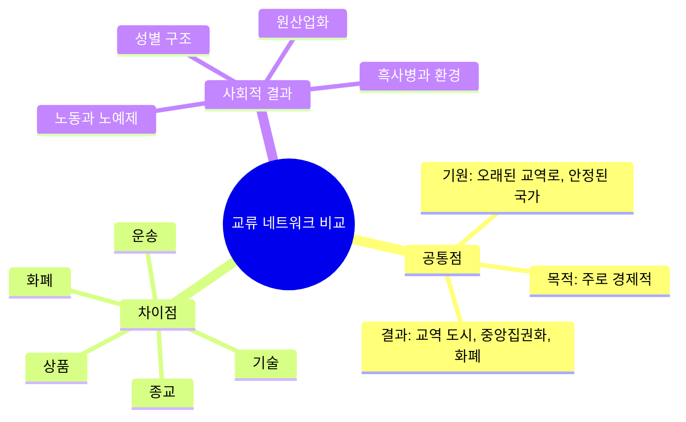
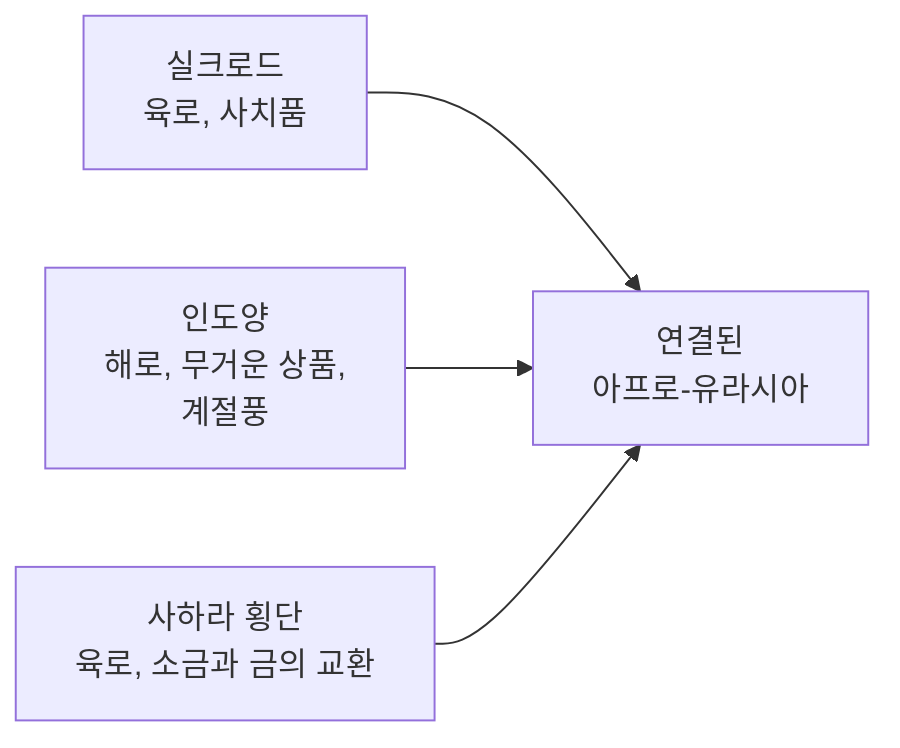
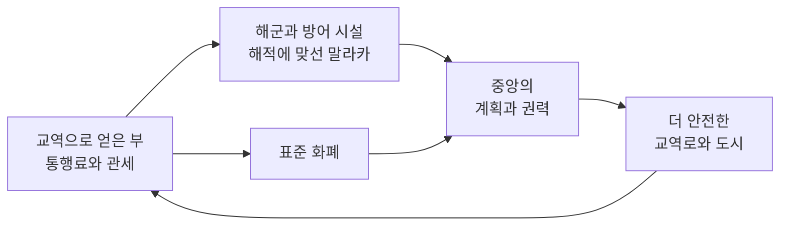
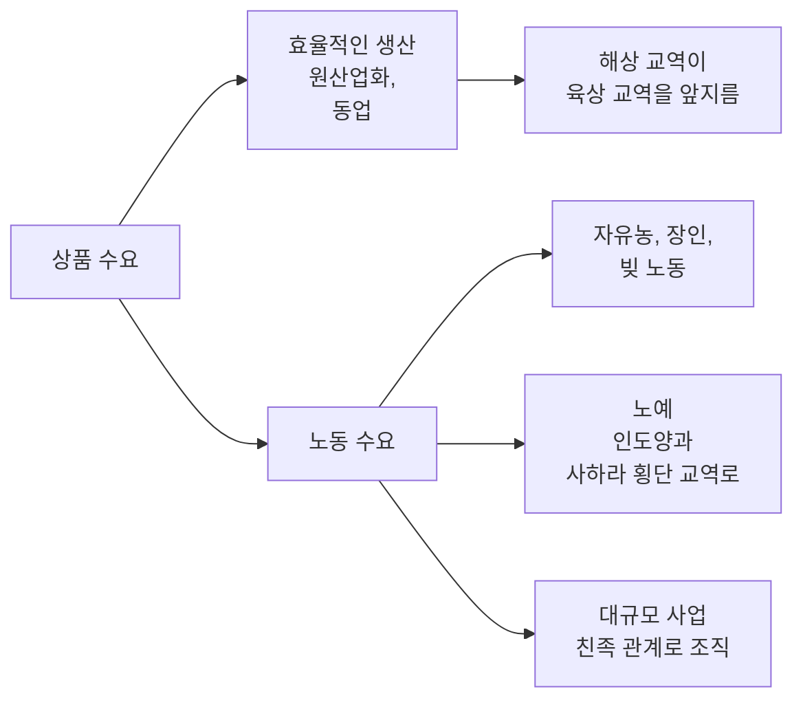
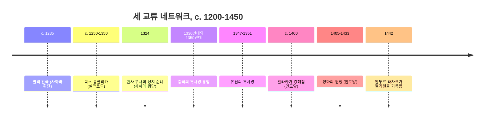
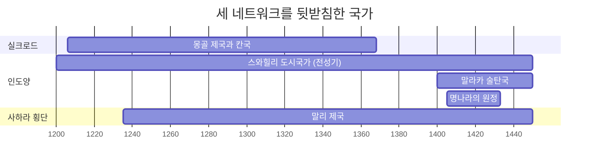

# AP 세계사: 모던 — 토픽 2.7 경제 교류 비교 (Comparison of Economic Exchange)

**Focus Question (교재 Essential Question):** c. 1200–1450년 여러 교류 네트워크 사이의 공통점과 차이점은 무엇이었는가?

> 출처: College Board CED 기준 · 교재 반영 (교재 Topic 2.7)

**Unit 2: 교류의 네트워크 (Networks of Exchange, c. 1200–1450)**

---

## 학습 목표 (Learning Objective)

| 코드 | 학습 목표 |
|---|---|
| 2.7 LO-L (—) | c. 1200–1450년 여러 교류 네트워크 사이의 공통점과 차이점을 설명하라. |

> 교재의 Essential Question이 이 학습 목표와 글자 그대로 같아서, 여기 쓴 학습 목표 문구를 뒷받침한다. CED는 2.7에 주제 초점 (Thematic focus)을 두지 않으므로 코드에 주제를 붙이지 않았다.

## 역사적 개념 (Historical Developments, CED)

> 2.7은 비교 토픽이다. CED는 새로운 역사적 개념을 더하지 않는다. 대신 "Review: Unit 2 Key Concepts"에서 핵심 개념 (Key concepts) 두 개(KC-3.1, KC-3.3)와 2.1의 역사적 개념 세 개를 제시하고, 이를 바탕으로 **교류 네트워크를 비교**하게 한다. 교재는 **기원, 목적, 결과**(공통점)와 **상품, 운송, 기술, 종교**(차이점)를 축으로 비교한다.

| # | 복습: Unit 2 핵심 개념 (Review: Unit 2 Key Concepts, CED) | 출처 토픽 | 다루는 곳 |
|---|---|---|---|
| R1 | KC-3.1: 지역 안팎에서 인간 교류망이 깊어지고 넓어지면서 여러 사회 안에서, 그리고 사회와 사회 사이에서 문화·기술·생물학적 전파가 일어났다. | 2.1–2.6 | §1, §3 (기술, 종교), §5 (흑사병) |
| R2 | KC-3.1.I.A.i: 상업 관행이 개선되면서 교역량이 늘고 실크로드 (Silk Roads)를 비롯한 기존 교역로의 지리적 범위가 넓어졌으며, 이는 강력한 신흥 교역 도시들의 성장을 촉진했다. | 2.1 | §2 (교역 도시) |
| R3 | KC-3.1.I.C.i: 지역 간 사치품 교역이 커진 데에는 기존 운송·상업 기술의 혁신이 뒷받침되었다. 캐러밴서라이 (Caravanserai), 여러 형태의 신용 (Credit), 화폐 경제 (Money economy)의 발달이 그 예이다. | 2.1 | §3 (캐러밴서라이, 화폐와 상업 관행) |
| R4 | KC-3.3: 교역망의 변화는 생산 능력 증대의 결과이자 원인이었으며, 사회·성별 구조와 환경 변화에 중요한 영향을 미쳤다. | 2.1, 2.5 | §4, §5 |
| R5 | KC-3.3.I.B: 아프로-유라시아에서 사치품 수요가 늘었다. 중국·페르시아·인도의 장인과 상인은 수출용 직물과 도자기 생산을 늘렸고, 중국에서는 철과 강철 생산이 확대되었다. | 2.1 | §4 (생산) |

---

## 큰 그림 요약

> "부유한 상인들은 큰 화물을 들여와 내리고는, 그동안 아무런 안전도 생각하지 않고, 수량을 확인하지도, 물건을 지키지도 않은 채 거리낌 없이 시장으로 보낸다."
> — 압두르 라자크 (Abdu Razzak), 「캘리컷 견문기 (Description of Calicut)」 (1442)

"**향신료의 도시 (City of Spices)**" **캘리컷 (Calicut)**은 어떤 면에서는 다른 큰 교역 도시와 같았다. **안전**했고, 여러 부류의 사람들이 시장을 이용했다. 그러나 **화폐**나, **정치체 (Polity)**(정부)가 교역에서 돈을 버는 방식 같은 면에서는 달랐다. 1200–1450년의 **세 교역 네트워크** 전체에도 같은 원리가 적용된다. 세 네트워크는 **기원**(오래된 교역로 위에 세워지고 안정된 국가의 뒷받침을 받음), **목적**(주로 경제적이지만 외교관과 선교사도 오감), **결과**(네트워크의 "매듭"인 교역 도시, 중앙집권화, 표준 화폐)에서 **비슷했다.** 반면 **상품, 운송, 기술, 종교, 화폐**에서는 **달랐다.** 교역은 **사회적 결과**도 낳았다. 원산업화, 새로운 동업 방식, 노예제를 포함한 노동 수요 증가, 일부 예외가 있는 가부장제, 흑사병, 환경에 대한 부담이 그것이다.

---

## §1. 세 교류 네트워크

| 네트워크 | 경로 | 특징 |
|---|---|---|
| **실크로드** | 중국과 중앙아시아의 **고비 사막**과 산길을 지나 서남아시아와 유럽으로 | 상인들이 주로 **사치품**을 전문으로 다룸 |
| **인도양** | 동아시아와 동남·남·서남아시아를 잇는 **계절풍에 의존하는** 교역로 | 상인들이 **육로로 옮기기에 너무 무거운 상품**을 교환함 |
| **사하라 횡단** | 북아프리카와 지중해에서 사막을 건너 서아프리카와 동아프리카로 | 북아프리카의 **소금**과 사막 남쪽 왕국들의 **금**을 맞바꿈 |

> ⚠️ 교재는 사하라 횡단 교역로가 "서아프리카**와 동아프리카**"까지 이어졌다고 쓴다. 대부분의 설명과 교재의 2.4 본문은 **서아프리카**(가나, 말리, 송가이)에 초점을 맞춘다. 동아프리카는 주로 인도양을 통해 연결되었다.

## §2. 공통점: 기원, 목적, 결과

### 기원

- 지역 간 교역은 농경 문화가 **안정된 정착지**로 자리 잡으면서 **기원전부터** 시작되었다. 1200–1450년의 교역은 초기 상인과 정복자들이 처음 낸 **교역로 위에 세워졌다.**
- 왕국과 제국이 커지면서, 그들이 장악하고 다닌 **교역로도 함께 넓어졌다.**
- 교역 네트워크가 성장하려면 **안정된 국가**가 필요했다. 안정된 왕국, 칼리프국, 도시국가, 제국은 교역로와 상인을 **보호**했다. 캘리컷의 상인들이 도둑맞을 걱정 없이 화물을 두고 떠날 수 있었던 것도 이 때문이다.
- 안정된 국가는 교역의 수익을 높이는 **기술 발전**도 뒷받침했다. **나침반**, **삼각돛**, **수확량이 많은 작물**, 무거운 짐을 싣는 **안장**이 그 예다.

### 목적

- **주된 목적은 경제적인 것**이었다. 사람들이 기르거나 만들 수 있는 것을 원하거나 필요한 것과 바꾸는 것이다.
- 그러나 **외교관**(동맹 협상)과 **선교사**(개종자 모집)도 교역로를 오갔다. 이들은 상인과 함께 상품뿐 아니라 **생활 방식**도 주고받았다.

### 결과

- **"매듭"으로서의 교역 도시:** 네트워크는 일정한 간격으로 교차하고 **교차점마다 튼튼하게 매듭지어진** 끈의 그물과 같다. 교역 도시는 네트워크를 붙잡아 주는 **매듭**이었다.
- **중앙집권화 (Centralization):** 교역으로 얻은 부는 도시가 중앙 권력을 키우는 데 쓰였다. 예를 들어 **말라카**는 말라카 해협을 지나는 배에 매긴 통행료로 부유해졌고, **해적을 막기 위해 강한 해군**을 키웠다. 이를 위해서는 **중앙의 계획**이 필요했다. 모든 교역로의 도시가 비슷하게 부를 써서 교역로와 도시를 안전하게 지켰다.
- **표준 화폐:** 널리 인정되는 화폐는 **거래를 빠르게 했고**, 상인들이 **상품의 가치를 잴 수 있게** 했다. 이것도 중앙집권화를 촉진했다.

### 교재 표: 교역로별 교역 도시

| 교역로 | 교역 도시 |
|---|---|
| **실크로드** | 창안 (지금의 중국), 사마르칸트 (우즈베키스탄), 알레포 (시리아), 모술 (이라크) |
| **인도양** | 말라카 (말레이시아), 캘리컷 (인도), 호르무즈 (이란), 몸바사 (케냐), 알렉산드리아 (이집트) |
| **사하라 횡단** | 가오와 팀북투 (말리), 마라케시 (모로코), 카이로 (이집트) |

## §3. 차이점: 상품, 운송, 기술, 종교

### 교재 표: 교역로 사이의 차이

| 항목 | 실크로드 | 인도양 (와 지중해) | 사하라 횡단 |
|---|---|---|---|
| **상품** | **동→서:** 비단, 차, 향신료, 염료, 도자기, 쌀, 종이, 화약. **서→동:** 말, 안장, 과일, 가축, 꿀, 직물 | **동아프리카에서:** 금, 상아, 석영, 동물 가죽. **서남아시아에서:** 감귤류, 과일, 대추야자, 책. **남인도에서:** 직물, 후추, 진주 | **북→남:** 말, 책, 소금. **남→북:** 금, 상아, 옷감, 노예 |
| **운송** | 말, 낙타 | 다우선, 정크선 | 상품을 실은 낙타 대상, 사람은 걸어서 이동 |
| **기술** | 안장, 캐러밴서라이 | 선미타, 삼각돛, 아스트롤라베, 나침반 | 실을 수 있는 짐을 늘린 안장 |
| **종교** | 불교: 남아시아 → 동·동남아시아. 성리학: 중국 → 한국·일본·베트남. 이슬람: 서남아시아 → 남아시아 | 불교: 남아시아 → 동·동남아시아. 성리학: 중국 → 한국·일본·베트남. 이슬람: 남아시아 → 동남아시아. 기독교: 지중해 지역에서 | 이슬람: 서남아시아와 북아프리카 → 사하라 이남 아프리카 |

> ⚠️ 추출된 텍스트에서 이 표의 열이 뒤섞여 있어서, 위 배열은 2.1–2.4 내용을 바탕으로 다시 맞춘 것이다. 인쇄된 교재와 대조해 확인이 필요하다.

### 화폐와 상업 관행

| 화폐 또는 관행 | 지역 | 내용 |
|---|---|---|
| **비단** | 실크로드 | 한때 **교역품이자 화폐**였음 |
| **주석 주괴 (Tin ingots)** | 동남아시아 일부 지역 | **화폐의 기준**으로 쓰임 |
| **개오지 조개껍데기** | 서아프리카 국가들 | 화폐로 쓰임 (2.4 참고) |
| **금과 금속 주화** | 시간이 지나며 여러 국가 | **화폐 경제**로 바뀜 |
| **비전, 초기 은행, 신용** | 중국 | 거래를 덜 번거롭게 하려고 만듦 (2.1 참고) |

## §4. 사회적 결과: 생산과 노동

### 생산

- 사치품 수요가 늘자 생산자들은 **더 효율적으로** 일해야 했다. **중국**은 **철, 강철, 도자기** 수요를 맞추려고 **원산업화 (Proto-industrialization)**를 겪었다 (1.1 참고).
- **투자 위험을 나누는 동업 (Partnerships)** 같은 새로운 상업 관행이 나타났다.
- 중국의 **직물과 도자기**, 남아시아와 동남아시아의 **향신료** 생산이 늘었다.
- 상품의 양이 늘면서 **해상 교역량이 육상 교역량을 앞지르기 시작했다.** 그래서 **더 큰 배**와 더 나은 항해 지식과 기술이 필요해졌다.

### 노동

- 상품 수요와 함께 **노동 수요도 늘었다.**
- 이전 시대의 노동 형태가 **이어졌다.** 자유농, 가내 수공업 (Cottage industries)의 장인, 빚을 갚으려고 강제로 일한 사람, 노예가 그것이다.
- **노예 무역은 인도양과 사하라 횡단 교역로에서 흔했다.**
- 관개 수로, 군사 방어 시설, 큰 건축물 같은 **대규모 사업**에는 **수천 명의 조직된 노동자**가 필요했고, **친족 관계**가 이를 조직하는 데 큰 역할을 하는 경우가 많았다.

> "저수지에서 나는 일하는 사람을 너무 많이 보았는데, 1만 5천에서 2만 명은 되어 보였다. 개미처럼 보였다... 왕은 이 저수지 공사를 장수들에게 나누어 맡겼고, 장수들은 각자 맡은 사람들이 일을 하도록 감독할 책임이 있었다..."
> — 도밍구 파이스 (Domingo Paes), **비자야나가라 제국 (Vijayanagara Empire)**(남인도)에 관한 기록 (1520–22)

> ⚠️ 교재는 이것을 "1300년대"의 목격담이라고 쓰지만, 도밍구 파이스는 **1520–22년**에 이 글을 썼다. 이 단원 시기의 목격담이 아니라, 대규모 사업이 어떻게 조직되었는지 보여 주는 예로 보자.

## §5. 사회·성별 구조와 환경 변화

### 사회·성별 구조

- 사회는 여전히 **계급이나 카스트**로 나뉘었고, 드문 예외를 빼면 **가부장제 (Patriarchy)**였다.

| 지역 | 여성의 역할 |
|---|---|
| **몽골 제국** | 가부장제였지만 여성이 **더 자유로웠음**. 자유롭게 돌아다녔고, (서쪽의) **부르카**와 (동쪽의) **전족**을 거부했으며, **대칸의 최고 조언자**인 경우가 많았음 (2.2 참고) |
| **유럽** | 여성이 **농민과 장인**으로 일했고 **자신들의 길드**가 있었음 |
| **동남아시아** | 여성이 시장 거래에 능숙했고, 유력한 가문을 대신해 **시장을 운영하고 관리했음** |
| **그 밖의 지역** | 여성은 거의 모든 생활 영역에서 남성보다 **기회와 자유가 훨씬 적었음** |

### 환경 변화

- 교류를 이끈 바로 그 연결 때문에 **인구가 크게 줄었다.** 상인, 외교관, 선교사가 교역로를 따라 **흑사병**과 다른 전염병을 옮겼다.
- 흑사병은 **콘스탄티노폴리스** 같은 **한때 위대했던 도시들의 쇠퇴**에 영향을 주었다.
- 대부분의 역사가는 유럽 인구의 **적어도 3분의 1**이 죽었다고 본다. **중국**에서는 **1330년대와 1350년대**에 흑사병이 퍼져 **수천만 명**이 죽었다.
- **광저우 (Canton), 사마르칸트, 팀북투, 카이로, 베네치아** 같은 도시에서 **교육 중심지**가 발달했다.
- **정치적 불안과 농업 확대**가 환경에 부담을 주었다. **삼림 벌채**나 **과잉 방목**으로 생긴 **토양 침식** 때문에 늘어난 인구가 다른 곳으로 이주해야 했다 (2.6 참고).

---

## 연표

---

## 요약표: 공통점과 차이점

| 공통점 | 차이점 |
|---|---|
| **기원:** 오래된 교역로 위에 세워졌고, 안정된 국가가 필요했음 | **상품:** 사치품 (실크로드), 무거운 상품 (인도양), 소금과 금의 교환 (사하라 횡단) |
| **목적:** 주로 경제적이며, 외교관과 선교사도 오감 | **운송:** 말과 낙타, 다우선과 정크선, 걸어서 이동하는 낙타 대상 |
| **결과:** 교역 도시("매듭"), 중앙집권화, 표준 화폐 | **기술:** 안장과 캐러밴서라이, 항해 도구, 짐을 더 싣는 안장 |
| **사회:** 원산업화, 노동 수요 증가, 흑사병 | **종교:** 불교, 성리학, 이슬람과 지중해의 기독교, 사하라 이남 아프리카의 이슬람 |
| — | **화폐:** 비단, 주석 주괴, 개오지 조개껍데기 |

---

## Key Terms (핵심 용어)

| 주제 | 용어 | 정의 |
|---|---|---|
| 경제 | 교류 네트워크 (Network of exchange) | 지역들을 잇는 교역로 체계. 도시를 매듭으로 한 끈의 그물과 같음 |
| 경제 | 정치체 (Polity) | 왕국, 칼리프국, 도시국가, 제국 같은 정치 단위 |
| 경제 | 중앙집권화 (Centralization) | 권력을 중앙 정부에 모으는 것. 교역의 부가 해군과 화폐에 쓰임 |
| 경제 | 표준 화폐 (Standardized currency) | 널리 인정되어 거래를 빠르게 하고 가치를 재는 화폐 |
| 경제 | 주석 주괴 (Tin ingots) | 동남아시아 일부 지역에서 화폐의 기준으로 쓰인 주석 덩어리 |
| 경제 | 개오지 조개껍데기 (Cowrie shells) | 서아프리카 국가들에서 화폐로 쓰인 조개껍데기 |
| 경제 | 원산업화 (Proto-industrialization) | 기계 이전의 대규모 생산. 중국의 철, 강철, 도자기에서 볼 수 있음 |
| 경제 | 동업 (Partnership) | 투자 위험을 나누는 상업 방식 |
| 사회 | 가내 수공업 (Cottage industry) | 장인이 집에서 하는 수공업 생산 |
| 사회 | 가부장제 (Patriarchy) | 남성이 대부분의 권력을 가진 사회 |
| 문화 | 캘리컷 (Calicut) | 압두르 라자크가 기록한(1442) 인도양의 시장 도시, "향신료의 도시" |
| 문화 | 비자야나가라 제국 (Vijayanagara Empire) | 대규모로 조직된 건설 사업으로 알려진 남인도의 제국 |
| 추가 | 사치품 (Luxury goods) | 값은 비싸고 부피는 작은 상품. 실크로드의 주력 상품 |
| 추가 | 계절풍 (Monsoon winds) | 인도양 교역이 의존한 계절성 바람 |
| 추가 | 디아스포라 공동체 (Diasporic community) | 교역 도시에 정착한 외국 상인 집단 |
