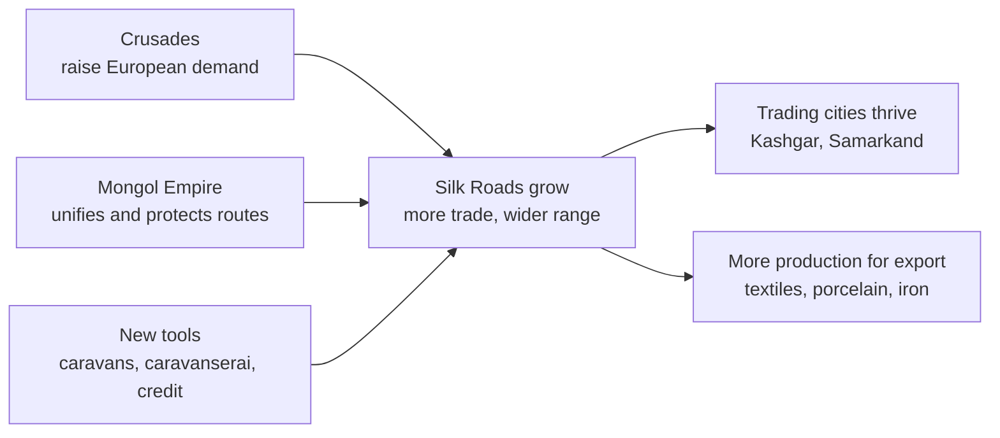

# AP World History: Modern — Topic 2.1 Summary: The Silk Roads (c. 1200–1450)

> Source: Summary of AP_WH_2.1_Notes_EN.md (College Board CED · textbook incorporated, Topic 2.1 reading)

**Unit 2: Networks of Exchange (c. 1200–1450)**

---

## In One Sentence

After 1200, the Silk Roads grew because the Crusades raised European demand, the Mongol Empire unified and protected the routes, and new transportation and commercial tools made trade easier, and this growth made oasis cities such as Kashgar and Samarkand rich and pushed China, Persia, and India to make more goods for export.

## The Big Picture

The **Silk Roads** were a network of land trade routes that linked China with Central Asia, the Middle East, and the Mediterranean. A **network of exchange** is a set of routes that connects regions so they can trade goods and ideas. The Silk Roads were **not new** after 1200. They had already had two "golden ages," under Rome and Han China and later under the Abbasids and Tang China. After 1200 the **Mongol Empire** began a **third golden age**, and trade grew in **volume** (how much was traded) and in **range** (how far it reached).

---

## Key Points

### 1. Background: Three Golden Ages

- **First golden age:** under the **Roman and Han empires**. Trade fell sharply when these empires collapsed.
- **Second golden age (8th–9th centuries):** **Arab merchants** of the **Abbasid Empire** and **Tang China** brought the routes back to life.
- Tang China **sold** porcelain, tea, and silk, and **bought** luxuries such as cotton, precious stones, horses, and grapes.
- **Third golden age (c. 1250–1350):** **Mongol rule** joined and protected the routes. This is called the **Pax Mongolica** ("Mongol peace"; see 2.2).

### 2. Causes: Demand and the Mongols

- During the **Crusades**, European lords and knights brought **fabrics and spices** home from the East. This made Europeans want more Asian **luxury goods** (expensive goods that are small and easy to carry).
- Demand went **both ways**: Europe wanted **silk, tea, and rhubarb**, and China wanted Europe's **gold and silver**.
- The textbook says **no other cause** mattered as much as the rise of the **Mongol Empire**.
- The Mongols conquered the **Abbasid Caliphate in 1258** and then took control of China.
- For the first time, the whole route was under **one authority** that **respected merchants** and **enforced laws**. The Mongols improved roads and **punished bandits**, so travel became safer.

### 3. Causes: Better Transportation

- Merchants traveled in **caravans** (large groups), which was safer than traveling alone.
- New **camel saddles** let camels carry much heavier loads.
- China used the **magnetic compass** and an improved **rudder** (the part that steers a ship).
- The Chinese **junk** was a huge ship with many sails. Its hull was split into **compartments**, so it was strong and less likely to sink.
- These sea tools helped China control trade routes in the **South China Sea**.

### 4. Causes: Commercial Innovations

- **Caravanserai** were inns about **100 miles apart**, the distance a camel could go before it needed water. Travelers rested there and could swap tired animals for fresh ones.
- China had long had a **money economy**: people used money instead of **barter** (trading goods for goods).
- **Flying cash** was a Chinese **credit** system. A merchant deposited money in one place and took out the same amount in another, so he did not have to carry heavy copper coins.
- China used **paper money** from about 800 C.E. In the 1300s, **banking houses** opened in European cities.
- A **bill of exchange** was a paper that promised the holder a set amount of money on a set date. Merchants could trade **without carrying coins**.

### 5. Effect: Rich Oasis Trading Cities

- Much of the route crossed **hot, dry land**, so cities with **rivers** became busy trade centers. Caravanserai were small oases between them.
- **Kashgar** sat at the western edge of China, where the **northern and southern routes crossed**. The **Kashgar River** watered farms of wheat, rice, fruit, and cotton.
- Kashgar's artisans made textiles, rugs, leather goods, and pottery. Once mainly **Buddhist**, it also became a center of **Islamic scholarship**.
- **Samarkand** (in present-day Uzbekistan) lay in the **Zeravshan River** valley, a stop between China and the Mediterranean.
- Samarkand was home to **Christianity, Buddhism, Zoroastrianism, and Islam**. These cities traded **ideas** as well as goods.

### 6. Effect: The Hanseatic League and Export Production

- In the **13th century**, cities in northern Germany and Scandinavia formed the **Hanseatic League**, a trade alliance (the textbook's table gives **1296**).
- Member cities such as **Lübeck, Hamburg, and Riga** controlled trade in the North Sea and Baltic Sea, drove out pirates, and **monopolized** (had sole control of) trade in timber, grain, leather, and salted fish.
- League ships sailed to **Mediterranean ports** to pick up Asian goods brought by **Arab caravans**. The league lasted until the **mid-1600s**.
- More demand led to more **supply**. Chinese, Persian, and Indian artisans made more **silk and other textiles** and **porcelain** (fine ceramics) for export.
- China also made more **iron and steel**, which drove its **proto-industrialization** (large-scale production for market before machines).

## Must-Know Terms & People

| Term | What it is | Why it matters |
|---|---|---|
| Mongol Empire | The empire that unified the Silk Roads under one authority | The biggest single cause of trade growth after 1200 |
| Caravanserai | Inns about 100 miles apart along trade routes | Made long trips across dry land possible |
| Money economy | An economy that uses money instead of barter | Made exchange simpler and larger |
| Flying cash | A Chinese credit system: deposit in one place, withdraw in another | Its exchange offices became a model for modern banks |
| Paper money | Currency in paper form, from China (c. 800 C.E.) | Made large purchases easier |
| Banking houses | Money institutions in European cities from the 1300s | People could turn in a bill of exchange for money |
| Bill of exchange | A paper promising a set payment on a set date | Let merchants trade without carrying coins |
| Kashgar | An oasis city at China's western edge where routes crossed | CED example of a new trading city |
| Samarkand | A trade city in the Zeravshan River valley | CED example of a trading city with many religions |
| Hanseatic League | A trade alliance of northern German and Scandinavian cities | Shows trade networks growing in Europe too |
| Luxury goods | High-value, small goods such as silk and porcelain | Demand for them drove the whole network |
| Proto-industrialization | Large-scale production for market before machines | China's iron and steel output grew with demand |

## Key Dates

| Year | Event |
|---|---|
| 8th–9th centuries | Abbasid merchants and Tang China revive the routes (second golden age) |
| c. 800 | Paper money in use in China |
| c. 1250–1350 | Third golden age under the Pax Mongolica |
| 1258 | Mongols conquer the Abbasid Caliphate |
| 1296 | Hanseatic League (textbook table date) |
| 1300s | Banking houses open in European cities |
| Mid-1600s | Hanseatic League ends |

## How the Exam Asks About It

- **Legitimacy & consolidation:** this topic is about trade more than rulers, so the closest theme is how power protected trade. The Mongols kept their routes safe by enforcing laws, respecting merchants, and punishing bandits. The Hanseatic League drove out pirates, and it faded once national governments could protect their own merchants.
- **Continuity, innovation, diversity:** continuity: the Silk Roads were old routes that went back to Rome and Han China. Innovation: flying cash, bills of exchange, and banking houses let merchants trade without carrying coins. Diversity: Samarkand was home to Christians, Buddhists, Zoroastrians, and Muslims.
- **Likely comparison:** Kashgar vs. Samarkand. Both were river-watered oasis cities where ideas were traded as well as goods. Kashgar sat where the northern and southern routes crossed and went from Buddhist to a center of Islamic scholarship, while Samarkand was a stop toward the Mediterranean with many religions side by side.
- **Common trap:** saying the Silk Roads began after 1200 or were created by the Mongols. Fix: the routes were already old, and what was new after 1200 was **more trade over a wider range**.

## Check Yourself

1. Why was the rise of the Mongol Empire the most important cause of Silk Roads growth?

▶ Answer
For the first time, the whole route was under one authority that respected merchants and enforced laws. The Mongols also improved roads and punished bandits, so travel was safer.

2. How did flying cash and bills of exchange make trade easier?

▶ Answer
Both let merchants move value without carrying heavy coins. With flying cash a merchant deposited money in one place and withdrew it in another, and a bill of exchange promised a set payment on a set date.

3. Why did Kashgar and Samarkand become rich trading cities?

▶ Answer
The routes crossed hot, dry land, and these cities had rivers that gave water and food to travelers. They were key stops where routes met, so goods and ideas passed through them.

