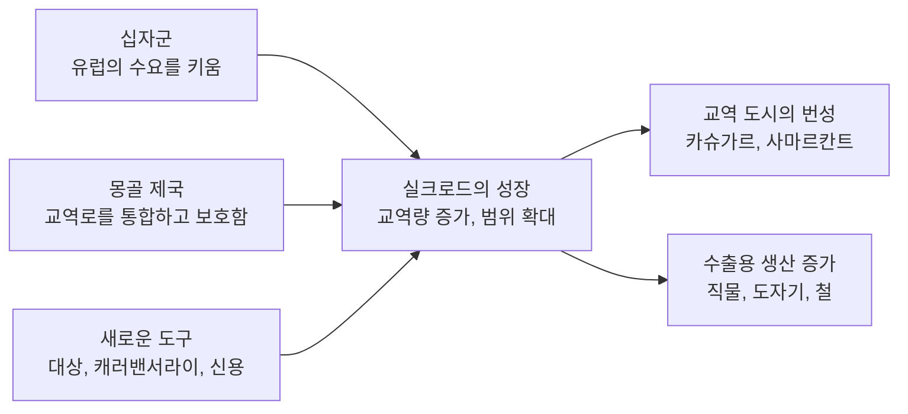

# AP 세계사: 모던 — 토픽 2.1 요약: 실크로드 (The Silk Roads)

> 출처: AP_WH_2.1_Notes_KR.md 요약 (College Board CED 기준 · 교재 반영, 교재 Topic 2.1)

**Unit 2: 교류의 네트워크 (Networks of Exchange, c. 1200–1450)**

---

## 한 문장 요약

1200년 이후 실크로드 (Silk Roads)는 십자군 (Crusades)이 유럽의 수요를 키우고, 몽골 제국 (Mongol Empire)이 교역로를 통합해 보호하고, 새로운 운송·상업 도구가 교역을 쉽게 만들면서 성장했으며, 이 성장으로 카슈가르 (Kashgar)와 사마르칸트 (Samarkand) 같은 오아시스 도시가 부유해지고 중국·페르시아·인도는 수출용 상품을 더 많이 만들었다.

## 큰 그림

**실크로드**는 중국을 중앙아시아, 중동, 지중해와 이은 육상 교역로의 네트워크였다. **교류의 네트워크** (Network of exchange)란 여러 지역을 이어 상품과 사상을 주고받게 하는 교역로의 묶음이다. 실크로드는 1200년 이후에 **새로 생긴 길이 아니다**. 이미 로마와 한 제국 시기, 그리고 뒤의 아바스 제국과 당나라 시기에 두 번의 "황금기"가 있었다. 1200년 이후 **몽골 제국**이 **세 번째 황금기**를 열었고, 교역은 **양**(얼마나 많이 거래했는가)과 **범위**(얼마나 멀리 닿았는가) 모두에서 커졌다.

---

## 핵심 정리

### 1. 배경: 세 번의 황금기

- **첫 번째 황금기:** **로마와 한 제국 (Roman and Han empires)** 시기이다. 두 제국이 무너지자 교역이 크게 줄었다.
- **두 번째 황금기 (8–9세기):** **아바스 제국** (Abbasid Empire)의 **아랍 상인**과 **당나라** (Tang China)가 교역로를 되살렸다.
- 당나라는 도자기, 차, 비단을 **팔았고**, 면화, 보석, 말, 포도 같은 사치품을 **사들였다**.
- **세 번째 황금기 (c. 1250–1350):** **몽골의 지배**가 교역로를 하나로 잇고 보호했다. 이를 **팍스 몽골리카 (Pax Mongolica)**("몽골의 평화", 2.2 참고)라고 부른다.

### 2. 원인: 수요와 몽골

- **십자군** 때 유럽의 영주와 기사들이 동방에서 **직물과 향신료**를 가지고 돌아왔다. 그러자 유럽인들은 아시아의 **사치품 (Luxury goods)**(값이 비싸고 작아서 나르기 쉬운 상품)을 더 원하게 되었다.
- 수요는 **양쪽 모두에** 있었다. 유럽은 **비단, 차, 대황** (Rhubarb)을 원했고, 중국은 유럽의 **금과 은**을 원했다.
- 교재는 **몽골 제국**의 등장만큼 큰 영향을 준 **원인은 없었다**고 쓴다.
- 몽골은 **1258년 아바스 칼리프조** (Abbasid Caliphate)를 정복하고, 이어 중국까지 지배했다.
- 처음으로 교역로 전체가 **상인을 존중**하고 **법을 집행**하는 **하나의 권력** 아래 놓였다. 몽골은 도로를 정비하고 **도적을 처벌**해 여행을 더 안전하게 만들었다.

### 3. 원인: 더 나은 운송

- 상인들은 **대상 (Caravan)**(큰 무리)을 이루어 다녔고, 이는 혼자 다니는 것보다 안전했다.
- 새로운 **낙타 안장 (Camel saddle)** 덕분에 낙타가 훨씬 무거운 짐을 실을 수 있었다.
- 중국은 **나침반** (Magnetic compass)과 개량된 **키 (Rudder)**(배의 방향을 잡는 장치)를 썼다.
- 중국의 **정크선** (Junk)은 돛이 여러 개인 거대한 배였다. 선체가 **격벽**으로 나뉘어 있어 튼튼하고 잘 가라앉지 않았다.
- 이런 해양 기술 덕분에 중국은 **남중국해** (South China Sea)의 교역로를 장악할 수 있었다.

### 4. 원인: 상업 혁신

- **캐러밴서라이** (Caravanserai)는 낙타가 물 없이 갈 수 있는 거리인 약 **100마일 간격**으로 세운 숙소였다. 여행자는 이곳에서 쉬고, 지친 가축을 새 가축으로 바꿀 수 있었다.
- 중국은 오래전부터 **화폐 경제** (Money economy)였다. 사람들은 **물물교환 (Barter)**(물건과 물건을 바꾸는 것) 대신 화폐를 썼다.
- **비전** (Flying cash)은 중국의 **신용 (Credit)** 제도였다. 상인이 한 곳에 돈을 맡기고 다른 곳에서 같은 금액을 찾았기 때문에 무거운 구리 동전을 들고 다닐 필요가 없었다.
- 중국은 약 800년부터 **지폐** (Paper money)를 썼다. 1300년대에는 유럽 도시에 **은행** (Banking houses)이 생겼다.
- **환어음** (Bill of exchange)은 소지자에게 정해진 날짜에 정해진 금액을 주기로 약속한 문서였다. 상인은 **동전 없이도** 거래할 수 있었다.

### 5. 결과: 부유한 오아시스 교역 도시

- 교역로의 상당 부분이 **덥고 건조한 땅**을 지났기 때문에, **강**이 흐르는 도시들이 붐비는 교역 중심지가 되었다. 캐러밴서라이는 그 사이의 작은 오아시스였다.
- **카슈가르**는 중국 서쪽 끝, **북쪽 경로와 남쪽 경로가 만나는 곳**에 있었다. **카슈가르강**이 밀, 쌀, 과일, 면화를 기르는 농지에 물을 댔다.
- 카슈가르의 장인들은 직물, 양탄자, 가죽 제품, 도기를 만들었다. 원래는 주로 **불교** 도시였으나, **이슬람 학문**의 중심지가 되기도 했다.
- **사마르칸트**(지금의 우즈베키스탄)는 **제라프샨강 (Zeravshan River)** 유역에 있었고, 중국과 지중해 사이의 경유지였다.
- 사마르칸트에는 **기독교, 불교, 조로아스터교, 이슬람**이 함께 있었다. 이 도시들에서는 상품뿐 아니라 **사상**도 오갔다.

### 6. 결과: 한자 동맹과 수출용 생산

- **13세기**에 북부 독일과 스칸디나비아의 도시들이 교역 동맹인 **한자 동맹** (Hanseatic League)을 결성했다 (교재 표에는 **1296년**).
- **뤼베크 (Lübeck), 함부르크 (Hamburg), 리가 (Riga)** 같은 회원 도시들은 북해와 발트해의 교역을 장악하고, 해적을 몰아냈으며, 목재, 곡물, 가죽, 소금에 절인 생선의 교역을 **독점**(혼자 차지함)했다.
- 동맹의 배들은 **지중해 항구**로 가서 **아랍 대상**이 가져온 아시아 상품을 실었다. 한자 동맹은 **1600년대 중반**까지 이어졌다.
- 수요가 늘자 **공급**도 늘었다. 중국·페르시아·인도의 장인들은 수출용 **비단과 직물**, **도자기 (Porcelain)**(고급 도자기) 생산을 늘렸다.
- 중국은 **철과 강철**도 더 많이 만들었고, 이것이 **원산업화 (Proto-industrialization)**(기계 이전에 시장을 겨냥한 대규모 생산)를 이끌었다.

## 꼭 알아야 할 용어·인물

| 용어 | 무엇인가 | 왜 중요한가 |
|---|---|---|
| 몽골 제국 (Mongol Empire) | 실크로드를 하나의 권력 아래 통합한 제국 | 1200년 이후 교역 성장의 가장 큰 원인 |
| 캐러밴서라이 (Caravanserai) | 교역로를 따라 약 100마일 간격으로 세운 숙소 | 건조한 땅을 지나는 먼 여행을 가능하게 함 |
| 화폐 경제 (Money economy) | 물물교환 대신 화폐를 쓰는 경제 | 교환을 더 쉽고 크게 만듦 |
| 비전 (Flying cash) | 한 곳에 맡기고 다른 곳에서 찾는 중국의 신용 제도 | 환전소가 근대 은행의 모델이 됨 |
| 지폐 (Paper money) | 종이로 된 화폐로, 중국에서 시작됨 (c. 800년) | 큰 거래를 쉽게 함 |
| 은행 (Banking houses) | 1300년대부터 유럽 도시에 생긴 금융 기관 | 환어음을 내고 돈으로 받을 수 있었음 |
| 환어음 (Bill of exchange) | 정해진 날짜에 정해진 금액을 주기로 약속한 문서 | 상인이 동전 없이 거래할 수 있게 함 |
| 카슈가르 (Kashgar) | 교역로가 만나는 중국 서쪽 끝의 오아시스 도시 | 신흥 교역 도시의 CED 예시 |
| 사마르칸트 (Samarkand) | 제라프샨강 (Zeravshan River) 유역의 교역 도시 | 여러 종교가 공존한 교역 도시의 CED 예시 |
| 한자 동맹 (Hanseatic League) | 북부 독일과 스칸디나비아 도시들의 교역 동맹 | 유럽에서도 교역 네트워크가 커졌음을 보여 줌 |
| 사치품 (Luxury goods) | 비단, 도자기처럼 값이 비싸고 작은 상품 | 그 수요가 네트워크 전체를 움직임 |
| 원산업화 (Proto-industrialization) | 기계 이전에 시장을 겨냥한 대규모 생산 | 수요에 따라 중국의 철과 강철 생산이 늘어남 |

## 주요 연도

| 연도 | 사건 |
|---|---|
| 8–9세기 | 아바스 (Abbasid) 상인과 당나라 (Tang China)가 교역로를 되살림 (두 번째 황금기) |
| c. 800 | 중국에서 지폐 (Paper money) 사용 |
| c. 1250–1350 | 팍스 몽골리카 (Pax Mongolica) 아래의 세 번째 황금기 |
| 1258 | 몽골 (Mongols)이 아바스 칼리프조 (Abbasid Caliphate)를 정복 |
| 1296 | 한자 동맹 (Hanseatic League) (교재 표의 연도) |
| 1300년대 | 유럽 도시에 은행 (Banking houses)이 생김 |
| 1600년대 중반 | 한자 동맹 (Hanseatic League)이 끝남 |

## 시험에서는 이렇게 묻는다

- **정당화와 공고화:** 이 토픽은 통치자보다 교역을 다루므로, 가장 가까운 주제는 권력이 교역을 어떻게 보호했는가이다. 몽골은 법을 집행하고, 상인을 존중하고, 도적을 처벌해 교역로를 안전하게 지켰다. 한자 동맹은 해적을 몰아냈고, 각국 정부가 자국 상인을 보호할 수 있게 되자 힘을 잃었다.
- **연속성·혁신·다양성:** 연속성: 실크로드는 로마와 한 제국 시기까지 거슬러 올라가는 오래된 교역로였다. 혁신: 비전, 환어음, 은행 덕분에 상인은 동전을 들고 다니지 않고도 거래할 수 있었다. 다양성: 사마르칸트에는 기독교도, 불교도, 조로아스터교도, 무슬림이 함께 살았다.
- **자주 나오는 비교:** 카슈가르 vs. 사마르칸트. 둘 다 강물을 이용한 오아시스 도시였고, 상품뿐 아니라 사상이 오가는 곳이었다. 카슈가르는 북쪽 경로와 남쪽 경로가 만나는 곳에 있었고 불교 도시에서 이슬람 학문의 중심지가 되었다. 반면 사마르칸트는 지중해로 가는 길의 경유지였고 여러 종교가 함께 있었다.
- **자주 하는 실수:** 실크로드가 1200년 이후에 시작되었다거나 몽골이 만들었다고 쓰는 것이다. 바로잡기: 교역로는 이미 오래되었고, 1200년 이후에 새로워진 것은 **더 넓은 범위에서 더 많은 교역**이 이루어졌다는 점이다.

## 스스로 확인하기

1. 몽골 제국의 등장이 실크로드 성장의 가장 중요한 원인이었던 이유는 무엇인가?

▶ 정답
처음으로 교역로 전체가 상인을 존중하고 법을 집행하는 하나의 권력 아래 놓였다. 몽골은 도로를 정비하고 도적을 처벌해 여행을 더 안전하게 만들었다.

2. 비전과 환어음은 교역을 어떻게 쉽게 만들었는가?

▶ 정답
둘 다 상인이 무거운 동전을 들고 다니지 않고도 돈을 옮길 수 있게 했다. 비전은 한 곳에 돈을 맡기고 다른 곳에서 찾는 제도였고, 환어음은 정해진 날짜에 정해진 금액을 주기로 약속한 문서였다.

3. 카슈가르와 사마르칸트가 부유한 교역 도시가 된 이유는 무엇인가?

▶ 정답
교역로는 덥고 건조한 땅을 지났는데, 이 도시들에는 여행자에게 물과 식량을 주는 강이 있었다. 또 교역로가 만나는 주요 경유지였기 때문에 상품과 사상이 이곳을 거쳐 갔다.

