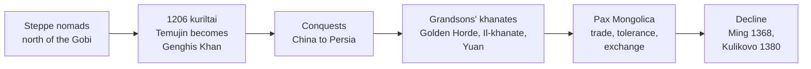

# AP World History: Modern — Topic 2.2 Summary: The Mongol Empire (c. 1200–1450)

> Source: Summary of AP_WH_2.2_Notes_EN.md (College Board CED · textbook incorporated, Topic 2.2 reading)

**Unit 2: Networks of Exchange (c. 1200–1450)**

---

## In One Sentence

The Mongol Empire grew through the conquests of Genghis Khan and his grandsons, and by guarding roads and drawing conquered peoples into one network, it revived Afro-Eurasian trade and spread ideas, technology, and disease.

## The Big Picture

The **Mongols** were nomadic herders from the dry steppes north of the Gobi Desert. In 1206, **Temujin** united them and became **Genghis Khan**. His armies, and then his grandsons, built the **largest continuous land empire in history**, from China to Russia and Persia. The conquests were very violent. But the Mongols also protected trade routes, allowed many religions, and moved knowledge across Afro-Eurasia (Africa, Europe, and Asia together). By the late 1300s, Mongol rule was falling apart in China and Russia.

---

## Key Points

### 1. Genghis Khan built a state

- The Mongols were **pastoral nomads**: clans who herded goats and sheep and moved with their animals.
- Steppe life was hard. **Everyone, men and women,** had to ride well, and courage was highly valued.
- Temujin spent decades making **tribal alliances** and defeating rivals one by one.
- He valued **personal loyalty**. He sometimes gave top jobs to talented people outside his family.
- In **1206**, a **kuriltai** (a meeting of Mongol chiefs) elected him khan (ruler). He took the name **Genghis Khan**, "ruler of all."

### 2. How the Mongols conquered

- Mongol soldiers were skilled riders with the **short bow** and were very disciplined.
- In a **feigned retreat**, a small group pretended to run away. When the enemy chased them, a larger Mongol force surrounded the enemy.
- Captured Chinese and Persian engineers built **siege weapons** such as catapults and portable towers.
- Cities that resisted were often wiped out. Stories of this **brutality** made some leaders surrender before an attack.
- They attacked the **Jin Empire** in northern China (1210) and conquered **Kara Khitai** in Central Asia and the Islamic **Khwarazm Empire** (1219). By 1227, the empire reached from the North China Sea to eastern Persia.

### 3. The Pax Mongolica: trade and exchange

- The **Pax Mongolica** ("Mongolian peace," c. 1250–1350) was a time of safe travel and trade across the empire.
- Mongol soldiers **guarded the Silk Roads**, and roads were built and protected.
- With each conquest, **new peoples were drawn into** the Mongol economy and trade networks.
- Genghis Khan practiced **religious tolerance**, which was unusual at the time.
- A captured scribe adapted the **Uyghur alphabet** to write Mongolian. Mongolia still uses it today.

### 4. Batu and the Golden Horde in Russia

- Batu, a grandson of Genghis Khan, invaded Russia in 1236 and destroyed **Kiev** in 1240.
- The Mongols used **indirect rule**: Russian princes stayed in charge and paid **tribute** (regular payments) to the Mongols.
- **Moscow** collected extra tribute, built an army, and led a coalition that beat the Golden Horde at the **Battle of Kulikovo (1380)**.
- Mongol rule cut Russia off from Western Europe, so a **more distinctly Russian culture** grew. Resisting the Mongols laid the base of the modern Russian state.

> ⚠️ The textbook gives 1380, the Battle of Kulikovo, as the Golden Horde's defeat. Many accounts say Mongol tribute over Russia ended only in 1480. Check how your teacher presents this.

### 5. Hulegu in Persia and Kublai Khan in China

- In **1258**, Hulegu destroyed **Baghdad** and ended the Abbasid Caliphate. His khanate was the **Il-khanate**.
- In **1260**, the Muslim **Mamluks**, led by Baibars, defeated the Mongols in Palestine and stopped their advance.
- In the Il-khanate, **Persians served as ministers and officials**, and most Mongols there converted to **Islam**.
- **Kublai Khan** conquered the Song Dynasty and founded the **Yuan Dynasty** (1271) in China. He followed **Chinese traditions** and tolerated many religions.

### 6. Decline and lasting impact

- The Yuan **angered the Chinese**: it gave government jobs to foreigners, ended the **civil service exams**, and kept Mongols separate.
- From 1274, the Yuan **failed to conquer** Japan, Indochina, Burma, and Java.
- In **1368**, **Zhu Yuanzhang**, a poor Buddhist monk, led a revolt and founded the **Ming Dynasty**.
- **Cultural transfer:** Greco-Islamic medicine and **Arabic numerals** reached Western Europe, Islamic science reached China, and Chinese paper reached Europe.
- **Disease:** fleas carrying the **bubonic plague** (Black Death) spread along Mongol trade and military routes.

## Must-Know Terms & People

| Term | What it is | Why it matters |
|---|---|---|
| Genghis Khan | Temujin, founder of the Mongol Empire | Built the Mongol state and began its conquests |
| Kuriltai | A meeting of Mongol chiefs | Elected Genghis Khan in 1206 |
| Khanate | A kingdom ruled by a khan | The empire split into khanates under his grandsons |
| Pax Mongolica | "Mongolian peace," c. 1250–1350 | Safe roads revived Afro-Eurasian trade |
| Golden Horde | Batu's khanate in Russia | Ruled Russia indirectly through tribute |
| Moscow | A Russian city-state | Led the coalition that won at Kulikovo in 1380 |
| Il-khanate | Hulegu's khanate in Persia | Destroyed Baghdad and used Persian officials |
| Kublai Khan | Grandson of Genghis; Great Khan from 1260 | Founded the Yuan Dynasty in China |
| Yuan Dynasty | Mongol dynasty in China (1271–1368) | Followed Chinese traditions but alienated the Chinese |
| Zhu Yuanzhang | Buddhist monk from a poor peasant family | Overthrew the Yuan and founded the Ming in 1368 |
| Uyghur alphabet | Script adapted to write Mongolian | A CED example of cultural transfer |
| Bubonic plague | The Black Death | Spread along Mongol trade and military routes |

## Key Dates

| Year | Event |
|---|---|
| 1206 | A kuriltai elects Temujin as Genghis Khan |
| 1240 | Batu destroys Kiev |
| 1258 | Hulegu destroys Baghdad |
| 1260 | The Mamluks defeat the Mongols; Kublai becomes Great Khan |
| 1271 | Kublai founds the Yuan Dynasty |
| 1368 | Zhu Yuanzhang founds the Ming Dynasty |
| 1380 | Moscow's coalition wins the Battle of Kulikovo |

## How the Exam Asks About It

- **Legitimacy & consolidation:** Genghis Khan was elected by a kuriltai and rewarded loyalty. His heirs kept power by using local elites: Russian princes paid tribute, Persians ran the Il-khanate, and Kublai followed Chinese traditions.
- **Continuity, innovation, diversity:** Continuity: old trade routes and local officials kept working. Innovation: the Uyghur alphabet was adapted to write Mongolian. Diversity: the Yuan tolerated Buddhists, Daoists, Muslims, Jews, and Christians.
- **Likely comparison:** Golden Horde vs. Yuan. Both were Mongol khanates ruling settled peoples. The Golden Horde ruled indirectly through Russian princes, while the Yuan followed Chinese traditions but kept Mongols separate from the Chinese.
- **Common trap:** describing the Mongols only as destroyers. Fix: they did cause great destruction, but they also revived trade and spread knowledge across Afro-Eurasia during the Pax Mongolica.

## Check Yourself

1. How did the Mongol Empire help trade and communication?

▶ Answer
During the Pax Mongolica, Mongol soldiers guarded the Silk Roads and roads were built and protected. Conquered peoples were drawn into one trade network that linked Asia, the Middle East, Africa, and Europe.

2. Give two reasons the Yuan Dynasty lost power in China.

▶ Answer
The Yuan angered the Chinese by hiring foreigners, ending the civil service exams, and keeping Mongols separate. Its failed invasions of Japan and other lands made it look weaker, and in 1368 Zhu Yuanzhang's revolt founded the Ming.

3. Name two ideas or technologies that moved across Eurasia because of Mongol contact.

▶ Answer
Greco-Islamic medical knowledge and Arabic numerals reached Western Europe. Islamic science reached China, and Chinese paper reached Europe.

