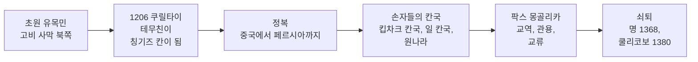

# AP 세계사: 모던 — 토픽 2.2 요약: 몽골 제국 (The Mongol Empire)

> 출처: AP_WH_2.2_Notes_KR.md 요약 (College Board CED 기준 · 교재 반영, 교재 Topic 2.2)

**Unit 2: 교류의 네트워크 (Networks of Exchange, c. 1200–1450)**

---

## 한 문장 요약

몽골 제국 (Mongol Empire)은 칭기즈 칸 (Genghis Khan)과 그 손자들의 정복으로 커졌고, 도로를 지키고 피정복민을 하나의 교역망에 끌어들여 아프로-유라시아 (Afro-Eurasia)의 교역을 되살렸으며 사상, 기술, 질병을 퍼뜨렸다.

## 큰 그림

**몽골** (Mongols)은 고비 사막 (Gobi Desert) 북쪽의 건조한 초원에서 가축을 치던 유목민이었다. 1206년 **테무친** (Temujin)이 이들을 통일하고 **칭기즈 칸**이 되었다. 그의 군대와 손자들은 중국에서 러시아와 페르시아까지 이르는 **역사상 가장 큰 연속된 육상 제국**을 세웠다. 정복은 매우 잔혹했다. 그러나 몽골은 교역로를 보호하고, 여러 종교를 허용했으며, 아프로-유라시아(아프리카, 유럽, 아시아를 합친 지역) 곳곳으로 지식을 옮겼다. 1300년대 후반이 되자 중국과 러시아에서 몽골의 지배가 무너지고 있었다.

---

## 핵심 정리

### 1. 칭기즈 칸이 국가를 세웠다

- 몽골은 **유목민** (Pastoral nomads)이었다. 염소와 양을 치며 가축과 함께 옮겨 다니는 씨족들이었다.
- 초원의 생활은 혹독했다. **남녀 모두** 말을 잘 타야 했고, 용기를 매우 중시했다.
- 테무친은 수십 년 동안 **부족 동맹**을 맺고 경쟁자를 하나씩 물리쳤다.
- 그는 **개인적 충성**을 가장 중시했다. 때로는 가족이 아닌 재능 있는 사람에게 높은 자리를 주었다.
- **1206년** **쿠릴타이 (Kuriltai)**(몽골 족장들의 회의)가 그를 칸 (Khan, 통치자)으로 뽑았다. 그는 "모든 것의 통치자"라는 뜻의 **칭기즈 칸**이라는 이름을 얻었다.

### 2. 몽골은 어떻게 정복했는가

- 몽골 병사는 말을 잘 타고 **단궁** (Short bow)에 능숙했으며 규율이 매우 엄격했다.
- **거짓 후퇴** (Feigned retreat)에서는 작은 부대가 도망치는 척했다. 적이 쫓아오면 더 큰 몽골군이 적을 포위했다.
- 붙잡힌 중국·페르시아 기술자들이 투석기와 이동식 공성탑 같은 **공성 무기** (Siege weapons)를 만들었다.
- 저항한 도시는 몰살되는 일이 많았다. 이런 **잔혹함**에 대한 소문 때문에 일부 지도자는 공격받기 전에 항복했다.
- 북중국의 **금나라** (Jin Empire)를 공격했고(1210), 중앙아시아의 **카라 키타이** (Kara Khitai)와 이슬람 국가인 **호라즘** (Khwarazm)을 정복했다(1219). 1227년까지 제국은 북중국해에서 페르시아 동부까지 이르렀다.

### 3. 팍스 몽골리카: 교역과 교류

- **팍스 몽골리카 (Pax Mongolica)**("몽골의 평화", c. 1250–1350)는 제국 전역에서 안전하게 여행하고 교역할 수 있었던 시기이다.
- 몽골 병사들이 **실크로드 (Silk Roads)를 지켰고**, 도로가 건설되고 보호받았다.
- 정복할 때마다 **새로운 민족이** 몽골의 경제와 교역망에 **편입되었다**.
- 칭기즈 칸은 당시로서는 드문 **종교적 관용** (Religious tolerance)을 베풀었다.
- 붙잡힌 서기가 **위구르 문자** (Uyghur alphabet)를 몽골어에 맞게 고쳤다. 이 문자는 지금도 몽골에서 쓰인다.

### 4. 바투와 러시아의 킵차크 칸국

- 칭기즈 칸의 손자 **바투** (Batu)는 1236년 러시아를 침공했고, 1240년 **키예프** (Kiev)를 파괴했다.
- 몽골은 **간접 통치** (Indirect rule)를 했다. 러시아 공후들이 그대로 다스리면서 몽골에 **공납 (Tribute)**(정기적으로 바치는 재물)을 냈다.
- **모스크바** (Moscow)는 추가 공납을 걷어 군대를 키웠고, 연합을 이끌어 **쿨리코보 전투** (Battle of Kulikovo, 1380)에서 킵차크 칸국 (Golden Horde)을 물리쳤다.
- 몽골의 지배로 러시아는 서유럽과 단절되었고, 그 결과 **더 뚜렷한 러시아 문화**가 자랐다. 몽골에 대한 저항은 근대 러시아 국가의 기초가 되었다.

> ⚠️ 교재는 1380년 쿨리코보 전투를 킵차크 칸국의 패배로 쓴다. 많은 설명에서는 러시아에 대한 몽골의 공납 지배가 1480년에야 끝났다고 본다. 선생님이 어떻게 가르치는지 확인이 필요하다.

### 5. 페르시아의 훌라구와 중국의 쿠빌라이 칸

- **1258년** **훌라구** (Hulegu)가 **바그다드** (Baghdad)를 파괴하고 아바스 칼리프조 (Abbasid Caliphate)를 끝냈다. 그의 칸국이 **일 칸국** (Il-khanate)이다.
- **1260년** 바이바르스 (Baibars)가 이끄는 무슬림 **맘루크** (Mamluks)가 팔레스타인에서 몽골군을 물리치고 진격을 막았다.
- 일 칸국에서는 **페르시아인이 대신과 관리**를 맡았고, 그곳의 몽골인 대부분이 **이슬람**으로 개종했다.
- **쿠빌라이 칸** (Kublai Khan)은 송나라 (Song Dynasty)를 정복하고 중국에 **원나라** (Yuan Dynasty)를 세웠다(1271). 그는 **중국 전통**을 따랐고 여러 종교를 관용했다.

### 6. 쇠퇴와 오래 남은 영향

- 원나라는 **중국인의 반감을 샀다.** 외국인에게 관직을 주었고, **과거제** (Civil service examinations)를 폐지했으며, 몽골인을 중국인과 분리했다.
- 1274년부터 원나라는 일본, 인도차이나, 버마, 자와 **정복에 실패했다**.
- **1368년** 가난한 불교 승려 **주원장** (Zhu Yuanzhang)이 반란을 이끌어 **명나라** (Ming Dynasty)를 세웠다.
- **문화 전파:** 그리스-이슬람 의학 지식 (Greco-Islamic medical knowledge)과 **아라비아 숫자** (Arabic numerals)가 서유럽에 전해졌고, 이슬람 과학이 중국에, 중국의 종이가 유럽에 전해졌다.
- **질병:** **흑사병** (Bubonic plague / Black Death)을 옮기는 벼룩이 몽골의 교역로와 군사 경로를 따라 퍼졌다.

## 꼭 알아야 할 용어·인물

| 용어 | 무엇인가 | 왜 중요한가 |
|---|---|---|
| 칭기즈 칸 (Genghis Khan) | 몽골 제국을 세운 테무친 (Temujin) | 몽골 국가를 세우고 정복을 시작함 |
| 쿠릴타이 (Kuriltai) | 몽골 족장들의 회의 | 1206년 칭기즈 칸을 선출함 |
| 칸국 (Khanate) | 칸이 다스리는 왕국 | 손자들 대에 제국이 여러 칸국으로 나뉨 |
| 팍스 몽골리카 (Pax Mongolica) | "몽골의 평화", c. 1250–1350 | 안전한 도로가 아프로-유라시아 교역을 되살림 |
| 킵차크 칸국 (Golden Horde) | 러시아를 다스린 바투 (Batu)의 칸국 | 공납을 통해 러시아를 간접 통치함 |
| 모스크바 (Moscow) | 러시아의 도시국가 | 1380년 쿨리코보에서 승리한 연합을 이끎 |
| 일 칸국 (Il-khanate) | 페르시아를 다스린 훌라구 (Hulegu)의 칸국 | 바그다드를 파괴하고 페르시아인 관리를 씀 |
| 쿠빌라이 칸 (Kublai Khan) | 칭기즈 칸의 손자, 1260년부터 대칸 (Great Khan) | 중국에 원나라를 세움 |
| 원나라 (Yuan Dynasty) | 중국의 몽골 왕조 (1271–1368) | 중국 전통을 따랐지만 중국인의 반감을 삼 |
| 주원장 (Zhu Yuanzhang) | 가난한 농민 출신의 불교 승려 | 1368년 원나라를 무너뜨리고 명나라를 세움 |
| 위구르 문자 (Uyghur alphabet) | 몽골어 표기에 맞게 고친 문자 | 문화 전파를 보여 주는 CED 예시 |
| 흑사병 (Bubonic plague) | 검은 죽음 (Black Death) | 몽골의 교역로와 군사 경로를 따라 퍼짐 |

## 주요 연도

| 연도 | 사건 |
|---|---|
| 1206 | 쿠릴타이 (Kuriltai)가 테무친 (Temujin)을 칭기즈 칸 (Genghis Khan)으로 선출 |
| 1240 | 바투 (Batu)가 키예프 (Kiev)를 파괴 |
| 1258 | 훌라구 (Hulegu)가 바그다드 (Baghdad)를 파괴 |
| 1260 | 맘루크 (Mamluks)가 몽골군을 격퇴. 쿠빌라이 (Kublai)가 대칸 (Great Khan)이 됨 |
| 1271 | 쿠빌라이가 원나라 (Yuan Dynasty)를 건국 |
| 1368 | 주원장 (Zhu Yuanzhang)이 명나라 (Ming Dynasty)를 건국 |
| 1380 | 모스크바 (Moscow)가 이끈 연합이 쿨리코보 전투 (Battle of Kulikovo)에서 승리 |

## 시험에서는 이렇게 묻는다

- **정당화와 공고화:** 칭기즈 칸은 쿠릴타이에서 선출되었고 충성에 보상했다. 후계자들은 현지 엘리트를 이용해 권력을 지켰다. 러시아 공후는 공납을 바쳤고, 페르시아인이 일 칸국을 운영했으며, 쿠빌라이는 중국 전통을 따랐다.
- **연속성·혁신·다양성:** 연속성: 기존의 교역로와 현지 관리들이 계속 기능했다. 혁신: 위구르 문자를 몽골어 표기에 맞게 고쳤다. 다양성: 원나라는 불교도, 도교도, 무슬림, 유대인, 기독교인을 관용했다.
- **자주 나오는 비교:** 킵차크 칸국 vs. 원나라. 둘 다 정착민을 다스린 몽골 칸국이었다. 킵차크 칸국은 러시아 공후를 통해 간접 통치했고, 원나라는 중국 전통을 따랐지만 몽골인을 중국인과 분리했다.
- **자주 하는 실수:** 몽골을 파괴자로만 쓰는 것이다. 바로잡기: 몽골은 큰 파괴를 일으켰지만, 팍스 몽골리카 동안 아프로-유라시아 전역에서 교역을 되살리고 지식을 퍼뜨리기도 했다.

## 스스로 확인하기

1. 몽골 제국은 교역과 통신에 어떻게 도움이 되었는가?

▶ 정답
팍스 몽골리카 동안 몽골 병사들이 실크로드를 지켰고, 도로가 건설되고 보호받았다. 피정복민은 아시아, 중동, 아프리카, 유럽을 잇는 하나의 교역망에 편입되었다.

2. 원나라가 중국에서 힘을 잃은 이유를 두 가지 들어 보라.

▶ 정답
원나라는 외국인을 관리로 쓰고, 과거제를 폐지하고, 몽골인을 분리해 중국인의 반감을 샀다. 일본 등 원정에 실패해 약해 보였고, 1368년 주원장의 반란으로 명나라가 세워졌다.

3. 몽골과의 접촉으로 유라시아를 건너 퍼진 지식이나 기술을 두 가지 들어 보라.

▶ 정답
그리스-이슬람 의학 지식과 아라비아 숫자가 서유럽에 전해졌다. 이슬람 과학은 중국에, 중국의 종이는 유럽에 전해졌다.

