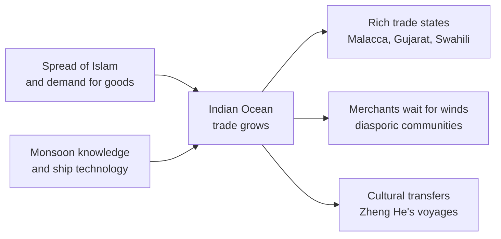

# AP World History: Modern — Topic 2.3 Summary: Exchange in the Indian Ocean (c. 1200–1450)

> Source: Summary of AP_WH_2.3_Notes_EN.md (College Board CED · textbook incorporated, Topic 2.3 reading)

**Unit 2: Networks of Exchange (c. 1200–1450)**

---

## In One Sentence

Indian Ocean trade grew after 1200 because of the spread of Islam, demand for special goods, knowledge of the monsoon winds, and better ship technology, and it led to rich trade states, merchant communities far from home, and cultural exchange such as Zheng He's voyages.

## The Big Picture

Trade across the Indian Ocean already existed by 200 B.C.E., but it grew much bigger after 1200. Muslim merchants from **Dar al-Islam** (the "House of Islam," the Muslim world) linked ports from East Africa to China. Sailors learned to use the seasonal **monsoon winds** and new tools such as the astrolabe. Trade made some states rich, such as Malacca, Gujarat, and the Swahili city-states. Merchants who waited in ports for the winds settled down and mixed their culture with local culture.

## Key Points

### 1. Causes: Islam and Demand for Special Goods

- The spread of **Islam** connected more cities than ever before, in East Africa, South Asia, and East and Southeast Asia.
- **Muslim Persians and Arabs** were the main sailors. They carried goods to ports all over the ocean.
- In **Calicut**, a spice port in western India, Arab merchants and Chinese merchants met. Local rulers welcomed them because they brought wealth.
- Each region sold its own **specialized products**: Indian cotton cloth and pepper, spices from the Spice Islands, Chinese silk and porcelain, and horses from Southwest Asia.
- **South Asia** sat in the center of the ocean, so it gained the most.

### 2. Causes: Monsoon Winds and Ship Technology

- The **monsoon winds** change with the seasons. In winter they blow from the northeast; in spring and summer they blow from the southwest.
- Merchants had to **time** their voyages and often waited in ports for months for the right wind.
- The **lateen sail** (a triangular sail used by Arab sailors) could catch wind from many directions.
- The **stern rudder**, a Chinese invention, made ships steadier and easier to steer. The **dhow** was a small wooden Arab and Indian ship.
- Muslim navigators improved the **astrolabe** in the 12th century. It showed how far north or south of the equator a ship was (latitude). The CED also names the compass and larger ships such as the Chinese junk.

> ⚠️ The 2.1 reading dates the magnetic compass and junk to the Han Dynasty, while the 2.3 reading moves the compass to Topic 4.1. Since the CED's 2.3 HD names the compass and larger ship designs, they are kept here.

### 3. Trade States: Malacca and Gujarat

- Trade helped **states grow**, because rulers wanted a steady share of trade money.
- **Malacca** was a Muslim **city-state** (one city that rules itself). It built a **navy** and charged **fees** on ships passing through the narrow Strait of Malacca between India and China.
- In the 1400s the Sultan of Malacca grew strong enough to **expand** into Sumatra and the southern Malay Peninsula.
- In 1511 the **Portuguese** invaded Malacca. They grew rich, but less than they hoped, because traders moved to other routes and ports.
- **Gujarat**, a Rajput kingdom in western India, was the **go-between** for East–West trade. Its **customs** (taxes on imports) earned many times more than the worth of some whole European states.

### 4. The Swahili City-States of East Africa

- **"Swahili"** means "coasters," the people of East African trade cities such as **Kilwa**, Mombasa, and Zanzibar.
- They **exported** ivory, gold, enslaved people, tortoise shells, and rhinoceros horns.
- They **imported** Chinese porcelain, Indian cotton, and ironwork. Chinese porcelain is still found in Swahili ruins.
- At the height of trade, many mosques and rich merchants' homes in Kilwa were built of **stone or coral**, not mud. This shows their wealth.
- East Africa also had a long **slave trade**. Enslaved people were sold to North Africa, the Middle East, and India, often as sailors, soldiers, or servants.

### 5. Diasporic Communities

- A **diaspora** is a group of people who settle far from their homeland.
- While waiting for the winds, merchants **mixed** with local people. Many married local women and stayed for good.
- **Arab and Persian** merchants settled in East Africa. Arab and East African merchants settled in western Indian ports.
- Islam first came to southern Asia through **intermarriage**, not through missionaries or conquest. The children were usually raised Muslim.
- The exchange went **both ways**: settlers brought their customs, and local culture changed the settlers. Chinese merchants lived in Southeast Asia, and Malay merchants lived in Sri Lanka.

### 6. Zheng He's Voyages

- **Zheng He** (1371–1433) was a Muslim admiral of the Ming Dynasty. The emperor **Yongle** sent him on seven voyages, starting in 1405.
- At their height, the fleets had **more than 300 ships** and 28,000 people. They sailed to Indonesia, Ceylon, Arabia, and the East African coast.
- The goal was to show Ming power and receive **tribute** (gifts that showed respect to China).
- The voyages brought **prestige**, new markets, new knowledge, and the first giraffe seen in China. They also led Chinese people to move to Southeast Asian ports.
- **Confucian** scholars thought foreign contact threatened social order, and critics said the voyages cost too much. Yongle's son **Zhu Gaozhi** ended them.

> ⚠️ The textbook says Zheng He reached the "Cape of Good Hope." Most accounts say he reached only the East African coast (around present-day Kenya). Check how your teacher presents this.

## Must-Know Terms & People

| Term | What it is | Why it matters |
|---|---|---|
| Dar al-Islam | The "House of Islam," the Muslim world | Muslim merchants linked its ports across the ocean |
| Monsoon winds | Seasonal winds that change direction | Environmental knowledge that decided when ships could sail |
| Lateen sail | A triangular sail that catches wind from many directions | Let ships use wind from many directions |
| Astrolabe | A tool that finds latitude, improved by Muslim navigators | Told sailors how far north or south they were |
| Dhow | A small wooden Arab and Indian ship | The main ship of the western Indian Ocean |
| Calicut | A spice port on India's west coast | Where Arab and Chinese merchants met |
| Malacca | A Muslim city-state on the Strait of Malacca | Got rich from a navy and fees on passing ships |
| Gujarat | A Rajput kingdom in western India | Earned huge customs revenue as the East–West go-between |
| Swahili city-states | Trade cities on the East African coast, such as Kilwa | Grew rich trading ivory and gold for porcelain and cotton |
| Diaspora | A settlement of people away from their homeland | Spread culture both ways between merchants and locals |
| Zheng He | A Muslim admiral of the Ming Dynasty | His voyages are the key example of cultural transfer |
| Tribute | Gifts sent to China to show respect | The main purpose of Zheng He's voyages |

## Key Dates

| Year | Event |
|---|---|
| c. 200 B.C.E. | Indian Ocean trade already exists |
| 12th century | Muslim navigators improve the astrolabe |
| 1400s | Sultan of Malacca expands into Sumatra |
| 1405 | First of Zheng He's seven voyages |
| 1433 | Zheng He dies and the voyages end |
| 1511 | Portuguese invade Malacca |
| 18th–19th centuries | Peak of the Indian Ocean slave trade |

## How the Exam Asks About It

- **Legitimacy & consolidation:** Trade states built power on trade money. Malacca used its navy and ship fees, and Gujarat used customs. The Ming emperor Yongle used Zheng He's voyages to show China's power and collect tribute.
- **Continuity, innovation, diversity:** Continuity is the Indian Ocean trade itself, which existed long before 1200. Innovation is new sailing tools such as the improved astrolabe. Diversity is the many merchant groups in the ports: Muslim, Chinese, Jewish, and Malay.
- **Likely comparison:** Malacca and the Swahili city-states. Similar: both got their wealth from trade, not from farming or mining. Different: Malacca taxed ships passing through a strait, while the Swahili cities exported African goods such as ivory and gold.
- **Common trap:** Students think Islam spread around the Indian Ocean mainly by conquest. Fix: merchants first brought Islam to southern Asia through marriage with local women, not through missionaries or armies.

## Check Yourself

1. How did the monsoon winds shape Indian Ocean trade?

▶ Answer
The winds blew from the northeast in winter and from the southwest in spring and summer, so merchants had to time their voyages. They often waited in ports for months, and many settled there, which created diasporic communities.

2. How did Malacca become rich?

▶ Answer
Malacca built a navy and charged fees on ships passing through the Strait of Malacca, the narrow route between India and China. Its wealth came from trade, not from farming or mining.

3. Why did Zheng He's voyages end?

▶ Answer
Confucian scholars feared that foreign contact threatened social order, and critics said the voyages cost too much. Yongle's son Zhu Gaozhi ended them and made building ships with more than two masts a crime.

