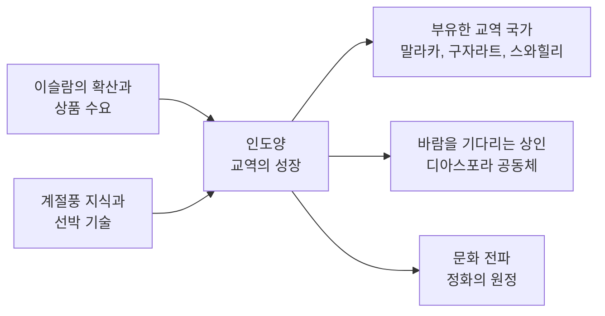

# AP 세계사: 모던 — 토픽 2.3 요약: 인도양 교역 (Exchange in the Indian Ocean)

> 출처: AP_WH_2.3_Notes_KR.md 요약 (College Board CED 기준 · 교재 반영, 교재 Topic 2.3)

**Unit 2: 교류의 네트워크 (Networks of Exchange, c. 1200–1450)**

---

## 한 문장 요약

인도양 교역은 1200년 이후 이슬람의 확산, 특산품에 대한 수요, 계절풍 (Monsoon winds)에 대한 지식, 더 나은 선박 기술 덕분에 성장했고, 그 결과 부유한 교역 국가, 고향을 떠난 상인 공동체, 그리고 정화 (Zheng He)의 원정 같은 문화 교류가 생겨났다.

## 큰 그림

인도양을 건너는 교역은 이미 기원전 200년에도 있었지만, 1200년 이후 훨씬 커졌다. **이슬람 세계 (Dar al-Islam)**("이슬람의 집", 무슬림 세계)의 무슬림 상인들이 동아프리카에서 중국까지 항구들을 이었다. 선원들은 계절에 따라 바뀌는 **계절풍**과 아스트롤라베 (Astrolabe) 같은 새 도구를 쓰는 법을 익혔다. 교역은 말라카 (Malacca), 구자라트 (Gujarat), 스와힐리 도시국가 (Swahili city-states) 같은 국가를 부유하게 만들었다. 항구에서 바람을 기다리던 상인들은 그곳에 정착해 자기 문화를 현지 문화와 섞었다.

## 핵심 정리

### 1. 원인: 이슬람과 특산품 수요

- **이슬람**이 퍼지면서 동아프리카, 남아시아, 동아시아·동남아시아의 그 어느 때보다 많은 도시가 연결되었다.
- **무슬림 페르시아인과 아랍인**이 바다의 주역이었다. 이들은 인도양 곳곳의 항구로 상품을 실어 날랐다.
- 인도 서부의 향신료 항구 **캘리컷** (Calicut)에서 아랍 상인과 중국 상인이 만났다. 현지 통치자들은 부를 가져오는 이들을 환영했다.
- 지역마다 고유한 **특산품** (Specialized products)을 팔았다. 인도의 면직물과 후추, 향료 제도 (Spice Islands)의 향신료, 중국의 비단과 도자기, 서남아시아의 말이 그 예이다.
- **남아시아**는 인도양 한가운데에 있어서 가장 큰 이익을 보았다.

### 2. 원인: 계절풍과 선박 기술

- **계절풍**은 계절에 따라 방향이 바뀐다. 겨울에는 북동쪽에서, 봄과 여름에는 남서쪽에서 분다.
- 상인들은 항해 **시기**를 맞춰야 했고, 알맞은 바람을 기다리며 항구에서 몇 달씩 머무는 일이 많았다.
- **삼각돛 (Lateen sail)**(아랍 선원들이 쓴 삼각형 돛)은 여러 방향에서 부는 바람을 받을 수 있었다.
- 중국의 발명품인 **선미타** (Stern rudder)는 배를 더 안정적이고 조종하기 쉽게 만들었다. **다우선** (Dhow)은 아랍·인도의 작은 목조선이었다.
- 12세기에 무슬림 항해자들이 **아스트롤라베**를 개량했다. 이 도구는 배가 적도에서 남북으로 얼마나 떨어져 있는지(위도)를 알려 주었다. CED는 나침반 (Compass)과 중국의 정크선 (Junk) 같은 더 큰 선박도 든다.

> ⚠️ 2.1 교재는 나침반과 정크선을 한나라 시기로 보지만, 2.3 교재는 나침반을 Topic 4.1로 넘긴다. CED의 2.3 역사적 개념이 나침반과 더 큰 선박 설계를 들기 때문에 여기서도 다룬다.

### 3. 교역 국가: 말라카와 구자라트

- 통치자들이 교역 수입을 꾸준히 얻으려 했기 때문에, 교역은 **국가의 성장**을 도왔다.
- **말라카**는 이슬람 **도시국가 (City-state)**(한 도시가 스스로 다스리는 나라)였다. 해군을 키우고, 인도와 중국 사이의 좁은 말라카 해협을 지나는 배에 **통행료**를 물렸다.
- 1400년대에 말라카의 술탄은 수마트라와 말레이반도 남부까지 **팽창**할 만큼 강해졌다.
- 1511년 **포르투갈**이 말라카를 침공했다. 포르투갈은 부유해졌지만 기대만큼은 아니었다. 상인들이 다른 교역로와 항구로 옮겨 갔기 때문이다.
- 인도 서부의 라지푸트 (Rajput) 왕국 **구자라트**는 동서 교역의 **중개자**였다. 구자라트의 **관세 (Customs)**(수입품에 매기는 세금) 수입은 일부 유럽 국가 전체의 가치보다 몇 배나 많았다.

### 4. 동아프리카의 스와힐리 도시국가

- "**스와힐리**"는 "해안 사람들 (Coasters)"이라는 뜻으로, **킬와 (Kilwa)**, 몸바사 (Mombasa), 잔지바르 (Zanzibar) 같은 동아프리카 교역 도시의 사람들을 가리킨다.
- 이들은 상아, 금, 노예, 거북 등딱지, 코뿔소 뿔을 **수출**했다.
- 중국 도자기, 인도 면직물, 철제품을 **수입**했다. 지금도 스와힐리 유적에서 중국 도자기가 발견된다.
- 교역이 절정일 때 킬와의 많은 모스크와 부유한 상인의 집은 진흙이 아니라 **돌이나 산호**로 지어졌다. 이것이 이들의 부를 보여 준다.
- 동아프리카에는 오래된 **노예 무역**도 있었다. 노예들은 북아프리카, 중동, 인도로 팔려 가 선원, 군인, 하인으로 일하는 경우가 많았다.

### 5. 디아스포라 공동체

- **디아스포라** (Diaspora)는 고향에서 멀리 떨어진 곳에 정착한 사람들의 집단이다.
- 바람을 기다리는 동안 상인들은 현지 사람들과 **어울렸다**. 많은 상인이 현지 여성과 결혼해 그곳에 영구히 머물렀다.
- **아랍·페르시아** 상인은 동아프리카에 정착했다. 아랍·동아프리카 상인은 인도 서부의 항구에 정착했다.
- 이슬람은 선교나 정복이 아니라 **통혼** (Intermarriage)을 통해 남아시아에 처음 전해졌다. 그 자녀들은 대개 무슬림으로 자랐다.
- 교류는 **양방향**이었다. 정착민은 자기 관습을 들여왔고, 현지 문화도 정착민을 바꾸었다. 중국 상인은 동남아시아에, 말레이 상인은 스리랑카에 살았다.

### 6. 정화의 원정

- **정화**(1371–1433)는 명나라의 무슬림 제독이었다. **영락제** (Yongle)가 1405년부터 그를 일곱 차례 원정에 보냈다.
- 전성기의 함대는 **300척 이상**의 배와 2만 8천 명으로 이루어졌다. 함대는 인도네시아, 실론, 아라비아, 동아프리카 해안까지 항해했다.
- 목적은 명나라의 힘을 보여 주고 **조공 (Tribute)**(중국에 존중을 표하는 예물)을 받는 것이었다.
- 원정은 중국의 **위상**, 새로운 시장, 새로운 지식, 그리고 중국인이 처음 본 기린을 가져왔다. 중국인이 동남아시아 항구로 이주하는 계기도 되었다.
- **유교** 학자들은 외국과의 교류가 사회 질서를 위협한다고 보았고, 비판자들은 원정에 돈이 너무 많이 든다고 했다. 영락제의 아들 **주고치** (Zhu Gaozhi)가 원정을 끝냈다.

> ⚠️ 교재는 정화가 "희망봉"까지 갔다고 쓴다. 대부분의 설명에서는 동아프리카 해안(지금의 케냐 부근)까지 갔다고 본다. 선생님이 어떻게 가르치는지 확인이 필요하다.

## 꼭 알아야 할 용어·인물

| 용어 | 무엇인가 | 왜 중요한가 |
|---|---|---|
| 이슬람 세계 (Dar al-Islam) | "이슬람의 집", 무슬림 세계 | 무슬림 상인들이 인도양 곳곳의 항구를 이었다 |
| 계절풍 (Monsoon winds) | 계절에 따라 방향이 바뀌는 바람 | 배가 언제 떠날 수 있는지를 정한 환경 지식이다 |
| 삼각돛 (Lateen sail) | 여러 방향에서 부는 바람을 받는 삼각형 돛 | 배가 여러 방향의 바람을 이용할 수 있게 했다 |
| 아스트롤라베 (Astrolabe) | 무슬림 항해자들이 개량한, 위도를 알아내는 도구 | 선원이 남북으로 얼마나 와 있는지 알려 주었다 |
| 다우선 (Dhow) | 아랍·인도의 작은 목조선 | 서부 인도양의 주된 배였다 |
| 캘리컷 (Calicut) | 인도 서해안의 향신료 항구 | 아랍 상인과 중국 상인이 만난 곳이다 |
| 말라카 (Malacca) | 말라카 해협의 이슬람 도시국가 | 해군과 지나가는 배의 통행료로 부유해졌다 |
| 구자라트 (Gujarat) | 인도 서부의 라지푸트 왕국 | 동서 교역의 중개자로서 막대한 관세 수입을 얻었다 |
| 스와힐리 도시국가 (Swahili city-states) | 킬와 같은 동아프리카 해안의 교역 도시 | 상아와 금을 도자기, 면직물과 바꾸며 부유해졌다 |
| 디아스포라 (Diaspora) | 고향을 떠난 사람들의 정착지 | 상인과 현지인 사이에 문화를 양방향으로 퍼뜨렸다 |
| 정화 (Zheng He) | 명나라의 무슬림 제독 | 그의 원정은 문화 전파의 대표적인 예이다 |
| 조공 (Tribute) | 존중을 표하려고 중국에 보낸 예물 | 정화 원정의 주된 목적이었다 |

## 주요 연도

| 연도 | 사건 |
|---|---|
| c. 기원전 200년 | 인도양 교역이 이미 존재함 |
| 12세기 | 무슬림 항해자들이 아스트롤라베를 개량함 |
| 1400년대 | 말라카 술탄이 수마트라로 팽창함 |
| 1405 | 정화의 일곱 차례 원정 중 첫 번째 |
| 1433 | 정화 사망, 원정 중단 |
| 1511 | 포르투갈이 말라카를 침공함 |
| 18–19세기 | 인도양 노예 무역의 절정 |

## 시험에서는 이렇게 묻는다

- **정당화와 공고화:** 교역 국가들은 교역 수입을 바탕으로 힘을 키웠다. 말라카는 해군과 통행료를, 구자라트는 관세를 이용했다. 명나라 영락제는 정화의 원정으로 중국의 힘을 보여 주고 조공을 거두었다.
- **연속성·혁신·다양성:** 연속성은 1200년 훨씬 전부터 있던 인도양 교역 그 자체이다. 혁신은 개량된 아스트롤라베 같은 새 항해 도구이다. 다양성은 항구에 모인 여러 상인 집단, 곧 무슬림, 중국인, 유대인, 말레이인이다.
- **자주 나오는 비교:** 말라카와 스와힐리 도시국가. 공통점: 둘 다 농업이나 광업이 아니라 교역에서 부를 얻었다. 차이점: 말라카는 해협을 지나는 배에 통행료를 물렸고, 스와힐리 도시들은 상아와 금 같은 아프리카 상품을 수출했다.
- **자주 하는 실수:** 학생들은 이슬람이 인도양 일대에 주로 정복으로 퍼졌다고 생각한다. 바로잡기: 상인들은 선교사나 군대가 아니라 현지 여성과의 결혼을 통해 남아시아에 처음 이슬람을 전했다.

## 스스로 확인하기

1. 계절풍은 인도양 교역에 어떤 영향을 주었는가?

▶ 정답
바람이 겨울에는 북동쪽에서, 봄과 여름에는 남서쪽에서 불었기 때문에 상인들은 항해 시기를 맞춰야 했다. 이들은 항구에서 몇 달씩 기다리는 일이 많았고, 많은 상인이 그곳에 정착해 디아스포라 공동체가 생겼다.

2. 말라카는 어떻게 부유해졌는가?

▶ 정답
말라카는 해군을 키우고, 인도와 중국 사이의 좁은 길목인 말라카 해협을 지나는 배에 통행료를 물렸다. 말라카의 부는 농업이나 광업이 아니라 교역에서 나왔다.

3. 정화의 원정은 왜 끝났는가?

▶ 정답
유교 학자들은 외국과의 교류가 사회 질서를 위협한다고 걱정했고, 비판자들은 원정에 돈이 너무 많이 든다고 했다. 영락제의 아들 주고치는 원정을 끝내고 돛대가 두 개 넘는 배를 만드는 것을 범죄로 정했다.

