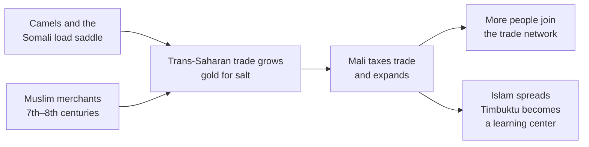

# AP World History: Modern — Topic 2.4 Summary: Trans-Saharan Trade Routes (c. 1200–1450)

> Source: Summary of AP_WH_2.4_Notes_EN.md (College Board CED · textbook incorporated, Topic 2.4 reading)

**Unit 2: Networks of Exchange (c. 1200–1450)**

---

## In One Sentence

Trade across the Sahara grew because of **Muslim merchants**, **camels**, and better **camel saddles**, and it grew even more when the **Mali Empire** taxed the trade, used the money to **expand**, and drew new people into the network, which spread **Islam** and made **Timbuktu** a center of learning.

## The Big Picture

The **Sahara Desert** is very dry, so few people lived there. Trade across it grew when **Muslim merchants** arrived in the **7th and 8th centuries**. Two tools made the trip possible: the **camel** and the **camel saddle**, especially the **Somali saddle**, which could carry **600 pounds**. Caravans traded West African **gold** for North African **salt**. In the **early 1200s**, the **Mali Empire** took over the region, **taxed** the trade, and grew rich and large, so trade and contact grew even more.

## Key Points

### 1. The Sahara, Oases, and Caravans

- The **Sahara** is about **3.6 million square miles**, about the size of China. Its dry climate made farming nearly impossible.
- An **oasis** is a place where underground water reaches the surface and makes the land fertile. Only about **800 square miles** of the Sahara are oases.
- A **caravan** is a large group of traders and camels traveling together. Caravans often had **thousands of camels** and carried food and **water** to reach the next oasis.
- There were **seven north–south routes** and **two east–west routes**. They connected Sub-Saharan Africans with more cultures and trading partners.

### 2. Camels: A Desert Animal

- Camels came from **Arabia** and appeared in **North Africa** in the **3rd century B.C.E.**
- They were used to the harsh **Arabian Desert**, so they **adapted well** to the Sahara.
- A camel can drink **more than 50 gallons** in three minutes and then go a long time without water.
- After **300 C.E.**, camels began to **replace horses and donkeys**.

### 3. Camel Saddles: The Key Innovation

- An **innovation** is a new or improved way of doing something. The CED's main example of a transportation innovation here is the **camel saddle**.
- People made as many as **15 types** of camel saddles for different jobs.
- The **North Arabian saddle** put the rider high on the hump. It was best for seeing and **control in battle**.
- The **Somali saddle**, made by the Somalis of East Africa, could carry **loads up to 600 pounds**. The textbook says it had the **greatest impact on trade**.
- Without it, camels could not carry **heavy trade goods** across the desert.

### 4. Gold for Salt: What Moved

- Going **north**, West Africa sent **gold** (the most precious good), ivory, hides, and **enslaved people**.
- Going **south**, North African Arab and Berber traders sent **salt**, cloth, paper, and horses.
- West African merchants got gold from the **Senegal River**.
- By the end of the **8th century**, this trade was **famous in Europe and Asia**. For more than 700 years it made **Ghana and Mali** rich.

### 5. Mali: How an Empire Grew Trade

- By the **12th century**, wars had **permanently weakened Ghana**. **Mali** became the most powerful new trading state.
- In **1235**, **Sundiata**, "the Lion Prince," came back from exile and **reclaimed the throne**. Most scholars believe he was a **Muslim**, and he used ties with other Muslims to trade with **North African and Arab merchants**.
- Mali profited from gold and **taxed nearly all other trade** entering West Africa, so it became **richer than Ghana**.
- Rulers set a **currency** (money people trust): **cowrie shells**, cotton cloth, gold, glass beads, and salt. They also **protected trade routes**.
- Tax money bought **horses and iron weapons**. Armies used them to **expand** into resource-rich areas, and each expansion **drew more people** into the trade network.

### 6. Mansa Musa, Islam, and Mali's Decline

- **Mansa Musa**, Sundiata's grand-nephew, ruled in the **14th century**. He was known mostly as a **religious leader**.
- In **1324**, he made the **hajj** (the Muslim pilgrimage to **Mecca**) with 100 camels, thousands of people, and **gold** to give away. It **showed Mali's wealth** to the world.
- Back home, he built **religious schools in Timbuktu** and **mosques** in trading cities. **Timbuktu** became a world-famous center of **Islamic learning**.
- Most West Africans, who were mostly **farmers**, **kept their traditional beliefs**, but support for Islam grew in Mali.
- Less than 100 years after Mansa Musa's death, Mali was declining. By the **late 1400s**, **Songhai** had replaced it as the leading power.

## Must-Know Terms & People

| Term | What it is | Why it matters |
|---|---|---|
| Trans-Saharan trade | Trade across the Sahara, mainly West African gold for salt | The main network of this topic; it made West African empires rich |
| Caravan | A large group of traders and camels traveling together | A CED example of transportation that helped trade grow |
| Oasis | A fertile place where underground water reaches the surface | Caravans moved from oasis to oasis for water |
| Camel saddle | A saddle design for riding or carrying loads on a camel | A CED example of a transportation innovation |
| Somali saddle | A saddle from East Africa built for loads up to 600 pounds | The textbook says it had the greatest impact on trade |
| Mali | A West African trading empire (1200s–1400s) | Taxed nearly all trade and used the money to expand |
| Sundiata | "The Lion Prince," who founded Mali in 1235 | Built trade ties with North African and Arab merchants |
| Mansa Musa | Mali's ruler in the 14th century and a devout Muslim | His 1324 hajj showed Mali's wealth; he spread Islamic learning |
| Hajj | The Muslim pilgrimage to Mecca | Mansa Musa's hajj made Mali famous |
| Timbuktu | A trade city in Mali | Became a world-famous center of Islamic learning |
| Cowrie shells | Shells used as money in Mali and Gao | Show how rulers set currencies to support trade |
| Songhai | The kingdom that replaced Mali by the late 1400s | Grew larger and richer than Mali in the same way |

## Key Dates

| Year | Event |
|---|---|
| 3rd century B.C.E. | Camels appear in North Africa |
| After 300 C.E. | Camels begin to replace horses and donkeys |
| 7th–8th centuries | Muslim merchants increase the volume of trade |
| 12th century | Wars permanently weaken Ghana |
| 1235 | Sundiata reclaims the throne and founds Mali |
| 1324 | Mansa Musa's hajj to Mecca |
| Late 1400s | Songhai replaces Mali as the leading power |
| 1500s | Timbuktu's books sell for more than most other goods |

## How the Exam Asks About It

- **Legitimacy & consolidation:** Mali's rulers kept power by **taxing trade**, setting **currencies**, and **protecting trade routes**. Tax money paid for **horses and iron weapons** to expand. Sundiata used **Muslim ties** to build trade, and Mansa Musa built **schools and mosques** and showed Mali's wealth on his **hajj**.
- **Continuity, innovation, diversity:** Continuity: Mali kept the **gold trade** that had made Ghana rich. Innovation: the **Somali saddle**, which let camels carry 600 pounds. Diversity: rulers and city people were **Muslim**, but most farmers **kept traditional beliefs**.
- **Likely comparison:** Ghana vs. Mali. Similarity: both grew rich from the **gold trade**. Difference: Mali also **taxed nearly all other trade**, so it was richer, and its rulers were **Muslim**.
- **Common trap:** Students think any camel saddle, such as the North Arabian saddle, was the key to trade. Fix: the North Arabian saddle was for **battle**; the textbook credits the **Somali load saddle**, built for heavy loads.

## Check Yourself

1. Why were camels and the Somali saddle so important for trans-Saharan trade?

▶ Answer
Camels were adapted to the desert and could go a long time without water. The Somali saddle let a camel carry up to 600 pounds, so caravans could move heavy trade goods across the Sahara.

2. How did Mali's expansion draw more people into trade?

▶ Answer
Mali taxed trade and used the money to buy horses and iron weapons. Its armies expanded into resource-rich areas, and each expansion drew more people into Mali's economy and trade network.

3. What were the effects of Mansa Musa's hajj and reign?

▶ Answer
His 1324 hajj showed Mali's wealth to the outside world. After he returned, he built religious schools in Timbuktu and mosques in trading cities, which deepened support for Islam in Mali.

