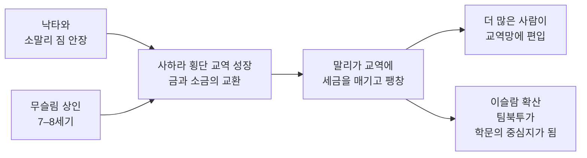

# AP 세계사: 모던 — 토픽 2.4 요약: 사하라 횡단 교역 (Trans-Saharan Trade Routes)

> 출처: AP_WH_2.4_Notes_KR.md 요약 (College Board CED 기준 · 교재 반영, 교재 Topic 2.4)

**Unit 2: 교류의 네트워크 (Networks of Exchange, c. 1200–1450)**

---

## 한 문장 요약

사하라를 건너는 교역은 **무슬림 상인**, **낙타**, 더 나은 **낙타 안장** 덕분에 성장했고, **말리 제국** (Mali Empire)이 교역에 세금을 매기고 그 돈으로 **팽창**하며 새로운 사람들을 교역망에 끌어들이면서 더욱 커졌으며, 그 결과 **이슬람**이 퍼지고 **팀북투** (Timbuktu)가 학문의 중심지가 되었다.

## 큰 그림

**사하라 사막** (Sahara Desert)은 매우 건조해서 그곳에 사는 사람이 적었다. 이 사막을 건너는 교역은 **7–8세기**에 **무슬림 상인**이 오면서 성장했다. 이 여행을 가능하게 한 도구는 두 가지였다. 하나는 **낙타**이고, 다른 하나는 **낙타 안장 (Camel saddle)**, 특히 **600파운드**를 실을 수 있었던 **소말리 안장** (Somali saddle)이다. 대상은 서아프리카의 **금**을 북아프리카의 **소금**과 맞바꾸었다. **1200년대 초** **말리 제국**이 이 지역을 차지하고 교역에 **세금**을 매겨 부유하고 커지면서, 교역과 교류는 더욱 늘었다.

## 핵심 정리

### 1. 사하라, 오아시스, 대상

- **사하라**의 넓이는 약 **360만 제곱마일**로, 중국과 비슷하다. 기후가 건조해 농사가 거의 불가능했다.
- **오아시스** (Oasis)는 땅속의 물이 지표로 올라와 땅이 비옥해진 곳이다. 사하라 중 오아시스는 약 **800제곱마일**뿐이다.
- **대상** (Caravan)은 함께 이동하는 상인과 낙타의 큰 무리이다. 대상은 낙타가 **수천 마리**인 경우가 많았고, 다음 오아시스까지 버틸 식량과 **물**을 실었다.
- 사하라에는 **남북 교역로 7개**와 **동서 교역로 2개**가 있었다. 이 길들은 사하라 이남 아프리카 사람들을 더 많은 문화와 교역 상대와 이어 주었다.

### 2. 낙타: 사막의 동물

- 낙타는 **아라비아**가 원산지이며, **기원전 3세기**에 **북아프리카**에 나타났다.
- 낙타는 혹독한 **아라비아 사막** (Arabian Desert)에 익숙했기 때문에 사하라에도 **잘 적응했다.**
- 낙타는 3분 만에 **50갤런이 넘는** 물을 마시고, 그 뒤 오랫동안 물 없이 지낼 수 있다.
- **300년 이후** 낙타가 **말과 당나귀를 대신하기** 시작했다.

### 3. 낙타 안장: 핵심 혁신

- **혁신** (Innovation)은 어떤 일을 하는 새롭거나 더 나은 방법이다. 이 토픽에서 CED가 드는 운송 혁신의 대표 예시는 **낙타 안장**이다.
- 사람들은 용도에 따라 **15가지**나 되는 낙타 안장을 만들었다.
- **북아라비아 안장** (North Arabian saddle)은 타는 사람을 혹 위에 높이 앉혔다. **전투**에서 시야를 넓히고 낙타를 조종하기에 가장 좋았다.
- 동아프리카의 소말리인이 만든 **소말리 안장**은 **최대 600파운드의 짐**을 실을 수 있었다. 교재는 이 안장이 **교역에 가장 큰 영향**을 주었다고 쓴다.
- 이 안장이 없었다면 낙타로 사막을 건너 **무거운 교역품**을 나를 수 없었다.

### 4. 금과 소금의 교환: 무엇이 오갔나

- **북쪽으로**는 서아프리카의 **금**(가장 귀한 상품), 상아, 가죽, **노예**가 갔다.
- **남쪽으로**는 북아프리카의 아랍·베르베르 상인이 **소금**, 옷감, 종이, 말을 보냈다.
- 서아프리카 상인들은 **세네갈강** (Senegal River)에서 금을 얻었다.
- **8세기 말**에 이 교역은 이미 **유럽과 아시아에 널리 알려져** 있었다. 이 교역은 700년이 넘는 동안 **가나와 말리**를 부유하게 했다.

### 5. 말리: 제국은 어떻게 교역을 키웠나

- **12세기**가 되자 전쟁으로 **가나가 영영 약해졌다.** 그 자리에서 가장 강력한 새 교역 국가가 된 것이 **말리**였다.
- **1235년** "사자 왕자" **순디아타** (Sundiata)가 망명에서 돌아와 **왕위를 되찾았다.** 대부분의 학자는 그가 **무슬림**이었다고 보며, 그는 같은 신앙을 가진 사람들과의 관계를 이용해 **북아프리카·아랍 상인**과 교역했다.
- 말리는 금으로 이익을 얻었을 뿐 아니라 서아프리카로 들어오는 **거의 모든 교역에 세금**을 매겨 **가나보다 더 부유해졌다.**
- 통치자들은 **화폐**(사람들이 가치를 믿는 돈)를 정했다. **개오지 조개껍데기 (Cowrie shells)**, 면포, 금, 유리구슬, 소금이 화폐였다. 통치자들은 **교역로도 보호했다.**
- 세금으로 **말과 철제 무기**를 샀다. 군대는 이것으로 자원이 풍부한 지역으로 **팽창**했고, 팽창할 때마다 **더 많은 사람이** 교역망에 편입되었다.

### 6. 만사 무사, 이슬람, 말리의 쇠퇴

- 순디아타의 종손인 **만사 무사** (Mansa Musa)는 **14세기**에 다스렸다. 그는 주로 **종교 지도자**로 알려졌다.
- **1324년** 그는 낙타 100마리, 수천 명의 사람, 나누어 줄 **금**을 거느리고 **성지 순례 (Hajj)**, 곧 무슬림의 **메카 (Mecca)** 순례를 떠났다. 이 순례는 **말리의 부를 세계에 보여 주었다.**
- 돌아온 뒤 그는 **팀북투에 종교 학교**를 세우고 교역 도시에 **모스크**를 지었다. **팀북투**는 세계적으로 유명한 **이슬람 학문**의 중심지가 되었다.
- 대부분 **농민**이었던 서아프리카 사람들은 대체로 **전통 신앙을 지켰지만**, 말리에서 이슬람에 대한 지지는 깊어졌다.
- 만사 무사가 죽은 뒤 100년도 안 되어 말리는 쇠퇴했다. **1400년대 후반**에는 **송가이** (Songhai)가 말리를 대신해 강자가 되었다.

## 꼭 알아야 할 용어·인물

| 용어 | 무엇인가 | 왜 중요한가 |
|---|---|---|
| 사하라 횡단 교역 (Trans-Saharan trade) | 사하라를 건너 주로 서아프리카의 금과 소금을 맞바꾼 교역 | 이 토픽의 중심 교역망이다. 서아프리카 제국을 부유하게 했다 |
| 대상 (Caravan) | 함께 이동하는 상인과 낙타의 큰 무리 | 교역 성장을 도운 운송 수단의 CED 예시이다 |
| 오아시스 (Oasis) | 땅속의 물이 지표로 올라와 비옥해진 곳 | 대상은 물을 얻으려고 오아시스에서 오아시스로 이동했다 |
| 낙타 안장 (Camel saddle) | 낙타를 타거나 짐을 싣기 위한 안장 | 운송 혁신의 CED 예시이다 |
| 소말리 안장 (Somali saddle) | 최대 600파운드의 짐을 싣도록 만든 동아프리카의 안장 | 교재는 이 안장이 교역에 가장 큰 영향을 주었다고 쓴다 |
| 말리 (Mali) | 서아프리카의 교역 제국 (1200년대–1400년대) | 거의 모든 교역에 세금을 매기고 그 돈으로 팽창했다 |
| 순디아타 (Sundiata) | 1235년 말리를 세운 "사자 왕자" | 북아프리카·아랍 상인과 교역 관계를 맺었다 |
| 만사 무사 (Mansa Musa) | 14세기 말리의 통치자이자 독실한 무슬림 | 1324년 성지 순례로 말리의 부를 보여 주었고 이슬람 학문을 퍼뜨렸다 |
| 성지 순례 (Hajj) | 무슬림의 메카 순례 | 만사 무사의 성지 순례로 말리가 유명해졌다 |
| 팀북투 (Timbuktu) | 말리의 교역 도시 | 세계적으로 유명한 이슬람 학문의 중심지가 되었다 |
| 개오지 조개껍데기 (Cowrie shells) | 말리와 가오 (Gao)에서 화폐로 쓰인 조개껍데기 | 통치자가 교역을 돕기 위해 화폐를 정했음을 보여 준다 |
| 송가이 (Songhai) | 1400년대 후반 말리를 대신한 왕국 | 말리와 비슷한 과정을 거쳐 말리보다 크고 부유해졌다 |

## 주요 연도

| 연도 | 사건 |
|---|---|
| 기원전 3세기 | 북아프리카에 낙타 등장 |
| 300년 이후 | 낙타가 말과 당나귀를 대신하기 시작 |
| 7–8세기 | 무슬림 상인으로 교역량 증가 |
| 12세기 | 전쟁으로 가나가 영영 약해짐 |
| 1235 | 순디아타가 왕위를 되찾고 말리 건국 |
| 1324 | 만사 무사의 메카 성지 순례 |
| 1400년대 후반 | 송가이가 말리를 대신해 강자가 됨 |
| 1500년대 | 팀북투의 책이 대부분의 다른 상품보다 비싸게 팔림 |

## 시험에서는 이렇게 묻는다

- **정당화와 공고화:** 말리의 통치자는 **교역에 세금**을 매기고, **화폐**를 정하고, **교역로를 보호**해 권력을 지켰다. 세금으로 **말과 철제 무기**를 사서 팽창했다. 순디아타는 **무슬림과의 관계**를 이용해 교역을 키웠고, 만사 무사는 **학교와 모스크**를 세우고 **성지 순례**로 말리의 부를 보여 주었다.
- **연속성·혁신·다양성:** 연속성 (Continuity): 말리는 가나를 부유하게 했던 **금 교역**을 이어 갔다. 혁신 (Innovation): 낙타가 600파운드를 실을 수 있게 한 **소말리 안장**. 다양성 (Diversity): 통치자와 도시 사람들은 **무슬림**이었지만, 대부분의 농민은 **전통 신앙을 지켰다.**
- **자주 나오는 비교:** 가나와 말리. 공통점: 둘 다 **금 교역**으로 부유해졌다. 차이점: 말리는 **거의 모든 교역에 세금**도 매겨 더 부유했고, 통치자가 **무슬림**이었다.
- **자주 하는 실수:** 학생들은 북아라비아 안장 같은 아무 낙타 안장이나 교역의 핵심이었다고 생각하곤 한다. 바로잡기: 북아라비아 안장은 **전투**용이었다. 교재는 무거운 짐을 싣도록 만든 **소말리 짐 안장**을 꼽는다.

## 스스로 확인하기

1. 낙타와 소말리 안장은 왜 사하라 횡단 교역에 그렇게 중요했는가?

▶ 정답
낙타는 사막에 적응해 오랫동안 물 없이 지낼 수 있었다. 소말리 안장 덕분에 낙타 한 마리가 최대 600파운드를 실을 수 있어, 대상이 무거운 교역품을 사하라 건너편으로 나를 수 있었다.

2. 말리의 팽창은 어떻게 더 많은 사람을 교역에 끌어들였는가?

▶ 정답
말리는 교역에 세금을 매기고 그 돈으로 말과 철제 무기를 샀다. 군대가 자원이 풍부한 지역으로 팽창할 때마다 더 많은 사람이 말리의 경제와 교역망에 편입되었다.

3. 만사 무사의 성지 순례와 통치는 어떤 결과를 낳았는가?

▶ 정답
1324년의 성지 순례는 말리의 부를 바깥 세계에 보여 주었다. 돌아온 뒤 그는 팀북투에 종교 학교를, 교역 도시에 모스크를 세웠고, 이로써 말리에서 이슬람에 대한 지지가 깊어졌다.

