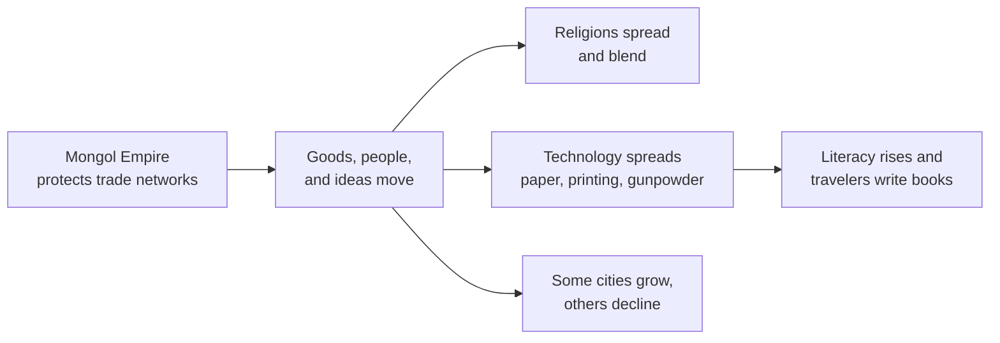

# AP World History: Modern — Topic 2.5 Summary: Cultural Consequences of Connectivity (c. 1200–1450)

> Source: Summary of AP_WH_2.5_Notes_EN.md (College Board CED · textbook incorporated, Topic 2.5 reading)

**Unit 2: Networks of Exchange (c. 1200–1450)**

---

## In One Sentence

Trade networks spread religions, languages, art, and technology such as paper and gunpowder across Afro-Eurasia, often blending them with local traditions, while trade made some cities grow, disease and invasion made others decline, and travelers wrote about it all.

## The Big Picture

From about 1200 to 1450, **goods, people, and ideas** moved fairly freely along Afro-Eurasia's trade networks, by land across deserts and by sea on the China Sea and the Indian Ocean. One reason was the **stability of the Mongol Empire**, which protected merchants and travelers. Religions spread and often **blended** with local faiths. Technologies such as **paper, printing, and gunpowder** spread through trade. Some trade cities grew, others declined, and travelers such as **Marco Polo**, **Ibn Battuta**, and **Margery Kempe** wrote books about what they saw.

## Key Points

### 1. Buddhism Changes in East Asia

- Buddhism came to China from India along the **Silk Roads**. The 7th-century monk **Xuanzang** helped make it popular.
- Monks explained Buddhism with **Daoist** ideas. The two blended into **Chan Buddhism** (called **Zen** in Japan). This blending is **syncretism** (the mixing of different religions or cultures).
- In the **Song Dynasty** (960–1279), **printing** made Buddhist scriptures easy to get, and Buddhist writers used the **vernacular** (everyday spoken language).
- **Neo-Confucianism** blended **rational thought** with ideas from Daoism and Buddhism. It spread to Japan and Vietnam and became **Korea's official state ideology**.

### 2. Hinduism and Buddhism in South and Southeast Asia

- Hinduism and Buddhism reached Southeast Asia through **trade**.
- In Sri Lanka, the **Sinhala dynasties** were **Buddhist**. The island was a center of Buddhist study with many monasteries, and Buddhist priests often **advised the kings**.
- The **Khmer Empire** (in present-day Cambodia) was **Hindu, then Buddhist**.
- At **Angkor Thom**, the Khmer royal city, later Buddhist rulers **added Buddhist art but kept the Hindu art**. The two religions **coexisted** (lived side by side).

### 3. Islam Shapes Language, Learning, and Art

- Islam spread through **merchants, missionaries, and conquests**.
- **Africa:** **Swahili**, a blend of Bantu and Arabic, became a widely spoken language. **Timbuktu** became a center of Islamic learning, and African leaders made **pilgrimages to Mecca**.
- **South Asia:** Islam's message of **equality** attracted **lower-caste Hindus**. **Urdu** drew on Hindi, Arabic, and Farsi, and **Bhakti** poets looked for links between Hinduism and Islam.
- **Southeast Asia:** on **Java**, traditional stories, **puppetry**, and poetry took in Muslim characters and techniques.

### 4. Science and Technology Travel

- **Islamic scholars** translated Greek classics into Arabic and **saved Aristotle's works** from being lost. They also took in Indian math and Chinese papermaking.
- **Paper** reached Europe from China in the **13th century**. Together with **printing**, it helped **literacy rise**.
- **Gunpowder** and guns spread from China and **changed warfare**.
- Sailors spread tools such as the **lateen sail**, **stern rudder**, **astrolabe**, and **magnetic compass**.

### 5. Cities Grow and Decline

- **Hangzhou** shows how **trade supported urbanization** (the growth of cities). It had about 1 million people and sat at the southern end of the **Grand Canal**.
- **Kashgar** declined after attacks by **nomadic invaders**, and **Tamerlane** ravaged it in 1389–1390.
- **Constantinople** was weakened by the **Fourth Crusade** (1204) and by plague, and it fell to the **Ottomans** in 1453.
- Cities grew with **political stability, safe transportation, and trade**. They declined with **invasions, disease, and lower farm output**.
- The **Black Death** (1347–1351) came to Europe along trade routes. Up to 25 million Europeans may have died, and the labor shortage **weakened the feudal system**.

### 6. Travelers Write About the World

- **Marco Polo**, a merchant from Venice, visited **Kublai Khan's** court and wrote from a **merchant's view** about trade and cities.
- **Ibn Battuta**, a Muslim scholar from Morocco, traveled for **more than 30 years**, mostly in Muslim lands. He wrote from a **devoted Muslim's view**.
- **Margery Kempe**, an English mystic who could not read or write, went on pilgrimages and dictated **one of the earliest autobiographies in English**.

## Must-Know Terms & People

| Term | What it is | Why it matters |
|---|---|---|
| Syncretism | The blending of different religious or cultural traditions | The main way religions changed as they spread |
| Chan (Zen) Buddhism | A blend of Buddhism and Daoism | A clear example of syncretism in East Asia |
| Neo-Confucianism | A blend of rational thought with Daoist and Buddhist ideas | Became Korea's official state ideology |
| Angkor Thom | A Khmer royal city with both Hindu and Buddhist art | Shows two religions coexisting in Southeast Asia |
| Swahili | A language that blends Bantu and Arabic | Shows Islam's cultural influence in Africa |
| Paper and printing | Chinese inventions that spread along trade routes | Helped literacy rise in Europe |
| Hangzhou | A trade and culture center of southern China | Shows how trade made cities grow |
| Constantinople | A city weakened by crusaders and plague | Shows how cities could decline |
| Black Death | A plague that reached Europe along trade routes | May have killed up to 25 million Europeans and weakened the feudal system |
| Marco Polo | A Venetian merchant who visited Kublai Khan | Opened European eyes to China |
| Ibn Battuta | A Moroccan Muslim scholar and traveler | Recorded the reach of the Islamic world |
| Margery Kempe | An English mystic and pilgrim | Wrote one of the earliest autobiographies in English |

## Key Dates

| Year | Event |
|---|---|
| 960–1279 | Song Dynasty; Neo-Confucianism develops and printing spreads scriptures |
| 1204 | Fourth Crusade weakens Constantinople |
| 13th century | Papermaking reaches Europe from China |
| 1295 | Marco Polo returns to Italy |
| 1325 onward | Ibn Battuta's 30-plus years of travel |
| 1347–1351 | Black Death epidemic in Europe |
| 1389–1390 | Tamerlane ravages Kashgar |
| 1453 | Constantinople falls to the Ottomans |

## How the Exam Asks About It

- **Legitimacy & consolidation:** A spreading religion could unify people and justify a kingdom's leadership. Buddhist priests advised Sinhala kings, African leaders made pilgrimages to Mecca to deepen their ties to Islam, and Neo-Confucianism became Korea's state ideology.
- **Continuity, innovation, diversity:** Continuity is the Hindu art the Khmer kept at Angkor Thom after they became Buddhist. Innovation is gunpowder and guns, which changed warfare. Diversity is the mixed languages that Islam helped create, such as Swahili and Urdu.
- **Likely comparison:** Marco Polo and Ibn Battuta. Similar: both made long journeys across Afro-Eurasia and wrote famous books about them. Different: Polo wrote as a merchant about trade and cities, while Ibn Battuta wrote as a devoted Muslim and traveled mostly in Muslim lands.
- **Common trap:** Students say trade made every city grow. Fix: the fate of cities varied. Hangzhou grew through trade, but Kashgar declined after invasions, and Constantinople was hit by a crusade and plague.

## Check Yourself

1. What is Chan Buddhism, and why is it an example of syncretism?

▶ Answer
Chan Buddhism formed in China when monks explained Buddhism with Daoist ideas and the two blended. It is syncretism because two belief systems mixed into one new faith.

2. Name two technologies that spread from China and one effect of each.

▶ Answer
Paper reached Europe in the 13th century and, with printing, helped literacy rise. Gunpowder and guns spread from China and changed warfare.

3. Give two reasons cities grew and two reasons they declined in this period.

▶ Answer
Cities grew with political stability and the rise of trade, as Hangzhou did. They declined with invasions and disease, as Kashgar and Constantinople did.

