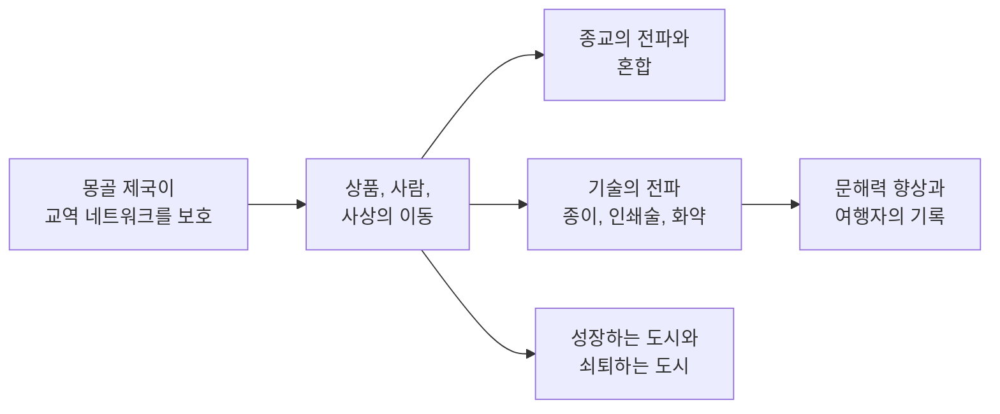

# AP 세계사: 모던 — 토픽 2.5 요약: 연결이 낳은 문화적 결과 (Cultural Consequences of Connectivity)

> 출처: AP_WH_2.5_Notes_KR.md 요약 (College Board CED 기준 · 교재 반영, 교재 Topic 2.5)

**Unit 2: 교류의 네트워크 (Networks of Exchange, c. 1200–1450)**

---

## 한 문장 요약

교역 네트워크는 종교, 언어, 미술, 그리고 종이와 화약 같은 기술을 아프로-유라시아 전역에 퍼뜨리며 현지 전통과 섞이게 했고, 교역으로 성장한 도시도 있었지만 질병과 침입으로 쇠퇴한 도시도 있었으며, 여행자들은 이 모든 것을 기록했다.

## 큰 그림

약 1200년부터 1450년까지 **상품, 사람, 사상**은 아프로-유라시아의 교역 네트워크를 따라 비교적 자유롭게 오갔다. 육지에서는 사막을 건넜고, 바다에서는 중국해와 인도양을 건넜다. 그 이유 중 하나는 상인과 여행자를 보호한 **몽골 제국 (Mongol Empire)의 안정**이었다. 종교가 퍼지면서 현지 신앙과 **섞이는** 경우가 많았다. **종이, 인쇄술, 화약** 같은 기술도 교역을 따라 퍼졌다. 어떤 교역 도시는 성장하고 어떤 도시는 쇠퇴했으며, **마르코 폴로 (Marco Polo)**, **이븐 바투타 (Ibn Battuta)**, **마저리 켐프 (Margery Kempe)** 같은 여행자들은 자신이 본 것을 책으로 남겼다.

## 핵심 정리

### 1. 동아시아에서 달라진 불교

- 불교 (Buddhism)는 인도에서 **실크로드** (Silk Roads)를 따라 중국에 전해졌다. 7세기 승려 **현장** (Xuanzang)이 불교를 널리 알리는 데 기여했다.
- 승려들은 **도교** (Daoism)의 생각으로 불교를 설명했다. 둘이 섞여 **선종 (Chan Buddhism)**(일본에서는 **Zen**)이 생겼다. 이렇게 섞이는 것을 **혼합주의 (Syncretism)**, 곧 서로 다른 종교나 문화가 섞이는 현상이라고 한다.
- **송나라 (Song Dynasty)**(960–1279) 때 **인쇄술**로 불경을 쉽게 구할 수 있게 되었고, 불교 작가들은 **구어 (Vernacular)**, 곧 일상에서 쓰는 말로 글을 썼다.
- **성리학** (Neo-Confucianism)은 **합리적 사고**와 도교·불교의 생각을 결합했다. 일본과 베트남으로 퍼졌고 **한국의 국가 공식 이념**이 되었다.

### 2. 남아시아와 동남아시아의 힌두교와 불교

- 힌두교 (Hinduism)와 불교는 **교역**을 통해 동남아시아에 전해졌다.
- 스리랑카의 **싱할라 왕조** (Sinhala dynasties)는 **불교** 국가였다. 이 섬은 사원이 많은 불교 연구의 중심지였고, 불교 승려가 **왕에게 조언**하는 일이 많았다.
- 지금의 캄보디아에 있던 **크메르 제국** (Khmer Empire)은 **힌두교에서 불교로** 바뀌었다.
- 크메르의 왕도 **앙코르 톰** (Angkor Thom)에서 훗날 불교도가 된 통치자들은 **힌두교 미술은 그대로 두고 불교 미술을 덧붙였다.** 두 종교가 **공존**, 곧 나란히 함께 있었다.

### 3. 언어, 학문, 예술을 바꾼 이슬람

- 이슬람 (Islam)은 **상인, 선교사, 정복**을 통해 퍼졌다.
- **아프리카:** 반투어와 아랍어가 섞인 **스와힐리어** (Swahili)가 널리 쓰이는 언어가 되었다. **팀북투** (Timbuktu)는 이슬람 학문의 중심지가 되었고, 아프리카 지도자들은 **메카 성지 순례**를 했다.
- **남아시아:** **평등**을 강조하는 이슬람은 **하층 카스트 힌두교도**에게 매력이 있었다. **우르두어** (Urdu)는 힌디어, 아랍어, 페르시아어(파르시어)의 영향을 받았고, **박티 (Bhakti)** 시인들은 힌두교와 이슬람의 연결점을 찾았다.
- **동남아시아:** **자와** (Java)의 전통 이야기, **인형극**, 시가 무슬림 인물과 기법을 받아들였다.

### 4. 퍼져 나간 과학과 기술

- **이슬람 학자**들은 그리스 고전을 아랍어로 번역해 **아리스토텔레스 (Aristotle)의 저작이 사라지지 않게 지켰다.** 인도의 수학과 중국의 제지술도 받아들였다.
- **종이**는 **13세기**에 중국에서 유럽으로 전해졌다. **인쇄술**과 함께 **문해력을 높이는** 데 기여했다.
- **화약** (Gunpowder)과 총은 중국에서 퍼져 **전쟁 방식을 바꾸었다.**
- 뱃사람들은 **삼각돛 (Lateen sail)**, **선미타 (Stern rudder)**, **아스트롤라베 (Astrolabe)**, **나침반 (Magnetic compass)** 같은 도구를 퍼뜨렸다.

### 5. 성장하는 도시와 쇠퇴하는 도시

- **항저우** (Hangzhou)는 **교역이 도시화 (Urbanization)**, 곧 도시의 성장을 이끈 모습을 보여 준다. 인구는 약 100만 명이었고 **대운하 (Grand Canal)** 남쪽 끝에 있었다.
- **카슈가르** (Kashgar)는 **유목민 침입자**의 공격을 받은 뒤 쇠퇴했고, 1389–1390년 **티무르** (Tamerlane)에게 짓밟혔다.
- **콘스탄티노폴리스** (Constantinople)는 **제4차 십자군**(1204)과 흑사병으로 약해졌고, 1453년 **오스만 제국** (Ottomans)에 함락되었다.
- 도시는 **정치적 안정, 안전한 교통, 교역**으로 성장했다. **침입, 질병, 농업 생산성의 감소**로 쇠퇴했다.
- **흑사병 (Black Death)**(1347–1351)은 교역로를 따라 유럽에 들어왔다. 유럽에서 최대 2,500만 명이 죽었을 수 있으며, 일손 부족으로 **봉건제가 약해졌다.**

### 6. 세계를 기록한 여행자들

- 베네치아 상인 **마르코 폴로**는 **쿠빌라이 칸** (Kublai Khan)의 궁정을 방문했고, **상인의 관점**에서 교역과 도시에 대해 썼다.
- 모로코의 무슬림 학자 **이븐 바투타**는 주로 이슬람 지역을 **30년 넘게** 여행했다. 그는 **독실한 무슬림의 관점**에서 기록했다.
- 읽고 쓸 줄 몰랐던 잉글랜드의 신비주의자 **마저리 켐프**는 순례를 다녔고, **영어로 된 가장 이른 자서전 중 하나**를 구술로 남겼다.

## 꼭 알아야 할 용어·인물

| 용어 | 무엇인가 | 왜 중요한가 |
|---|---|---|
| 혼합주의 (Syncretism) | 서로 다른 종교나 문화 전통이 섞이는 것 | 종교가 퍼지면서 바뀐 가장 중요한 방식 |
| 선종 (Chan/Zen Buddhism) | 불교와 도교가 섞인 신앙 | 동아시아 혼합주의의 분명한 예 |
| 성리학 (Neo-Confucianism) | 합리적 사고와 도교·불교 사상을 결합한 사상 | 한국의 국가 공식 이념이 됨 |
| 앙코르 톰 (Angkor Thom) | 힌두교와 불교 미술이 함께 있는 크메르의 왕도 | 동남아시아에서 두 종교가 공존한 모습을 보여 줌 |
| 스와힐리어 (Swahili) | 반투어와 아랍어가 섞인 언어 | 아프리카에 미친 이슬람의 문화적 영향을 보여 줌 |
| 종이와 인쇄술 (Paper and printing) | 교역로를 따라 퍼진 중국의 발명품 | 유럽의 문해력 향상에 기여함 |
| 항저우 (Hangzhou) | 남중국의 교역·문화 중심지 | 교역이 도시를 키운 모습을 보여 줌 |
| 콘스탄티노폴리스 (Constantinople) | 십자군과 흑사병으로 약해진 도시 | 도시가 쇠퇴할 수 있음을 보여 줌 |
| 흑사병 (Black Death) | 교역로를 따라 유럽에 들어온 전염병 | 유럽에서 최대 2,500만 명이 죽었을 수 있고 봉건제를 약하게 함 |
| 마르코 폴로 (Marco Polo) | 쿠빌라이 칸을 방문한 베네치아 상인 | 유럽인에게 중국을 알림 |
| 이븐 바투타 (Ibn Battuta) | 모로코의 무슬림 학자이자 여행자 | 이슬람 세계의 범위를 기록함 |
| 마저리 켐프 (Margery Kempe) | 잉글랜드의 신비주의자이자 순례자 | 영어로 된 가장 이른 자서전 중 하나를 남김 |

## 주요 연도

| 연도 | 사건 |
|---|---|
| 960–1279 | 송나라 (Song Dynasty). 성리학 (Neo-Confucianism)이 발전하고 인쇄술로 불경이 보급됨 |
| 1204 | 제4차 십자군 (Fourth Crusade)이 콘스탄티노폴리스 (Constantinople)를 약화시킴 |
| 13세기 | 제지술 (Papermaking)이 중국에서 유럽으로 전해짐 |
| 1295 | 마르코 폴로 (Marco Polo)가 이탈리아로 돌아옴 |
| 1325년부터 | 이븐 바투타 (Ibn Battuta)의 30년 넘는 여행 |
| 1347–1351 | 유럽의 흑사병 (Black Death) 대유행 |
| 1389–1390 | 티무르 (Tamerlane)가 카슈가르 (Kashgar)를 짓밟음 |
| 1453 | 콘스탄티노폴리스 (Constantinople)가 오스만 제국 (Ottomans)에 함락됨 |

## 시험에서는 이렇게 묻는다

- **정당화와 공고화:** 퍼져 나가는 종교는 사람들을 하나로 묶고 왕국 지도층의 권위를 정당화할 수 있었다. 불교 승려는 싱할라 왕에게 조언했고, 아프리카 지도자들은 메카 성지 순례로 이슬람과의 유대를 깊게 했으며, 성리학은 한국의 국가 이념이 되었다.
- **연속성·혁신·다양성:** 연속성 (Continuity)은 크메르가 불교로 바뀐 뒤에도 앙코르 톰에 남겨 둔 힌두교 미술이다. 혁신 (Innovation)은 전쟁 방식을 바꾼 화약과 총이다. 다양성 (Diversity)은 이슬람이 만드는 데 영향을 준 스와힐리어와 우르두어 같은 섞인 언어이다.
- **자주 나오는 비교:** 마르코 폴로와 이븐 바투타. 공통점: 둘 다 아프로-유라시아를 가로지르는 긴 여행을 했고 그에 관한 유명한 책을 남겼다. 차이점: 폴로는 상인으로서 교역과 도시에 대해 썼고, 이븐 바투타는 독실한 무슬림으로서 주로 이슬람 지역을 여행했다.
- **자주 하는 실수:** 교역 덕분에 모든 도시가 성장했다고 쓰는 것이다. 바로잡기: 도시의 운명은 엇갈렸다. 항저우는 교역으로 성장했지만, 카슈가르는 침입 뒤 쇠퇴했고, 콘스탄티노폴리스는 십자군과 흑사병의 타격을 받았다.

## 스스로 확인하기

1. 선종은 무엇이며, 왜 혼합주의의 예인가?

▶ 정답
선종은 중국에서 승려들이 도교의 생각으로 불교를 설명하면서 둘이 섞여 생긴 신앙이다. 두 신앙 체계가 섞여 하나의 새로운 신앙이 되었으므로 혼합주의의 예이다.

2. 중국에서 퍼진 기술 두 가지와 각각의 결과를 하나씩 써라.

▶ 정답
종이는 13세기에 유럽에 전해져 인쇄술과 함께 문해력을 높였다. 화약과 총은 중국에서 퍼져 전쟁 방식을 바꾸었다.

3. 이 시기 도시가 성장한 이유 두 가지와 쇠퇴한 이유 두 가지를 써라.

▶ 정답
도시는 항저우처럼 정치적 안정과 상업의 발달로 성장했다. 카슈가르와 콘스탄티노폴리스처럼 침입과 질병으로 쇠퇴했다.

