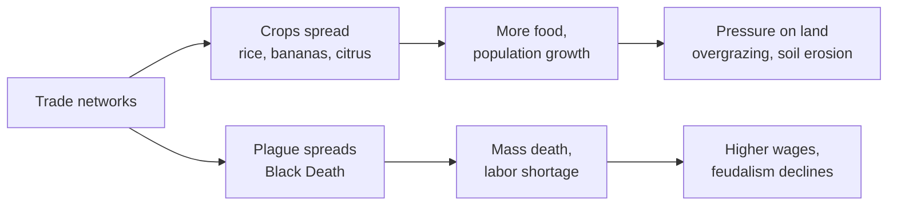

# AP World History: Modern — Topic 2.6 Summary: Environmental Consequences of Connectivity (c. 1200–1450)

> Source: Summary of AP_WH_2.6_Notes_EN.md (College Board CED · textbook incorporated, Topic 2.6 reading)

**Unit 2: Networks of Exchange (c. 1200–1450)**

---

## In One Sentence

Between 1200 and 1450, trade in Afro-Eurasia spread **new crops** that fed more people but also put pressure on the land, and it spread **disease**, above all the **Black Death**, which killed an estimated 75 to 200 million people.

## The Big Picture

Merchants did not only carry goods and ideas. They also carried **crops** and **pathogens** (germs that cause disease) to new places. New crops such as **Champa rice** and **bananas** gave people more food, so populations grew and people moved to new areas. But more people also meant more pressure on the land, which led to **overgrazing**, **deforestation**, and **soil erosion**. The most dramatic effect of trade was the **bubonic plague**, which spread along trade routes and reached Europe in **1347**. Giovanni Boccaccio, who lived through it, wrote: "Dead bodies filled every corner."

## Key Points

### 1. Champa Rice in China

- **Champa rice** ripened **fast**, resisted **drought and floods**, and gave **two harvests a year**.
- It came to China as **tribute** (a gift sent to show respect) from **Champa**, a kingdom in present-day central Vietnam. Some scholars think it may have come from **India** first.
- China planted it widely to **feed a growing population**, and the extra food made the population grow even more.
- **Terraced farming** (step-shaped fields on hillsides) in the uplands and **paddies** (flooded fields) in the lowlands let China grow rice on land once thought **unusable**.
- People **migrated south**, to the original rice-growing region, and this helped **cities grow**.

> ⚠️ The textbook says the rice was "introduced to the Champa states by Vietnam, a Hindu state," a sentence that seems garbled, since Champa was the Hindu-influenced kingdom and the Vietnamese state to its north (Đại Việt) was not Hindu. Many accounts say the rice came **from Champa** to Song China as tribute. Check how your teacher presents this.

### 2. Bananas in Sub-Saharan Africa

- **Indonesian seafarers** crossing the Indian Ocean brought **bananas** to Sub-Saharan Africa. Many Indonesians **settled on Madagascar**.
- Bananas are **nutrition-rich**, so the population **rose sharply**.
- Bananas let **Bantu-speaking peoples** move into places where **yams**, their traditional food, did not grow well.
- Growing bananas meant **clearing more land** for farms.

### 3. Cotton, Sugar, and Citrus in Dar al-Islam

- As the **caliphs** (Muslim rulers) conquered lands beyond the Arabian Peninsula, they spread **Islam**, **Arabic**, and the growing of **cotton, sugar, and citrus**.
- These crops spread across **Dar al-Islam** (the lands under Muslim rule) and the **Mediterranean**.
- **Samarkand's markets** passed new fruits and vegetables, and **rice and citrus** from Southwest Asia, on to **Europe**.
- Later, European demand for **sugar** became a key reason for the mass use of **enslaved people in the Americas** (1500s on).

### 4. Pressure on the Land

- Population growth **put pressure on resources**, and in some places the land wore out.
- At **Great Zimbabwe**, severe **overgrazing** (too many animals eating the plants) led people to **abandon the city** in the late 1400s.
- In **feudal Europe**, overused farmland and **deforestation** caused **soil erosion** (loss of topsoil), so farms produced less.
- The **Little Ice Age** (c. 1300–c. 1800), a cooler period, made harvests in Europe even smaller.
- Environmental degradation was also **one factor** in the decline of the **Maya** in the Americas.

### 5. The Black Death Spreads

- The **Mongol conquests** helped carry plague-bearing **fleas** from **southern China** to **Central Asia**, then on to Southeast Asia and **Europe**.
- **Caravanserai** (inns along trade routes) housed people and animals together. Some historians think they **helped spread** the disease, since animals probably carried the fleas.
- Scholars in Dar al-Islam and India were advancing medicine, but **no one at the time** knew how to stop the plague.
- It killed about **25 million** in China and other parts of Asia (1332–1347) and **one-third of Europe** within a few years (peak **1347–1351**).
- The textbook says **South Asia and Sub-Saharan Africa were spared** because they had few trading ports.

> ⚠️ The textbook says the plague "struck ... India," but later says South Asia was **spared** because it had few trading ports. Many accounts say South Asia had major ports such as Calicut, and historians still debate how badly India was hit because evidence is limited. Check how your teacher presents this.

### 6. Effects of the Plague on Europe

- With **fewer workers**, farm production **kept falling**.
- But each worker's labor became **more valuable**, so workers could **demand higher wages**.
- This changed the relationship between **workers and employers**.
- The shift helped prepare the way for economic change as **feudalism declined**.

## Must-Know Terms & People

| Term | What it is | Why it matters |
|---|---|---|
| Pathogen | A germ that causes disease (CED term) | The CED says pathogens, like crops, spread along trade routes |
| Champa rice | Fast-ripening rice with two harvests a year | Fed China's growing population and led to migration south |
| Bananas | A nutrition-rich crop brought to Africa by Indonesian seafarers | Caused sharp population growth in Sub-Saharan Africa |
| Bantu-speaking peoples | African peoples with metalworking and farming skills | Bananas let them move beyond yam-growing areas |
| Citrus | Fruits spread by the caliphates | A CED example of crop diffusion in the Mediterranean |
| Sugar | A crop spread by the caliphates | European demand later drove slavery in the Americas |
| Overgrazing | Too many animals eating the plant cover | Forced people to abandon Great Zimbabwe |
| Deforestation | Clearing forests | Caused soil erosion in feudal Europe |
| Soil erosion | Loss of topsoil | Lowered farm production in Europe |
| Little Ice Age | A cooler period, c. 1300–c. 1800 | Made harvests smaller in Europe |
| Black Death | The bubonic plague pandemic of the 1300s | Killed an estimated 75–200 million people in Eurasia |
| Caravanserai | Inns where travelers and their animals stayed together | May have helped spread the plague-carrying fleas |

## Key Dates

| Year | Event |
|---|---|
| c. 1300 | The Little Ice Age begins (lasts to c. 1800) |
| 1332–1347 | About 25 million die of plague in China and other parts of Asia |
| 1347 | The plague reaches Europe |
| 1347–1351 | The plague peaks in Europe; one-third of Europeans die |
| Late 1400s | Great Zimbabwe abandoned after overgrazing |
| 1500s on | European demand for sugar drives slavery in the Americas |

## How the Exam Asks About It

- **Legitimacy & consolidation:** This topic is about the environment, not rulers, so the closest theme is how societies changed. New crops let **China** and **Sub-Saharan Africa** support more people, while the **Black Death** weakened the old order in Europe as **feudalism declined**.
- **Continuity, innovation, diversity:** Continuity: crops and pathogens **continued** to spread along trade routes. Innovation: **upland terraces and lowland paddies** let China grow rice on land once thought unusable. Diversity: different crops changed different regions, **rice** in China, **bananas** in Africa, and **cotton, sugar, and citrus** in Dar al-Islam.
- **Likely comparison:** Crop diffusion vs. disease diffusion. Similarity: both traveled along **trade routes**. Difference: crops spread **gradually** and **increased** population; the plague spread **fast** and **decreased** it.
- **Common trap:** Students write that the Black Death only hurt Europe's economy. Fix: farm production fell, but the **labor shortage** made workers more valuable, so **wages rose**, which helped **feudalism decline**.

## Check Yourself

1. How did Champa rice change China?

▶ Answer
It gave two harvests a year, so China could feed a growing population, and the population grew even more. Terraces and paddies let farmers grow rice in new places, and people moved south, which helped cities grow.

2. Give one example of population growth damaging the environment.

▶ Answer
At Great Zimbabwe, overgrazing around the city led people to abandon it in the late 1400s. In feudal Europe, overused farmland and deforestation caused soil erosion, which lowered farm production.

3. Why could European workers demand higher wages after the Black Death?

▶ Answer
The plague killed about one-third of Europe's people, so there were too few workers. Each worker's labor became more valuable, so workers could ask for more pay.

