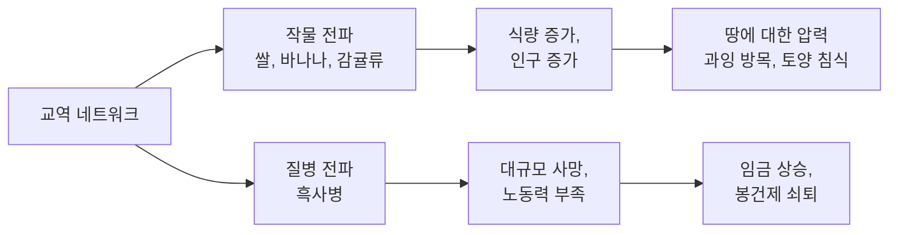

# AP 세계사: 모던 — 토픽 2.6 요약: 연결이 낳은 환경적 결과 (Environmental Consequences of Connectivity)

> 출처: AP_WH_2.6_Notes_KR.md 요약 (College Board CED 기준 · 교재 반영, 교재 Topic 2.6)

**Unit 2: 교류의 네트워크 (Networks of Exchange, c. 1200–1450)**

---

## 한 문장 요약

1200–1450년 아프로-유라시아의 교역은 더 많은 사람을 먹여 살렸지만 땅에도 부담을 준 **새로운 작물**을 퍼뜨렸고, 무엇보다 약 7,500만–2억 명의 목숨을 앗아 간 것으로 추정되는 **흑사병 (Black Death)** 같은 **질병**도 퍼뜨렸다.

## 큰 그림

상인들은 물건과 사상만 나른 것이 아니었다. 이들은 **작물**과 **병원체** (Pathogens, 질병을 일으키는 균)도 새로운 곳으로 옮겼다. **참파 쌀** (Champa rice)과 **바나나 (Bananas)** 같은 새 작물은 식량을 늘렸고, 그 결과 인구가 늘고 사람들이 새로운 지역으로 이주했다. 그러나 사람이 늘어난 만큼 땅에 대한 압력도 커져 **과잉 방목 (Overgrazing)**, **삼림 벌채 (Deforestation)**, **토양 침식** (Soil erosion)이 일어났다. 교역이 낳은 가장 극적인 결과는 교역로를 따라 퍼져 **1347년** 유럽에 이른 **선페스트** (Bubonic plague)였다. 이를 직접 겪은 조반니 보카치오 (Giovanni Boccaccio)는 "구석구석 시체가 가득했다"고 썼다.

## 핵심 정리

### 1. 중국의 참파 쌀

- **참파 쌀**은 **빨리 익고**, **가뭄과 홍수에 강했으며**, **1년에 두 번 수확**할 수 있었다.
- 이 쌀은 지금의 베트남 중부에 있던 왕국 **참파** (Champa)에서 **조공** (Tribute, 존경의 표시로 바치는 선물)으로 중국에 들어왔다. 일부 학자는 이 쌀이 원래 **인도**에서 왔을 수도 있다고 본다.
- 중국은 **늘어나는 인구를 먹여 살리려고** 이 쌀을 널리 심었고, 늘어난 식량은 인구를 더 늘렸다.
- 고지대의 **계단식 농업** (Terraced farming, 산비탈에 계단 모양으로 만든 밭)과 저지대의 **논 (Paddies, 물을 댄 밭)** 덕분에, 중국은 **쓸 수 없다고 여겨지던** 땅에서도 벼를 길렀다.
- 사람들이 원래의 벼농사 지역인 **남쪽으로 이주**했고, 이것이 **도시의 성장**을 도왔다.

> ⚠️ 교재는 이 쌀이 "힌두교 국가인 베트남이 참파 국가들에 들여왔다"고 쓰지만, 힌두교의 영향을 받은 나라는 참파였고 그 북쪽의 베트남 국가(대월, Đại Việt)는 힌두교 국가가 아니었으므로 문장이 뒤섞인 것으로 보인다. 많은 설명에서는 이 쌀이 **참파에서** 송나라로 조공으로 전해졌다고 본다. 선생님이 어떻게 가르치는지 확인이 필요하다.

### 2. 사하라 이남 아프리카의 바나나

- 인도양을 건너던 **인도네시아 항해자들** (Indonesian seafarers)이 사하라 이남 아프리카에 **바나나**를 들여왔다. 많은 인도네시아인이 **마다가스카르 (Madagascar)에 정착했다.**
- 바나나는 **영양이 풍부해** 인구가 **급격히 늘었다.**
- 바나나 덕분에 **반투어 사용 민족** (Bantu-speaking peoples)은 전통 식량인 **얌** (Yams)이 잘 자라지 않는 곳으로도 이주할 수 있었다.
- 바나나를 기르려면 농사지을 **땅을 더 개간**해야 했다.

### 3. 이슬람 세계의 면화, 사탕수수, 감귤류

- **칼리프** (Caliphs, 이슬람 세계의 통치자)들이 아라비아반도 바깥의 땅을 정복하면서 **이슬람**, **아랍어**, 그리고 **면화 (Cotton)·사탕수수 (Sugar)·감귤류 (Citrus)** 재배를 퍼뜨렸다.
- 이 작물들은 **이슬람 세계** (Dar al-Islam, 이슬람의 통치를 받는 땅)와 **지중해** 전역으로 퍼졌다.
- **사마르칸트 (Samarkand)의 시장**은 새로운 과일과 채소, 그리고 서남아시아의 **쌀과 감귤류**를 **유럽**에 전했다.
- 훗날 유럽의 **설탕** 수요는 **아메리카에서 노예를** 대규모로 부리는 핵심 요인이 되었다 (1500년대 이후).

### 4. 땅에 대한 압력

- 인구 증가는 **자원에 압력을 주었고**, 어떤 곳에서는 땅이 망가졌다.
- **그레이트 짐바브웨** (Great Zimbabwe)에서는 심각한 **과잉 방목**(가축이 너무 많아 식물을 다 먹어 치우는 것) 때문에 1400년대 후반에 사람들이 **도시를 버렸다.**
- **봉건 유럽**에서는 농지의 과다 사용과 **삼림 벌채**가 **토양 침식**(겉흙이 쓸려 나가는 것)을 일으켜 농업 생산이 줄었다.
- 서늘한 시기였던 **소빙하기** (Little Ice Age, c. 1300–c. 1800)는 유럽의 수확을 더 줄였다.
- 환경 훼손은 아메리카 **마야** (Maya)가 쇠퇴한 **요인 중 하나**이기도 했다.

### 5. 흑사병의 확산

- **몽골의 정복** (Mongol conquests)은 흑사병을 옮기는 **벼룩**이 **중국 남부**에서 **중앙아시아**로, 다시 동남아시아와 **유럽**으로 퍼지는 데 기여했다.
- **캐러밴서라이** (Caravanserai, 교역로의 숙소)는 사람과 동물을 한곳에 묵게 했다. 동물들이 벼룩을 옮겼을 가능성이 크기 때문에, 일부 역사가는 이곳이 질병 **확산을 도왔다**고 본다.
- 이슬람 세계와 인도의 학자들은 의학을 발전시키고 있었지만, 흑사병을 막을 방법은 **당시 누구도** 알지 못했다.
- 흑사병은 중국과 아시아의 다른 지역에서 약 **2,500만 명**(1332–1347)의 목숨을 앗아 갔고, 유럽에서는 몇 년 만에 **인구의 3분의 1**이 죽었다 (절정 **1347–1351**).
- 교재는 교역 항구가 적었던 **남아시아와 사하라 이남 아프리카는 피해를 면했다**고 쓴다.

> ⚠️ 교재는 흑사병이 "인도를 덮쳤다"고 하면서도, 뒤에서는 교역 항구가 적어 남아시아가 **피해를 면했다**고 쓴다. 많은 설명에서는 남아시아에 캘리컷 (Calicut) 같은 큰 항구가 있었다고 보며, 자료가 부족해 인도의 피해 정도는 역사가들 사이에서 아직 논쟁 중이다. 선생님이 어떻게 가르치는지 확인이 필요하다.

### 6. 흑사병이 유럽에 미친 영향

- **일할 사람이 줄면서** 농업 생산이 **계속 줄었다.**
- 그러나 노동자 한 사람 한 사람의 노동이 **더 귀해져**, 노동자들은 **더 높은 임금을 요구**할 수 있었다.
- 이로써 **노동자와 고용주**의 관계가 바뀌었다.
- 이 변화는 **봉건제가 쇠퇴**하면서 나타난 경제적 변화의 바탕이 되었다.

## 꼭 알아야 할 용어·인물

| 용어 | 무엇인가 | 왜 중요한가 |
|---|---|---|
| 병원체 (Pathogen) | 질병을 일으키는 균 (CED 용어) | CED는 작물처럼 병원체도 교역로를 따라 퍼졌다고 본다 |
| 참파 쌀 (Champa rice) | 빨리 익고 1년에 두 번 수확하는 벼 | 중국의 늘어나는 인구를 먹여 살리고 남쪽으로의 이주를 낳았다 |
| 바나나 (Bananas) | 인도네시아 항해자들이 아프리카에 들여온 영양이 풍부한 작물 | 사하라 이남 아프리카의 인구를 급격히 늘렸다 |
| 반투어 사용 민족 (Bantu-speaking peoples) | 금속 기술과 농업 기술을 가진 아프리카의 민족들 | 바나나 덕분에 얌 재배 지역 너머로 이주했다 |
| 감귤류 (Citrus) | 칼리프국이 퍼뜨린 과일 | 지중해 작물 전파의 CED 예시이다 |
| 사탕수수·설탕 (Sugar) | 칼리프국이 퍼뜨린 작물 | 훗날 유럽의 수요가 아메리카 노예제를 부추겼다 |
| 과잉 방목 (Overgrazing) | 가축이 너무 많아 식물을 다 먹어 치우는 것 | 그레이트 짐바브웨가 버려진 원인이다 |
| 삼림 벌채 (Deforestation) | 숲을 베어 내는 것 | 봉건 유럽에서 토양 침식을 일으켰다 |
| 토양 침식 (Soil erosion) | 겉흙이 쓸려 나가는 것 | 유럽의 농업 생산을 줄였다 |
| 소빙하기 (Little Ice Age) | c. 1300–c. 1800년의 서늘한 시기 | 유럽의 수확을 줄였다 |
| 흑사병 (Black Death) | 1300년대의 선페스트 (Bubonic plague) 대유행 | 유라시아에서 약 7,500만–2억 명이 죽은 것으로 추정된다 |
| 캐러밴서라이 (Caravanserai) | 여행자와 동물이 함께 묵던 숙소 | 흑사병을 옮기는 벼룩의 확산을 도왔을 수 있다 |

## 주요 연도

| 연도 | 사건 |
|---|---|
| c. 1300 | 소빙하기 (Little Ice Age) 시작 (c. 1800까지) |
| 1332–1347 | 중국과 아시아의 다른 지역에서 흑사병으로 약 2,500만 명 사망 |
| 1347 | 흑사병이 유럽에 도달 |
| 1347–1351 | 유럽에서 흑사병이 절정, 유럽인의 3분의 1 사망 |
| 1400년대 후반 | 과잉 방목으로 그레이트 짐바브웨 (Great Zimbabwe)가 버려짐 |
| 1500년대 이후 | 유럽의 설탕 수요가 아메리카 노예제를 부추김 |

## 시험에서는 이렇게 묻는다

- **정당화와 공고화:** 이 토픽은 통치자가 아니라 환경을 다루므로, 가장 가까운 주제는 사회가 어떻게 바뀌었는가이다. 새 작물 덕분에 **중국**과 **사하라 이남 아프리카**는 더 많은 사람을 먹여 살렸고, **흑사병**은 **봉건제가 쇠퇴**하면서 유럽의 옛 질서를 약하게 만들었다.
- **연속성·혁신·다양성:** 연속성: 작물과 병원체가 교역로를 따라 **계속** 퍼졌다. 혁신: **고지대의 계단식 농업과 저지대의 논** 덕분에 중국은 쓸 수 없다고 여겨지던 땅에서도 벼를 길렀다. 다양성: 중국의 **쌀**, 아프리카의 **바나나**, 이슬람 세계의 **면화·사탕수수·감귤류**처럼 지역마다 다른 작물이 변화를 가져왔다.
- **자주 나오는 비교:** 작물 전파와 질병 전파. 공통점: 둘 다 **교역로**를 따라 퍼졌다. 차이점: 작물은 **서서히** 퍼지며 인구를 **늘렸고**, 흑사병은 **빠르게** 퍼지며 인구를 **줄였다.**
- **자주 하는 실수:** 흑사병이 유럽 경제에 피해만 주었다고 쓰는 경우가 많다. 바로잡기: 농업 생산은 줄었지만 **노동력 부족** (Labor shortage)으로 노동자의 가치가 높아져 **임금이 올랐고**, 이것이 **봉건제 쇠퇴**를 도왔다.

## 스스로 확인하기

1. 참파 쌀은 중국을 어떻게 바꾸었는가?

▶ 정답
1년에 두 번 수확할 수 있어 중국은 늘어나는 인구를 먹여 살릴 수 있었고, 인구는 더 늘었다. 계단식 농업과 논 덕분에 새로운 곳에서도 벼를 길렀으며, 사람들이 남쪽으로 이주해 도시가 성장했다.

2. 인구 증가가 환경을 훼손한 예를 하나 들어 보라.

▶ 정답
그레이트 짐바브웨에서는 도시 주변의 과잉 방목 때문에 1400년대 후반에 사람들이 도시를 버렸다. 봉건 유럽에서는 농지의 과다 사용과 삼림 벌채가 토양 침식을 일으켜 농업 생산이 줄었다.

3. 흑사병 이후 유럽의 노동자들은 왜 더 높은 임금을 요구할 수 있었는가?

▶ 정답
흑사병으로 유럽 인구의 약 3분의 1이 죽어 일할 사람이 모자랐다. 노동자 한 사람 한 사람의 노동이 더 귀해졌기 때문에 노동자들은 더 많은 임금을 요구할 수 있었다.

