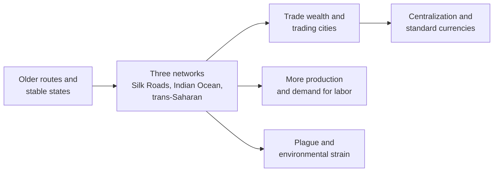

# AP World History: Modern — Topic 2.7 Summary: Comparison of Economic Exchange (c. 1200–1450)

> Source: Summary of AP_WH_2.7_Notes_EN.md (College Board CED · textbook incorporated, Topic 2.7 reading)

**Unit 2: Networks of Exchange (c. 1200–1450)**

---

## In One Sentence

From c. 1200 to c. 1450, the **Silk Roads**, the **Indian Ocean**, and the **trans-Saharan** routes were **similar** in their origins, purpose, and effects, but **different** in their goods, transport, technologies, religions, and currencies.

## The Big Picture

Topic 2.7 asks you to **compare** the three networks of exchange from Topics 2.1–2.6. A **network of exchange** is a system of trade routes that links regions. All three networks grew on **older routes**, needed **stable states** to protect them, and existed mainly for **trade**. All three produced rich **trading cities**, stronger central governments, and standard currencies. But each network moved different goods, with different animals or ships, and spread different religions. Trade also changed society: more production, more demand for workers, and the spread of **plague**.

## Key Points

### 1. The Three Networks
- **Silk Roads:** overland routes through the **Gobi Desert** and mountain passes, from China and Central Asia to Southwest Asia and Europe. Merchants mostly traded **luxury goods** (expensive goods that are small and light).
- **Indian Ocean:** sea routes that depended on the **monsoons** (seasonal winds). They linked East Asia with Southeast, South, and Southwest Asia. Merchants traded goods **too heavy to move by land**.
- **Trans-Saharan:** overland routes across the Sahara Desert. **Salt** from North Africa was traded for **gold** from kingdoms south of the desert.
- Together, the three networks **connected Afro-Eurasia** (Africa, Europe, and Asia).

> ⚠️ The textbook says the trans-Saharan routes reached "West and East Africa." Many accounts, and the textbook's own 2.4 reading, focus on West Africa (Ghana, Mali, Songhai), and say East Africa connected mainly through the Indian Ocean. Check how your teacher presents this.

### 2. Similarities: Origins and Purpose
- **Origins:** interregional trade began **long before the Common Era**. The trade of 1200–1450 **built on older routes**.
- As kingdoms and empires grew, **their trade routes grew too**.
- **Stable states** (kingdoms, caliphates, city-states, empires) **protected** routes and merchants. In **Calicut**, merchants could leave their cargo without fear of theft.
- Stable states also supported new **technology**, such as the **magnetic compass**, the **lateen sail** (a triangular sail), and stronger **saddles**.
- **Purpose:** the main goal was **economic**. But **diplomats** and **missionaries** traveled the routes too, so people exchanged ways of life as well as goods.

### 3. Similarities: Effects
- **Trading cities as "knots":** picture a net of cords that are **knotted** where they cross. Trading cities were the knots that held each network together.
- Examples: **Samarkand** (Silk Roads), **Malacca** and **Calicut** (Indian Ocean), and **Timbuktu** (trans-Saharan).
- **Centralization** means gathering power in a central government. **Malacca** grew rich from **fees** on ships and used the money to build a **navy against pirates**. This needed central planning.
- **Standard currencies** (money that many people accept) **sped up trade** and let merchants measure the value of goods.

### 4. Differences: Goods, Transport, Technology, Religion, Currency
- **Goods:** silk, porcelain, and tea went west on the Silk Roads. Pepper, textiles, and East African gold and ivory moved on the Indian Ocean. Salt went south and gold went north across the Sahara.
- **Transport:** **horses and camels** (Silk Roads), **dhows and junks** (ships of the Indian Ocean), and **camel caravans** with people on foot (trans-Saharan).
- **Technology:** saddles and the **caravanserai** (roadside inns for traders) on the Silk Roads; the **astrolabe**, lateen sail, and compass at sea.
- **Religion:** **Buddhism**, **Neo-Confucianism**, and **Islam** spread along the Silk Roads and the Indian Ocean. Islam spread across the Sahara to **Sub-Saharan Africa**.
- **Currency:** **silk** on the Silk Roads, **tin ingots** in parts of Southeast Asia, and **cowrie shells** in West Africa. Over time, many states moved to **gold and metal coins**.

> ⚠️ The columns of the textbook's table of differences were mixed up in the extracted text, so the goods, transport, technology, and religion details above are a reconstruction. Check them against the printed textbook.

### 5. Social Effects: Production and Labor
- Demand for luxury goods made producers work **more efficiently**. **China** went through **proto-industrialization** (large-scale production before machines) in iron, steel, and porcelain.
- New business practices appeared, such as **partnerships** that **shared the risk** of an investment.
- **Maritime** (sea) trade came to be **larger than overland trade**, so traders needed bigger ships.
- **Demand for labor rose.** Older kinds of work continued: free peasants, artisans, people working off debts, and **enslaved people**.
- The **slave trade** was common on the **Indian Ocean** and **trans-Saharan** routes.

### 6. Gender and the Environment
- Most societies stayed **patriarchies** (men held most power) and were divided by class or caste.
- Some women had more room: **Mongol** women moved freely and advised the Great Khan, **European** women had their own guilds, and **Southeast Asian** women ran markets.
- Merchants, diplomats, and missionaries carried the **bubonic plague** along trade routes. **At least one-third** of Europe's people died, and China lost **tens of millions**.
- More farming and political instability caused **deforestation**, **overgrazing**, and **soil erosion**, which pushed people to migrate.

## Must-Know Terms & People

| Term | What it is | Why it matters |
|---|---|---|
| Network of exchange | A system of trade routes linking regions | The thing you compare in this topic |
| Luxury goods | High-value goods that are small and light | The specialty of the Silk Roads |
| Monsoon winds | Seasonal winds in the Indian Ocean | Indian Ocean sailing depended on them |
| Calicut | The "City of Spices," an Indian Ocean market city | Shows how stable states kept trade safe |
| Malacca | A trading city on the Strait of Malacca | Used ship fees to build a navy, an example of centralization |
| Centralization | Gathering power in a central government | A shared effect of trade wealth on all routes |
| Standardized currency | Money that many people accept | Sped up trade and measured the value of goods |
| Tin ingots | Bars of tin used as money | A currency standard in parts of Southeast Asia |
| Cowrie shells | Shells used as money | The currency of West African states |
| Proto-industrialization | Large-scale production before machines | China's response to demand for iron, steel, and porcelain |
| Partnership | A business deal that shares investment risk | A new commercial practice of the era |
| Patriarchy | A society in which men hold most power | The gender structure in nearly all societies |

## Key Dates

| Year | Event |
|---|---|
| c. 1235 | Mali founded (trans-Saharan) |
| c. 1250–1350 | Pax Mongolica on the Silk Roads |
| 1324 | Mansa Musa's hajj (trans-Saharan) |
| 1330s and 1350s | Plague outbreaks in China |
| 1347–1351 | Black Death in Europe |
| c. 1400 | Malacca grows powerful (Indian Ocean) |
| 1405–1433 | Zheng He's voyages (Indian Ocean) |
| 1442 | Abdu Razzak describes Calicut |

## How the Exam Asks About It

- **Legitimacy & consolidation:** this topic is about trade, so the closest theme is how states used trade to **strengthen** their power. They protected routes and merchants, and trade wealth paid for navies (Malacca) and standard currencies, which led to **centralization**.
- **Continuity, innovation, diversity:** continuity is the networks building on **older routes** and older forms of labor; innovation is new practices such as **partnerships** and bigger ships for growing sea trade; diversity is the many currencies, from **silk** to **tin ingots** to **cowrie shells**.
- **Likely comparison:** **Silk Roads vs. Indian Ocean.** Both built on older routes, were protected by stable states, and had trading cities as "knots." The Silk Roads went overland with horses and camels and carried luxury goods, whereas the Indian Ocean went by sea with dhows and junks, used the monsoons, and carried heavy goods.
- **Common trap:** describing each network one by one instead of **comparing** them. Organize your answer by category: origins, purpose, and effects for similarities; goods, transport, technology, religion, and currency for differences.

## Check Yourself

1. Name the three areas in which the networks of exchange were similar.

▶ Answer
Their origins (they built on older routes and needed stable states), their purpose (mainly economic), and their effects (trading cities, centralization, and standard currencies).

2. How does Malacca show the link between trade wealth and centralization?

▶ Answer
Malacca grew rich from fees on ships in the Strait of Malacca. It used that wealth to build a navy against pirates, which needed central planning.

3. How did the same connections that spread trade also cause a population decline?

▶ Answer
Merchants, diplomats, and missionaries carried the bubonic plague along the trade routes. At least one-third of Europe's people died, and China lost tens of millions.

