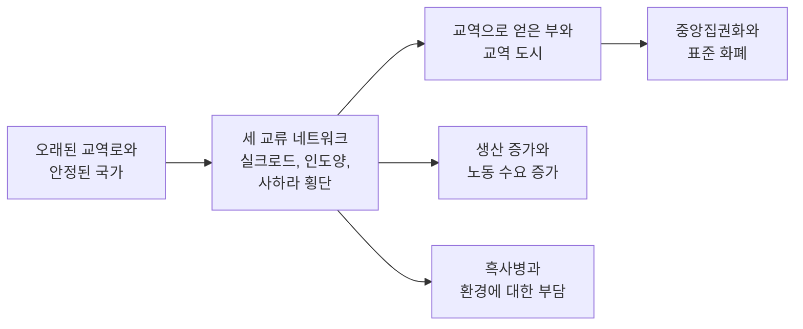

# AP 세계사: 모던 — 토픽 2.7 요약: 경제 교류 비교 (Comparison of Economic Exchange)

> 출처: AP_WH_2.7_Notes_KR.md 요약 (College Board CED 기준 · 교재 반영, 교재 Topic 2.7)

**Unit 2: 교류의 네트워크 (Networks of Exchange, c. 1200–1450)**

---

## 한 문장 요약

c. 1200–1450년 **실크로드 (Silk Roads)**, **인도양 (Indian Ocean)**, **사하라 횡단 (Trans-Saharan)** 교역로는 기원, 목적, 결과에서는 **비슷했지만**, 상품, 운송, 기술, 종교, 화폐에서는 **달랐다.**

## 큰 그림

토픽 2.7은 토픽 2.1–2.6에서 배운 세 교류 네트워크를 **비교** (Comparison)하라고 요구한다. **교류 네트워크** (Network of exchange)는 지역들을 잇는 교역로 체계이다. 세 네트워크는 모두 **오래된 교역로** 위에서 자랐고, 이를 지켜 줄 **안정된 국가**가 필요했으며, 주로 **교역**을 위해 존재했다. 세 네트워크 모두 부유한 **교역 도시**, 더 강한 중앙 정부, 표준 화폐를 낳았다. 그러나 네트워크마다 서로 다른 상품을, 서로 다른 동물이나 배로 옮겼고, 서로 다른 종교를 퍼뜨렸다. 교역은 사회도 바꾸었다. 생산이 늘고, 노동자 수요가 커지고, **흑사병** (Plague)이 퍼졌다.

## 핵심 정리

### 1. 세 교류 네트워크
- **실크로드:** **고비 사막** (Gobi Desert)과 산길을 지나 중국과 중앙아시아에서 서남아시아와 유럽으로 이어진 육로이다. 상인들은 주로 **사치품 (Luxury goods)**(작고 가볍지만 비싼 상품)을 거래했다.
- **인도양:** **계절풍 (Monsoon)**(계절마다 바뀌는 바람)에 의존한 바닷길이다. 동아시아와 동남·남·서남아시아를 이었다. 상인들은 **육로로 옮기기에 너무 무거운 상품**을 거래했다.
- **사하라 횡단:** 사하라 사막을 건너는 육로이다. 북아프리카의 **소금**과 사막 남쪽 왕국들의 **금**을 맞바꾸었다.
- 세 네트워크는 함께 **아프로-유라시아 (Afro-Eurasia)**(아프리카, 유럽, 아시아)를 **연결했다.**

> ⚠️ 교재는 사하라 횡단 교역로가 "서아프리카와 동아프리카"까지 이어졌다고 쓴다. 많은 설명과 교재의 2.4 본문에서는 서아프리카(가나, 말리, 송가이)에 초점을 맞추고, 동아프리카는 주로 인도양을 통해 연결되었다고 본다. 선생님이 어떻게 가르치는지 확인이 필요하다.

### 2. 공통점: 기원과 목적
- **기원:** 지역 간 교역은 **기원전부터** 시작되었다. 1200–1450년의 교역은 **오래된 교역로 위에 세워졌다.**
- 왕국과 제국이 커지면서 **그들의 교역로도 함께 커졌다.**
- **안정된 국가**(왕국, 칼리프국, 도시국가, 제국)가 교역로와 상인을 **보호**했다. **캘리컷** (Calicut)에서는 상인들이 도둑맞을 걱정 없이 화물을 두고 떠날 수 있었다.
- 안정된 국가는 **나침반 (Magnetic compass)**, **삼각돛 (Lateen sail)**, 더 튼튼한 **안장 (Saddle)** 같은 새 **기술**도 뒷받침했다.
- **목적:** 주된 목적은 **경제적인 것**이었다. 그러나 **외교관**과 **선교사**도 교역로를 오갔으므로, 사람들은 상품뿐 아니라 생활 방식도 주고받았다.

### 3. 공통점: 결과
- **"매듭"으로서의 교역 도시:** 끈이 교차하는 곳마다 **매듭**을 지은 그물을 떠올려 보자. 교역 도시는 각 네트워크를 붙잡아 주는 매듭이었다.
- 예로 **사마르칸트 (Samarkand)**(실크로드), **말라카** (Malacca)와 **캘리컷**(인도양), **팀북투 (Timbuktu)**(사하라 횡단)가 있다.
- **중앙집권화** (Centralization)는 권력을 중앙 정부에 모으는 것이다. **말라카**는 배에 매긴 **통행료**로 부유해졌고, 그 돈으로 **해적을 막는 해군**을 키웠다. 이를 위해서는 중앙의 계획이 필요했다.
- **표준 화폐 (Standardized currency)**(많은 사람이 인정하는 돈)는 **거래를 빠르게 했고**, 상인들이 상품의 가치를 잴 수 있게 했다.

### 4. 차이점: 상품, 운송, 기술, 종교, 화폐
- **상품:** 비단, 도자기, 차는 실크로드를 따라 서쪽으로 갔다. 후추, 직물, 동아프리카의 금과 상아는 인도양에서 오갔다. 사하라에서는 소금이 남쪽으로, 금이 북쪽으로 갔다.
- **운송:** **말과 낙타**(실크로드), **다우선 (Dhow)과 정크선 (Junk)**(인도양의 배), 사람은 걸어서 따라가는 **낙타 대상 (Camel caravan)**(사하라 횡단)이다.
- **기술:** 실크로드에는 안장과 **캐러밴서라이 (Caravanserai)**(상인을 위한 길가 숙소)가 있었고, 바다에서는 **아스트롤라베 (Astrolabe)**, 삼각돛, 나침반을 썼다.
- **종교:** **불교 (Buddhism)**, **성리학 (Neo-Confucianism)**, **이슬람** (Islam)은 실크로드와 인도양을 따라 퍼졌다. 이슬람은 사하라를 건너 **사하라 이남 아프리카** (Sub-Saharan Africa)로 퍼졌다.
- **화폐:** 실크로드에서는 **비단**, 동남아시아 일부 지역에서는 **주석 주괴 (Tin ingots)**, 서아프리카에서는 **개오지 조개껍데기** (Cowrie shells)를 썼다. 시간이 지나며 여러 국가가 **금과 금속 주화**로 옮겨 갔다.

> ⚠️ 추출된 텍스트에서 교재의 차이점 표의 열이 뒤섞여 있어서, 위의 상품, 운송, 기술, 종교 내용은 다시 맞춘 것이다. 인쇄된 교재와 대조해 확인이 필요하다.

### 5. 사회적 결과: 생산과 노동
- 사치품 수요가 늘자 생산자들은 **더 효율적으로** 일해야 했다. **중국**은 철, 강철, 도자기에서 **원산업화 (Proto-industrialization)**(기계 이전의 대규모 생산)를 겪었다.
- 투자 **위험을 나누는** **동업 (Partnership)** 같은 새로운 상업 관행이 나타났다.
- **해상** 교역이 **육상 교역보다 커지면서**, 상인들에게 더 큰 배가 필요해졌다.
- **노동 수요가 늘었다.** 자유농, 장인, 빚을 갚으려고 일한 사람, **노예** 같은 이전 시대의 노동 형태가 이어졌다.
- **노예 무역**은 **인도양**과 **사하라 횡단** 교역로에서 흔했다.

### 6. 성별 구조와 환경
- 대부분의 사회는 여전히 **가부장제 (Patriarchy)**(남성이 대부분의 권력을 가진 사회)였고, 계급이나 카스트로 나뉘었다.
- 일부 여성은 더 많은 여지를 가졌다. **몽골** 여성은 자유롭게 돌아다니고 대칸 (Great Khan)에게 조언했으며, **유럽** 여성은 자신들의 길드가 있었고, **동남아시아** 여성은 시장을 운영했다.
- 상인, 외교관, 선교사가 교역로를 따라 **흑사병** (Bubonic plague)을 옮겼다. 유럽 인구의 **적어도 3분의 1**이 죽었고, 중국에서는 **수천만 명**이 죽었다.
- 농업 확대와 정치적 불안은 **삼림 벌채**, **과잉 방목**, **토양 침식**을 낳았고, 이 때문에 사람들이 다른 곳으로 이주했다.

## 꼭 알아야 할 용어·인물

| 용어 | 무엇인가 | 왜 중요한가 |
|---|---|---|
| 교류 네트워크 (Network of exchange) | 지역들을 잇는 교역로 체계 | 이 토픽에서 비교하는 대상 |
| 사치품 (Luxury goods) | 작고 가볍지만 값이 비싼 상품 | 실크로드의 주력 상품 |
| 계절풍 (Monsoon winds) | 인도양에서 계절마다 바뀌는 바람 | 인도양 항해가 여기에 의존함 |
| 캘리컷 (Calicut) | "향신료의 도시"로 불린 인도양의 시장 도시 | 안정된 국가가 교역을 안전하게 지켰음을 보여 줌 |
| 말라카 (Malacca) | 말라카 해협의 교역 도시 | 통행료로 해군을 키운 중앙집권화의 예 |
| 중앙집권화 (Centralization) | 권력을 중앙 정부에 모으는 것 | 모든 교역로에서 교역의 부가 낳은 공통 결과 |
| 표준 화폐 (Standardized currency) | 많은 사람이 인정하는 돈 | 거래를 빠르게 하고 상품의 가치를 잼 |
| 주석 주괴 (Tin ingots) | 돈으로 쓰인 주석 덩어리 | 동남아시아 일부 지역의 화폐 기준 |
| 개오지 조개껍데기 (Cowrie shells) | 돈으로 쓰인 조개껍데기 | 서아프리카 국가들의 화폐 |
| 원산업화 (Proto-industrialization) | 기계 이전의 대규모 생산 | 철, 강철, 도자기 수요에 대한 중국의 대응 |
| 동업 (Partnership) | 투자 위험을 나누는 상업 방식 | 이 시대의 새로운 상업 관행 |
| 가부장제 (Patriarchy) | 남성이 대부분의 권력을 가진 사회 | 거의 모든 사회의 성별 구조 |

## 주요 연도

| 연도 | 사건 |
|---|---|
| c. 1235 | 말리 (Mali) 건국 (사하라 횡단) |
| c. 1250–1350 | 실크로드의 팍스 몽골리카 (Pax Mongolica) |
| 1324 | 만사 무사 (Mansa Musa)의 성지 순례 (사하라 횡단) |
| 1330년대와 1350년대 | 중국의 흑사병 유행 |
| 1347–1351 | 유럽의 흑사병 (Black Death) |
| c. 1400 | 말라카가 강해짐 (인도양) |
| 1405–1433 | 정화 (Zheng He)의 원정 (인도양) |
| 1442 | 압두르 라자크 (Abdu Razzak)가 캘리컷을 기록함 |

## 시험에서는 이렇게 묻는다

- **정당화와 공고화:** 이 토픽은 교역에 관한 것이므로, 가장 가까운 주제는 국가가 교역을 이용해 권력을 **강화**한 방식이다. 국가는 교역로와 상인을 보호했고, 교역으로 얻은 부로 해군(말라카)과 표준 화폐를 마련했으며, 이것이 **중앙집권화**로 이어졌다.
- **연속성·혁신·다양성:** 연속성은 네트워크가 **오래된 교역로**와 이전의 노동 형태 위에 세워진 것이다. 혁신은 **동업** 같은 새로운 관행과, 커지는 해상 교역을 위한 더 큰 배이다. 다양성은 **비단**에서 **주석 주괴**, **개오지 조개껍데기**에 이르는 여러 화폐이다.
- **자주 나오는 비교:** **실크로드 vs. 인도양.** 둘 다 오래된 교역로 위에 세워졌고, 안정된 국가의 보호를 받았으며, 교역 도시를 "매듭"으로 가졌다. 실크로드는 말과 낙타로 육로를 오가며 사치품을 날랐고, 인도양은 다우선과 정크선으로 바다를 오가며 계절풍을 이용하고 무거운 상품을 날랐다.
- **자주 하는 실수:** 네트워크를 **비교**하지 않고 하나씩 따로 설명하는 것이다. 답을 항목별로 정리하자. 공통점은 기원, 목적, 결과로, 차이점은 상품, 운송, 기술, 종교, 화폐로 나누어 쓴다.

## 스스로 확인하기

1. 교류 네트워크들이 비슷했던 세 영역을 말해 보라.

▶ 정답
기원(오래된 교역로 위에 세워졌고 안정된 국가가 필요했음), 목적(주로 경제적), 결과(교역 도시, 중앙집권화, 표준 화폐)이다.

2. 말라카는 교역의 부와 중앙집권화의 관계를 어떻게 보여 주는가?

▶ 정답
말라카는 말라카 해협을 지나는 배에 매긴 통행료로 부유해졌다. 그 부로 해적을 막는 해군을 키웠는데, 이를 위해서는 중앙의 계획이 필요했다.

3. 교역을 넓힌 바로 그 연결이 어떻게 인구 감소도 가져왔는가?

▶ 정답
상인, 외교관, 선교사가 교역로를 따라 흑사병을 옮겼다. 유럽 인구의 적어도 3분의 1이 죽었고, 중국에서는 수천만 명이 죽었다.

