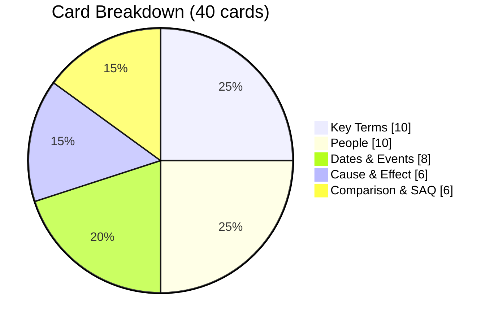

# 3.1 Flashcards — European, East Asian, and Gunpowder Empires Expand
> How to use: read the question, recall the answer, then click **▶ Answer** to check.
> Check off cards you got right with `- [x]` so only the ones to review remain.

---

## 🅰️ Key Terms

- [ ] **1. What were the Gunpowder Empires?**

▶ Answer

Large, multiethnic Islamic states in Southwest, Central, and South Asia that used firearms to conquer and control territory: <b>Ottoman, Safavid, Mughal</b>

- [ ] **2. What is armed trade?**

▶ Answer

Empires traded with each other but kept troops ready at all times, unlike the free markets of later eras

- [ ] **3. What were the new monarchies?**

▶ Answer

1500s European monarchies that centralized power by controlling taxes, the army, and religion. Examples: Tudors (England), Valois (France), Ferdinand & Isabella (Spain)

- [ ] **4. What is a tsar?**

▶ Answer

The title of the Russian ruler, first used by Ivan IV in 1547

- [ ] **5. Who were the Cossacks?**

▶ Answer

Peasant warriors hired by the Stroganov family; they took control of the Volga region and led the push into Siberia

- [ ] **6. Who were the Manchus?**

▶ Answer

A people from Manchuria who overthrew the Ming in 1644 and founded the Qing Dynasty

- [ ] **7. What is the ghazi ideal?**

▶ Answer

The ideal of the warrior fighting for Islam; it justified conquest by the Turkic gunpowder empires

- [ ] **8. What is a shah?**

▶ Answer

The title of a Persian ruler; Ismail proclaimed himself shah of the Safavid Empire in 1501

- [ ] **9. What were harem politics?**

▶ Answer

Women and insiders at the Ottoman court gaining power by influencing succession; together with weak sultans, a cause of Ottoman decline

- [ ] **10. Name the four castes and the group outside the system.**

▶ Answer

Brahmins (priests) → Kshatriyas (warriors & rulers) → Vaishyas (merchants & farmers) → Shudras (laborers). Outside the system: <b>Dalits</b>

---

## 👤 People

- [ ] **11. Ivan IV (r. 1547–1584)**

▶ Answer

"Ivan the Terrible." First to use the title tsar; conquered the Kazan, Astrakhan, and Siberia khanates

- [ ] **12. Kangxi (r. 1661–1722)**

▶ Answer

Qing emperor; long reign of stability and expansion. Absorbed Taiwan and Mongolia; made Tibet a protectorate

- [ ] **13. Qianlong (r. 1736–1796)**

▶ Answer

Qing emperor; peak territory, annexed Xinjiang. Rejected Britain's 1793 trade request. Late-reign corruption led to the White Lotus Rebellion

- [ ] **14. Tamerlane (Timur)**

▶ Answer

Late 14th-century Mongol-Turkic conqueror; capital at Samarkand. Conquered from Persia to India. His descendant Babur founded the Mughal Empire

- [ ] **15. Mehmed II (r. 1451–1481)**

▶ Answer

"The Conqueror." Took Constantinople with cannons in 1453 → Istanbul

- [ ] **16. Suleiman I (r. 1520–1566)**

▶ Answer

"The Magnificent." Ottoman peak. Conquered Rhodes (1522) and Hungary (1526); failed to take Vienna (1529)

- [ ] **17. Ismail**

▶ Answer

Founder of the Safavid Empire; proclaimed shah in 1501; made Shi'a Islam the state religion

- [ ] **18. Shah Abbas I (r. 1588–1629)**

▶ Answer

Safavid peak. Trained Christian boys as soldiers; brought in European weapons and military advisers

- [ ] **19. Akbar**

▶ Answer

The ruler who made the Mughal Empire its strongest and richest

- [ ] **20. Aurangzeb (r. 1658–1707)**

▶ Answer

Mughal emperor. Southern expansion drained the treasury; persecution of Sikhs and Hindus sparked revolts → decline

---

## 📅 Dates & Events

- [ ] **21. What happened in 1453?**

▶ Answer

Mehmed II conquered Constantinople (end of the Byzantine Empire)

- [ ] **22. What happened in 1501?**

▶ Answer

Ismail proclaimed himself shah, beginning the Safavid Empire

- [ ] **23. Result and significance of the Battle of Chaldiran (1514)?**

▶ Answer

The Sunni Ottomans defeated the Shi'a Safavids, hardening the Sunni–Shi'a divide

- [ ] **24. What was the Battle of Lepanto (1571)?**

▶ Answer

A naval battle in which a Spanish-Venetian force defeated the Ottomans; an early sign of Ottoman decline

- [ ] **25. What did Russia achieve in 1639?**

▶ Answer

It crossed Siberia and reached the Pacific Ocean

- [ ] **26. What happened in 1644?**

▶ Answer

The Manchus overthrew the Ming and founded the Qing

- [ ] **27. Why does the 1683 siege of Vienna matter?**

▶ Answer

The second failed Ottoman siege of Vienna; the turning point that ended Ottoman dominance in Eastern Europe

- [ ] **28. What happened with Britain's 1793 trade request?**

▶ Answer

Qianlong rejected it, telling George III that China had no need for British goods; the Qing kept European trade limited to Canton

---

## 🔗 Cause & Effect

- [ ] **29. Two causes of the Islamic gunpowder empires' early success?**

▶ Answer

① Military strength based on gunpowder weapons ② The power vacuum after the Mongol khanates broke up, plus weak or corrupt earlier rulers

- [ ] **30. Why did the Ming rebuild the Great Wall?**

▶ Answer

In the 1440s the Mongols defeated the Ming and captured the emperor → northern defenses were strengthened

- [ ] **31. Two structural weaknesses of the Safavid Empire?**

▶ Answer

① No navy ② A border with the powerful Ottomans

- [ ] **32. What caused the White Lotus Rebellion (1796–1804)?**

▶ Answer

Official corruption and heavy taxes late in Qianlong's reign

- [ ] **33. Effect of the Gutenberg printing press on Europe?**

▶ Answer

Literacy rose → knowledge and ideas spread quickly

- [ ] **34. What happened in India after the Mughal decline?**

▶ Answer

Britain and France expanded their influence; Britain ruled India by the 19th century

---

## ⚖️ Comparison & SAQ Practice

- [ ] **35. Four traits shared by the three Islamic gunpowder empires?**

▶ Answer

① Descended from Central Asian Turkic nomads ② Spoke a Turkic language ③ Exploited the post-Mongol power vacuum ④ Relied on gunpowder weapons

- [ ] **36. Religious difference between the Ottomans and Safavids, and its effects?**

▶ Answer

Ottomans = Sunni, Safavids = Shi'a → Battle of Chaldiran and an Ottoman embargo on the Safavid silk trade. The tension continues in present-day Iran and Iraq

- [ ] **37. How was Russian expansion similar to Islamic gunpowder empire expansion?**

▶ Answer

Both were land-based expansions using gunpowder weapons, ruled many ethnic groups, and used religion (Orthodoxy / Islam) to legitimize rule

- [ ] **38. Examples of how land-based empires legitimized power, 1450–1750?**

▶ Answer

Religion (Shi'a state religion, Orthodox missions, ghazi ideal), titles (tsar, shah), and patronage of art and architecture (Mughal buildings, Qianlong's arts patronage)

- [ ] **39. Why did the Islamic empires decline while Russia grew stronger (18th–19th c.)?**

▶ Answer

As Western Europe pulled ahead economically and militarily, Russia modernized and the Islamic empires did not

- [ ] **40. Summarize Qing–European relations in one sentence.**

▶ Answer

Confident in its self-sufficiency, the Qing limited European trade to Canton and refused British demands to expand it

