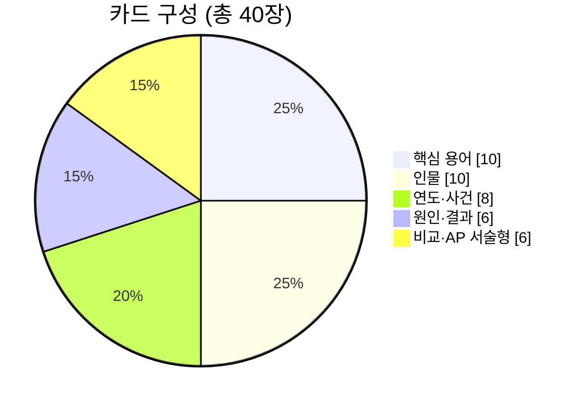

# 3.1 플래시카드 — European, East Asian, and Gunpowder Empires Expand
> 사용법: 질문을 읽고 답을 떠올린 뒤 **▶ 정답**을 눌러 확인하세요.
> 맞힌 카드는 `- [x]`로 체크해 두면 복습할 카드만 남길 수 있습니다.

---

## 🅰️ 핵심 용어 (Key Terms)

- [ ] **1. Gunpowder Empires란?**

▶ 정답

화약 무기로 영토를 정복하고 통제한 서남·중앙·남아시아의 크고 다민족적인 이슬람 국가들. <b>Ottoman, Safavid, Mughal</b>

- [ ] **2. Armed trade (무장 교역)란?**

▶ 정답

제국들이 서로 교역하면서도 군대를 늘 대기시킨 방식. 이후 시대의 자유시장과 대비됨

- [ ] **3. New monarchies란?**

▶ 정답

1500년대 유럽에서 세금·군대·종교를 장악해 권력을 중앙에 모은 군주정. 예: 영국 Tudors, 프랑스 Valois, 스페인 Ferdinand & Isabella

- [ ] **4. Tsar란?**

▶ 정답

러시아 군주의 칭호. 1547년 Ivan IV가 처음 사용

- [ ] **5. Cossacks란?**

▶ 정답

Stroganov 가문이 고용한 농민 전사들. 볼가강 일대를 장악하고 시베리아 정복에 앞장섬

- [ ] **6. Manchu란?**

▶ 정답

만주 지역 민족. 1644년 명을 무너뜨리고 Qing Dynasty를 세움

- [ ] **7. Ghazi ideal이란?**

▶ 정답

이슬람을 위해 싸우는 전사의 이상. 튀르크계 화약 제국의 정복을 정당화함

- [ ] **8. Shah란?**

▶ 정답

페르시아 군주의 칭호. 1501년 Ismail이 사파비 제국의 shah를 선언

- [ ] **9. Harem politics란?**

▶ 정답

오스만 궁정의 여성과 측근들이 후계 문제에 개입하며 권력을 행사한 현상. 약한 술탄과 함께 오스만 쇠퇴의 원인

- [ ] **10. Caste system의 4계층과 그 밖의 집단은?**

▶ 정답

Brahmins(사제) → Kshatriyas(무사·통치자) → Vaishyas(상인·농민) → Shudras(노동자). 카스트 밖: <b>Dalits</b>

---

## 👤 인물 (People)

- [ ] **11. Ivan IV (r. 1547–1584)**

▶ 정답

"Ivan the Terrible". 처음으로 tsar 칭호 사용. Kazan·Astrakhan·Siberia 칸국 정복

- [ ] **12. Kangxi (r. 1661–1722)**

▶ 정답

청 황제. 오래 재위하며 안정과 확장을 이끔. 대만·몽골 편입, 티베트를 보호령으로 삼음

- [ ] **13. Qianlong (r. 1736–1796)**

▶ 정답

청 황제. 최대 영토, 신장 편입. 1793년 영국의 교역 확대 요청 거절. 말기 부패로 백련교의 난 발생

- [ ] **14. Tamerlane (Timur)**

▶ 정답

14세기 후반 몽골·튀르크계 정복자. 수도 Samarkand. 페르시아에서 인도까지 정복. 후손 Babur가 무굴 건국

- [ ] **15. Mehmed II (r. 1451–1481)**

▶ 정답

"the Conqueror". 1453년 대포로 콘스탄티노플 정복 → Istanbul

- [ ] **16. Suleiman I (r. 1520–1566)**

▶ 정답

"the Magnificent". 오스만 전성기. Rhodes(1522)·Hungary(1526) 정복, 1529년 빈 포위 실패

- [ ] **17. Ismail**

▶ 정답

사파비 제국 건국자. 1501년 shah 선언. 시아파 이슬람을 국교로 삼음

- [ ] **18. Shah Abbas I (r. 1588–1629)**

▶ 정답

사파비 전성기. 기독교도 소년을 군인으로 훈련, 유럽 무기와 군사 고문 도입

- [ ] **19. Akbar**

▶ 정답

무굴 제국을 가장 강하고 부유하게 만든 통치자

- [ ] **20. Aurangzeb (r. 1658–1707)**

▶ 정답

무굴 황제. 남쪽 확장으로 재정 고갈, 시크교도·힌두교도 탄압으로 반란 초래 → 쇠퇴

---

## 📅 연도·사건 (Dates & Events)

- [ ] **21. 1453년에 일어난 일은?**

▶ 정답

Mehmed II의 콘스탄티노플 정복 (비잔틴 제국 멸망)

- [ ] **22. 1501년에 일어난 일은?**

▶ 정답

Ismail이 shah를 선언하며 사파비 제국 시작

- [ ] **23. 1514년 Battle of Chaldiran의 결과와 의미는?**

▶ 정답

오스만(수니)이 사파비(시아)에 승리. 수니·시아 대립이 굳어짐

- [ ] **24. 1571년 Battle of Lepanto는?**

▶ 정답

스페인·베네치아 연합 해군이 오스만을 꺾은 해전. 오스만 쇠퇴의 신호

- [ ] **25. 1639년 러시아가 이룬 것은?**

▶ 정답

시베리아를 가로질러 태평양에 도달

- [ ] **26. 1644년에 일어난 일은?**

▶ 정답

만주족이 명을 무너뜨리고 청 건국

- [ ] **27. 1683년 빈 포위의 의미는?**

▶ 정답

오스만의 두 번째 빈 포위 실패. 동유럽 지배력이 꺾인 전환점

- [ ] **28. 1793년 매카트니 사절단 사건의 핵심은?**

▶ 정답

영국이 교역 확대를 요청했으나 건륭제가 "중국은 영국 상품이 필요 없다"며 거절. 청은 교역을 Canton 한 곳으로 제한

---

## 🔗 원인·결과 (Cause & Effect)

- [ ] **29. 이슬람 화약 제국들이 처음 성공한 원인 2가지는?**

▶ 정답

① 화약 무기 기반의 군사력 ② 몽골 칸국 붕괴로 생긴 권력 공백과 이전 지배층의 부패

- [ ] **30. 명이 만리장성을 다시 쌓은 이유는?**

▶ 정답

1440년대 몽골에 패해 황제가 포로로 잡힘 → 북방 방어 강화

- [ ] **31. 사파비 제국의 구조적 약점 2가지는?**

▶ 정답

① 해군이 없음 ② 강력한 오스만과 국경을 맞댐

- [ ] **32. 백련교의 난(1796–1804)의 원인은?**

▶ 정답

건륭제 말기의 관료 부패와 무거운 세금

- [ ] **33. Gutenberg printing press가 유럽에 미친 영향은?**

▶ 정답

문해율 상승 → 지식과 사상이 빠르게 퍼짐

- [ ] **34. 무굴 제국 쇠퇴 이후 인도에서 일어난 일은?**

▶ 정답

영국·프랑스가 영향력을 넓혔고, 19세기 영국이 인도를 지배

---

## ⚖️ 비교·AP 서술형 (Comparison & SAQ Practice)

- [ ] **35. 세 이슬람 화약 제국의 공통점 4가지는?**

▶ 정답

① 중앙아시아 튀르크계 유목민 출신 ② 튀르크어 사용 ③ 몽골 칸국 붕괴 후 권력 공백 활용 ④ 화약 무기 의존

- [ ] **36. 오스만과 사파비의 종교적 차이와 그 결과는?**

▶ 정답

오스만 = Sunni, 사파비 = Shi'a → Chaldiran 전투, 오스만의 사파비 비단 교역 금수 조치. 갈등은 오늘날 이란·이라크까지 이어짐

- [ ] **37. 러시아 팽창과 이슬람 화약 제국 팽창의 공통점은?**

▶ 정답

둘 다 화약 무기를 쓴 육상 팽창이며, 다민족을 통치하고 종교(동방정교 / 이슬람)로 통치를 정당화함

- [ ] **38. 1450–1750년 육상 제국들이 정통성을 세운 방법 예시는?**

▶ 정답

종교(시아파 국교화, 동방정교 선교, ghazi ideal), 칭호(tsar, shah), 예술·건축 후원(무굴 건축, 건륭제의 예술 후원)

- [ ] **39. 18–19세기 이슬람 제국은 쇠퇴하고 러시아는 강해진 이유는?**

▶ 정답

서유럽이 경제·군사적으로 앞서 나갈 때 러시아는 근대화했고, 이슬람 제국들은 근대화하지 못함

- [ ] **40. 청과 유럽의 관계를 한 문장으로 설명하면?**

▶ 정답

청은 자급자족을 자신하며 유럽과의 교역을 Canton 한 곳으로 제한하고 영국의 확대 요구를 거절함

