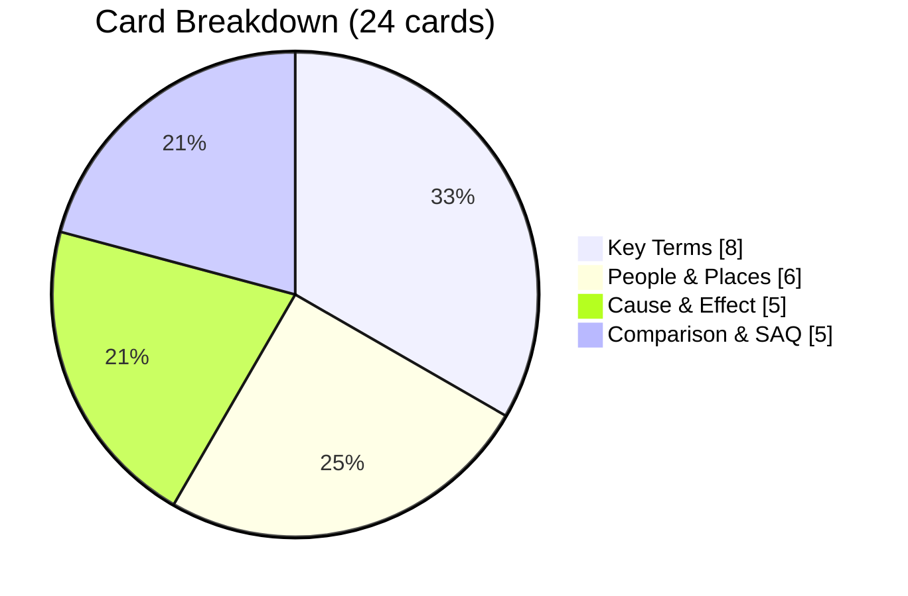

# 3.2 Flashcards — Empires: Administration
> How to use: read the question, recall the answer, then click **▶ Answer** to check.
> Check off cards you got right with `- [x]` so only the ones to review remain.
> Based on the College Board course framework, not your textbook.

---

## 🅰️ Key Terms

- [ ] **1. What was the devshirme?**

▶ Answer

The Ottoman practice of taking Christian boys from the Balkans, converting them to Islam, and training them as soldiers or officials

- [ ] **2. Who were the Janissaries?**

▶ Answer

Elite Ottoman infantry raised through the devshirme, armed with guns and loyal only to the sultan

- [ ] **3. What was the civil service exam?**

▶ Answer

A test on the Confucian classics used to pick government officials; the Qing kept it from the Ming

- [ ] **4. What was the mansabdar system?**

▶ Answer

Akbar's Mughal ranking system: officials received land revenue rights in return for supplying troops; not hereditary

- [ ] **5. What were zamindars?**

▶ Answer

Mughal local landholders who collected taxes from peasants for the state and kept a share

- [ ] **6. What was tax farming?**

▶ Answer

An Ottoman system that sold the right to collect taxes to individuals, who paid the state up front and then collected from the people

- [ ] **7. What was the mit'a?**

▶ Answer

The Inca labor tax: people worked on roads, temples, farms, and mines for the state

- [ ] **8. What is the divine right of kings?**

▶ Answer

The European belief that monarchs rule by God's will; it justified absolute monarchy

---

## 👤 People & Places

- [ ] **9. Louis XIV**

▶ Answer

French "Sun King" (r. 1643–1715). Absolute monarch; moved his court to Versailles in 1682 to control the nobles

- [ ] **10. Peter the Great**

▶ Answer

Russian tsar (r. 1682–1725). Westernized Russia; built a navy, founded St. Petersburg (1703), created the Table of Ranks (1722)

- [ ] **11. Shah Jahan**

▶ Answer

Mughal emperor who built the Taj Mahal (1632–1653) as a tomb for his wife Mumtaz Mahal

- [ ] **12. Shah Abbas I**

▶ Answer

Safavid ruler; used ghulam slave soldiers and made Isfahan the capital (1598)

- [ ] **13. Forbidden City**

▶ Answer

Imperial palace in Beijing, built under the Ming and used by the Qing as the center of power

- [ ] **14. Isfahan**

▶ Answer

Safavid capital under Shah Abbas I, known for its grand square and mosques

---

## 🔗 Cause & Effect

- [ ] **15. Why did the Ottomans recruit Christian boys instead of Turkish nobles?**

▶ Answer

The boys had no family power base, so they were loyal only to the sultan

- [ ] **16. Why did Louis XIV move his court to Versailles?**

▶ Answer

To keep nobles close and under watch, limiting their independent power

- [ ] **17. Why did the Qing keep the civil service exam?**

▶ Answer

To win the support of Han Chinese scholars and staff the government with skilled officials, while Manchus kept control

- [ ] **18. What did the Ottomans gain by taking Egypt in 1517?**

▶ Answer

Sultans claimed the title of caliph and became protectors of Mecca and Medina, strengthening their religious legitimacy

- [ ] **19. How did monumental architecture help rulers?**

▶ Answer

It showed wealth, power, and divine favor, making the ruler's authority seem natural and lasting

---

## ⚖️ Comparison & SAQ Practice

- [ ] **20. Compare the devshirme and the Qing civil service exam.**

▶ Answer

Similarity: both produced officials loyal to the central ruler. Difference: the devshirme drafted outsiders (Christian boys), while the exam chose insiders by merit (Confucian scholars)

- [ ] **21. Compare the Inca mit'a and Mughal zamindars.**

▶ Answer

Both funded the state. The mit'a collected labor directly; zamindars collected money or crops through local middlemen

- [ ] **22. Give one way rulers in the Americas used religion to legitimize power.**

▶ Answer

Mexica: human sacrifice to Huitzilopochtli showed state power. Inca: the Sapa Inca was a descendant of the sun god Inti

- [ ] **23. How did the divine right of kings and the Mandate of Heaven differ?**

▶ Answer

Divine right: the king answers only to God. Mandate of Heaven: heaven can withdraw its support from an unjust ruler, which can justify rebellion

- [ ] **24. Name one risk of relying on local tax collectors.**

▶ Answer

They could keep too much revenue and abuse peasants, leading to corruption, lower state income, and revolts

