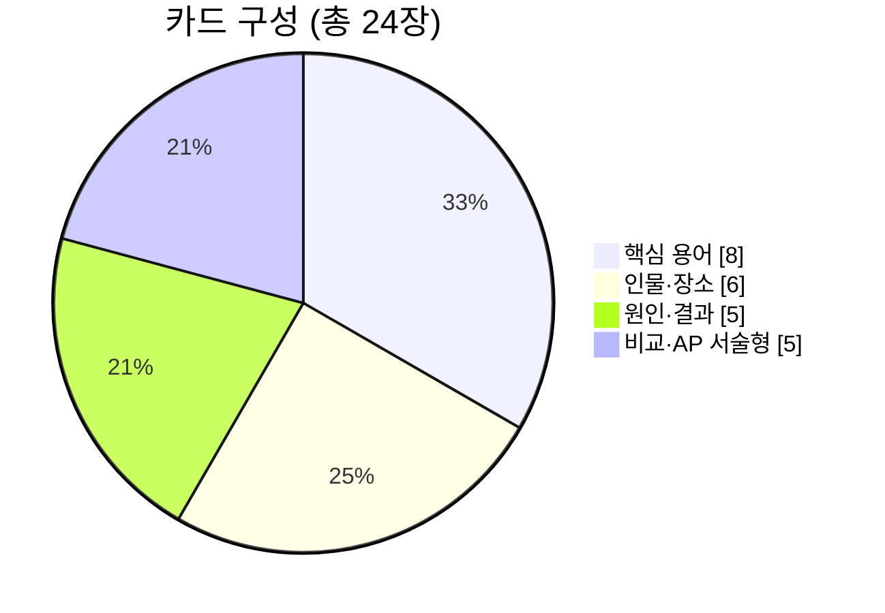

# 3.2 플래시카드 — Empires: Administration (제국의 통치 방식)
> 사용법: 질문을 읽고 답을 떠올린 뒤 **▶ 정답**을 눌러 확인하세요.
> 맞힌 카드는 `- [x]`로 체크해 두면 복습할 카드만 남길 수 있습니다.
> 교재가 아니라 College Board 과정 체계를 바탕으로 만들었습니다.

---

## 🅰️ 핵심 용어

- [ ] **1. Devshirme란?**

▶ 정답

발칸의 기독교도 소년을 데려와 이슬람으로 개종시키고 군인이나 관료로 키운 오스만 제도

- [ ] **2. Janissaries (예니체리)란?**

▶ 정답

devshirme로 길러낸 오스만 정예 보병. 총으로 무장했고 술탄에게만 충성

- [ ] **3. 과거제 (Civil service exam)란?**

▶ 정답

유교 경전 시험으로 관료를 뽑는 제도. 청이 명에서 이어받음

- [ ] **4. Mansabdar 제도란?**

▶ 정답

악바르가 만든 무굴의 관료 등급제. 군대를 대는 대가로 토지 세수 권리를 줌. 세습 불가

- [ ] **5. Zamindar란?**

▶ 정답

농민에게서 세금을 걷어 국가에 내고 일부를 가진 무굴의 지방 지주

- [ ] **6. 징세 청부 (Tax farming)란?**

▶ 정답

세금을 걷을 권리를 개인에게 판 오스만 제도. 그 개인이 국가에 먼저 돈을 낸 뒤 백성에게서 걷음

- [ ] **7. Mit'a란?**

▶ 정답

잉카의 노동세. 도로·신전·농지·광산에서 국가를 위해 일함

- [ ] **8. 왕권신수설 (Divine right of kings)이란?**

▶ 정답

군주는 신의 뜻으로 다스린다는 유럽의 믿음. 절대왕정을 정당화함

---

## 👤 인물·장소

- [ ] **9. 루이 14세**

▶ 정답

프랑스의 "태양왕"(r. 1643–1715). 절대군주. 귀족을 통제하려고 1682년 궁정을 베르사유로 옮김

- [ ] **10. 표트르 대제**

▶ 정답

러시아 차르(r. 1682–1725). 러시아를 서구화함. 해군 창설, 상트페테르부르크 건설(1703), 관등표 제정(1722)

- [ ] **11. 샤 자한**

▶ 정답

왕비 뭄타즈 마할의 무덤으로 타지마할(1632–1653)을 지은 무굴 황제

- [ ] **12. 샤 아바스 1세**

▶ 정답

사파비 통치자. ghulam 노예 군인을 활용하고 이스파한을 수도로 정함(1598)

- [ ] **13. 자금성**

▶ 정답

베이징의 황궁. 명나라 때 지었고 청이 권력의 중심으로 계속 사용

- [ ] **14. 이스파한**

▶ 정답

샤 아바스 1세 시대 사파비의 수도. 대광장과 모스크로 유명

---

## 🔗 원인·결과

- [ ] **15. 오스만은 왜 튀르크 귀족 대신 기독교도 소년을 데려다 썼나?**

▶ 정답

가문 기반이 없어서 술탄에게만 충성했기 때문

- [ ] **16. 루이 14세는 왜 궁정을 베르사유로 옮겼나?**

▶ 정답

귀족을 가까이 두고 감시해 독자적인 권력을 줄이려고

- [ ] **17. 청은 왜 과거제를 유지했나?**

▶ 정답

한족 학자의 지지를 얻고 유능한 관료를 확보하면서도 만주족이 통제권을 유지하려고

- [ ] **18. 1517년 이집트 정복으로 오스만이 얻은 것은?**

▶ 정답

술탄이 칼리프 칭호를 주장하고 메카·메디나의 보호자가 됨 → 종교적 정통성 강화

- [ ] **19. 기념비적 건축은 통치자에게 어떤 도움이 되었나?**

▶ 정답

부와 권력, 신의 은총을 보여주어 통치자의 권위가 당연하고 영원한 것처럼 보이게 함

---

## ⚖️ 비교·AP 서술형

- [ ] **20. Devshirme와 청의 과거제를 비교하면?**

▶ 정답

공통점: 둘 다 중앙 통치자에게 충성하는 관료를 만들어냄. 차이점: devshirme는 외부인(기독교도 소년)을 징집했고, 과거제는 내부인(유학자)을 능력으로 뽑음

- [ ] **21. 잉카의 mit'a와 무굴의 zamindar를 비교하면?**

▶ 정답

둘 다 국가 재정을 마련함. mit'a는 노동을 직접 걷었고, zamindar는 지방 중개인을 통해 돈이나 곡물을 걷음

- [ ] **22. 아메리카 통치자들이 종교로 정통성을 세운 예를 하나 들면?**

▶ 정답

Mexica: 우이칠로포치틀리에게 바친 인신공양으로 국가 권력을 과시. Inca: 사파 잉카를 태양신 인티의 후손으로 여김

- [ ] **23. 왕권신수설과 천명사상의 차이는?**

▶ 정답

왕권신수설: 왕은 신에게만 책임을 짐. 천명사상: 통치자가 부당하면 하늘이 지지를 거둘 수 있어 반란을 정당화할 수 있음

- [ ] **24. 지방 징세인에게 의존할 때의 위험 하나는?**

▶ 정답

세수를 너무 많이 챙기고 농민을 착취할 수 있음 → 부패, 국가 수입 감소, 반란

