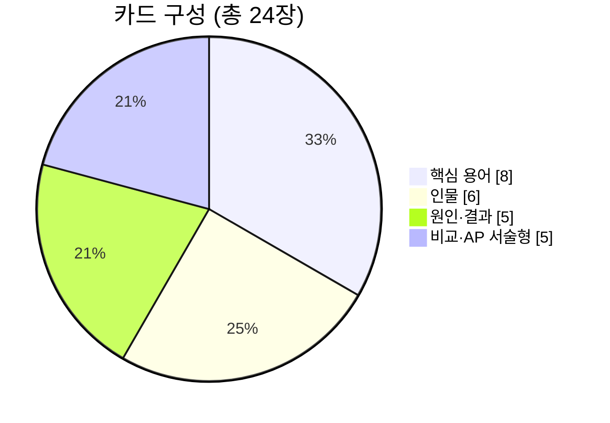

# 3.3 플래시카드 — Empires: Belief Systems (신앙 체계)
> 사용법: 질문을 읽고 답을 떠올린 뒤 **▶ 정답**을 눌러 확인하세요.
> 맞힌 카드는 `- [x]`로 체크해 두면 복습할 카드만 남길 수 있습니다.
> 교재가 아니라 College Board 과정 체계를 바탕으로 만들었습니다.

---

## 🅰️ 핵심 용어

- [ ] **1. 종교개혁 (Protestant Reformation)이란?**

▶ 정답

1517년 마르틴 루터가 시작한 16세기 운동. 가톨릭 교회에서 떨어져 나와 서방 기독교를 분열시킴

- [ ] **2. 면벌부 (Indulgences)란?**

▶ 정답

죄에 대한 벌을 줄여준다며 교회에 낸 돈. 면벌부 판매가 루터 비판의 핵심 대상

- [ ] **3. 가톨릭 (반)종교개혁이란?**

▶ 정답

가톨릭 교회의 대응. 트리엔트 공의회(1545–1563)에서 교리를 재확인하고 일부 폐단을 고쳤으며, 예수회가 신앙을 전파함

- [ ] **4. 예수회 (Jesuits)란?**

▶ 정답

이그나티우스 데 로욜라가 세운 가톨릭 수도회(1540 승인). 교육과 아시아·아메리카 선교에 힘씀

- [ ] **5. 베스트팔렌 조약 (1648)의 내용은?**

▶ 정답

30년 전쟁을 끝내고 국가 주권을 인정. 통치자가 자국의 종교를 결정

- [ ] **6. 시크교 (Sikhism)란?**

▶ 정답

1500년경 펀자브에서 구루 나나크가 창시한 신앙. 힌두교와 이슬람 사상을 결합: 유일신, 카스트 거부, 업과 윤회

- [ ] **7. 딘이 일라히 (Din-i Ilahi)란?**

▶ 정답

1582년 악바르가 궁정에서 장려한 혼합 신앙. 여러 종교의 요소를 섞음

- [ ] **8. 혼합주의 (Syncretism)란?**

▶ 정답

서로 다른 신앙 체계의 요소를 섞어 새로운 신앙을 만드는 것 (예: 시크교)

---

## 👤 인물

- [ ] **9. 마르틴 루터**

▶ 정답

95개조 반박문(1517)을 게시한 독일 수도사. 오직 믿음으로 구원받고, 오직 성경만이 권위라고 가르침

- [ ] **10. 장 칼뱅**

▶ 정답

제네바에서 활동한 개혁가. 예정설(신이 구원받을 사람을 이미 정해 두었다)을 가르침

- [ ] **11. 헨리 8세**

▶ 정답

혼인 문제로 교황과 결별한 영국 왕. 수장령(1534)으로 영국 국교회의 수장이 됨

- [ ] **12. 구루 나나크**

▶ 정답

북인도 펀자브에서 시크교를 창시한 인물 (1469–1539)

- [ ] **13. 악바르의 종교 정책**

▶ 정답

관용: 지즈야 폐지(1564), 여러 종교 간 토론 개최, 딘이 일라히 장려

- [ ] **14. 아우랑제브의 종교 정책**

▶ 정답

엄격한 수니 정통주의: 지즈야 부활(1679), 일부 힌두 사원 파괴, 시크교 구루 테그 바하두르 처형(1675)

---

## 🔗 원인·결과

- [ ] **15. 종교개혁의 원인 세 가지는?**

▶ 정답

교회의 부패(면벌부), 사상을 퍼뜨린 인쇄술, 권력과 교회 재산을 원한 군주들

- [ ] **16. 인쇄술은 종교개혁에 어떤 도움을 주었나?**

▶ 정답

루터의 글과 자국어 성경이 빠르게 퍼져, 사람들이 직접 성경을 읽고 교회의 가르침을 판단할 수 있게 됨

- [ ] **17. 종교개혁은 유럽 군주의 권력을 어떻게 바꾸었나?**

▶ 정답

교황은 권위를 잃고, 군주는 자기 영토의 종교와 교회 재산을 장악해 국가가 강해짐

- [ ] **18. 수니·시아 분열은 왜 정치 문제가 되었나?**

▶ 정답

수니 오스만과 시아 사파비가 종교로 통치를 정당화하고 지지를 모았기 때문. 그래서 국경 전쟁과 교역 다툼이 종교 경쟁이 됨

- [ ] **19. 아우랑제브의 정책은 어떤 결과를 낳았나?**

▶ 정답

힌두교도·시크교도의 반란, 시크교의 무장화(칼사, 1699), 무굴 제국 약화

---

## ⚖️ 비교·AP 서술형

- [ ] **20. 악바르와 아우랑제브를 비교하면?**

▶ 정답

악바르의 관용(지즈야 폐지, 종교 간 토론)은 힌두교도의 지지와 안정을 가져옴. 아우랑제브의 엄격한 정책(지즈야 부활)은 반란을 일으켜 제국을 약화시킴

- [ ] **21. 1450–1750년 기독교 분열과 수니·시아 분열의 공통점 하나는?**

▶ 정답

두 경우 모두 통치자가 종교 차이를 이용해 권력을 정당화했고, 그 결과 국가 간 전쟁이 일어남

- [ ] **22. 시크교가 혼합주의의 예인 이유는?**

▶ 정답

이슬람의 유일신·평등 사상과 힌두교의 업·윤회 사상을 결합했기 때문

- [ ] **23. 가톨릭 개혁과 개신교 종교개혁의 차이는?**

▶ 정답

개신교는 교회에서 떨어져 나감. 가톨릭 개혁은 교회의 권위를 지키면서 트리엔트에서 교리를 재확인하고 예수회 선교로 확장함

- [ ] **24. 베스트팔렌 조약의 장기적 영향 하나를 설명하면?**

▶ 정답

국가 주권을 확립함: 교황이 아니라 국가가 스스로의 일을 결정. 근대 국가 체제의 바탕이 됨

