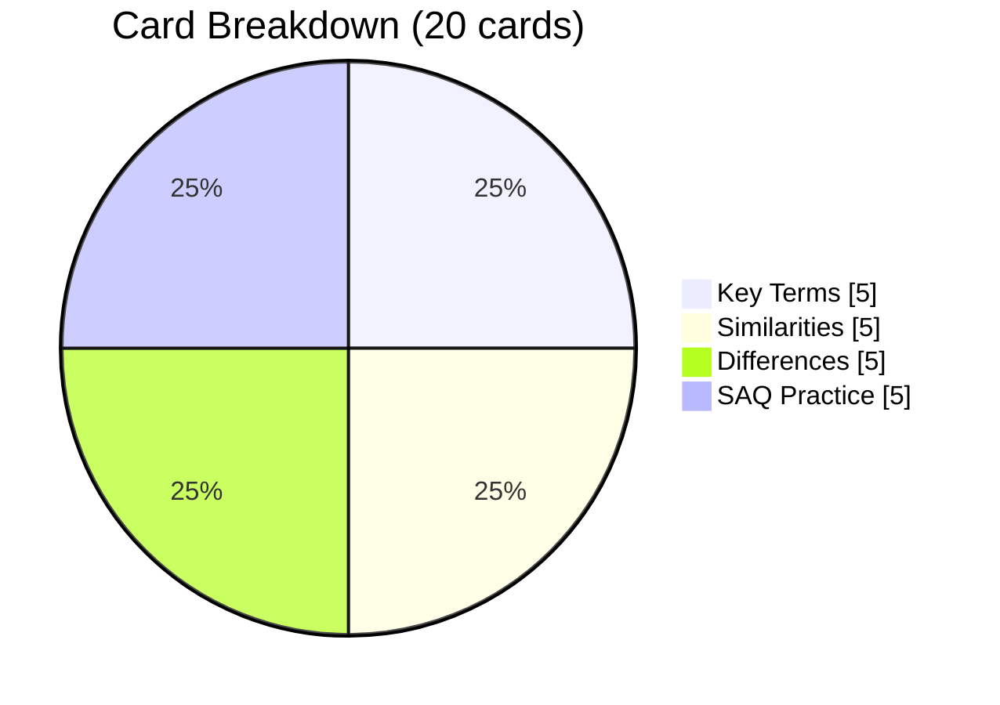

# 3.4 Flashcards — Comparison in Land-Based Empires
> How to use: read the question, recall the answer, then click **▶ Answer** to check.
> Check off cards you got right with `- [x]` so only the ones to review remain.
> Based on the College Board course framework, not your textbook.

---

## 🅰️ Key Terms

- [ ] **1. What was the millet system?**

▶ Answer

The Ottoman system that let religious communities (Christians, Jews) run their own religious and legal affairs in return for paying the jizya

- [ ] **2. What were the Manchu banners?**

▶ Answer

Qing military units, organized under banners, that kept Manchu soldiers as a separate, loyal elite

- [ ] **3. What was the queue?**

▶ Answer

A Manchu hairstyle (shaved forehead, long braid) that the Qing required of Han men as a sign of loyalty

- [ ] **4. Who were the Rajputs?**

▶ Answer

Hindu warrior rulers in northern India; Akbar won them over through marriage alliances and high posts

- [ ] **5. Land-based vs. maritime empire?**

▶ Answer

Land-based: power from armies, land taxes, and territory (Ottoman, Qing). Maritime: power from navies and overseas trade (Portugal, Britain, Unit 4)

---

## ✅ Similarities

- [ ] **6. What military technology did all the land-based empires share?**

▶ Answer

Gunpowder weapons (cannons and muskets) for conquest and defense

- [ ] **7. How did both the Ottomans and Russians use religion?**

▶ Answer

To legitimize rule: the Ottoman sultan claimed to be caliph; the tsar was protector of the Orthodox Church with divine right

- [ ] **8. What problem did the devshirme, mansabdars, and the Table of Ranks all solve?**

▶ Answer

Powerful nobles competing with the ruler; all three created officials whose position depended on serving the ruler

- [ ] **9. Name monuments from three different empires.**

▶ Answer

Taj Mahal (Mughal), Forbidden City (Qing), Süleymaniye Mosque (Ottoman), Isfahan (Safavid), St. Petersburg (Russia)

- [ ] **10. What population challenge did all these empires face?**

▶ Answer

Ruling many ethnic and religious groups, often with the ruling group as a minority

---

## ↔️ Differences

- [ ] **11. How did Ottoman and Safavid treatment of religious minorities differ?**

▶ Answer

Ottomans: millet system gave minorities self-rule. Safavids: pushed Shi'a conversion more forcefully

- [ ] **12. How did the Qing handle being a minority over the Han majority?**

▶ Answer

Kept Manchu identity (banners, queue) but adopted Chinese government, the civil service exam, and Confucianism

- [ ] **13. How did Mughal religious policy differ from Safavid policy?**

▶ Answer

The Mughals (especially Akbar) tolerated a Hindu majority; the Safavids made one form of Islam (Shi'a) the required state faith

- [ ] **14. How did Russia and the Qing respond differently to the West?**

▶ Answer

Russia westernized under Peter the Great; the Qing limited trade to Canton and rejected British demands

- [ ] **15. How was the Ottoman Empire unusual among land-based empires?**

▶ Answer

It also had a strong navy in the Mediterranean (until Lepanto, 1571)

---

## ✍️ SAQ Practice

- [ ] **16. Compare one method the Ottomans and Mughals used to keep power.**

▶ Answer

Both built loyal elites: Ottomans with the devshirme (Christian boys trained for service), Mughals with mansabdars (ranked, non-hereditary officials). Both reduced the power of hereditary nobles

- [ ] **17. Explain one difference between Akbar's and the Qing's approach to ruling a majority.**

▶ Answer

Akbar shared power through religious tolerance and Hindu officials; the Qing kept Manchus separate (banners, queue) while ruling through Chinese institutions

- [ ] **18. Explain why religious tolerance could strengthen an empire.**

▶ Answer

It lowered resistance from subject peoples and won elite support, so the empire spent less on putting down revolts (e.g., Akbar vs. Aurangzeb)

- [ ] **19. Explain how heavy taxation was both a strength and a weakness.**

▶ Answer

Strength: it paid for armies, officials, and monuments. Weakness: too much tax caused peasant revolts (Mughal, Safavid, White Lotus in Qing)

- [ ] **20. What three parts should an AP comparison answer have?**

▶ Answer

Claim (similarity or difference) → Evidence (specific term and date) → Reasoning (why it happened or why it worked)

