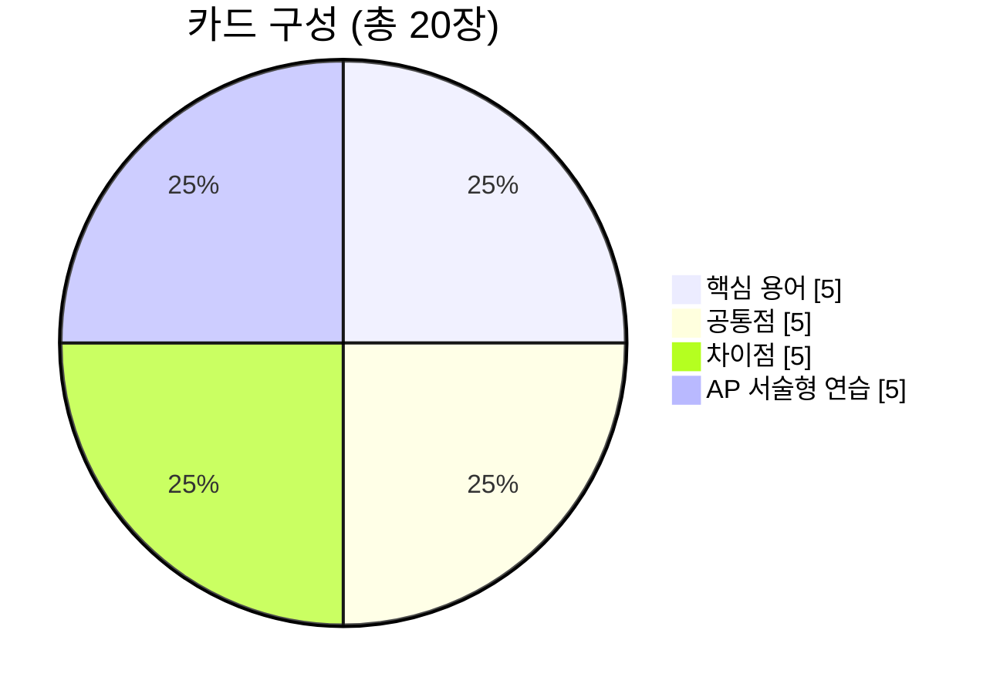

# 3.4 플래시카드 — Comparison in Land-Based Empires (육상 제국 비교)
> 사용법: 질문을 읽고 답을 떠올린 뒤 **▶ 정답**을 눌러 확인하세요.
> 맞힌 카드는 `- [x]`로 체크해 두면 복습할 카드만 남길 수 있습니다.
> 교재가 아니라 College Board 과정 체계를 바탕으로 만들었습니다.

---

## 🅰️ 핵심 용어

- [ ] **1. 밀레트 제도 (Millet system)란?**

▶ 정답

종교 공동체(기독교·유대교)가 지즈야를 내는 대신 종교·법률 문제를 스스로 처리하게 한 오스만 제도

- [ ] **2. 만주 팔기 (Manchu banners)란?**

▶ 정답

깃발(기)별로 편성한 청의 군사 조직. 만주족 군인을 충성스러운 별도 엘리트로 유지함

- [ ] **3. 변발 (Queue)이란?**

▶ 정답

앞머리를 밀고 뒷머리를 길게 땋는 만주식 머리 모양. 청이 한족 남성에게 충성의 표시로 강요함

- [ ] **4. 라지푸트 (Rajputs)란?**

▶ 정답

북인도의 힌두 무사 통치자들. 악바르가 혼인 동맹과 고위직으로 자기편으로 만듦

- [ ] **5. 육상 제국과 해양 제국의 차이는?**

▶ 정답

육상 제국: 군대·토지세·영토로 권력을 얻음 (오스만, 청). 해양 제국: 해군·해외 교역으로 권력을 얻음 (포르투갈, 영국, Unit 4)

---

## ✅ 공통점

- [ ] **6. 모든 육상 제국이 공통으로 쓴 군사 기술은?**

▶ 정답

정복과 방어에 쓴 화약 무기 (대포와 소총)

- [ ] **7. 오스만과 러시아는 종교를 어떻게 활용했나?**

▶ 정답

통치를 정당화하는 데 활용. 오스만 술탄은 칼리프를 자처했고, 차르는 신권을 가진 동방정교회의 보호자였음

- [ ] **8. Devshirme, mansabdar, 관등표가 공통으로 해결한 문제는?**

▶ 정답

통치자와 경쟁하는 강한 귀족. 셋 다 지위가 통치자에 대한 봉사에 달린 관료를 만들어냄

- [ ] **9. 서로 다른 세 제국의 기념비 건축을 말해보면?**

▶ 정답

타지마할(무굴), 자금성(청), 쉴레이마니예 모스크(오스만), 이스파한(사파비), 상트페테르부르크(러시아)

- [ ] **10. 이 제국들이 공통으로 겪은 인구 구성의 과제는?**

▶ 정답

여러 민족과 종교 집단을 다스려야 했고, 지배층이 소수인 경우가 많았음

---

## ↔️ 차이점

- [ ] **11. 오스만과 사파비는 종교적 소수를 어떻게 다르게 대했나?**

▶ 정답

오스만: 밀레트 제도로 소수 공동체에 자치를 허용. 사파비: 시아파 개종을 더 강하게 밀어붙임

- [ ] **12. 청은 한족 다수를 다스리는 소수 지배층으로서 어떻게 대응했나?**

▶ 정답

만주족 정체성(팔기, 변발)은 지키면서 중국식 정부·과거제·유교를 받아들임

- [ ] **13. 무굴과 사파비의 종교 정책 차이는?**

▶ 정답

무굴(특히 악바르)은 힌두교도 다수를 관용함. 사파비는 이슬람의 한 종파(시아파)를 국교로 강제함

- [ ] **14. 러시아와 청은 서양에 어떻게 다르게 대응했나?**

▶ 정답

러시아는 표트르 대제 때 서구화함. 청은 교역을 광저우로 제한하고 영국의 요구를 거절함

- [ ] **15. 오스만이 육상 제국 중에서 특이했던 점은?**

▶ 정답

지중해에서 강한 해군도 가졌음 (레판토 해전, 1571년 전까지)

---

## ✍️ AP 서술형 연습

- [ ] **16. 오스만과 무굴이 권력을 유지한 방법 하나를 비교하면?**

▶ 정답

둘 다 충성스러운 엘리트를 길렀음. 오스만은 devshirme(기독교도 소년을 데려와 훈련), 무굴은 mansabdar(세습되지 않는 등급제 관료)를 씀. 두 방식 모두 세습 귀족의 힘을 줄임

- [ ] **17. 악바르와 청이 다수 주민을 다스린 방식의 차이 하나는?**

▶ 정답

악바르는 종교적 관용과 힌두교도 관료 등용으로 권력을 나눔. 청은 만주족을 따로 유지하면서(팔기, 변발) 중국식 제도로 다스림

- [ ] **18. 종교적 관용이 제국을 강하게 만들 수 있는 이유는?**

▶ 정답

백성의 저항이 줄고 엘리트의 지지를 얻어 반란 진압에 드는 비용이 적어지기 때문 (예: 악바르 vs 아우랑제브)

- [ ] **19. 무거운 세금이 강점이자 약점이었던 이유는?**

▶ 정답

강점: 군대·관료·건축 비용을 댈 수 있음. 약점: 세금이 지나치면 농민 반란이 일어남 (무굴, 사파비, 청의 백련교의 난)

- [ ] **20. AP 비교 답안에 들어가야 할 세 부분은?**

▶ 정답

주장(공통점 또는 차이점) → 근거(구체적 용어와 연도) → 설명(왜 일어났는지, 왜 효과가 있었는지)

