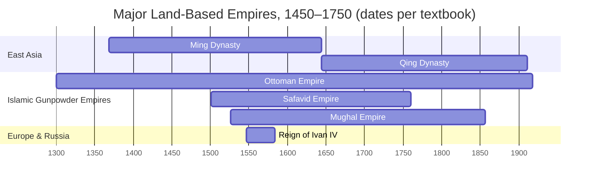
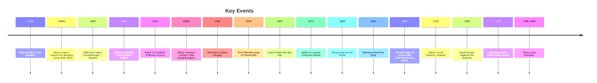
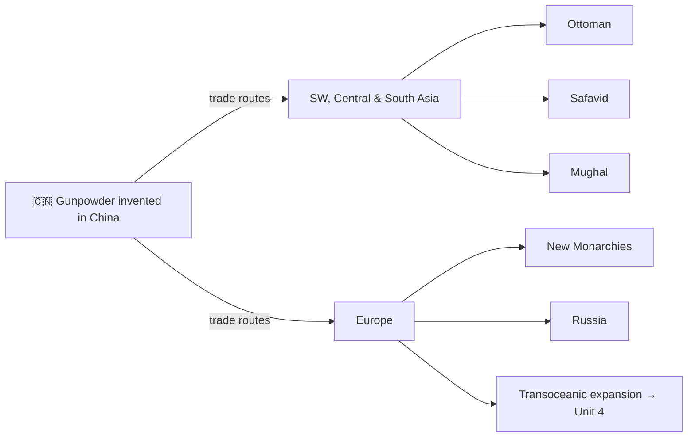
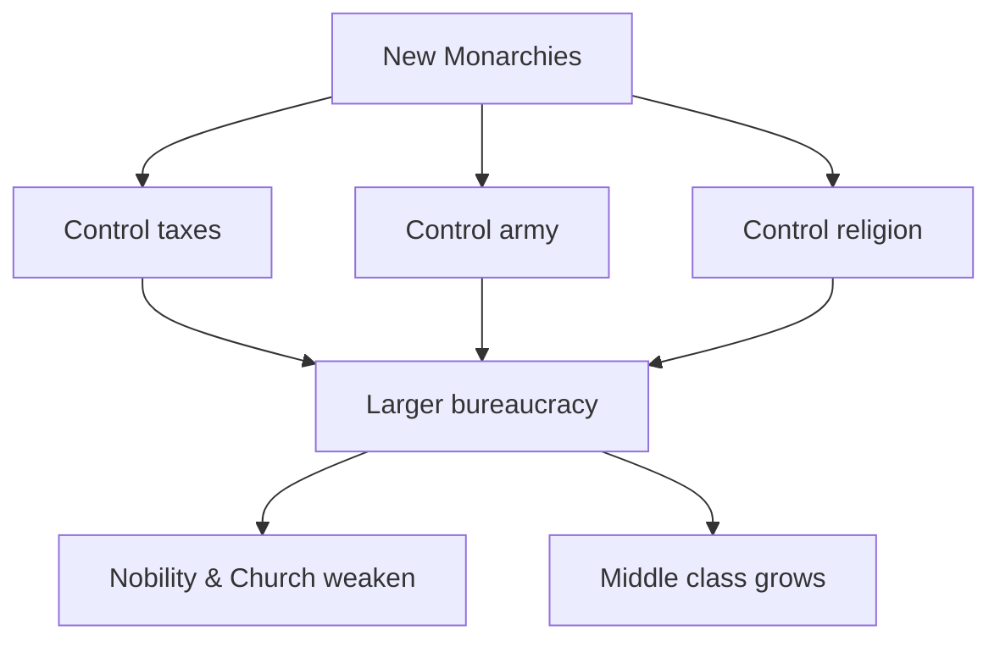
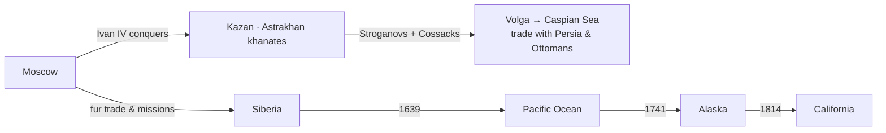
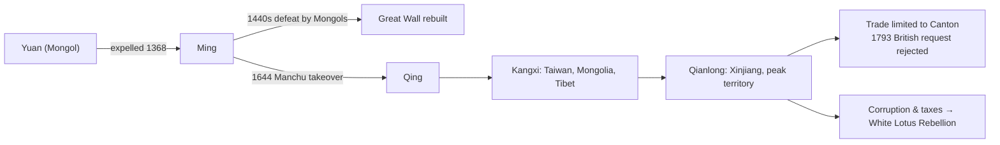
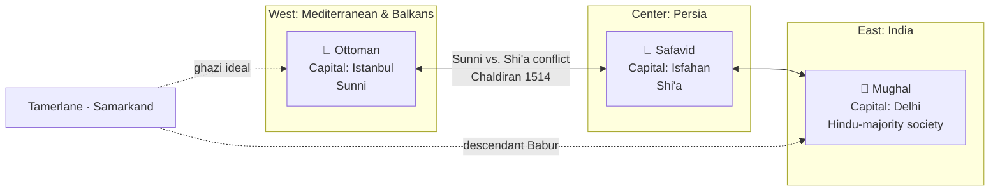
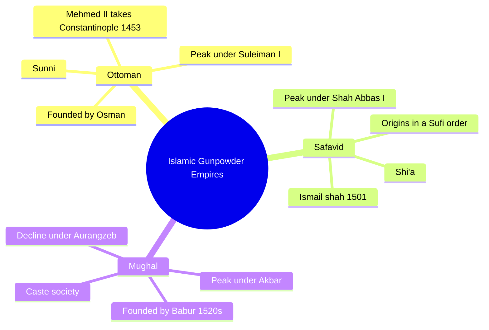
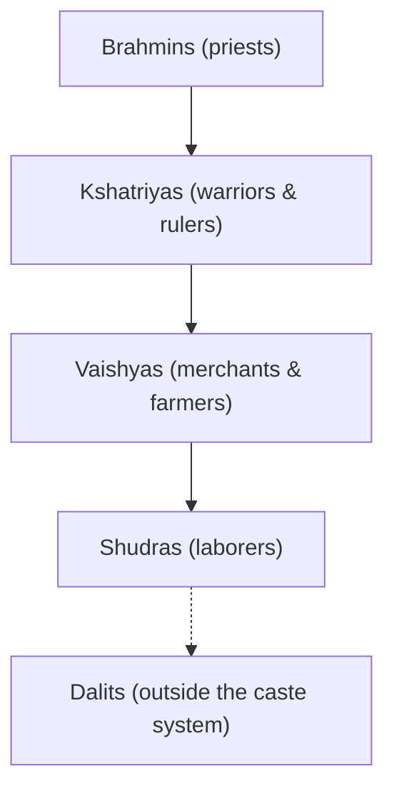
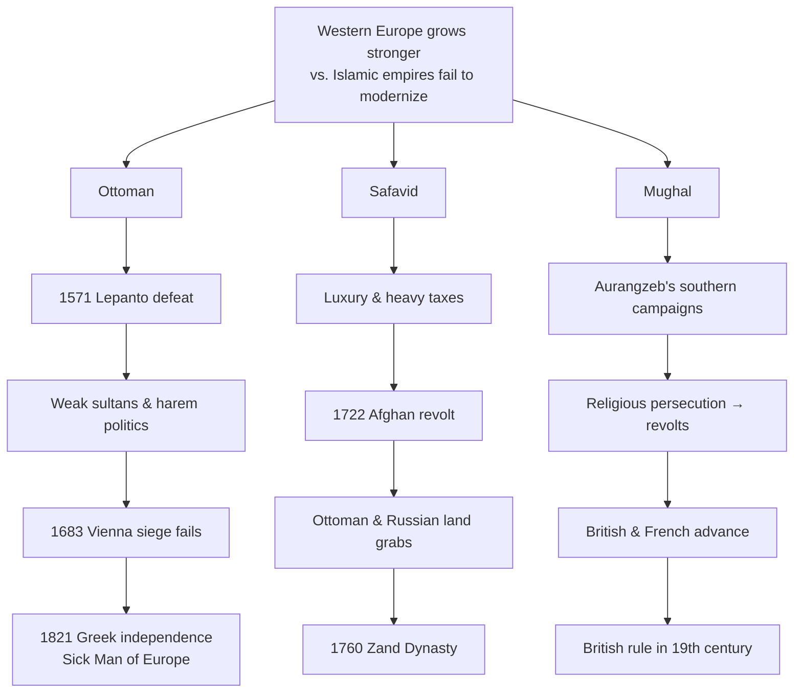

# 3.1 European, East Asian, and Gunpowder Empires Expand
> **Essential Question:** How did certain land-based empires develop and expand between 1450 and 1750?

---

## 🗓️ Timeline at a Glance

### Empire Lifespans

### Key Events

---

## 📌 Overview
- Gunpowder spread from China along trade routes and drove major change from 1450 to 1750
- **Gunpowder Empires**: large, multiethnic states in Southwest, Central, and South Asia that used firearms to conquer and hold territory
  - **Ottoman, Safavid, Mughal**, all strongly shaped by Islam
- **Qing (China)**: expanded despite repeated invasions and enjoyed long periods of stability
- **Europe**: built an even wider exchange network through transoceanic links with the Americas (Unit 4)
- **Armed trade**: empires traded with each other but kept troops ready at all times, unlike the free markets of later eras

---

## 🏰 Europe
- **1450**: traditionally marks the end of the medieval period and the start of the early modern period
  - Waves of plague ended, and so did the **Hundred Years' War** (England vs. France)
  - The **Gutenberg printing press** led to a rise in literacy
- **New monarchies (1500s)**: centralized power by taking control of taxes, the army, and religion
  - **Tudors** (England), **Valois** (France), **Ferdinand & Isabella** (Spain)
  - Bureaucracies grew, and the **middle class rose** as nobles and the Church lost power

---

## 🐻 Russia
- Identity caught between Europe and Asia: shaped by Mongol rule, Kievan Rus', and Viking raids
- **Ivan IV (Ivan the Terrible, r. 1547–1584)**
  - First to use the title **tsar** (1547)
  - Conquered the **Kazan, Astrakhan, and Siberia** khanates, remnants of the Mongol Golden Horde
- **Control of the Volga**: the **Stroganov** family hired **Cossacks** to take control of the Volga region
  - Secured access to the Caspian Sea for trade with Persia and the Ottomans
- **To the Pacific**
  - Fur traders and military forces pushed east
  - Missionaries converted local peoples to **Eastern Orthodoxy**
  - Reached the Pacific in **1639**, then set up trading posts as far as Alaska (1741) and California (1814)

### Russian Expansion Route (map replacement)

---

## 🐉 East Asia

### Ming Dynasty (1368–1644)
- Overthrew the Yuan and stabilized East Asia for nearly 300 years
- Portuguese and other European traders arrived
- Expanded into Mongolia and Central Asia but could not hold those gains
- **1440s**: an emperor was captured after a defeat by the Mongols → **Great Wall rebuilt**
- **1644**: the Manchus seized power and founded the **Qing Dynasty** (lasted until 1911)

### Qing Dynasty (1644–1911)
| Emperor | Reign | Key Points |
|---|---|---|
| **Kangxi** | 1661–1722 | One of the longest-reigning emperors; led an era of stability and expansion. Absorbed Taiwan, Mongolia, and Central Asia; made Tibet a protectorate |
| **Qianlong** | 1736–1796 | Poet and patron of the arts; largest territory. Annexed **Xinjiang** (Uyghurs), sent troops into Tibet, succeeded against Nepal. Campaigns in Burma and Vietnam failed and were costly |

- **Conflicts with the West**
  - The Qing limited European trade to a single port, **Canton (Guangzhou)**
  - In 1793 Britain asked to expand trade; Qianlong told George III that China had no need for British goods
- **White Lotus Rebellion (1796–1804)**: a peasant revolt caused by late-reign corruption and heavy taxes; about 100,000 people died during its suppression

### From Ming to Qing

---

## ☪️ Rise of the Islamic Gunpowder Empires

### Shared Traits
1. Descended from **Turkic nomads** of Central Asia
2. Spoke a **Turkic language**
3. Exploited the **power vacuum** left by the breakup of the Mongol khanates
4. Relied on **gunpowder weapons** such as cannons

→ Early success came from **military strength** and the weakness or corruption of earlier rulers

### The Rule of Tamerlane (Timur the Lame, late 14th century)
- Mongol-Turkic ruler who conquered from Persia to India; capital at **Samarkand**
- Reportedly massacred about 100,000 Hindus in Delhi
- **Ghazi ideal**: the ideal of the warrior fighting for Islam
- Patron of learning and the arts
- His empire fell apart soon after his death, but it left a model of conquest and a cultural legacy
- His descendant **Babur** founded the Mughal Empire

### Locations of the Three Islamic Empires (map replacement)

### Comparing the Three Empires

---

## 🌙 The Ottoman Empire (1300s–1918)
- Founded by **Osman**; lasted more than 600 years, until just after World War I
- **Mehmed II (the Conqueror, r. 1451–1481)**
  - **Conquered Constantinople in 1453** and renamed it **Istanbul**
  - Used giant cannons and took control of the **Bosporus Strait**
  - Pushed into the Balkans and the Black Sea; could not conquer Venice but forced it to pay yearly tribute
- Early 16th century: expanded into Syria, Israel, Egypt, and Algeria. After defeating the **Mamluks**, Istanbul became the center of the Islamic world
- **Suleiman I (the Magnificent, r. 1520–1566)**: the empire's peak
  - Conquered Rhodes (1522) and Hungary (1526)
  - **Failed siege of Vienna** (1529)
  - Built up Mediterranean naval power and took Tripoli in North Africa

---

## 🕌 The Safavids (1501–1760s)
- Began as the **Safavid order of Sufism** (northern Azerbaijan)
- **Ismail**: conquered Persia and proclaimed himself **shah** in 1501
- Weaknesses: no navy, and a border with the powerful Ottomans
- **Shah Abbas I (r. 1588–1629)**: the empire's peak
  - Took Christian boys and trained them as soldiers
  - Imported European weapons and used Europeans as military advisers
- Made **Shi'a Islam** the core of state unity → conflict with the **Sunni** Ottomans
  - Defeated by the Ottomans at the **Battle of Chaldiran** (near Tabriz) in 1514
  - Shi'a–Sunni tension still affects present-day Iran and Iraq
- The Ottomans placed an embargo on the Safavid **silk trade**
- **Women**: veiled and restricted, but had inheritance rights under Islamic law and could sometimes divorce

---

## 🐘 Mughal India (1520s–1800s)
- Founded by **Babur** (a descendant of Timur), who conquered northern India in the 1520s
- **Akbar**: the ruler who made the empire its strongest and richest
- Economy: Arab merchants handled trade; textiles, tropical foods, spices, and gems were exchanged for gold and silver
- **Castes**: Brahmins, Kshatriyas, Vaishyas, Shudras, plus the **Dalits** outside the system
- Architectural legacy shows the empire's wealth and refined culture

---

## 📉 Decline of the Gunpowder Empires
- As Western Europe grew stronger economically and militarily, the Islamic empires failed to modernize. Russia modernized successfully

| Empire | Causes of Decline |
|---|---|
| **Ottoman** | Defeat at the **Battle of Lepanto** (1571) by a Spanish-Venetian force. Weak sultans and **harem politics**. **Failed siege of Vienna (1683)** was the turning point. Greek independence (1821) → **"Sick Man of Europe"** |
| **Safavid** | Lavish rulers and heavy taxes after Abbas. **Afghan revolt (1722)**; Mahmud declared himself shah. Ottomans and Russians seized territory. Replaced by the **Zand Dynasty** in 1760 |
| **Mughal** | **Aurangzeb (r. 1658–1707)**: southern expansion drained the treasury; persecution of Sikhs, Hindus, and other religious minorities sparked revolts. After his death Britain and France expanded their influence; Britain ruled by the 19th century |

---

## 🔑 Key Terms by Theme
| GOVERNMENT: China | GOVERNMENT: Turkic | GOVERNMENT: Leaders |
|---|---|---|
| Ming Dynasty | Gunpowder Empires | Ivan IV (Russia) |
| Manchu | Ottoman Empire | Tamerlane |
| Qing Dynasty | shah | Suleiman I (Ottoman) |
| Kangxi | Safavid Empire | Ismail (Safavid) |
| Emperor Qianlong | Mughal Empire | Shah Abbas I (Safavid) |
| | | Akbar (Mughal) |

| TECHNOLOGY | SOCIETY: Turkic |
|---|---|
| Gutenberg printing press | ghazi ideal, castes |

---

## 📝 AP Practice Questions (Textbook p.184)
> Long Essay Questions from the end of Unit 3. Suggested writing time: 40 minutes. Full question list: see the index in the 3.4 notes.

### LEQ 3: Southern & Southwestern Asia
> New technology, including gunpowder weapons, shaped empires throughout southern and southwestern Asia from 1450–1750.
> Develop an argument that evaluates the extent to which various land-based empires in southern and southwestern Asia developed in similar ways from 1450–1750.

- **Reasoning skill:** Comparison
- **Empires:** Ottoman, Safavid, Mughal
- **Possible thesis:** The three empires developed in largely similar ways (Turkic origins, gunpowder conquest, Islamic legitimacy), but they differed sharply in how they treated religious minorities.
- **Evidence from these notes:** Mehmed II's cannons at Constantinople (1453), Chaldiran (1514), Babur's conquest (1520s); Sunni vs. Shi'a; shared causes of decline
- **See also:** 3.2 (devshirme, ghulams, mansabdars), 3.3 (Akbar vs. Aurangzeb), 3.4 (comparison table)

### LEQ 4: Russia & China
> New technology, including gunpowder weapons, shaped empires in Russia and China from 1450–1750.
> Develop an argument that evaluates the extent to which various land-based empires in Russia and China developed in similar ways from 1450–1750.

- **Reasoning skill:** Comparison
- **Empires:** Russia (Ivan IV → Peter the Great), Ming → Qing
- **Possible thesis:** Both expanded across Inner Asia with gunpowder armies and ruled many different peoples, but they responded to Western Europe in opposite ways.
- **Evidence from these notes:** Ivan IV's conquest of Kazan and Astrakhan, reaching the Pacific (1639); Kangxi and Qianlong adding Taiwan, Mongolia, Tibet, and Xinjiang; trade limited to Canton, 1793 rejection
- **See also:** 3.2 (Table of Ranks, Peter's westernization, civil service exam), 3.4 (comparison table)
