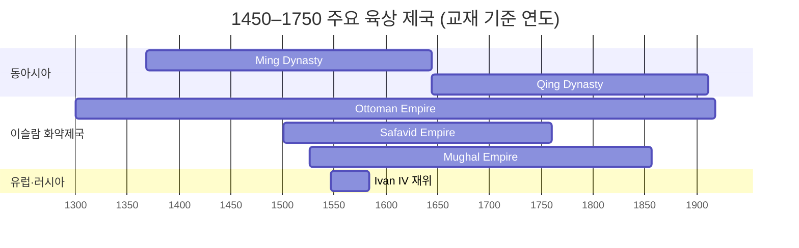
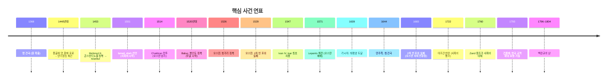
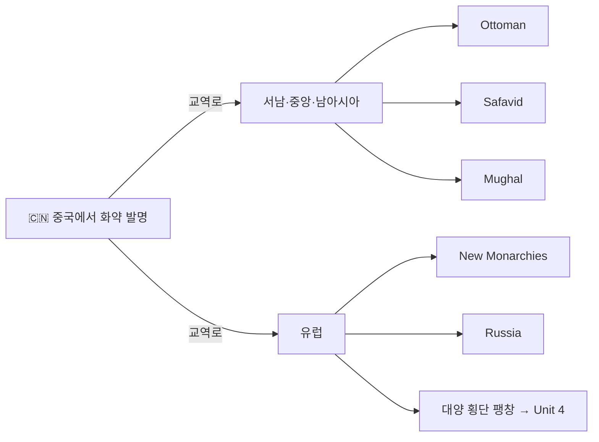
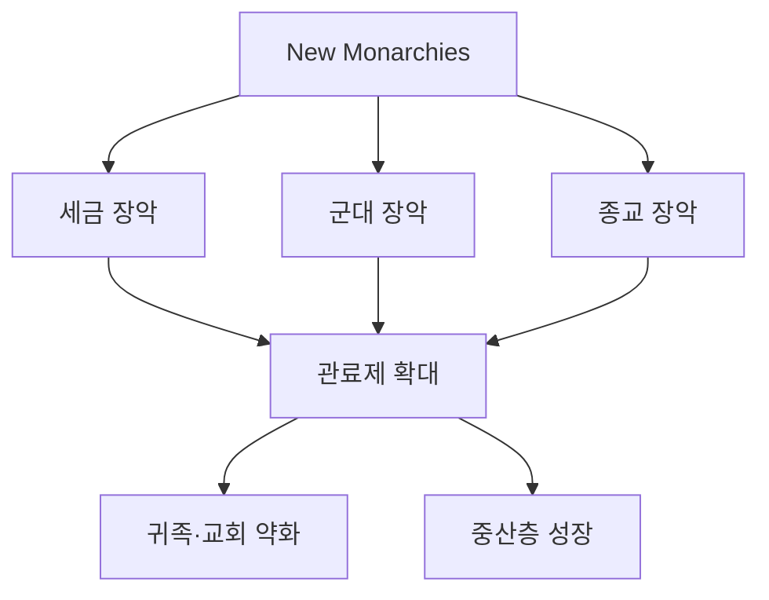
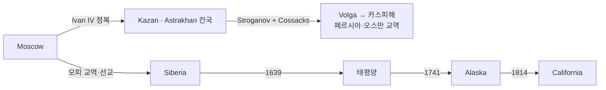
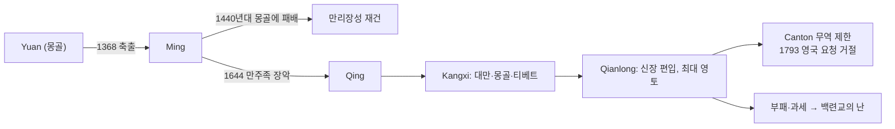
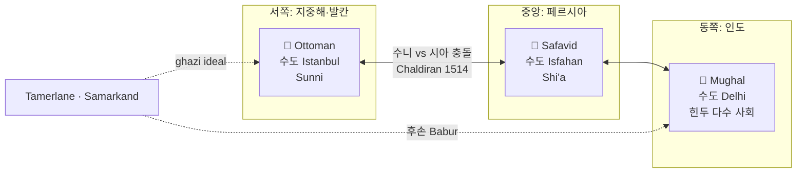
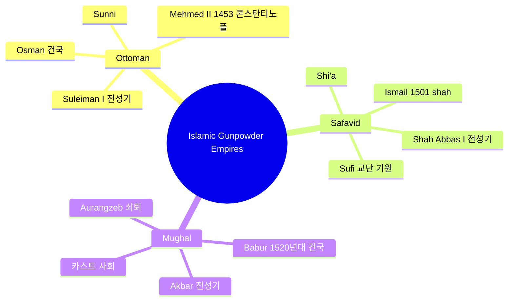
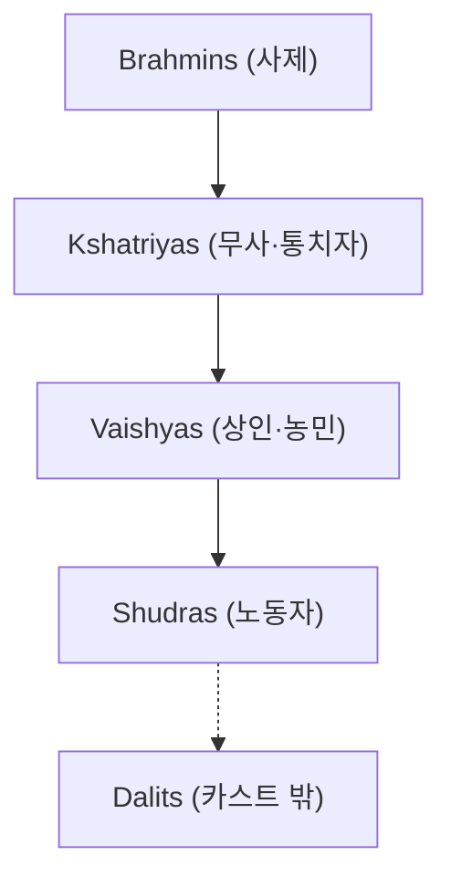
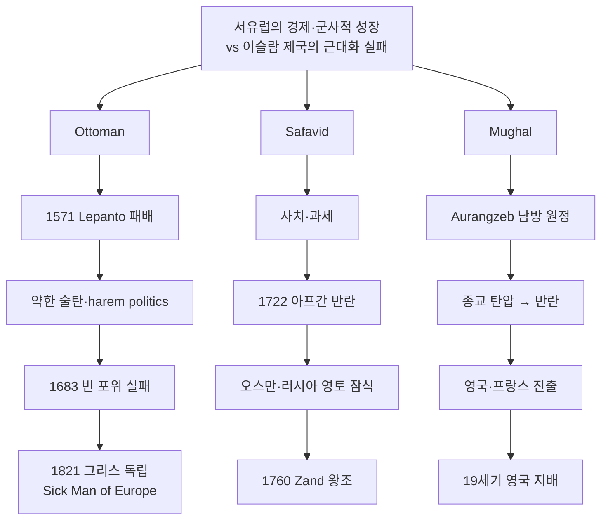

# 3.1 European, East Asian, and Gunpowder Empires Expand
> **Essential Question:** 1450–1750년, 일부 육상 제국은 어떻게 발전하고 확장했는가?

---

## 🗓️ 한눈에 보는 연표

### 제국별 존속 기간

### 주요 사건

---

## 📌 개요
- 화약은 중국에서 시작해 교역로를 따라 퍼졌고, 1450–1750년에 큰 변화를 일으킴
- **Gunpowder Empires**: 화약 무기로 영토를 정복하고 통제한 서남·중앙·남아시아의 크고 다민족적인 국가들
  - **Ottoman, Safavid, Mughal**. 셋 다 이슬람의 영향이 강함
- **Qing (청)**: 여러 차례 침략을 받으면서도 영토를 넓혔고, 오랫동안 안정을 누림
- **Europe**: 아메리카와의 대양 횡단 연결로 더 넓은 교환망을 만듦 (Unit 4)
- **Armed trade (무장 교역)**: 제국들은 서로 교역하면서도 군대를 늘 대기시킴. 이후 시대의 자유시장과는 다른 방식

---

## 🏰 Europe
- **1450년**: 흔히 중세가 끝나고 근대 초기가 시작된 해로 봄
  - 전염병 유행이 끝나고, **백년전쟁**(영국 vs 프랑스)이 끝남
  - **Gutenberg printing press**가 나오면서 글을 읽는 사람이 늘어남
- **New monarchies (1500년대)**: 세금·군대·종교를 장악해 권력을 중앙에 모음
  - 영국 **Tudors**, 프랑스 **Valois**, 스페인 **Ferdinand & Isabella**
  - 관료제가 커지고, 귀족과 교회가 힘을 잃는 만큼 **중산층이 성장**함

---

## 🐻 Russia
- 유럽과 아시아 사이의 정체성: 몽골 통치, 키예프 루스, 바이킹 침입의 영향을 받음
- **Ivan IV (Ivan the Terrible, r. 1547–1584)**
  - 1547년 **tsar** 칭호를 처음 사용
  - 몽골 금장한국에서 갈라져 나온 **Kazan, Astrakhan, Siberia** 칸국을 정복
- **Control of the Volga**: **Stroganov** 가문이 **Cossacks**를 고용해 볼가강 일대를 장악
  - 카스피해로 나가는 길을 확보해 페르시아·오스만과 교역
- **To the Pacific**
  - 모피 상인과 군사 세력이 동쪽으로 진출
  - 선교사들이 현지 주민을 **동방정교**로 개종시킴
  - **1639년** 태평양에 도달 → 알래스카(1741), 캘리포니아(1814)까지 교역 거점 설치

### 러시아 팽창 경로 (지도 대체)

---

## 🐉 East Asia

### Ming Dynasty (1368–1644)
- 원나라를 무너뜨리고 약 300년 동안 통치하며 동아시아를 안정시킴
- 포르투갈 등 유럽 상인들이 들어옴
- 몽골·중앙아시아로 영토를 넓혔지만 지켜내지 못함
- **1440년대** 몽골군에 패해 황제가 포로로 잡힘 → **만리장성 재건**
- **1644년** 만주족이 권력을 잡고 **Qing Dynasty**를 세움 (1911년까지)

### Qing Dynasty (1644–1911)
| 황제 | 재위 | 핵심 내용 |
|---|---|---|
| **Kangxi** | 1661–1722 | 가장 오래 재위한 황제 중 한 명. 안정과 확장의 시대를 이끔. 대만·몽골·중앙아시아 편입, 티베트를 보호령으로 삼음 |
| **Qianlong** | 1736–1796 | 시인이자 예술 후원자. 영토 최대. **Xinjiang(신장)** 편입(위구르인), 티베트에 군대 파견, 네팔 원정 성공. 버마·베트남 원정은 실패하고 비용만 큼 |

- **Conflicts with the West**
  - 청은 유럽과의 교역을 **광저우(Canton)** 한 곳으로 제한함
  - 1793년 영국이 교역 확대를 요청했지만, 건륭제는 조지 3세에게 "중국은 영국 상품이 필요 없다"고 답함
- **White Lotus Rebellion (1796–1804)**: 말기의 부패와 무거운 세금 때문에 일어난 농민 반란. 진압 과정에서 약 10만 명이 사망

### 명 → 청 흐름

---

## ☪️ Rise of the Islamic Gunpowder Empires

### 공통점
1. 중앙아시아의 **튀르크계 유목민** 출신
2. **튀르크어** 사용
3. 몽골 칸국들이 무너진 뒤 생긴 **권력 공백**을 이용
4. 대포 같은 **화약 무기**에 의존

→ 처음 성공할 수 있었던 이유는 **군사력**과, 이전 지배 세력의 약화·부패

### The Rule of Tamerlane (Timur the Lame, 14세기 후반)
- 몽골·튀르크계 통치자. 페르시아에서 인도까지 정복했고 수도는 **Samarkand**
- 델리에서 약 10만 명의 힌두교도를 학살했다고 전해짐
- **Ghazi ideal**: 이슬람을 위해 싸우는 전사의 이상
- 학문과 예술을 후원함
- 죽은 뒤 제국은 빠르게 무너졌지만, 정복 방식과 문화적 유산을 남김
- 후손 **Babur**가 무굴 제국을 세움

### 세 이슬람 제국의 위치 (지도 대체)

### 세 제국 비교

---

## 🌙 The Ottoman Empire (1300s–1918)
- **Osman**이 세움. 제1차 세계대전 직후까지 600년 넘게 존속
- **Mehmed II (the Conqueror, r. 1451–1481)**
  - **1453년 Constantinople 정복** → 이름을 **Istanbul**로 바꿈
  - 거대한 대포를 사용했고, **보스포루스 해협**을 장악
  - 발칸·흑해까지 진출. 베네치아는 정복하지 못했지만 매년 공물을 받아냄
- 16세기 초: 시리아·이스라엘·이집트·알제리까지 확장. **Mamluk**을 무너뜨린 뒤 이스탄불이 이슬람 세계의 중심이 됨
- **Suleiman I (the Magnificent, r. 1520–1566)**: 제국의 전성기
  - 1522년 Rhodes, 1526년 Hungary 정복
  - 1529년 **Vienna 포위 실패**
  - 지중해 해군력을 키우고 북아프리카 트리폴리를 장악

---

## 🕌 The Safavids (1501–1760s)
- **Sufism의 Safavid 교단**에서 시작 (북부 아제르바이잔)
- **Ismail**: 페르시아를 정복하고 1501년 **shah**를 선언
- 약점: 해군이 없었음 + 강력한 오스만과 맞닿아 있었음
- **Shah Abbas I (r. 1588–1629)**: 전성기
  - 기독교도 소년을 데려다 군인으로 훈련시킴
  - 유럽에서 무기를 들여오고, 유럽인을 군사 고문으로 씀
- **Shi'a Islam**을 국가 통합의 중심으로 삼음 → **Sunni** 오스만과 충돌
  - 1514년 **Chaldiran 전투**(타브리즈 인근)에서 오스만에 패함
  - 시아·수니 갈등은 오늘날 이란·이라크 지역에도 남아 있음
- 오스만이 사파비 **비단 교역**에 금수 조치를 내림
- **Women**: 베일을 쓰고 생활이 제한됐지만, 이슬람법에 따라 상속권이 있었고 경우에 따라 이혼도 가능했음

---

## 🐘 Mughal India (1520s–1800s)
- **Babur**(티무르의 후손)가 1520년대 북인도를 정복하고 세움
- **Akbar**: 제국을 가장 강하고 부유하게 만든 통치자
- 경제: 아랍 상인이 교역을 맡음. 직물·열대 식품·향신료·보석을 금·은과 교환
- **Castes (카스트)**: Brahmins, Kshatriyas, Vaishyas, Shudras + 카스트 밖의 **Dalits**
- 건축 유산이 무굴 제국의 부와 수준 높은 문화를 보여줌

---

## 📉 Decline of the Gunpowder Empires
- 서유럽이 경제·군사적으로 강해지는 동안 이슬람 제국들은 근대화하지 못함. 러시아는 근대화에 성공

| 제국 | 쇠퇴 요인 |
|---|---|
| **Ottoman** | 1571년 **Lepanto 해전** 패배(스페인·베네치아 연합). 약한 술탄들과 **harem politics**. **1683년 빈 포위 실패**가 전환점. 1821년 그리스 독립 → **"Sick Man of Europe"** |
| **Safavid** | Abbas 이후 통치자들의 사치와 무거운 세금. **1722년 아프간 반란**으로 Mahmud가 샤를 자칭. 오스만·러시아가 영토를 빼앗음. 1760년 **Zand Dynasty**로 교체 |
| **Mughal** | **Aurangzeb (r. 1658–1707)**: 남쪽 확장으로 재정 고갈. 시크교도·힌두교도 등 소수 종교를 탄압해 반란이 일어남. 그가 죽은 뒤 영국·프랑스가 영향력을 넓혔고, 19세기 영국이 지배 |

---

## 🔑 Key Terms by Theme
| GOVERNMENT: China | GOVERNMENT: Turkic | GOVERNMENT: Leaders |
|---|---|---|
| Ming Dynasty | Gunpowder Empires | Ivan IV (Russia) |
| Manchu | Ottoman Empire | Tamerlane |
| Qing Dynasty | shah | Suleiman I (Ottoman) |
| Kangxi | Safavid Empire | Ismail (Safavid) |
| Emperor Qianlong | Mughal Empire | Shah Abbas I (Safavid) |
| | | Akbar (Mughal) |

| TECHNOLOGY | SOCIETY: Turkic |
|---|---|
| Gutenberg printing press | ghazi ideal, castes |

---

## 📝 AP 연습 문제 (교재 p.184)
> Unit 3 끝에 있는 서술형 문제(LEQ)입니다. 권장 시간은 40분입니다. 답안은 영어로 써야 하므로 문제는 원문 그대로 두고 번역을 함께 적었습니다. 전체 문제 목록은 3.4 노트의 색인표를 보세요.

### LEQ 3: 남아시아·서남아시아
> New technology, including gunpowder weapons, shaped empires throughout southern and southwestern Asia from 1450–1750.
> Develop an argument that evaluates the extent to which various land-based empires in southern and southwestern Asia developed in similar ways from 1450–1750.

**번역:** 1450–1750년, 화약 무기를 비롯한 새로운 기술이 남아시아와 서남아시아 제국들을 형성했다. 이 지역의 여러 육상 제국이 어느 정도 비슷한 방식으로 발전했는지 평가하는 논증을 전개하라.

- **역사적 사고 기술:** 비교 (Comparison)
- **비교할 제국:** 오스만, 사파비, 무굴
- **논지 예시:** 세 제국은 튀르크계 기원, 화약을 이용한 정복, 이슬람에 기댄 정통성이라는 점에서 대체로 비슷하게 발전했지만, 종교적 소수를 대하는 방식은 크게 달랐다.
- **이 노트의 근거:** 메흐메트 2세의 콘스탄티노플 대포(1453), 찰디란 전투(1514), 바부르의 정복(1520년대), 수니 vs 시아, 공통된 쇠퇴 원인
- **함께 볼 노트:** 3.2 (devshirme, ghulams, mansabdar), 3.3 (악바르 vs 아우랑제브), 3.4 (종합 비교표)

### LEQ 4: 러시아와 중국
> New technology, including gunpowder weapons, shaped empires in Russia and China from 1450–1750.
> Develop an argument that evaluates the extent to which various land-based empires in Russia and China developed in similar ways from 1450–1750.

**번역:** 1450–1750년, 화약 무기를 비롯한 새로운 기술이 러시아와 중국의 제국들을 형성했다. 두 지역의 육상 제국이 어느 정도 비슷한 방식으로 발전했는지 평가하는 논증을 전개하라.

- **역사적 사고 기술:** 비교 (Comparison)
- **비교할 제국:** 러시아 (이반 4세 → 표트르 대제), 명 → 청
- **논지 예시:** 두 제국은 화약 군대로 내륙 아시아에 걸쳐 영토를 넓히고 여러 민족을 다스렸지만, 서유럽에는 정반대로 대응했다.
- **이 노트의 근거:** 이반 4세의 카잔·아스트라한 정복, 태평양 도달(1639), 강희제·건륭제의 대만·몽골·티베트·신장 편입, 광저우 교역 제한과 1793년 영국 요청 거절
- **함께 볼 노트:** 3.2 (관등표, 표트르의 서구화, 과거제), 3.4 (종합 비교표)
