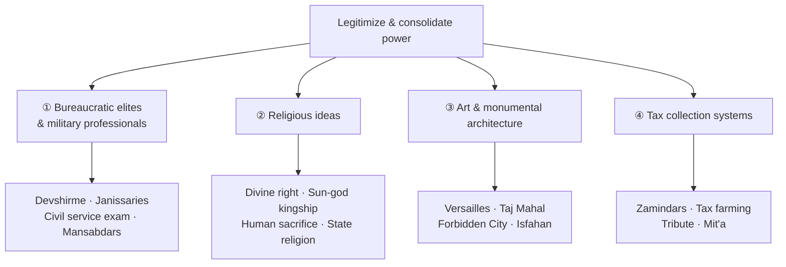
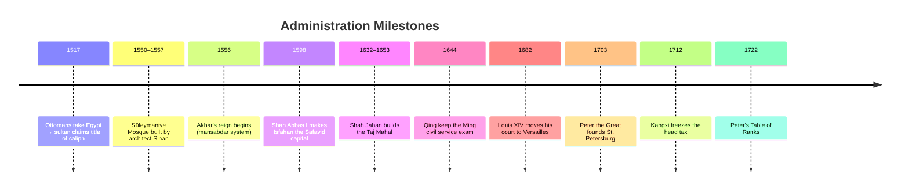
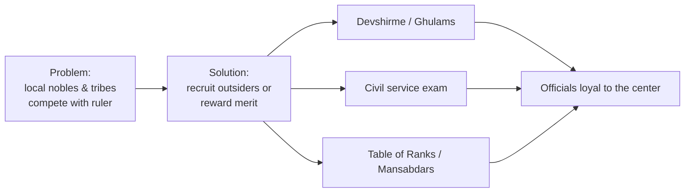
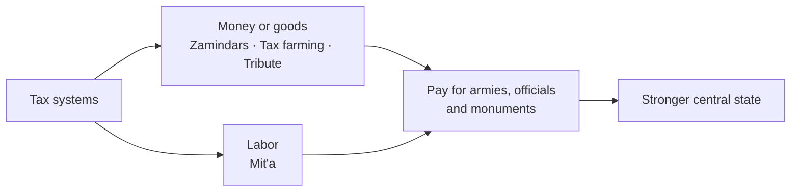

# 3.2 Empires: Administration
> **Source note:** Built from the College Board AP World History: Modern course framework (Unit 3, Topic 3.2), not from your textbook. Check names and dates against class materials.
>
> **Focus Question:** How did rulers of land-based empires legitimize and consolidate their power, 1450–1750?

---

## 🧭 Big Picture
Growing empires had to rule large, diverse populations spread over huge distances. Rulers used **four main tools** to make their rule seem rightful (**legitimize**) and to pull power to the center (**consolidate**).

## 🗓️ Timeline

---

## ① Bureaucratic Elites & Military Professionals
Rulers built officials and soldiers whose **loyalty belonged to the ruler**, not to local nobles or families.

| Empire | System | How it worked | Why it helped the ruler |
|---|---|---|---|
| **Ottoman** | **Devshirme** → **Janissaries** | Christian boys from the Balkans were taken, converted to Islam, and trained. The best became administrators; others became Janissaries, elite infantry armed with guns | No family power base, so they were loyal only to the sultan |
| **Qing** | **Civil service exam** | Kept from the Ming; tested the Confucian classics. Manchu and Han officials were often paired in the same post | Merit-based officials; won over Han Chinese scholars while Manchus kept control |
| **Mughal** | **Mansabdar** system (Akbar) | Officials were ranked and given land revenue rights in return for supplying troops; not hereditary | Tied nobles' income to service, not birth |
| **Safavid** | **Ghulams** (Shah Abbas I) | Christian slave soldiers from the Caucasus | Balanced the power of the Qizilbash tribal warriors |
| **Russia** | **Table of Ranks** (Peter the Great, 1722) | Promotion based on state service, not noble birth | Made nobles serve the tsar |

---

## ② Religious Ideas
| Empire / Region | Religious idea used | Effect |
|---|---|---|
| **Europe** (e.g., Louis XIV, r. 1643–1715) | **Divine right of kings**: monarchs rule by God's will | Justified **absolute monarchy** |
| **Ottoman** | After taking Egypt (1517), sultans claimed the title **caliph** and protected Mecca and Medina | Leader of the Sunni world |
| **Safavid** | **Shi'a Islam** as the state religion | United Persia and set it apart from the Ottomans |
| **Qing** | **Mandate of Heaven**, Confucian rituals; support for Tibetan Buddhism | Accepted by Han Chinese, Mongols, and Tibetans |
| **Mexica (Aztec)** | **Human sacrifice** to the sun and war god Huitzilopochtli | Showed state power; war captives were offered |
| **Inca** | The **Sapa Inca** was a descendant of the sun god **Inti**; Temple of the Sun (Coricancha) in Cusco | Ruler seen as divine |

---

## ③ Art & Monumental Architecture
Huge buildings showed **wealth, power, and divine favor**.

| Building / City | Empire | Ruler & Date | Purpose |
|---|---|---|---|
| **Versailles** | France | Louis XIV, court moved in 1682 | Kept nobles close and under watch |
| **Taj Mahal** | Mughal | Shah Jahan, 1632–1653 | Tomb for his wife Mumtaz Mahal; display of Mughal splendor |
| **Fatehpur Sikri** | Mughal | Akbar, 1570s | New capital city |
| **Forbidden City** | Qing | Built under the Ming (1420); used by the Qing | Imperial palace, center of power |
| **Isfahan** | Safavid | Shah Abbas I, capital from 1598 | Grand square and mosques; Persian culture |
| **Süleymaniye Mosque** | Ottoman | Suleiman I, architect Sinan, 1550–1557 | Islamic leadership and wealth |
| **St. Petersburg** | Russia | Peter the Great, 1703 | "Window to the West"; symbol of westernization |

---

## ④ Tax Collection Systems
| Empire | System | How it worked |
|---|---|---|
| **Mughal** | **Zamindars** | Local landholders collected taxes from peasants for the state and kept a share |
| **Ottoman** | **Tax farming** | The right to collect taxes was sold to individuals, who paid the state up front and then collected from the people |
| **Mexica (Aztec)** | **Tribute** | Conquered city-states paid goods (cotton, cacao, feathers), recorded in tribute lists |
| **Inca** | **Mit'a** | A labor tax: people worked on roads, temples, farms, and mines |
| **Qing** | Land tax + head tax | Kangxi froze the head tax in 1712 to win peasant support |

---

## 👑 European Absolute Monarchs
- **Louis XIV (France)**: the "Sun King"; divine right, Versailles, a large standing army
- **Peter the Great (Russia, r. 1682–1725)**: **westernization**. Built a navy, founded St. Petersburg, made nobles adopt Western dress and shave their beards, created the Table of Ranks

---

## ⚠️ Limits of Central Power
- Local elites (zamindars, tax farmers) could keep too much revenue → corruption
- Elite soldiers could turn against the ruler (later Janissary revolts)
- Expansion and monuments cost a lot → heavy taxes → revolts (see Mughal and Safavid decline in 3.1)

---

## 🔑 Key Terms
| Bureaucracy & Military | Religion | Architecture | Taxes |
|---|---|---|---|
| Devshirme | Divine right of kings | Versailles | Zamindar |
| Janissaries | Caliph | Taj Mahal | Tax farming |
| Civil service exam | Mandate of Heaven | Forbidden City | Tribute |
| Mansabdar | Human sacrifice (Mexica) | Isfahan | Mit'a |
| Ghulams | Sapa Inca / Inti | St. Petersburg | |
| Table of Ranks | Absolute monarchy | Süleymaniye Mosque | |

---

## 📝 AP Practice Questions (Textbook p.184–188)

### LEQ 2: Changes in Government
> Rulers of empires in Africa and Eurasia from 1450–1750 developed new methods of governing to solidify their authority over their citizens.
> Develop an argument that evaluates the extent to which changes in government caused the consolidation of power in empires in the period 1450–1750.

- **Reasoning skill:** Causation
- **Possible thesis:** Changes in government, especially loyal bureaucracies and new tax systems, were the main cause of consolidation, but they worked only alongside gunpowder armies and religious legitimacy.
- **Evidence from these notes:** devshirme, civil service exam, mansabdars, Table of Ranks, Versailles; zamindars, tax farming, mit'a
- **Africa:** Ottoman rule in Egypt and North Africa (3.1)
- **Tip:** This question is close to the DBQ below, so the model essay's outline also works here.

### DBQ
> Evaluate the extent to which rulers in Eurasia succeeded in consolidating power within their states, during the period c. 1450 to c. 1750.

- **Time:** 15 minutes planning + 45 minutes writing
- **Documents (p.185–188):**
  1. Ming village gazetteer on tax captains, c. 1450
  2. Machiavelli, *The Prince*, on the Ottoman sultan, 1513
  3. Hideyoshi's Sword Hunt edict, 1588
  4. Lissner's painting of the 1648 Salt Riot in Moscow, 1938
  5. Bernier on Mughal land grants, 1668
  6. Saint-Simon's memoirs on Louis XIV
  7. Rousset de Missy on Peter the Great's beard tax, 1730
- **Model essay:** `AP_WH_Unit3_DBQ_EN.md`

### DBQ 2 (another printing of the textbook): Peter the Great
> Using the documents and your knowledge of world history, evaluate the extent to which Peter the Great took steps during his reign (1682–1725) to modernize Russia and transform it into a major European power.

- **Time:** 15 minutes planning + 45 minutes writing
- **Requirements:** at least 6 documents; sourcing for at least 3
- **Documents (p.185–188):**
  1. Bishop Burnet of England describing Peter, 1698
  2. Peter I, Decree on Compulsory Education of the Nobility
  3. Peter I, Decree on the Invitation of Foreigners, 1702
  4. Peter I, Decree on Western Dress, 1701
  5. Statute for the College of Manufactures, 1723
  6. Rousset de Missy, *Life of Peter the Great*, c. 1730
  7. Portrait of Peter the Great, Library of Congress
- **Model essay:** `AP_WH_Unit3_DBQ2_PeterTheGreat_EN.md`
