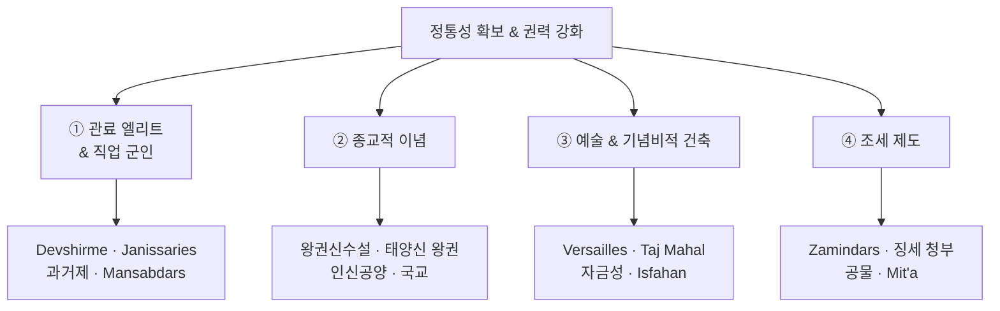
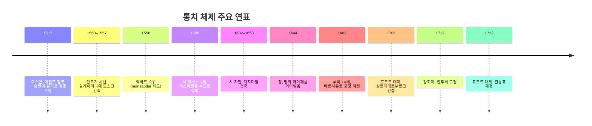
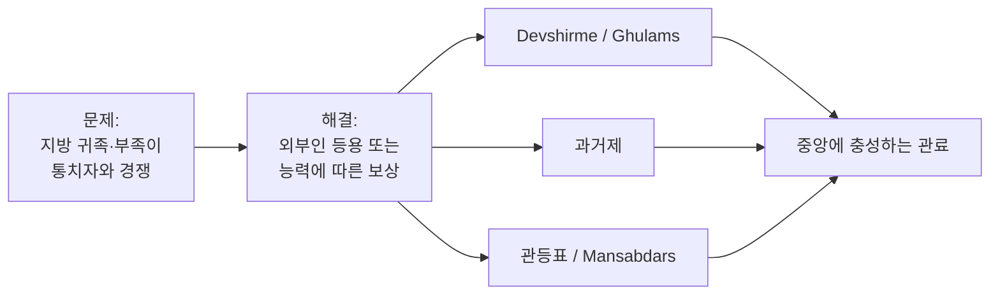
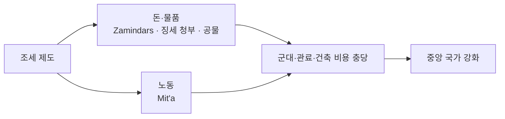

# 3.2 Empires: Administration (제국의 통치 방식)
> **출처 안내:** 교재가 아니라 College Board AP World History: Modern 과정 체계(Unit 3, Topic 3.2)를 바탕으로 정리했습니다. 이름과 연도는 수업 자료와 함께 확인하세요.
>
> **핵심 질문:** 1450–1750년, 육상 제국의 통치자들은 어떻게 권력의 정통성을 세우고 권력을 강화했는가?

---

## 🧭 큰 그림
커지는 제국은 넓은 지역에 흩어진 다양한 사람들을 다스려야 했습니다. 통치자들은 **네 가지 도구**로 통치가 정당해 보이게 하고(**legitimize**), 권력을 중앙에 모았습니다(**consolidate**).

## 🗓️ 연표

---

## ① 관료 엘리트 & 직업 군인
통치자들은 지방 귀족이나 가문이 아니라 **통치자 자신에게 충성하는** 관료와 군인을 길러냈습니다.

| 제국 | 제도 | 운영 방식 | 통치자에게 도움이 된 이유 |
|---|---|---|---|
| **Ottoman** | **Devshirme** → **Janissaries** | 발칸의 기독교도 소년을 데려와 이슬람으로 개종시키고 훈련함. 뛰어난 소년은 관료가 되고, 나머지는 총으로 무장한 정예 보병 예니체리가 됨 | 가문 기반이 없어 술탄에게만 충성 |
| **Qing** | **과거제 (Civil service exam)** | 명에서 이어받음. 유교 경전 시험. 같은 관직에 만주인과 한인을 함께 임명하는 경우가 많았음 | 능력 위주 관료 선발. 한족 학자를 끌어들이면서도 만주족이 통제권 유지 |
| **Mughal** | **Mansabdar** 제도 (악바르) | 관료에게 등급을 매기고, 군대를 대는 대가로 토지 세수 권리를 줌. 세습 불가 | 귀족의 수입을 출신이 아니라 복무에 연결 |
| **Safavid** | **Ghulams** (샤 아바스 1세) | 캅카스 출신 기독교도 노예 군인 | 키질바시 부족 전사 세력을 견제 |
| **Russia** | **관등표 (Table of Ranks)** (표트르 대제, 1722) | 귀족 출신이 아니라 국가에 복무한 정도로 승진 | 귀족이 차르를 섬기도록 만듦 |

---

## ② 종교적 이념
| 제국 / 지역 | 활용한 종교 이념 | 효과 |
|---|---|---|
| **유럽** (예: 루이 14세, r. 1643–1715) | **왕권신수설 (Divine right)**: 군주는 신의 뜻으로 다스린다 | **절대왕정** 정당화 |
| **Ottoman** | 이집트 정복(1517) 후 **칼리프** 칭호를 주장하고 메카·메디나를 보호 | 수니 세계의 지도자 |
| **Safavid** | **시아파 이슬람**을 국교로 삼음 | 페르시아를 통합하고 오스만과 구별 |
| **Qing** | **천명 (Mandate of Heaven)**, 유교 의례, 티베트 불교 후원 | 한족·몽골·티베트인 모두에게 인정받음 |
| **Mexica (아즈텍)** | 태양·전쟁의 신 우이칠로포치틀리에게 **인신공양** | 국가 권력 과시. 전쟁 포로를 바침 |
| **Inca** | **사파 잉카**는 태양신 **인티**의 후손. 쿠스코의 태양 신전(코리칸차) | 통치자를 신성한 존재로 여김 |

---

## ③ 예술 & 기념비적 건축
거대한 건축물은 **부와 권력, 신의 은총**을 보여주었습니다.

| 건축물 / 도시 | 제국 | 통치자 & 시기 | 목적 |
|---|---|---|---|
| **베르사유 궁전** | 프랑스 | 루이 14세, 1682년 궁정 이전 | 귀족을 가까이 두고 감시 |
| **타지마할** | 무굴 | 샤 자한, 1632–1653 | 왕비 뭄타즈 마할의 무덤. 무굴의 화려함 과시 |
| **파테푸르 시크리** | 무굴 | 악바르, 1570년대 | 새 수도 |
| **자금성** | 청 | 명나라 때 건설(1420), 청이 계속 사용 | 황궁이자 권력의 중심 |
| **이스파한** | 사파비 | 샤 아바스 1세, 1598년부터 수도 | 대광장과 모스크. 페르시아 문화 |
| **쉴레이마니예 모스크** | 오스만 | 쉴레이만 1세, 건축가 시난, 1550–1557 | 이슬람 세계의 지도력과 부 |
| **상트페테르부르크** | 러시아 | 표트르 대제, 1703 | "서방으로 난 창". 서구화의 상징 |

---

## ④ 조세 제도
| 제국 | 제도 | 운영 방식 |
|---|---|---|
| **Mughal** | **Zamindars** | 지방 지주가 농민에게서 세금을 걷어 국가에 내고 일부를 가짐 |
| **Ottoman** | **징세 청부 (Tax farming)** | 세금을 걷을 권리를 개인에게 팔고, 그 개인이 국가에 먼저 돈을 낸 뒤 백성에게서 걷음 |
| **Mexica (아즈텍)** | **공물 (Tribute)** | 정복된 도시국가가 면직물·카카오·깃털 등을 바침. 공물 목록에 기록 |
| **Inca** | **Mit'a** | 노동세. 도로·신전·농지·광산에서 일함 |
| **Qing** | 토지세 + 인두세 | 강희제가 1712년 인두세를 고정해 농민의 지지를 얻음 |

---

## 👑 유럽의 절대군주
- **루이 14세 (프랑스)**: "태양왕". 왕권신수설, 베르사유, 대규모 상비군
- **표트르 대제 (러시아, r. 1682–1725)**: **서구화**. 해군 창설, 상트페테르부르크 건설, 귀족에게 서양식 옷을 입고 수염을 깎게 함, 관등표 제정

---

## ⚠️ 중앙 권력의 한계
- 지방 엘리트(zamindar, 징세 청부인)가 세수를 너무 많이 챙김 → 부패
- 정예 군인이 통치자에게 등을 돌릴 수 있음 (후대의 예니체리 반란)
- 확장과 건축에 많은 비용 → 무거운 세금 → 반란 (3.1의 무굴·사파비 쇠퇴 참고)

---

## 🔑 핵심 용어
| 관료·군사 | 종교 | 건축 | 조세 |
|---|---|---|---|
| Devshirme | 왕권신수설 (Divine right) | 베르사유 | Zamindar |
| Janissaries (예니체리) | 칼리프 (Caliph) | 타지마할 | 징세 청부 (Tax farming) |
| 과거제 | 천명 (Mandate of Heaven) | 자금성 | 공물 (Tribute) |
| Mansabdar | 인신공양 (Mexica) | 이스파한 | Mit'a |
| Ghulams | 사파 잉카 / 인티 | 상트페테르부르크 | |
| 관등표 (Table of Ranks) | 절대왕정 | 쉴레이마니예 모스크 | |

---

## 📝 AP 연습 문제 (교재 p.184–188)
> 답안은 영어로 써야 하므로 문제는 원문 그대로 두고 번역을 함께 적었습니다.

### LEQ 2: 정부의 변화
> Rulers of empires in Africa and Eurasia from 1450–1750 developed new methods of governing to solidify their authority over their citizens.
> Develop an argument that evaluates the extent to which changes in government caused the consolidation of power in empires in the period 1450–1750.

**번역:** 1450–1750년, 아프리카와 유라시아 제국의 통치자들은 백성에 대한 권위를 굳히려고 새로운 통치 방식을 만들었다. 정부의 변화가 제국의 권력 강화를 어느 정도 일으켰는지 평가하는 논증을 전개하라.

- **역사적 사고 기술:** 인과관계 (Causation)
- **논지 예시:** 정부의 변화, 특히 충성스러운 관료제와 새로운 조세 제도가 권력 강화의 주된 원인이었다. 다만 화약 군대와 종교적 정통성이 함께 있어야 효과가 있었다.
- **이 노트의 근거:** devshirme, 과거제, mansabdar, 관등표, 베르사유, zamindar, 징세 청부, mit'a
- **아프리카:** 오스만의 이집트·북아프리카 통치 (3.1)
- **팁:** 아래 DBQ와 주제가 거의 같아서 모범 에세이의 구성을 그대로 활용할 수 있습니다.

### DBQ (문서 기반 문제)
> Evaluate the extent to which rulers in Eurasia succeeded in consolidating power within their states, during the period c. 1450 to c. 1750.

**번역:** 1450년경–1750년경, 유라시아의 통치자들이 자국 내에서 권력을 강화하는 데 어느 정도 성공했는지 평가하라.

- **시간:** 계획 15분 + 쓰기 45분
- **문서 (p.185–188):**
  1. 세량장에 관한 명나라 마을 기록, 1450년경
  2. 마키아벨리, 『군주론』 중 오스만 술탄 부분, 1513
  3. 히데요시의 칼 사냥령, 1588
  4. 1648년 모스크바 소금 폭동을 그린 리스너의 그림, 1938
  5. 무굴의 토지 수여에 관한 베르니에의 기록, 1668
  6. 루이 14세에 관한 생시몽의 회고록
  7. 표트르 대제의 수염세에 관한 루세 드 미시의 기록, 1730
- **모범 에세이:** `AP_WH_Unit3_DBQ_EN.md` (한국어 해설: `AP_WH_Unit3_DBQ_KR.md`)

### DBQ 2 (다른 인쇄본): 표트르 대제
> Using the documents and your knowledge of world history, evaluate the extent to which Peter the Great took steps during his reign (1682–1725) to modernize Russia and transform it into a major European power.

**번역:** 문서와 세계사 지식을 활용하여, 표트르 대제가 재위 기간(1682–1725) 동안 러시아를 근대화하고 유럽의 주요 강대국으로 바꾸기 위해 어느 정도 조치를 취했는지 평가하라.

- **시간:** 계획 15분 + 쓰기 45분
- **요구 사항:** 문서 6개 이상 활용, 3개 이상 출처 분석
- **문서 (p.185–188):**
  1. 영국 버넷 주교의 표트르 묘사, 1698
  2. 표트르 1세, 귀족 의무 교육령
  3. 표트르 1세, 외국인 초청령, 1702
  4. 표트르 1세, 서양 복장령, 1701
  5. 공업청 규정, 1723
  6. 루세 드 미시, 『표트르 대제의 생애』, 1730년경
  7. 표트르 대제 초상화, 미국 의회도서관
- **모범 에세이:** `AP_WH_Unit3_DBQ2_PeterTheGreat_EN.md` (한국어 해설: `AP_WH_Unit3_DBQ2_PeterTheGreat_KR.md`)
