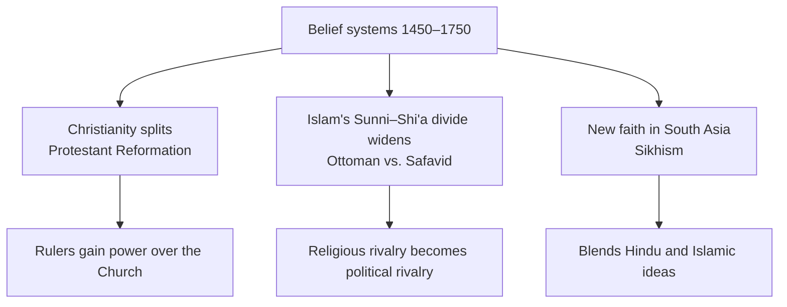
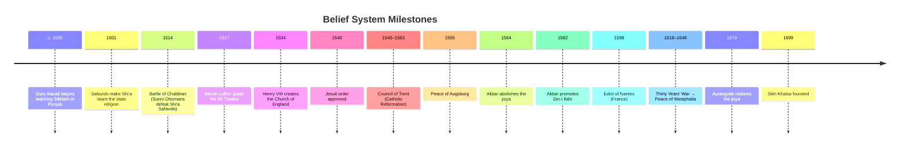
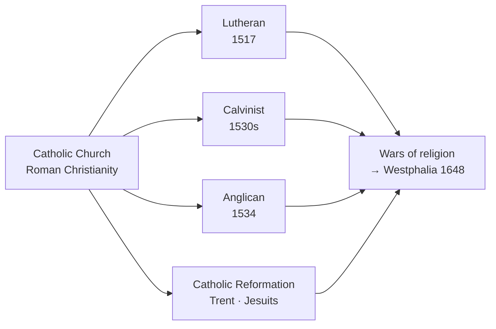
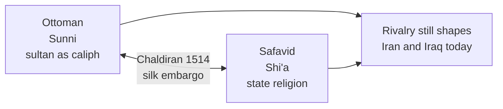
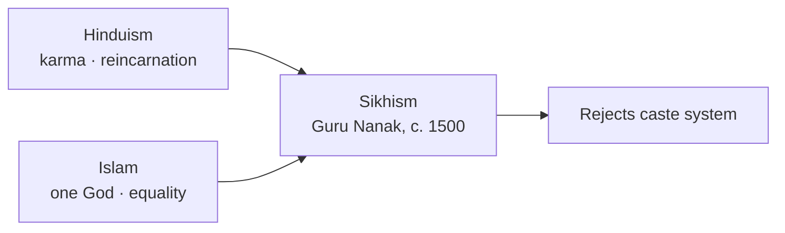

# 3.3 Empires: Belief Systems
> **Source note:** Built from the College Board AP World History: Modern course framework (Unit 3, Topic 3.3), not from your textbook. Check names and dates against class materials.
>
> **Focus Question:** How and why did belief systems change, and split, between 1450 and 1750?

---

## 🧭 Big Picture
Two major religions split further, and a new faith appeared in South Asia. In every case, **religion and politics were tightly linked**: rulers used religious divisions to strengthen their own power.

## 🗓️ Timeline

---

## ✝️ Europe: The Protestant Reformation

### Causes
- **Church corruption**: sale of **indulgences** (payments said to reduce punishment for sins)
- **Printing press**: new ideas and Bibles spread quickly
- **Rulers** wanted more power and the Church's land and wealth
- Renaissance **humanism** encouraged questioning authority

### Key Reformers
| Reformer | Place & Date | Main ideas |
|---|---|---|
| **Martin Luther** | Holy Roman Empire, 1517 | **95 Theses** attacked indulgences. Salvation by **faith alone**; the **Bible alone** is the authority |
| **John Calvin** | Geneva, 1530s–1560s | **Predestination**: God has already chosen who is saved |
| **Henry VIII** | England, 1534 | Broke with the Pope to end his marriage; **Act of Supremacy** made the king head of the **Church of England** (Anglican) |

### The Catholic (Counter-) Reformation
- **Council of Trent (1545–1563)**: reaffirmed Catholic teachings and fixed some abuses
- **Jesuits (1540, Ignatius of Loyola)**: education and missionary work in Asia and the Americas
- **Inquisition**: courts that tried people accused of heresy

### Wars of Religion
| Conflict | Result |
|---|---|
| Wars in the Holy Roman Empire → **Peace of Augsburg (1555)** | Each prince chose Lutheran or Catholic for his lands |
| **French Wars of Religion** → **Edict of Nantes (1598)** | Limited tolerance for French Protestants (Huguenots) |
| **Thirty Years' War (1618–1648)** → **Peace of Westphalia** | Recognized state sovereignty; rulers decided religion in their states; Catholic–Protestant split became permanent |

### Effects
- Western Christianity split for good
- Power of the Pope fell; **power of monarchs and states rose**
- Jesuit missions spread Catholicism worldwide

---

## ☪️ Islam: The Sunni–Shi'a Split Widens
- **Ottoman = Sunni**, **Safavid = Shi'a**
- Ismail made **Shi'a Islam** the state religion of Persia (1501), often by force on a largely Sunni population
- **Battle of Chaldiran (1514)**: the Ottomans won, fixing the border between Sunni and Shi'a lands
- The religious divide became a **political rivalry**: wars, trade embargoes (silk), and competing claims to lead the Muslim world

---

## 🪯 South Asia: Sikhism, Akbar, and Aurangzeb

### Sikhism
- Founded by **Guru Nanak** (1469–1539) in **Punjab**, northern India, around 1500
- A **syncretic** faith: it mixes elements of Hinduism and Islam
- Belief in **one God**, **rejects the caste system**, keeps ideas of karma and reincarnation
- Holy site: the **Golden Temple** at Amritsar

### Mughal Religious Policy: Akbar vs. Aurangzeb
| | **Akbar** (r. 1556–1605) | **Aurangzeb** (r. 1658–1707) |
|---|---|---|
| Approach | **Tolerance** | **Strict Sunni orthodoxy** |
| Jizya (tax on non-Muslims) | **Abolished** (1564) | **Restored** (1679) |
| Key action | Held debates among faiths; promoted **Din-i Ilahi** (1582), a blend of faiths for his court | Destroyed some Hindu temples; executed the Sikh guru Tegh Bahadur (1675) |
| Result | Hindu support, stable empire | Revolts by Hindus and Sikhs; Sikhs militarized (**Khalsa**, 1699); empire weakened |

---

## 🔑 Key Terms
| Christianity | Islam | South Asia |
|---|---|---|
| Protestant Reformation | Sunni | Sikhism |
| Indulgences | Shi'a | Guru Nanak |
| 95 Theses | Battle of Chaldiran | Syncretism |
| Predestination | Caliph | Din-i Ilahi |
| Church of England | | Jizya |
| Catholic Reformation / Council of Trent | | Khalsa |
| Jesuits | | |
| Peace of Westphalia | | |

---

## 📝 AP Practice Question (Textbook p.184)

### LEQ 1: Islam & Christianity
> In Africa and Eurasia from 1450–1750, various forms of Islam and Christianity were key factors in the expansion of empires.
> Develop an argument that evaluates the extent to which the various belief systems showed continuity or change over time during the period from 1450–1750.

- **Reasoning skill:** Continuity and change over time
- **Possible thesis:** Belief systems changed a great deal as Christianity and Islam each split further, but they stayed the same in one key way: rulers kept using religion to legitimize power.
- **Change:** Protestant Reformation (1517), Peace of Westphalia (1648), Shi'a state religion in Persia (1501), rise of Sikhism
- **Continuity:** religion as a basis of rule (caliph, divine right), taxes on religious minorities (jizya), missionary expansion (Jesuits)
- **See also:** 3.1 (Chaldiran, ghazi ideal), 3.2 (religious legitimacy table)
