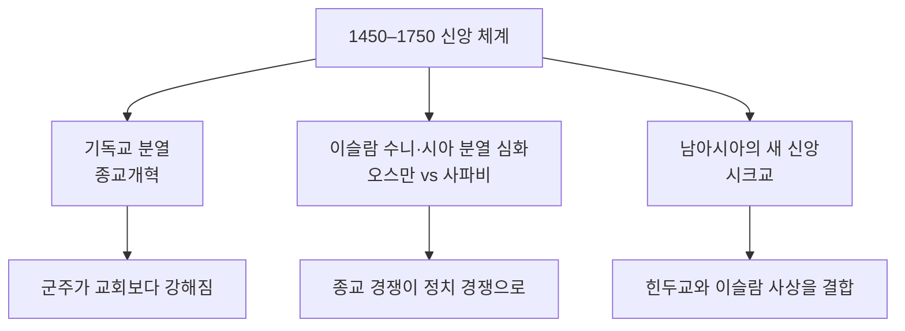
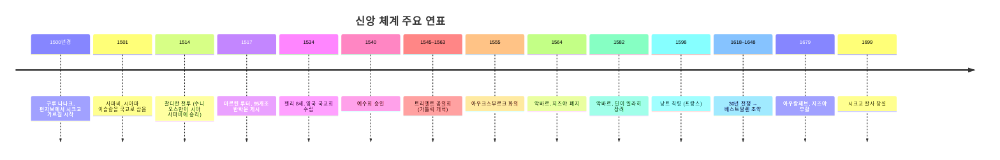
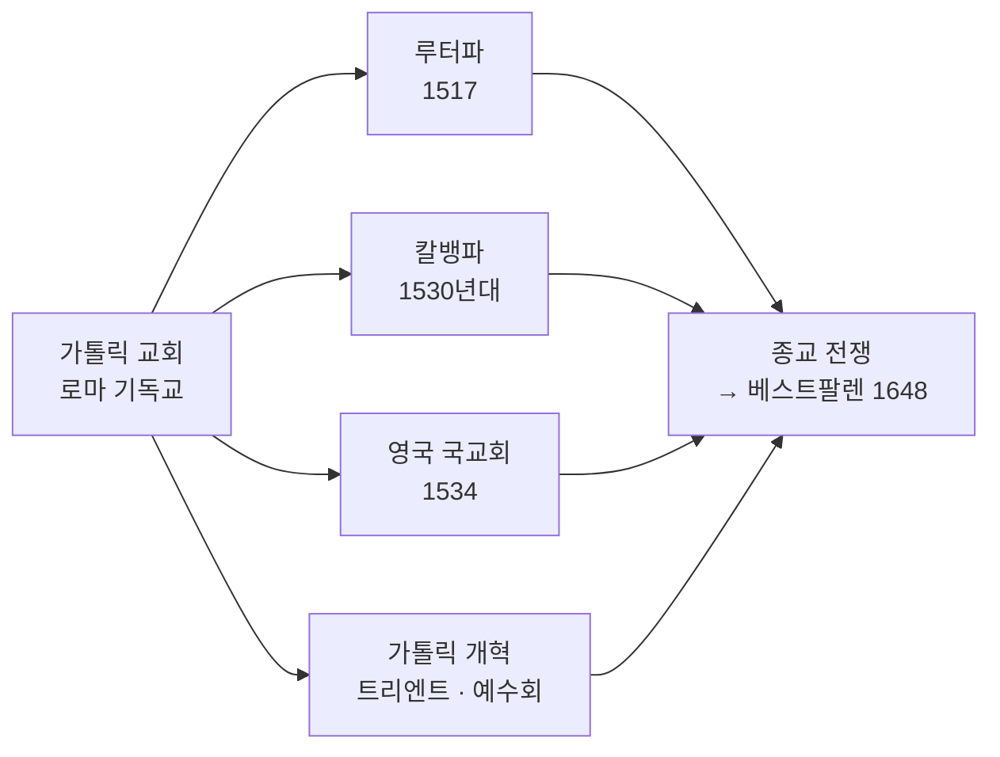
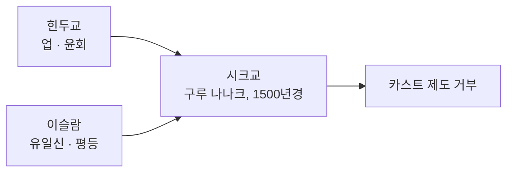

# 3.3 Empires: Belief Systems (신앙 체계)
> **출처 안내:** 교재가 아니라 College Board AP World History: Modern 과정 체계(Unit 3, Topic 3.3)를 바탕으로 정리했습니다. 이름과 연도는 수업 자료와 함께 확인하세요.
>
> **핵심 질문:** 1450–1750년, 신앙 체계는 어떻게, 왜 변화하고 분열했는가?

---

## 🧭 큰 그림
큰 종교 두 개가 더 갈라졌고, 남아시아에서는 새로운 신앙이 나타났습니다. 어느 경우든 **종교와 정치가 밀접하게 얽혀** 있었고, 통치자들은 종교 분열을 이용해 권력을 키웠습니다.

## 🗓️ 연표

---

## ✝️ 유럽: 종교개혁 (Protestant Reformation)

### 원인
- **교회의 부패**: **면벌부(indulgences)** 판매 (죄에 대한 벌을 줄여준다며 돈을 받음)
- **인쇄술**: 새로운 사상과 성경이 빠르게 퍼짐
- **군주들**이 더 큰 권력과 교회의 토지·재산을 원함
- 르네상스 **인문주의**가 권위에 의문을 품게 함

### 주요 개혁가
| 인물 | 장소 & 시기 | 핵심 사상 |
|---|---|---|
| **마르틴 루터** | 신성로마제국, 1517 | **95개조 반박문**으로 면벌부 비판. **오직 믿음**으로 구원받고, **오직 성경**만이 권위 |
| **장 칼뱅** | 제네바, 1530년대–1560년대 | **예정설**: 신이 구원받을 사람을 이미 정해 두었다 |
| **헨리 8세** | 영국, 1534 | 혼인을 무효로 하려고 교황과 결별. **수장령**으로 왕이 **영국 국교회**(성공회)의 수장이 됨 |

### 가톨릭 (반)종교개혁
- **트리엔트 공의회 (1545–1563)**: 가톨릭 교리를 재확인하고 일부 폐단을 고침
- **예수회 (1540, 이그나티우스 데 로욜라)**: 교육과 아시아·아메리카 선교
- **종교재판**: 이단으로 고발된 사람을 재판한 법정

### 종교 전쟁
| 갈등 | 결과 |
|---|---|
| 신성로마제국 내 전쟁 → **아우크스부르크 화의 (1555)** | 각 제후가 자기 영지의 종교를 루터파나 가톨릭 중에서 선택 |
| **프랑스 종교 전쟁** → **낭트 칙령 (1598)** | 프랑스 개신교도(위그노)에게 제한적 관용 |
| **30년 전쟁 (1618–1648)** → **베스트팔렌 조약** | 국가 주권 인정. 통치자가 자국의 종교 결정. 가톨릭·개신교 분열이 굳어짐 |

### 결과
- 서방 기독교가 완전히 갈라짐
- 교황의 권력은 줄고 **군주와 국가의 권력은 커짐**
- 예수회 선교로 가톨릭이 전 세계에 퍼짐

---

## ☪️ 이슬람: 수니·시아 분열 심화
- **오스만 = 수니파**, **사파비 = 시아파**
- 이스마일이 1501년 **시아파 이슬람**을 페르시아의 국교로 삼음. 수니파가 많던 주민에게 강제로 개종시키는 경우가 많았음
- **찰디란 전투 (1514)**: 오스만이 승리해 수니 지역과 시아 지역의 경계가 굳어짐
- 종교 분열이 **정치적 경쟁**으로 이어짐: 전쟁, 비단 교역 금수 조치, 이슬람 세계 지도권 다툼

---

## 🪯 남아시아: 시크교, 악바르, 아우랑제브

### 시크교 (Sikhism)
- 1500년경 북인도 **펀자브**에서 **구루 나나크**(1469–1539)가 창시
- **혼합주의(syncretism)** 신앙: 힌두교와 이슬람의 요소를 섞음
- **유일신** 신앙, **카스트 제도 거부**, 업(karma)과 윤회 개념은 유지
- 성지: 암리차르의 **황금 사원**

### 무굴 제국의 종교 정책: 악바르 vs 아우랑제브
| | **악바르** (r. 1556–1605) | **아우랑제브** (r. 1658–1707) |
|---|---|---|
| 방식 | **관용** | **엄격한 수니 정통주의** |
| 지즈야 (비무슬림 인두세) | **폐지** (1564) | **부활** (1679) |
| 주요 행동 | 여러 종교 간 토론을 열고 궁정에 **딘이 일라히**(1582)라는 혼합 신앙을 장려 | 일부 힌두 사원을 파괴하고 시크교 구루 테그 바하두르를 처형(1675) |
| 결과 | 힌두교도의 지지, 제국 안정 | 힌두교도·시크교도 반란. 시크교가 무장함(**칼사**, 1699). 제국 약화 |

---

## 🔑 핵심 용어
| 기독교 | 이슬람 | 남아시아 |
|---|---|---|
| 종교개혁 (Protestant Reformation) | 수니파 (Sunni) | 시크교 (Sikhism) |
| 면벌부 (Indulgences) | 시아파 (Shi'a) | 구루 나나크 |
| 95개조 반박문 | 찰디란 전투 | 혼합주의 (Syncretism) |
| 예정설 (Predestination) | 칼리프 (Caliph) | 딘이 일라히 (Din-i Ilahi) |
| 영국 국교회 | | 지즈야 (Jizya) |
| 가톨릭 개혁 / 트리엔트 공의회 | | 칼사 (Khalsa) |
| 예수회 (Jesuits) | | |
| 베스트팔렌 조약 | | |

---

## 📝 AP 연습 문제 (교재 p.184)
> 답안은 영어로 써야 하므로 문제는 원문 그대로 두고 번역을 함께 적었습니다.

### LEQ 1: 이슬람과 기독교
> In Africa and Eurasia from 1450–1750, various forms of Islam and Christianity were key factors in the expansion of empires.
> Develop an argument that evaluates the extent to which the various belief systems showed continuity or change over time during the period from 1450–1750.

**번역:** 1450–1750년 아프리카와 유라시아에서 여러 갈래의 이슬람과 기독교는 제국 팽창의 핵심 요인이었다. 이 시기 여러 신앙 체계가 어느 정도 지속되거나 변화했는지 평가하는 논증을 전개하라.

- **역사적 사고 기술:** 지속과 변화 (Continuity and change over time)
- **논지 예시:** 기독교와 이슬람이 각각 더 갈라지면서 신앙 체계는 크게 변했다. 하지만 통치자가 종교로 권력을 정당화했다는 핵심적인 점은 그대로였다.
- **변화:** 종교개혁(1517), 베스트팔렌 조약(1648), 페르시아의 시아파 국교화(1501), 시크교의 등장
- **지속:** 통치의 근거로서의 종교(칼리프, 왕권신수설), 종교적 소수에 대한 세금(지즈야), 선교를 통한 확장(예수회)
- **함께 볼 노트:** 3.1 (찰디란, ghazi ideal), 3.2 (종교적 정통성 표)
