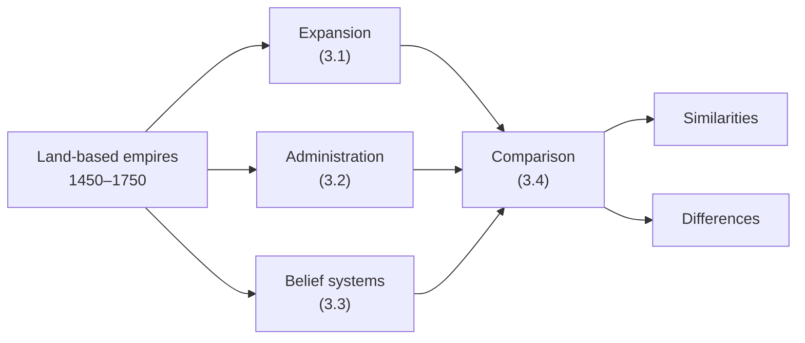
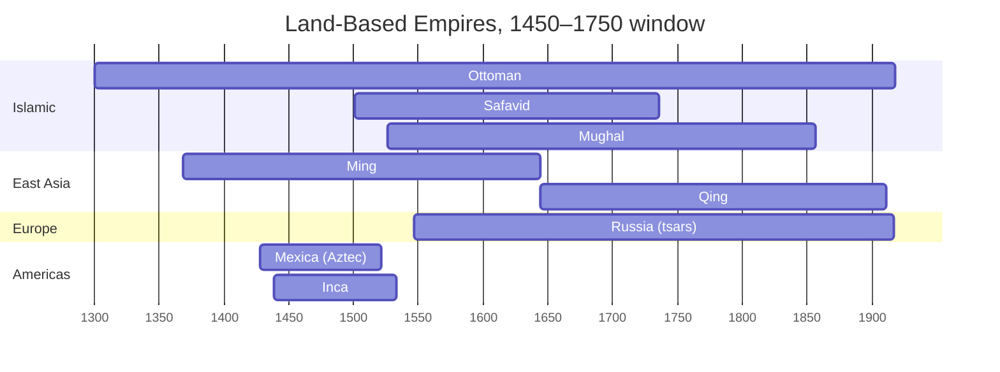
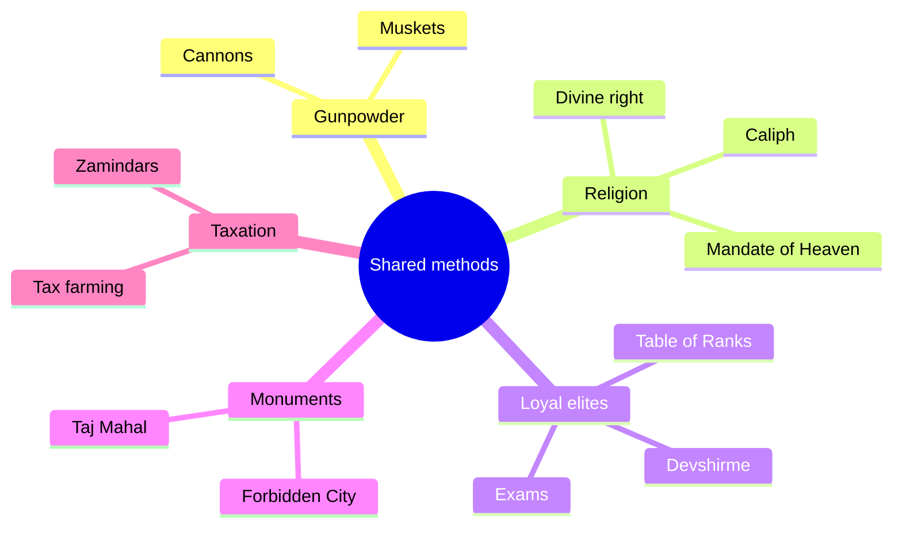
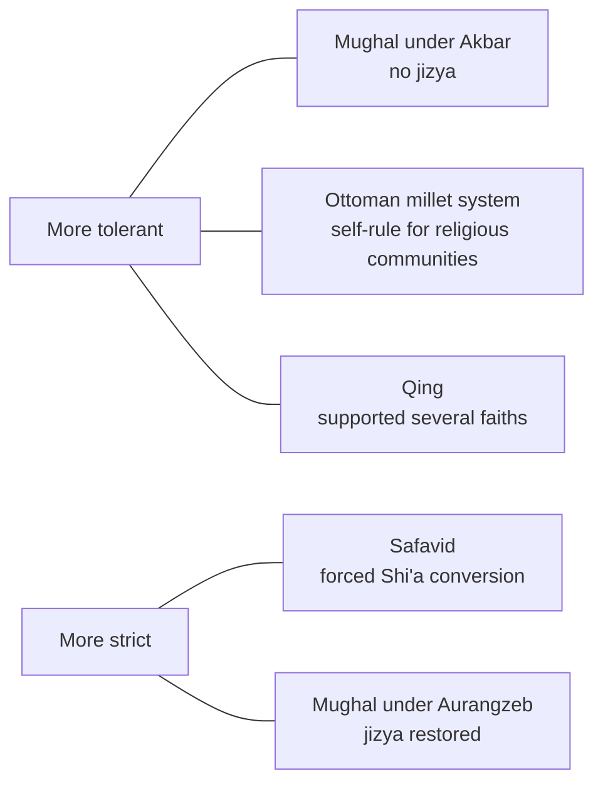

# 3.4 Comparison in Land-Based Empires
> **Source note:** Built from the College Board AP World History: Modern course framework (Unit 3, Topic 3.4), not from your textbook. Check names and dates against class materials.
>
> **Focus Question:** How were the ways land-based empires gained and kept power similar, and how were they different, 1450–1750?

---

## 🧭 Big Picture
This topic brings 3.1–3.3 together. The AP exam asks you to **compare**: name a similarity or difference, then **explain why**.

## 🗓️ Empires Side by Side

> Note: in 3.1 the textbook dates the Safavid end to the Zand Dynasty in 1760; 1736 here is the year the last Safavid shah was replaced by Nader Shah. Either is acceptable if you explain it.

---

## 📊 Master Comparison Table
| | **Ottoman** | **Safavid** | **Mughal** | **Qing** | **Russia** |
|---|---|---|---|---|---|
| **Founders' origin** | Turkic | Turkic (Sufi order) | Turkic-Mongol (Timurid) | Manchu (non-Han) | Slavic (Muscovy) |
| **Ruling group vs. majority** | Muslim rulers; many Christian subjects | Shi'a rulers; Sunni and Christian minorities | Muslim rulers; **Hindu majority** | **Manchu rulers; Han majority** | Orthodox Russians; many Muslim and Indigenous peoples in the east |
| **Religion used for legitimacy** | Sunni Islam; sultan as caliph | Shi'a Islam as state religion | Islam; Akbar's tolerance | Mandate of Heaven, Confucianism | Orthodox Christianity; tsar's divine right |
| **Elite soldiers / officials** | Devshirme, Janissaries | Ghulams | Mansabdars | Civil service exam; Manchu banners | Table of Ranks; Cossacks |
| **Tax system** | Tax farming | Land taxes, silk trade | Zamindars | Land + head tax | Taxes on serfs, fur tribute |
| **Monuments** | Süleymaniye Mosque | Isfahan | Taj Mahal | Forbidden City | St. Petersburg |
| **Gunpowder role** | Cannons at Constantinople (1453) | Adopted after Chaldiran (1514) | Babur's guns at Panipat (1526) | Firearms in frontier wars | Firearms in Siberian expansion |
| **Main religious tension** | Vs. Shi'a Safavids | Vs. Sunni Ottomans | Hindu–Muslim; Sikhs | Tibet, Xinjiang Muslims | Old Believers; non-Orthodox peoples |

---

## ✅ Similarities
1. **Gunpowder weapons** were used to conquer and defend territory
2. **Religion** was used to legitimize rule (caliph, Shi'a state, Mandate of Heaven, divine right)
3. **Loyal elites** were built to weaken rival nobles (devshirme, mansabdars, exams, Table of Ranks)
4. **Monumental architecture** displayed wealth and power
5. **Multiethnic, multireligious populations** had to be managed
6. **Taxes** paid for armies and officials, and heavy taxes later caused revolts

---

## ↔️ Key Differences

### 1. Religious policy toward subjects

- **Ottoman millet system**: Christian and Jewish communities ran their own religious and legal affairs and paid the jizya
- **Safavid**: pushed Shi'a conversion across Persia
- **Mughal**: changed with each ruler (Akbar tolerant, Aurangzeb strict)

### 2. Outsider rulers vs. the majority
| Empire | Approach |
|---|---|
| **Qing** | Manchus kept their own identity (queue hairstyle required of Han men, Manchu banners) but **adopted Chinese government and Confucianism** |
| **Mughal** | Muslim minority over a Hindu majority; Akbar married Rajput princesses and gave Hindus high posts |
| **Ottoman** | Used Christian-born officials (devshirme) and the millet system |

### 3. Relationship with the West
| Empire | Response |
|---|---|
| **Russia** | **Westernized** under Peter the Great → grew stronger |
| **Qing** | Limited trade to Canton, rejected British demands |
| **Ottoman / Safavid / Mughal** | Did not modernize enough → declined (3.1) |

### 4. Land-based vs. maritime focus
- **Land-based empires** (this unit): power came from armies, land taxes, and control of territory
- **Maritime empires** (Unit 4: Portugal, Spain, Britain): power came from navies and overseas trade
- Exception: the Ottomans also had a strong Mediterranean navy until Lepanto (1571)

---

## ✍️ AP Writing Frame (SAQ / LEQ)

**Sample comparison:**
> Both the Ottomans and the Qing built officials loyal to the ruler. The Ottomans used the **devshirme**, taking Christian boys with no family ties, while the Qing used the **civil service exam** to choose Confucian scholars by merit. Both methods weakened powerful nobles, but the Ottomans relied on outsiders, while the Qing won over the local Han elite.

---

## 🔑 Key Terms
| New in 3.4 | Review from 3.1–3.3 |
|---|---|
| Millet system | Devshirme, Janissaries |
| Manchu banners | Mansabdar, Zamindar |
| Queue (hairstyle) | Civil service exam |
| Rajputs | Shi'a vs. Sunni, caliph |
| Westernization | Jizya, Din-i Ilahi |
| Land-based vs. maritime empire | Table of Ranks |

---

## 📝 Unit 3 AP Practice Questions: Index (Textbook p.184–188)
Each question is written out in full at the end of the note listed under "Where."

| Question | Topic | Reasoning skill | Where | Also useful |
|---|---|---|---|---|
| **LEQ 1** | Islam & Christianity | Continuity & change | 3.3 notes | 3.1, 3.2 |
| **LEQ 2** | Changes in government | Causation | 3.2 notes | DBQ model essay |
| **LEQ 3** | Southern & southwestern Asia | Comparison | 3.1 notes | 3.4 comparison table |
| **LEQ 4** | Russia & China | Comparison | 3.1 notes | 3.4 comparison table |
| **DBQ** | Consolidating power in Eurasia | Evaluate extent | 3.2 notes | `AP_WH_Unit3_DBQ_EN.md` |
| **DBQ 2** | Peter the Great's modernization | Evaluate extent | 3.2 notes | `AP_WH_Unit3_DBQ2_PeterTheGreat_EN.md` |

> 💡 For LEQ 3 and LEQ 4, use the **AP Writing Frame** and the **Master Comparison Table** in this note.
