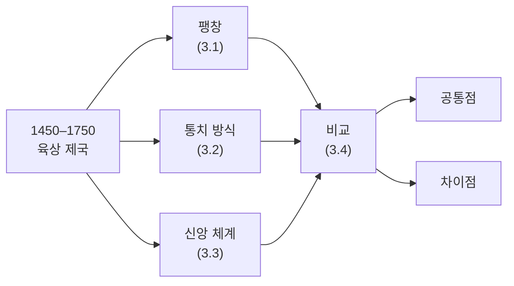
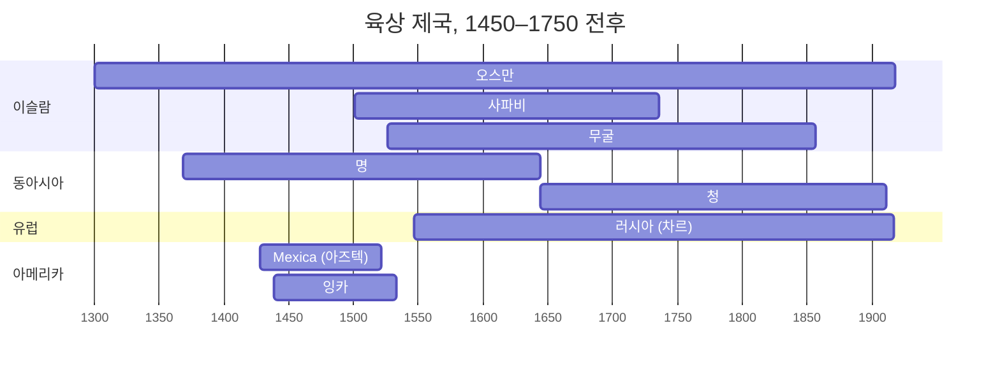
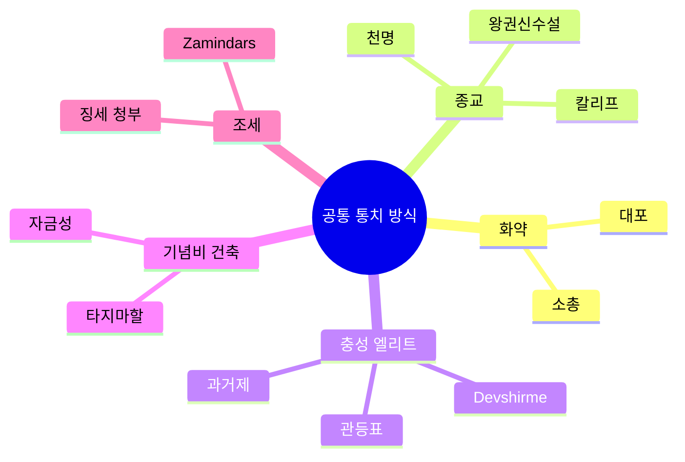
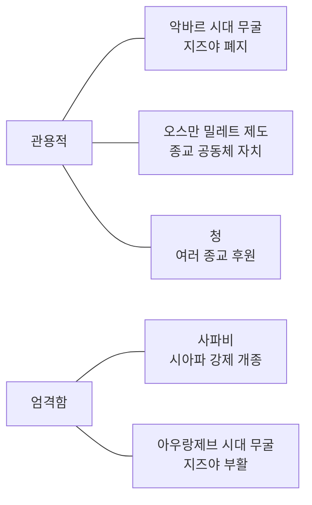

# 3.4 Comparison in Land-Based Empires (육상 제국 비교)
> **출처 안내:** 교재가 아니라 College Board AP World History: Modern 과정 체계(Unit 3, Topic 3.4)를 바탕으로 정리했습니다. 이름과 연도는 수업 자료와 함께 확인하세요.
>
> **핵심 질문:** 1450–1750년, 육상 제국들이 권력을 얻고 유지한 방식은 어떤 점이 비슷하고 어떤 점이 달랐는가?

---

## 🧭 큰 그림
이 주제는 3.1–3.3을 하나로 묶습니다. AP 시험에서는 **비교** 문제가 나옵니다. 공통점이나 차이점을 말한 뒤 **왜 그런지 설명**해야 합니다.

## 🗓️ 제국별 기간 비교

> 참고: 3.1 교재는 사파비의 끝을 1760년 Zand 왕조로 봅니다. 여기의 1736년은 나디르 샤가 마지막 사파비 샤를 대신한 해입니다. 근거를 설명하면 어느 쪽이든 괜찮습니다.

---

## 📊 종합 비교표
| | **오스만** | **사파비** | **무굴** | **청** | **러시아** |
|---|---|---|---|---|---|
| **건국 세력** | 튀르크계 | 튀르크계 (수피 교단) | 튀르크·몽골계 (티무르 후손) | 만주족 (비한족) | 슬라브계 (모스크바 대공국) |
| **지배층 vs 다수 주민** | 무슬림 지배층, 기독교도 백성 다수 | 시아파 지배층, 수니·기독교 소수 | 무슬림 지배층, **힌두교도 다수** | **만주족 지배층, 한족 다수** | 정교회 러시아인, 동쪽에 무슬림·원주민 다수 |
| **정통성의 종교적 근거** | 수니 이슬람, 술탄 = 칼리프 | 시아파 국교 | 이슬람, 악바르의 관용 | 천명, 유교 | 동방정교, 차르의 신권 |
| **정예 군인·관료** | Devshirme, 예니체리 | Ghulams | Mansabdars | 과거제, 만주 팔기 | 관등표, 코사크 |
| **조세 제도** | 징세 청부 | 토지세, 비단 교역 | Zamindars | 토지세 + 인두세 | 농노에게 걷는 세금, 모피 공물 |
| **기념비 건축** | 쉴레이마니예 모스크 | 이스파한 | 타지마할 | 자금성 | 상트페테르부르크 |
| **화약의 역할** | 콘스탄티노플 대포 (1453) | 찰디란(1514) 이후 도입 | 바부르의 총포, 파니파트 (1526) | 변경 전쟁의 화기 | 시베리아 팽창의 화기 |
| **주요 종교 갈등** | 시아파 사파비와 대립 | 수니파 오스만과 대립 | 힌두·무슬림, 시크교 | 티베트, 신장 무슬림 | 구교도, 비정교회 민족 |

---

## ✅ 공통점
1. **화약 무기**로 영토를 정복하고 지킴
2. **종교**로 통치를 정당화함 (칼리프, 시아파 국교, 천명, 왕권신수설)
3. **충성스러운 엘리트**를 길러 경쟁 귀족을 약화시킴 (devshirme, mansabdar, 과거제, 관등표)
4. **기념비적 건축**으로 부와 권력을 과시함
5. **다민족·다종교 주민**을 다스려야 했음
6. **세금**으로 군대와 관료를 유지했고, 나중에는 무거운 세금이 반란을 부름

---

## ↔️ 주요 차이점

### 1. 백성에 대한 종교 정책

- **오스만 밀레트 제도**: 기독교·유대교 공동체가 지즈야를 내는 대신 종교·법률 문제를 스스로 처리
- **사파비**: 페르시아 전역에 시아파 개종을 밀어붙임
- **무굴**: 통치자마다 달라짐 (악바르는 관용, 아우랑제브는 엄격)

### 2. 소수 출신 지배층과 다수 주민의 관계
| 제국 | 방식 |
|---|---|
| **청** | 만주족은 고유 정체성(한족 남성에게 변발 강요, 만주 팔기)을 지키면서도 **중국식 정부와 유교를 받아들임** |
| **무굴** | 힌두교도 다수를 다스리는 무슬림 소수. 악바르는 라지푸트 공주와 혼인하고 힌두교도를 고위직에 임명 |
| **오스만** | 기독교도 출신 관료(devshirme)와 밀레트 제도 활용 |

### 3. 서양과의 관계
| 제국 | 대응 |
|---|---|
| **러시아** | 표트르 대제가 **서구화** → 강해짐 |
| **청** | 교역을 광저우로 제한, 영국의 요구 거절 |
| **오스만 / 사파비 / 무굴** | 충분히 근대화하지 못함 → 쇠퇴 (3.1) |

### 4. 육상 제국 vs 해양 제국
- **육상 제국** (이번 단원): 군대, 토지세, 영토 장악으로 권력을 얻음
- **해양 제국** (Unit 4: 포르투갈, 스페인, 영국): 해군과 해외 교역으로 권력을 얻음
- 예외: 오스만은 레판토 해전(1571) 전까지 지중해에서 강한 해군도 가졌음

---

## ✍️ AP 서술형 틀 (SAQ / LEQ)

**비교 예시:**
> 오스만과 청은 모두 통치자에게 충성하는 관료를 길러냈다. 오스만은 가족 기반이 없는 기독교도 소년을 데려오는 **devshirme**를, 청은 유학자를 능력으로 뽑는 **과거제**를 썼다. 두 방식 모두 강한 귀족을 약화시켰지만, 오스만은 외부인에게 의존했고 청은 현지 한족 엘리트를 끌어들였다.

> 💡 AP 시험 답안은 **영어로** 써야 하므로, 영어판 예시 문장도 함께 연습하세요.

---

## 🔑 핵심 용어
| 3.4에서 새로 나온 용어 | 3.1–3.3 복습 |
|---|---|
| 밀레트 제도 (Millet system) | Devshirme, 예니체리 |
| 만주 팔기 (Manchu banners) | Mansabdar, Zamindar |
| 변발 (Queue) | 과거제 |
| 라지푸트 (Rajputs) | 시아 vs 수니, 칼리프 |
| 서구화 (Westernization) | 지즈야, 딘이 일라히 |
| 육상 제국 vs 해양 제국 | 관등표 |

---

## 📝 Unit 3 AP 연습 문제 색인 (교재 p.184–188)
문제 전문과 번역은 "수록 위치"에 적힌 노트 끝에 있습니다.

| 문제 | 주제 | 역사적 사고 기술 | 수록 위치 | 함께 볼 자료 |
|---|---|---|---|---|
| **LEQ 1** | 이슬람과 기독교 | 지속과 변화 | 3.3 노트 | 3.1, 3.2 |
| **LEQ 2** | 정부의 변화 | 인과관계 | 3.2 노트 | DBQ 모범 에세이 |
| **LEQ 3** | 남아시아·서남아시아 | 비교 | 3.1 노트 | 3.4 종합 비교표 |
| **LEQ 4** | 러시아와 중국 | 비교 | 3.1 노트 | 3.4 종합 비교표 |
| **DBQ** | 유라시아의 권력 강화 | 정도 평가 | 3.2 노트 | `AP_WH_Unit3_DBQ_KR.md` |
| **DBQ 2** | 표트르 대제의 근대화 | 정도 평가 | 3.2 노트 | `AP_WH_Unit3_DBQ2_PeterTheGreat_KR.md` |

> 💡 LEQ 3과 LEQ 4는 이 노트의 **AP 서술형 틀**과 **종합 비교표**를 활용하세요.
