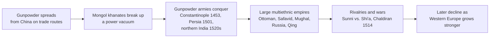

# AP World History: Modern — Topic 3.1 Summary: Empires Expand (c. 1450–1750)

> Source: Summary of AP_WH_3.1_Notes_EN.md

**Unit 3: Land-Based Empires (c. 1450–1750)**

---

## In One Sentence

Land-based empires grew between 1450 and 1750 because their rulers used **gunpowder weapons** to conquer and hold huge, multiethnic territories, and their political and religious rivalries, such as **Sunni Ottomans vs. Shi'a Safavids**, led to wars between them.

## The Big Picture

Gunpowder spread from China along trade routes to Asia and Europe. Turkic rulers in Southwest, Central, and South Asia used cannons and firearms to fill the **power vacuum** left when the Mongol khanates broke up. They built three **Gunpowder Empires**: the **Ottoman**, **Safavid**, and **Mughal**. At the same time, Russia pushed east to the Pacific, and the Manchus took over China and founded the **Qing**. These empires traded with each other but kept armies ready, and religious and political quarrels turned them into rivals.

## Key Points

### 1. Gunpowder and Armed Trade (LO-A)

- The **Gunpowder Empires** were large, **multiethnic** states (states with many peoples) that used firearms to conquer and hold land.
- The Ottomans, Safavids, and Mughals shared four traits: **Turkic nomad** roots, a Turkic language, use of the Mongol **power vacuum**, and reliance on **cannons**.
- Their early success came from **military strength** and from the weakness or corruption of the rulers before them.
- **Armed trade** means empires traded with each other but kept **troops ready** at all times.
- **Tamerlane** (Timur, late 1300s) left a model of conquest and the **ghazi ideal**, the ideal of a warrior fighting for Islam. His descendant **Babur** founded the Mughal Empire.

### 2. The Ottoman Empire (LO-A)

- Founded by **Osman**, it lasted more than 600 years, until just after World War I.
- **Mehmed II** used giant **cannons** to take **Constantinople in 1453** and renamed it **Istanbul**.
- After defeating the **Mamluks**, the Ottomans ruled Syria and Egypt, and Istanbul became the center of the Islamic world.
- **Suleiman I** (r. 1520–1566) ruled at the empire's **peak**. He conquered Hungary (1526) but **failed to take Vienna** (1529).
- Later decline: defeat at **Lepanto** (1571), weak sultans, and a second failed siege of **Vienna in 1683**, the turning point.

### 3. The Safavids and the Sunni–Shi'a Rivalry (LO-A)

- The Safavids began as a **Sufi order** (a group of Islamic mystics). **Ismail** conquered Persia and declared himself **shah** (king) in **1501**.
- They made **Shi'a Islam** the core of state unity. This put them in conflict with the **Sunni** Ottomans next door.
- The Ottomans defeated them at the **Battle of Chaldiran** in **1514** and placed an embargo on Safavid **silk** trade.
- **Shah Abbas I** (r. 1588–1629) was the strongest shah. He trained Christian boys as soldiers and bought **European weapons**.
- A big weakness: the Safavids had **no navy**.

### 4. Mughal India (LO-A)

- **Babur**, a descendant of Timur, conquered **northern India** in the 1520s.
- **Akbar** made the empire its strongest and richest.
- The rulers were Muslim, but most of their subjects were **Hindu**, and society kept the **caste system** (ranked social groups set by birth).
- India traded textiles, spices, and gems for **gold and silver**.
- **Aurangzeb** (r. 1658–1707) drained the treasury with southern wars, and his **persecution** of Sikhs and Hindus sparked revolts.

### 5. Russia and Europe (LO-A)

- **Ivan IV** (Ivan the Terrible) took the title **tsar** (emperor) in **1547**.
- He conquered the **Kazan and Astrakhan** khanates, pieces of the old Mongol Golden Horde.
- The Stroganov family hired **Cossacks** (frontier fighters) to control the Volga, which opened trade with Persia and the Ottomans.
- Fur traders and soldiers pushed east across **Siberia** and reached the **Pacific in 1639**. Missionaries spread **Eastern Orthodoxy**.
- In Western Europe, **new monarchies** (Tudors, Valois, Ferdinand and Isabella) took control of taxes, the army, and religion.

### 6. From Ming to Qing (LO-A)

- The **Ming** (1368–1644) brought stability, but after a defeat by the Mongols in the 1440s they **rebuilt the Great Wall**.
- In **1644** the **Manchus** seized power and founded the **Qing Dynasty**.
- **Kangxi** (r. 1661–1722) added Taiwan and Mongolia and made Tibet a protectorate (a state under Qing protection).
- **Qianlong** (r. 1736–1796) annexed **Xinjiang** and ruled the Qing's **largest territory**.
- The Qing limited European trade to one port, **Canton**, and in 1793 Qianlong rejected a British request for more trade.

## Must-Know Terms & People

| Term | What it is | Why it matters |
|---|---|---|
| Gunpowder Empires | Ottoman, Safavid, and Mughal states that conquered with firearms | The core example of land-based expansion |
| Armed trade | Trade between empires that kept troops ready | Shows trade and force went together |
| Ghazi ideal | Ideal of the warrior fighting for Islam | Model of conquest from Tamerlane |
| Mehmed II | Ottoman sultan who took Constantinople in 1453 | Cannons made the Ottomans a great power |
| Suleiman I | Ottoman sultan at the empire's peak | Took Hungary, failed at Vienna |
| Shah | Persian title for a king | Ismail took it in 1501 to found the Safavid state |
| Battle of Chaldiran | 1514 Ottoman victory over the Safavids | Key example of a Sunni vs. Shi'a rivalry |
| Shah Abbas I | Strongest Safavid shah | Built an army with European weapons |
| Babur | Descendant of Timur who founded the Mughal Empire | Linked Central Asian conquest to India |
| Akbar | Mughal ruler at the empire's height | Made the Mughals strong and rich |
| Ivan IV | First Russian ruler to take the title tsar | Began Russia's push east |
| Kangxi / Qianlong | Qing emperors who expanded China | Brought Taiwan, Mongolia, Tibet, and Xinjiang under Qing rule |

## Key Dates

| Year | Event |
|---|---|
| 1453 | Mehmed II takes Constantinople and renames it Istanbul |
| 1501 | Ismail declares himself shah; the Safavid Empire begins |
| 1514 | Ottomans defeat the Safavids at Chaldiran |
| 1520s | Babur conquers northern India; the Mughal Empire begins |
| 1529 | First Ottoman siege of Vienna fails |
| 1547 | Ivan IV takes the title tsar |
| 1644 | Manchus found the Qing Dynasty |
| 1683 | Second Ottoman siege of Vienna fails |

## How the Exam Asks About It

- **Legitimacy & consolidation:** Ottoman rulers drew on the ghazi ideal of fighting for Islam, the Safavids made Shi'a Islam the core of state unity, and Ivan IV took the title tsar. All of them held power with gunpowder armies.
- **Continuity, innovation, diversity:** Continuity: the caste system remained part of Mughal society. Innovation: Mehmed II used giant cannons to take Constantinople. Diversity: the Ottomans were Sunni, the Safavids Shi'a, and the Mughals were Muslim rulers of a Hindu-majority society.
- **Likely comparison:** Ottoman vs. Safavid. Both had Turkic roots, were Muslim, and used gunpowder weapons. But the Ottomans were Sunni and became a naval power, while the Safavids were Shi'a and had no navy.
- **Common trap:** Students call Mughal India a Hindu empire. The fix: the **rulers were Muslim**; most of the **people were Hindu**.

## Check Yourself

1. Name two traits the three Islamic Gunpowder Empires shared.

▶ Answer
They came from Turkic nomads of Central Asia and relied on gunpowder weapons such as cannons. They also spoke a Turkic language and used the power vacuum left by the Mongol khanates.

2. Why did the Ottomans and Safavids fight?

▶ Answer
The Ottomans were Sunni and the Safavids made Shi'a Islam the core of their state, so religion and borders made them rivals. The Ottomans won at Chaldiran in 1514.

3. How did Russia expand under Ivan IV and after him?

▶ Answer
Ivan IV conquered the Kazan and Astrakhan khanates, and Cossacks helped control the Volga. Fur traders and soldiers then crossed Siberia and reached the Pacific in 1639.

