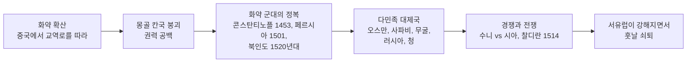

# AP 세계사: 모던 — 토픽 3.1 요약: 제국의 팽창 (Empires Expand)

> 출처: AP_WH_3.1_Notes_KR.md 요약

**Unit 3: 육상 제국 (Land-Based Empires, c. 1450–1750)**

---

## 한 문장 요약

1450–1750년에 육상 제국이 커진 것은 통치자들이 **화약 무기** (Gunpowder weapons)로 여러 민족이 사는 넓은 영토를 정복하고 지켰기 때문이며, **수니파 오스만 대 시아파 사파비 (Sunni Ottomans vs. Shi'a Safavids)** 같은 정치적·종교적 경쟁은 제국 사이의 전쟁으로 이어졌다.

## 큰 그림

화약은 중국에서 시작해 교역로를 따라 아시아와 유럽으로 퍼졌다. 서남·중앙·남아시아의 튀르크계 통치자들은 대포와 총을 이용해, 몽골 칸국들이 무너진 뒤 생긴 **권력 공백** (Power vacuum)을 메웠다. 이들은 세 **화약 제국 (Gunpowder Empires)**, 곧 **오스만 (Ottoman)**, **사파비 (Safavid)**, **무굴** (Mughal)을 세웠다. 같은 시기에 러시아는 동쪽으로 태평양까지 나아갔고, 만주족 (Manchus)은 중국을 차지해 **청** (Qing)을 세웠다. 이 제국들은 서로 교역하면서도 군대를 늘 대기시켰고, 종교적·정치적 다툼 때문에 경쟁자가 되었다.

## 핵심 정리

### 1. 화약과 무장 교역 (LO-A)

- **화약 제국** (Gunpowder Empires)은 총포로 땅을 정복하고 지킨 크고 **다민족적** (Multiethnic)인 국가, 곧 여러 민족이 함께 사는 국가였다.
- 오스만, 사파비, 무굴은 네 가지 공통점이 있었다. **튀르크계 유목민 (Turkic nomads)** 출신, 튀르크어 사용, 몽골이 남긴 **권력 공백** 이용, **대포 (Cannons)** 의존이다.
- 이들이 처음 성공한 이유는 **군사력**, 그리고 이전 통치자들의 약화와 부패였다.
- **무장 교역** (Armed trade)은 제국들이 서로 교역하면서도 **군대를 늘 대기**시킨 방식을 말한다.
- **티무르** (Tamerlane, 1300년대 후반)는 정복의 본보기와 **가지 이상 (Ghazi ideal)**, 곧 이슬람을 위해 싸우는 전사의 이상을 남겼다. 그의 후손 **바부르** (Babur)가 무굴 제국을 세웠다.

### 2. 오스만 제국 (The Ottoman Empire) (LO-A)

- **오스만** (Osman)이 세운 이 제국은 제1차 세계대전 직후까지 600년 넘게 이어졌다.
- **메흐메트 2세** (Mehmed II)는 거대한 **대포**로 **1453년 콘스탄티노플** (Constantinople)을 정복하고 이름을 **이스탄불** (Istanbul)로 바꾸었다.
- **맘루크** (Mamluks)를 무너뜨린 뒤 오스만은 시리아와 이집트를 다스렸고, 이스탄불은 이슬람 세계의 중심이 되었다.
- **쉴레이만 1세 (Suleiman I, r. 1520–1566)** 때 제국은 **전성기**였다. 그는 헝가리를 정복했지만(1526) **빈 (Vienna) 정복에는 실패**했다(1529).
- 훗날의 쇠퇴: **레판토 해전 (Battle of Lepanto)** 패배(1571), 약한 술탄들, 그리고 전환점이 된 **1683년 2차 빈 포위 실패**가 있었다.

### 3. 사파비와 수니–시아 경쟁 (The Safavids and the Sunni–Shi'a Rivalry) (LO-A)

- 사파비는 **수피 교단 (Sufi order)**, 곧 이슬람 신비주의자 집단에서 시작했다. **이스마일** (Ismail)은 페르시아를 정복하고 **1501년** **샤 (Shah)**, 곧 왕을 선언했다.
- 사파비는 **시아파 이슬람** (Shi'a Islam)을 국가 통합의 중심으로 삼았다. 그래서 이웃한 **수니파 (Sunni)** 오스만과 충돌했다.
- 오스만은 **1514년** **찰디란 전투** (Battle of Chaldiran)에서 사파비를 이겼고, 사파비의 **비단 (Silk)** 교역에 금수 조치를 내렸다.
- **샤 아바스 1세** (Shah Abbas I, r. 1588–1629)는 가장 강한 샤였다. 그는 기독교도 소년을 군인으로 훈련시키고 **유럽 무기**를 들여왔다.
- 큰 약점은 사파비에 **해군이 없었다**는 점이다.

### 4. 무굴 인도 (Mughal India) (LO-A)

- 티무르의 후손 **바부르**가 1520년대에 **북인도**를 정복했다.
- **악바르** (Akbar)는 제국을 가장 강하고 부유하게 만들었다.
- 통치자는 무슬림이었지만 백성 대부분은 **힌두교도** (Hindus)였고, 사회는 **카스트 (Caste)** 제도, 곧 태어나면서 정해지는 서열 집단을 유지했다.
- 인도는 직물, 향신료, 보석을 팔고 **금과 은**을 받았다.
- **아우랑제브** (Aurangzeb, r. 1658–1707)는 남쪽 전쟁으로 재정을 바닥냈고, 시크교도와 힌두교도를 **탄압**해 반란을 불렀다.

### 5. 러시아와 유럽 (Russia and Europe) (LO-A)

- **이반 4세** (Ivan IV, Ivan the Terrible)는 **1547년** **차르 (Tsar)**, 곧 황제라는 칭호를 썼다.
- 그는 옛 몽골 금장한국에서 갈라져 나온 **카잔 (Kazan)과 아스트라한 (Astrakhan)** 칸국을 정복했다.
- 스트로가노프 (Stroganov) 가문은 **코사크 (Cossacks)**, 곧 변경의 전사들을 고용해 볼가강 (Volga)을 장악했고, 이로써 페르시아·오스만과 교역할 길이 열렸다.
- 모피 상인과 군인들은 **시베리아** (Siberia)를 가로질러 **1639년 태평양**에 닿았다. 선교사들은 **동방정교** (Eastern Orthodoxy)를 퍼뜨렸다.
- 서유럽에서는 **신흥 군주국 (New monarchies)**(튜더 (Tudors), 발루아 (Valois), 페르난도와 이사벨 (Ferdinand and Isabella))이 세금, 군대, 종교를 장악했다.

### 6. 명에서 청으로 (From Ming to Qing) (LO-A)

- **명** (Ming, 1368–1644)은 안정을 가져왔지만, 1440년대 몽골에 패한 뒤 **만리장성 (Great Wall)을 재건**했다.
- **1644년** **만주족**이 권력을 잡고 **청나라** (Qing Dynasty)를 세웠다.
- **강희제** (Kangxi, r. 1661–1722)는 대만과 몽골을 편입하고 티베트를 보호령, 곧 청의 보호를 받는 나라로 삼았다.
- **건륭제** (Qianlong, r. 1736–1796)는 **신장** (Xinjiang)을 편입했고, 청의 **최대 영토**를 다스렸다.
- 청은 유럽과의 교역을 **광저우 (Canton)** 한 항구로 제한했고, 1793년 건륭제는 영국의 교역 확대 요청을 거절했다.

## 꼭 알아야 할 용어·인물

| 용어 | 무엇인가 | 왜 중요한가 |
|---|---|---|
| 화약 제국 (Gunpowder Empires) | 총포로 정복한 오스만, 사파비, 무굴 | 육상 제국 팽창의 대표 사례이다 |
| 무장 교역 (Armed trade) | 군대를 대기시킨 채 이루어진 제국 간 교역 | 교역과 무력이 함께 갔음을 보여 준다 |
| 가지 이상 (Ghazi ideal) | 이슬람을 위해 싸우는 전사의 이상 | 티무르에게서 이어진 정복의 본보기이다 |
| 메흐메트 2세 (Mehmed II) | 1453년 콘스탄티노플을 정복한 오스만 술탄 | 대포로 오스만을 강대국으로 만들었다 |
| 쉴레이만 1세 (Suleiman I) | 전성기의 오스만 술탄 | 헝가리를 얻었지만 빈에서 실패했다 |
| 샤 (Shah) | 페르시아의 왕을 뜻하는 칭호 | 이스마일이 1501년 이 칭호로 사파비를 세웠다 |
| 찰디란 전투 (Battle of Chaldiran) | 1514년 오스만이 사파비를 이긴 전투 | 수니 대 시아 경쟁의 핵심 사례이다 |
| 샤 아바스 1세 (Shah Abbas I) | 가장 강한 사파비의 샤 | 유럽 무기로 군대를 키웠다 |
| 바부르 (Babur) | 무굴 제국을 세운 티무르의 후손 | 중앙아시아의 정복을 인도로 이었다 |
| 악바르 (Akbar) | 전성기의 무굴 통치자 | 무굴을 강하고 부유하게 만들었다 |
| 이반 4세 (Ivan IV) | 처음으로 차르 칭호를 쓴 러시아 통치자 | 러시아의 동방 진출을 시작했다 |
| 강희제·건륭제 (Kangxi / Qianlong) | 중국을 넓힌 청 황제들 | 대만, 몽골, 티베트, 신장을 청의 지배 아래 두었다 |

## 주요 연도

| 연도 | 사건 |
|---|---|
| 1453 | 메흐메트 2세가 콘스탄티노플을 정복하고 이름을 이스탄불로 바꿈 |
| 1501 | 이스마일이 샤를 선언함. 사파비 제국이 시작됨 |
| 1514 | 오스만이 찰디란에서 사파비를 이김 |
| 1520년대 | 바부르가 북인도를 정복함. 무굴 제국이 시작됨 |
| 1529 | 오스만의 1차 빈 포위가 실패함 |
| 1547 | 이반 4세가 차르 칭호를 씀 |
| 1644 | 만주족이 청나라를 세움 |
| 1683 | 오스만의 2차 빈 포위가 실패함 |

## 시험에서는 이렇게 묻는다

- **정당화와 공고화:** 오스만 통치자들은 이슬람을 위해 싸운다는 가지 이상에 기댔고, 사파비는 시아파 이슬람을 국가 통합의 중심으로 삼았으며, 이반 4세는 차르 칭호를 썼다. 이들은 모두 화약 군대로 권력을 지켰다.
- **연속성·혁신·다양성:** 연속성은 카스트 제도가 무굴 사회에 계속 남아 있었다는 점이다. 혁신은 메흐메트 2세가 거대한 대포로 콘스탄티노플을 정복한 것이다. 다양성은 오스만이 수니파, 사파비가 시아파였고, 무굴은 힌두교도가 다수인 사회를 다스린 무슬림 통치자였다는 점이다.
- **자주 나오는 비교:** 오스만과 사파비. 두 제국 모두 튀르크계 출신이고, 무슬림이었으며, 화약 무기를 썼다. 그러나 오스만은 수니파였고 해군 강국이 되었으며, 사파비는 시아파였고 해군이 없었다.
- **자주 하는 실수:** 무굴 인도를 힌두 제국이라고 부르는 것이다. 바로잡기: **통치자는 무슬림**이었고, **백성 대부분이 힌두교도**였다.

## 스스로 확인하기

1. 세 이슬람 화약 제국이 공유한 특징 두 가지를 쓰라.

▶ 정답
중앙아시아의 튀르크계 유목민 출신이었고, 대포 같은 화약 무기에 의존했다. 또 튀르크어를 썼고, 몽골 칸국들이 남긴 권력 공백을 이용했다.

2. 오스만과 사파비는 왜 싸웠는가?

▶ 정답
오스만은 수니파였고 사파비는 시아파 이슬람을 국가의 중심으로 삼았기 때문에, 종교와 국경 문제로 경쟁자가 되었다. 1514년 찰디란 전투에서 오스만이 이겼다.

3. 러시아는 이반 4세 때와 그 뒤에 어떻게 팽창했는가?

▶ 정답
이반 4세는 카잔과 아스트라한 칸국을 정복했고, 코사크가 볼가강 장악을 도왔다. 이어 모피 상인과 군인들이 시베리아를 가로질러 1639년 태평양에 닿았다.

